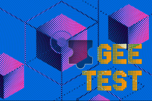
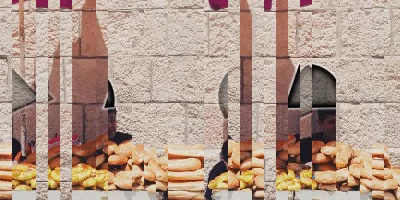
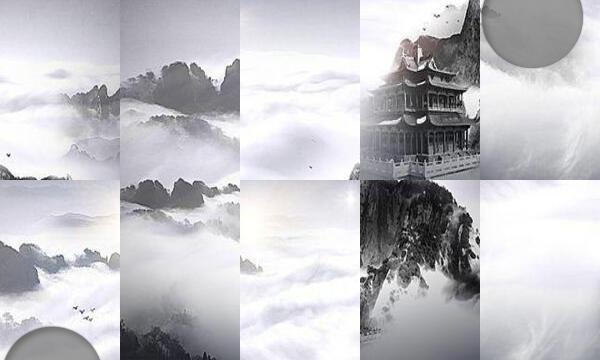
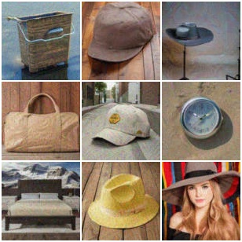
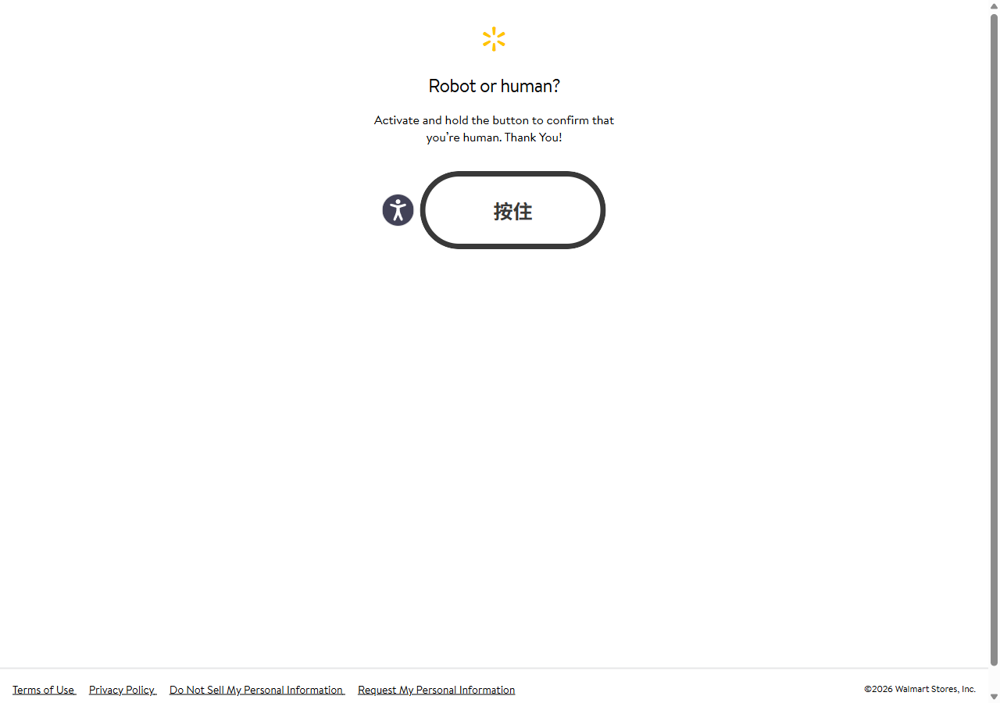
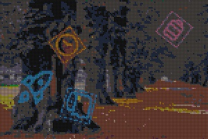
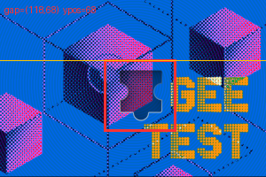

# eg_captcha — 验证码知识库（无可执行代码）

> **18 家厂商 · 93 个厂商×类型 · 86 个类型页 · 995 组真实样本 · 0 可执行代码**
>
> 一个不发放武器、只沉淀知识的验证码档案库：样本、方法、成本、失败原因，按厂商与类型整理。文档分层：`docs/<vendor>.md` 是索引，`cases/<vendor>/<type>/README.md` 是详解（可含 `text` 伪代码/公式，不含可运行脚本）。
>
> 样本版权归各厂商，仅用于研究与教学，禁止商用；权利人可通过 Issue 要求删除。

**一句话**：按厂商/类型查样本，按类型页看思路与结果，按方法/成本选路线，按审查状态看可信度。

**English**：A zero-code CAPTCHA knowledge base — 18 vendors, 93 vendor×type combinations, 995 real samples, method tags (CV/DET/OCR/VLM/ASR/PROTO/ACT), cost notes, and honest failure records.

> ⭐ 如果这个库帮你省下收集样本或技术选型的时间，点个 Star，让更多人找到它。
>
> **在线浏览**：[eg-captcha-viewer.jimmysmileltl.workers.dev](https://eg-captcha-viewer.jimmysmileltl.workers.dev/) — 首页按类型聚合（93 个类型，含 7 个仅文档），类型页附官方体验入口，详情左原始数据、右最终结果，支持人工审核、音频与 ↑↓ 切换。

## 为什么值得收藏

- **18 家厂商，一张地图**：极验、易盾、腾讯、数美、顶象、天爱、百度、银联、企讯通、凯格、美团、Amazon、reCAPTCHA、hCaptcha、HUMAN、DataDome、MTCaptcha、哔哩哔哩 B站，主流与长尾都在。
- **995 组真实样本，不是手绘示意图**：来自公开 demo、体验页或公开挑战页；每组都有来源、类型、方法和状态。
- **方法 + 成本，一起给**：CV / DET / OCR / VLM / ASR / PROTO / ACT，标明是否借助多模态 LLM，以及量大时该不该换路线。
- **失败也归档**：22 个类型没有求解器（15 个有案例，7 个仅文档）、6 个效果差、6 个部分进展、2 个只能靠浏览器；为什么没解，往往比“能解”更有信息量。
- **0 可执行代码，分享无压力**：没有 solver、token、密钥、原始报文或命令；类型页只含 `text` 伪代码/公式，适合在公司内部、课堂和团队里传阅。
- **AI 也能直接用**：自带 Claude Code skill，按厂商/类型/方法检索，不用把整库塞进上下文。

不敢说全网最全，但在“无可执行代码 + 厂商×类型 + 方法/成本 + 失败档案”这四个维度同时做到的，应该不多。

## 30 秒看懂

| 指标 | 数值 |
|---|---|
| 厂商 | 18 家 |
| 厂商×类型 | 93 个（44 个主类型，含无图/仅文档类型） |
| 案例 | 995 组（629 个纯样本 + 318 个结果待审 + 48 个已解） |
| 人工审核 | 781 组已审（通过 722 / 部分正确 17 / 未通过 42）；待审 109 / 不适用 105 |
| 类型页 | 86 篇（每个有案例的厂商×类型一篇） |
| 厂商索引 | 18 篇（+ 类型清单、方法论、体验入口共 21 篇 docs） |
| 类型级求解器 | 有 55 / 混合 2 / 无 22（含 7 个仅文档类型）/ 效果差 6 / 部分进展 6 / 需浏览器 2 |
| 可执行代码 | 0（无 py/js/html/sh；类型页可含 `text` 伪代码） |
| 体积 | 约 436 MB（以图片、音频与过程图为主） |

> 这些数字不是 KPI：`sample-only` 只代表有样本，`result-pending-review` 也不代表已通过。准确率来自源记录；人工审核结论单独记录在每个案例的 `review` 字段，未审案例为 `pending` / `not-applicable`。

**第一次来？** 打开[在线浏览器](https://eg-captcha-viewer.jimmysmileltl.workers.dev/)直接切换案例，或先看下面的厂商图，再从[厂商总览](#厂商总览)点进 `docs/<vendor>.md`。

## 它是什么，不是什么

| 是 | 不是 |
|---|---|
| 公开验证码样本与方法档案 | 求解器、SDK、脚本库 |
| 厂商 × 类型 × 方法 × 成本索引 | 可直接运行的代码或命令 |
| 带来源、状态、审查占位的案例 | 密钥、token、签名实现、完整绕过步骤 |
| 适合选型、教学、团队分享的知识库 | 打码 API 或验证码绕过服务 |

**适合谁**：爬虫/逆向工程师、安全研究与风控、QA、研究者与学生、做 AI Agent 的工具作者。

**不适合谁**：想直接拿现成打码 API 或绕过服务的人；想商用或再分发样本的人。

## 仓库长什么样

| 路径 | 内容 |
|---|---|
| `cases/<vendor>/<type>/README.md` | **类型页**：题面、样本图库、形态与难点、求解思路/关键伪代码、结果与审查、失败与边界 |
| `cases/<vendor>/<type>/<NNN>/` | 一组样本 + `meta.json`，有结果时再加答案、结果和标注 |
| `docs/<vendor>.md` | **厂商索引**：类型总表、代表样本、厂商级结论；详细内容在类型页 |
| `docs/types.md` / `docs/demos.md` | 全量类型清单（链到类型页）/ 官方与第三方体验入口 |
| `skill/eg-captcha/` | 给 Claude Code 用的检索 skill（纯 Markdown） |

> 查一个类型的「题面长什么样、怎么解、结果如何」→ 进 `cases/<vendor>/<type>/README.md`；查某厂商有哪些类型、整体强弱 → 进 `docs/<vendor>.md`。

## 18 家厂商，一眼看全

每家厂商一张代表图；完整图库见 `docs/<vendor>.md`。

| 极验 | 网易易盾 | 腾讯云 | 数美 |
|---|---|---|---|
|  |  |  |  |

| 顶象 | 天爱 | 中国银联 | 企讯通 |
|---|---|---|---|
|  |  |  |  |

| 凯格 | 美团 Yoda | Amazon AWS WAF | Google reCAPTCHA |
|---|---|---|---|
|  |  |  |  |

| hCaptcha | HUMAN Security | DataDome | MTCaptcha |
|---|---|---|---|
|  |  |  |  |

| 百度 | 哔哩哔哩 B站 |
|---|---|
|  |  |

## 先看哪里

| 你想 | 去哪里 |
|---|---|
| 快速浏览全部案例 | [在线浏览器](https://eg-captcha-viewer.jimmysmileltl.workers.dev/)（按类型浏览、左右对照、音频） |
| 实际体验验证码 | 下面的[热门入口](#热门体验入口)，完整列表见 [docs/demos.md](docs/demos.md) |
| 查某个类型的题面 / 思路 / 结果 | `cases/<vendor>/<type>/README.md`（从 [docs/types.md](docs/types.md) 或厂商索引进） |
| 查某家厂商有哪些类型 | 从[厂商总览](#厂商总览)进入对应 `docs/<vendor>.md` |
| 查全部类型 | [docs/types.md](docs/types.md) |
| 选方法 / 看成本 | [docs/00-methodology.md](docs/00-methodology.md) 的“方法标签与成本” |
| 找没解 / 效果差的类型 | 类型页的“失败与边界”“为什么没有结果”节 |
| 回填人工审查 | [skill/eg-captcha/references/review-workflow.md](skill/eg-captcha/references/review-workflow.md) |
| 让 Claude 用这套知识 | [skill/eg-captcha/SKILL.md](skill/eg-captcha/SKILL.md) |
| 参与整理 | [CONTRIBUTING.md](CONTRIBUTING.md) |

## 方法地图：CV、OCR、VLM 怎么选

| 方法 | 用 LLM？ | 适合 | 代表类型 / 厂商 | 成本 |
|---|---|---|---|---|
| `CV` | 否 | 缺口、边缘、几何、模板 | 极验 slide / 易盾 jigsaw / 顶象 jigsaw / 易盾 word-group | 最低；量大更省 |
| `DET` | 否 | 图标、网格、字符框 | 易盾 text-click / 腾讯 text-click / 天爱 icon-click | 中；需权重/标注 |
| `OCR` | 否 | 文字点选、字体、语序 | 易盾 text-click / 腾讯 text-click / MTCaptcha（OCR 兜底） | 低-中 |
| `VLM` | **是** | 语义点选、空间推理、网格、长尾 | reCAPTCHA grid / Amazon grid / 易盾 spatial | **起步最便宜；按调用计费** |
| `ASR` | 否 | 音频听写、语音验证 | Amazon audio / reCAPTCHA audio / DataDome audio | 中 |
| `PROTO` | 否 | 棋盘枚举、token、PoW | 极验 gobang / Amazon token / reCAPTCHA v3 | 低 |
| `ACT` | 否 | 轨迹、按压、无感 | 银联 no-image / HUMAN press-hold | 低 |
| `NONE` | — | 未做，括号内为建议路线 | 凯格 / hCaptcha / 企讯通 | — |

**选型口诀**：坐标题先 CV/DET，文字题先 OCR/DET，语义与长尾题先 VLM，声音题先 ASR，无题面题看 PROTO/ACT。

**成本判断**：VLM 不需要训练数据和标注，适合语义题、长尾题、网格题；量大时 CV 更便宜、更稳定。常见组合是 CV/OCR 先定位，VLM 只对分歧点或语义点调用（如 `DET+OCR+VLM`）。

## 案例解剖：一组样本包含什么

以 `cases/geetest/slide/001` 为例：

| 原始样本 | 求解标注 |
|---|---|
|  |  |

| 文件 | 作用 |
|---|---|
| `README.md`（类型目录） | 类型页：题面、样本图库、思路/伪代码、结果与审查、失败边界；同目录所有案例的入口 |
| `meta.json` | 来源、类型、变体、媒体、`method`、`solver`、`review` |
| `bg.*` / `aux-01.*` / `audio.*` | 原始主图、辅助图、音频 |
| `restored.*` / `solved.*` | 背景还原图、最终结果 / 拼合效果图（源目录可视化，未复核） |
| `denoised.*` / `split.*` | 去噪对照图、字符 / 图标拆分图 |
| `mark.*` / `trajectory.*` / `process-NN-*.*` | 定位标记、求解轨迹、源求解器过程图（按 `meta.process` 顺序展示） |
| `annotated.png` | 答案可视化，有结果的案例（`result-pending-review` / `solved`）才有 |
| `answer.txt` / `result.json` | 答案与原始结果，有结果的案例（`result-pending-review` / `solved`）才有 |

案例 `001`：`CV`（masked 梯度 + NCC），12/12 离线，无线上记录，审查 `pass`（12/12 通过）。完整拆解见 [cases/geetest/slide/README.md](cases/geetest/slide/README.md)；`sample-only` 案例只有 `meta.json` + 媒体，没有答案。

## 厂商总览

| 厂商 | 类型 | 案例 | 方法重点 | 文档 |
|---|---:|---:|---|---|
| 极验 GeeTest | 4 | 48 | CV / PROTO | [geetest.md](docs/geetest.md) |
| 网易易盾 | 12 | 120 | CV / VLM / DET+OCR+VLM / DET+CV+VLM / DET+OCR+CV | [yidun.md](docs/yidun.md) |
| 腾讯云验证码 | 5 | 48 | CV / DET+OCR+VLM | [tencent.md](docs/tencent.md) |
| 数美 | 5 | 56 | CV / DET+OCR+VLM / DET+OCR+CV | [shumei.md](docs/shumei.md) |
| 顶象 | 13 | 156 | CV / VLM / CV+VLM | [dingxiang.md](docs/dingxiang.md) |
| 天爱 | 14 | 156 | CV / CV+ACT / VLM / VLM+ACT / DET+OCR+VLM | [tianai.md](docs/tianai.md) |
| 中国银联 | 5 | 48 | CV / VLM / PROTO+ACT | [cup.md](docs/cup.md) |
| 企讯通 | 6 | 84 | CV / DET+OCR+CV / CV+ACT / NONE（rotate） | [qingtongbu.md](docs/qingtongbu.md) |
| 凯格 | 5 | 60 | DET+CV+OCR（文字点选 weak）、其余 NONE | [kgcaptcha.md](docs/kgcaptcha.md) |
| 美团 Yoda | 5 | 60 | CV / DET+OCR（部分进展） | [meituan.md](docs/meituan.md) |
| Amazon AWS WAF | 3 | 24 | VLM / ASR / PROTO | [amazon.md](docs/amazon.md) |
| Google reCAPTCHA | 4 | 36 | VLM / ASR / PROTO | [recaptcha.md](docs/recaptcha.md) |
| hCaptcha | 3 | 36 | NONE（建议 VLM） | [hcaptcha.md](docs/hcaptcha.md) |
| HUMAN Security | 3 | 8 | ACT / NONE | [human-security.md](docs/human-security.md) |
| DataDome | 2 | 13 | AUDIO+ASR / NONE | [datadome.md](docs/datadome.md) |
| MTCaptcha | 1 | 12 | ASR+OCR+VLM | [mtcaptcha.md](docs/mtcaptcha.md) |
| 百度 Baidu | 1 | 12 | CV+PROTO | [baidu.md](docs/baidu.md) |
| 哔哩哔哩 B站 | 2 | 18 | CV（极验 v3 word / v4 icon-pixel） | [bilibili.md](docs/bilibili.md) |

## 最近更新

- **2026-11-25**：Google reCAPTCHA 图片题完成**本地 VLM 闭环线上复核**：两次会话均在 4–5 题内收口（**2/2 会话**），但 3×3 单格 **2/6**、4×4 未线上；外部论文 `Breaking-reCAPTCHAv2` 的 YOLO 代码本机不可直接运行，检测器线上 **30 题 0 收口**。结论按两个口径分开：论文「100%」是会话级（答错换题）而非单格；可用路线是 VLM 读格 + 动态换图复判 + 会话级重试，动态换图后旧选中未可靠取消仍是失败来源。`docs/recaptcha.md` 与两个 grid 类型页已同步。
- **2026-11-25**：网易易盾语序选词 `yidun/word-group` **把决策层彻底证伪、锁定“识别层是天花板”，并给识别层补第 4 条掩膜源、按新构建重导 12 组**。在 14 个线上通过轮上重测逐层可读性，并按"头名与次名代价差"分档（共 110 层）：上层整体 26/56 = 46.4%，但差值 ≥0.60 的 12 层对 11 层（92%）、按现有 0.35 门槛钉死的上层字 21/30（70%）；下层整体 9/54 = 16.7%，**按 0.35 钉死的 20 个字全错（0/20）**——"上层清晰可读、下层只能推测"在数据上成立。新增 8 条改造实测（分层门控 ≤5/14、剔诱饵组 5/14、位置硬约束 6/14 完全无动作、粗排→定向精排 5/14、整图锁定字体前后逐字节一致、HOG 细节档 10×10 格 + 3×3 模糊最优 6/12（模糊 1×1 掉到 5/12、14 格 4/12）、掩膜横纵比搜索无提升、全量词表 3/14），连同此前六条共 14 条，再加上识别层的亮度三档分离（层头名 0.468 → 0.426，更差）、退化匹配模板（0.482 → 0.496，56 层多对 1 层，未接入），**16 条全部不超过 6/14**。决定性证据是"命中即先验"：判对的 6 轮真值是 固若金汤（1）/ 长治久安（3）/ 四平八稳（1）/ 坐立不安（1），判错的 8 轮真成语在第 4/4/14/55/179/3810/5197 名或根本不在词表；把 6 个吸引子成语从词表删掉即 **0/14**，换 29,250 条全量词表反而被 金汤之固、久安长治 这类倒序变体挤掉（3/14），加大枢纽字罚分只罚掉对的（≥0.6 时掉到 4/14 以下）。掩膜阅图（12/14 轮凑齐 8 层、2 轮缺一层；上层掩膜也常是碎片或粘连——"长"是带洞色块、"八"是两根断开长条）说明瓶颈在掩膜完整性与字形表示，不在分数。识别层补上**第 4 条掩膜源（区域 Lab 空间 k-means 10 色团，专捞被 3D 倒角切成亮面暗面的整字，不填内腔）**，与其他三路（色格枚举 / 覆盖度分带 / 同色射线生长）互补。A/B 实测（14 轮 × 4 组共 56 组逐层比 IoU）：**只有 7 组换了选层**，其余 49 组逐像素一致，换掉的组多把深蓝下层掩膜补大（270→390、254→299、482→513 px）；端到端整轮仍 **6/14**、前 3 名含真字的层 6→7、按 0.35 钉死层准确率 70.4→71.4%——**买到的是轮廓完整性与可读性，不是准确率**。过程图① 随之重画：绿=L1/橙=L2 的轮廓直接描在照片真实像素上，下排每层用**自己的真实像素**、掩膜外压暗 20% 并按识别角度转正，上层字（如 007 的 安/立）一眼可读，“上层清晰、下层靠推测”首次有可肉眼对照的图。12 组按新构建重导，与 11-23 版相比 4 组变化（007 偏安一隅 → 一路平安、008 第 2 击换组、009 铁马金戈 → 金戈铁马（组对颠倒）、012 安如泰山 → 稳如泰山）；但同一构建在 24 组全集上换掉 20 组答案，这张表读作快照而非稳定解。`meta.review` 保持原样（对应 11-22 版答案，需按新答案重审）。类型页第六/七节、`docs/yidun.md`、samples README 同步；viewer 重建（995 案例）。
- **2026-11-23**：网易易盾语序选词 `yidun/word-group` **建立逐层指标、证伪六条决策层改造、按新构建重导 12 组答案**。此前只有一个读数"整轮成语判对"（14 个线上通过轮回放判对 6 轮，43%），分辨率不足以判断改动好坏；改用题设本身可判的指标——**8 个字全是该成语的四个字**，所以每层的正确答案必定落在成语四字里，"层头名 ∈ 真字集"可以逐层判对错，样本量从 14 轮变成 110 层：**头名命中 33/110 = 30.0%（上层 L0 25/56 = 44.6%，被压住的下层 L1 8/54 = 14.8%），真字进前 8 为 34.5%（51.8% / 16.7%）**，随机水平 4/3002 ≈ 0.13%。在这把尺子上逐条实测，六条决策层改造全部无效：定向比对（词表收窄后只比候选字）单独做主解 3/14、当否决 4/14；同字配对 + 联合指派 3/14（配对本身正确，但"配对两层必须同字"把碎片层判死）；模板按半径 0/1/2/3 膨胀在 3 个难轮 24 层上是 2/24、2/24、2/24、3/24；填内洞的实心剪影把层头名从 30.0% 拉到 27.3%、L1 从 14.8% 拉到 9.3%；L1 降权 0.5 不变、降到 0 丢掉长治久安；可信层违规罚分 ×2.5 仍 6/14。结论写进类型页第七节：**瓶颈在字形表示，不在决策层**。同日按最终构建（quad 八层联合指派做主解，定向/同字配对只作补充候选）重导 12 组案例的 `answer.txt` / `result.json` / `annotated.png` / 过程图：与上一版相比 **10 组的成语或组对发生变化**，只有 005（稳如泰山）、011（长治久安）保持原样；`result.json` 改为原样保留求解字段（quad 路线给 `cost` / `margin`，旧的固定键名抽取会把证据写成 null）。类型页第六节重写（两版对照、cost/margin 口径、五组 margin=0 的并列），第七节新增分层可读性与已证伪方向两张表，`docs/yidun.md` 的审查列与弱点段同步；`meta.review` 保持原样（对应 11-22 版答案，需按新答案重审）；viewer 重建并核对 001（点 G1→G2）与 004（地久天长，与次解天长地久同代价）。
- **2026-11-22**：网易易盾增强文字点选 `yidun/text-click-enhanced` **给重叠对框加字径尺度上限**（案例 011 的虚线框把整头小牛框了进去）。011 的人工答案原来指向 YOLO 的 P3 = (205,67)–(293,160) **88×93**——这是把背景并进来的过并框，max 边是全图字径（所有检测框 max 边中位数 **42px**）的 **2.2 倍**；真正的字框是它内部的 P6 (203,103)–(242,141) **39×38**：框内白层 466px 连成 1 块（32×34）= 搬 的字身，深绿层 193px 压在其右上，锚点 (216,122) 取白层距离变换峰（厚 3.2px），回验原图 RGB(234,236,225)。尺度规则来自 12 组实测：真对框是字径的 **0.79–1.54 倍**，超过 **1.7 倍**（或不足 0.55 倍）不是两个字，而是背景块（牛身/船体/植被），画框、裁过程图、取锚点之前一律先剔。三处落地：① 案例数据 `pair` 3→6，结果图虚线框、过程图对框裁片与全图定位都收到 39×38，标签只写「重叠对 · 下层」不再露原始框号；② 自动求解器 v14 先过字径闸门再选框（此前它同样选中牛身框，结构分 3.7 全场最高）；③ 类型页第二/四/五/七节写清「对框有尺度上限」与失败项「对框套进背景」。同步按现行人工真值重算自动成绩：**21/36**（重叠对 13/25、独立字 8/11、对框选对 20/25、真对框锚点 13/20、OCR 钉住独立字 6/12 组）；其中 **006 降到 0/3**——按审核改到被压的下层后，v14 的墨迹中位锚点一个也没对上，如实写进类型页。雪@(41,119) 与其余坐标未动，`review` 保持原样。审查统计按 `meta.review` 现值刷新为**通过 11 / 部分 1 / 不通过 0**：006/009/010/011/012 已于答案重写后复审（2026-11-22 12:34–14:57 本地），其余 7 组仍是旧答案审查，待复审。viewer 已重建并核对 011/006/010。
- **2026-11-22**：网易易盾增强文字点选 `yidun/text-click-enhanced` **按审核意见修订 006**。审核指出：② 重「识别错误」，正确的是中上区域那组对——上面是青色 #00FCF6 的「异」，下面是褐色的「重」；① 驱、③ 灭「部分正确，是重叠的两个字，点击区域不准确」。核对：② 旧点 (198,106) 落在 YOLO 置信度 **0.35** 的误检框上，45× 放大看清是**橄榄枝**；①③ 旧点都落在**可读的完整层**上。三点改为 驱(283,103) / 重(185,67) / 灭(62,84)，一律点**被压住的下层**，灭 也从"独立字"改判为重叠对成员。由此得到两条布局修正：**三目标不一定是「1 独立 + 2 对」**（006 三点全在对里）、**上层完整字只用于排除与匹配，不是点击对象**。006 的 `annotated.png` / `process-02-pairs.png` / `answer.txt` / `result.json` / `meta.json` 重生成（`review` 保持原样、撤下无用的 `process-01-standalone.png`），类型页第二/四/五/六/七节、`docs/yidun.md`、`docs/types.md` 同步；自动成绩 23/36 尚未按新坐标重算，已在类型页标注（同日后续按新坐标重算为 21/36，见上条）。
- **2026-11-22**：网易易盾增强文字点选 `yidun/text-click-enhanced` **重叠对改用对冲锚点，自动求解 23/36**：12 组逐点离线比对（方形 12px），重叠对目标 14/24、独立字 9/12、对框选进前二 21/24、真对框上的锚点 16/24。做法砍掉「按颜色判层、按碎片度判上下、按字形配字」整条链——框级结构分 = z(框面积) − z(中位笔宽/框高)，配长宽比 0.8–1.3 选出两个近方形对框；落点直接取框内墨迹像素坐标的中位（两字墨迹的公共区域）；独立字用 RapidOCR 唯一命中钉住（6/12 组），其余组先选对框、再按 chamfer 差距配独立字。**量化否定了颜色分层**：24 个对目标落在像素少的颜色簇 12、多的簇 7、两簇都不在 5；颜色簇归属、明暗/饱和度、骨架端点、两色面积比（AUC 0.325，方向相反）、LAB ΔE（AUC 0.811 但加进选盒分不提升）都到不了更好；即使已知目标字（oracle），按真值定义取「目标色层最大块 DT 峰」也只有 6–10/24，低于墨迹中位 16/24。案例答案与图片不变（仍是人工判读），类型页第五节（求解思路）、第六节（自动成绩 + 审查列改取 `meta.review` 现值 7 通过 / 3 部分 / 2 不通过，并标明除 010 外均早于答案重判）、第七节（新失败项）重写，`docs/yidun.md` 求解器列、审查列与说明同步，viewer 重建。
- **2026-11-22**：网易易盾增强文字点选 `yidun/text-click-enhanced` **案例 010 更换样本**：旧样本（窃 → 爹 → 截）下线，改用新采集的 sets/13——题面 **般 → 虽 → 祸**，三点 般(119,21) / 虽(177,121) / 祸(259,117)。与旧样本相反，这组两个对目标**都是被压住的下层**：般 = P0 黄层（被橄榄绿 股 压住），虽 = P5 黑层（被黄 谁 压住），第三个 祸 是右侧独立薄荷绿框（RapidOCR 0° 0.99）。落点仍取目标自身露出笔画的最厚处并逐点回验 HSV（黑层加 S>100 约束，排除 S≈15 的灰影）。换样本后 24 个重叠对目标为 **18 个下层 / 6 个上层**。案例 010 的 `bg.jpg` / `annotated.png` / `process-01-standalone.png` / `process-02-pairs.png` / `answer.txt` / `result.json` / `meta.json` 全部重生成，`meta.review` 保持原样（只对旧样本有效）；类型页、`docs/yidun.md`、skill 与根统计同步，viewer 重建。
- **2026-11-22**：网易易盾增强文字点选 `yidun/text-click-enhanced` **按「独立字 + 两组重叠对各取一字」重判 12 组**，修正 11-21 版的布局结论。规则：3 个目标里通常只有 1 个是单独放置的（本批恰好在题面第 3 位，12/12），扣掉它剩 2 个目标，画面里正好 2 组重叠对——**两组都要点，每组各取 1 字**；按颜色把对框拆成上下两层，上层笔画完整（连通域少、最大块占比高），下层被上层切断（碎片多），**一般是在下面被切碎的那个才是目标**（24 个重叠对目标里 18 个是下层、6 个是上层，只能算「一般」）；点击点取目标**自己颜色露出笔画**的最厚处，不点重叠区中心。**推翻的错误**：① 11-21 版「010/011 两个目标同处一个重叠对」不成立——010（旧样本）重判为 窃(P0 白下层) + 爹(P3 粉上层)，011 恢复阶段一的独立结果 雪@(41,119)，第 改判到 P4 白上层；② 其余纠错：002 擦 从灰照片边缘 (86,32) 移到白字 (99,33)、006 驱 (285,99)→(275,100，青色 马+区) 与 重 (200,113)→(198,106)、008 多 改判为 P0 白上层（两个夕叠字）(128,53)、012 工 (78,53)→(53,80，蓝紫层) 与 骤 移到纯白 (193,71)、001 前 (73,108)→(76,113)、004 润 由上层改判下层。12 组全部 `evidence: manual`（人工逐字判读 + 坐标网格核对），结果图 ①②③ 大号空心环，`process-02-pairs.png` 每对一行；`review` 字段保持原样（那是对旧答案的结论，已标为待复审）。类型页、`docs/yidun.md`、`docs/types.md`、skill 已同步，viewer 已重建。
- **2026-11-21**：网易易盾增强文字点选 `yidun/text-click-enhanced` 从 **partial 1/3 升到 3/3**：12 组全部给出按题面字序的 3 个点击坐标。方法三件事——① **颜色簇分层**：框内 k-means 取候选墨色，按「离簇心距离 ≤32」做掩码；同一对的两字落在不同簇。② **碎片度判上下层**：上层字压在下面、笔画完整，连通域少而大；下层被切碎（010 P0 白层 2 块 418px = 上层，黑层 7 块 = 下层）。③ **锚点取目标自身墨色层的最厚处**（距离变换 argmax）：在「最上层字形响应 / 目标多边形命中 / 最近质心 / 最下层优先」四种命中模型下都成立，而框中心与重叠区中心只依赖其中之一。~~布局结论修正：第 3 目标必独立（12/12），但 **010/011 的两个目标同处一个重叠对**~~（**该布局结论已在 2026-11-22 版推翻**）。01–09 为人工逐字判读（`evidence: manual`），10–12 沿用自动求解器判字（siamese 0.88–0.95）+ 锚点校正（`unverified`）；对 002 允、003 织 两处旧落点做了纠错（分别落在白字墨与黄底空隙里，现改到目标自己的露出笔画上）。结果图换大号 ①②③ 空心环 + 置信度芯片，新增 `process-02-pairs.png`（每对一行：框内放大 / 全图定位 / 锚点特写 / 判读依据）；12 组 `answer.txt` / `result.json` / `meta.json` 更新（`review` 未动），类型页、`docs/yidun.md`、`docs/types.md`、根统计与 skill 已同步。
- **2026-11-21**：数美语序点选 `shumei/word-order` 改为**零 LLM 两步求解**：① YOLO(best_v3) 定位 4 个彩色字（10/10 组 4/4 框），数美专项补两个检测盲区——**相邻字并框按颜色拆分**（002 名/存）、**细长横条检测**（001/005 的「一」）；② RapidOCR（原图 ±25° + 颜色轮廓 ±40°）+ **ddddocr 单字分类**（±60° × 双尺度，大旋转字主力）三路票数合并，**33,753 条词库**（29,502 成语 + 4,251 四字常用语，后者从 jieba 词典抽取）4! 分配模糊匹配，总分 = 证据分 + top1 命中 + 词频先验 + **覆盖奖励**（0.3/字，修正「川流不息」抢答「小桥流水」）。10/10 匹配成功、全部 high；**纠正旧 VLM 的 002 判定「实至名归」→「名存实亡」**（逐字 OCR：实 16 / 存 7 / 名 13 / 亡 3 票，「至/归」0 票）。10 组案例改为 `result-pending-review`：`annotated.png`（大号①–④ + 底部「点击顺序」条）/ `answer.txt` / `result.json`，另有 5 张中间过程图——`detect_stages.png`（YOLO→拆分/细长笔画→最终框）、`cv_annotated.png`、`cv_glyphs.png`、`ocr_votes.png`（每字 top-5 读字与票数）、`order_candidates.png`（词库候选与打分）；方法标签 `DET+OCR+CV`、`solver.accuracy=high`；10 组已于 2026-11-21 人工复核为 `pass`（含 002 的名存实亡）。`docs/shumei.md` 索引与类型页已同步，viewer 已重建（媒体 URL 加内容哈希，替换图片后不再命中旧缓存）。
- **2026-11-21**：**文档分层重构**：新增 86 篇类型页 `cases/<vendor>/<type>/README.md`（题面 / 样本图库 / 形态与难点 / 求解思路与 `text` 伪代码 / 结果与审查 / 失败与边界），18 篇 `docs/<vendor>.md` 瘦身为厂商索引；[docs/types.md](docs/types.md) 的厂商名直达类型页；CONTRIBUTING 与 skill 同步「厂商索引 → 类型页 → meta.json」的路由；口径从「零代码」调整为「无可执行代码（类型页可含伪代码/公式）」。B站补齐到厂商表与类型清单。
- **2026-11-21**：网易易盾语序点选 `yidun/word-order` 改为**零 LLM 两步求解**：① YOLO(best_v3) 定位 4 个散落文字（12/12 组 4/4 框），传统 CV 按颜色聚类提轮廓；② RapidOCR 多角度读字（原图 ±25° + 颜色轮廓 ±40°，双路线票数合并）+ **29,502 条四字成语库**模糊匹配（4! 分配 + THUOCL 词频先验）定语序；12/12 匹配成功（四平八稳/稳如泰山/固若金汤/立国安邦，全部 high），纠正 LLM 时代的 5 组误判（05 安邦定国→立国安邦、08 古今多少→固若金汤、09 太平盛世→四平八稳、10 春风入画→四平八稳、12 安邦定国→立国安邦）。12 组案例改为 `result-pending-review`：`annotated.png`（按语序标注、绿色答案）、`answer.txt`（成语+有序坐标）、`result.json`（成语/top-10 候选/4 步点击/每字 OCR 票），`process` 含 `cv_glyphs.png`（颜色轮廓）与 `cv_annotated.png`（定位标注）；方法标签改为 `DET+OCR+CV`，`solver.accuracy=high`。`docs/yidun.md` 新增「word-order 求解过程拆解」附录（定位/颜色轮廓/OCR/成语匹配/失败记录），viewer 已重建并核对案例 001。
- **2026-11-21**：新增百度旋转验证码 `baidu/rotate`：12 组从 200 张人工标注真机图选取（角度 60°~301°），ConvNeXt Tiny `conv_0203_ft_0205_pl_0206` 预测回正，200 张离线 **MAE 10.50°、acc@10° 81.0%**；案例含 `bg.png` / `solved.png` / `answer.txt` / `result.json`，`solver.status: exists`、accuracy 高，审查 pending；`docs/baidu.md`、`docs/types.md`、`docs/demos.md` 已同步。
- **2026-11-20**：企讯通角度验证 `qingtongbu/angle` 从「效果差」升级：按实测改用 **ResNet50 360 类分类**（`aqc_spin_v2`）作主方法，保留 ConvNeXt-T 回归作对照。12 组逐组三联对比（原图 / ResNet50 / ConvNeXt）目检：ResNet50 **12/12** 回正方向正确或持平，ConvNeXt **11/12** 明显偏差（01/07/11 超 100°）。12 组案例补 `solved.png`（ResNet50 回正）、`answer.txt`（角度）、`result.json`（双方法角度与置信度）、`process-01-compare-methods.jpg`；`solver.status: weak→exists`、`method: CV`、`evidence: manual`，审查待回填；`docs/qingtongbu.md` 同步，viewer 已重建。
- **2026-11-20**：企讯通曲线 `qingtongbu/curve` 扩到 **24 组**并升级为双色模型可解：`QCaptcha.js` 反混淆确认参考/预览同为三次贝塞尔、两个控制点重合且 x=滑块位移，`p` 只含 P0/P3/ctrlY，答案=参考描边控制点 x（`moveX=c/2`）。新增**纯 HTTP** gen + 自编码轨迹 check 链路（无需浏览器/WASM）：新采 12 组全部在线 `code=200`，累计 0 偏移 **36/36 通过**；实测容差 **5%**（展示 ±15px；±30 图像 px 通过、+35 拒绝）。描边按用户指出的两型**分别建模**：彩色（Lab 色度）与灰白（灰晕/白芯 + 线响应），并用颜色骨架 + 端点吸附解决起终点被星形/鹅卵石/云朵干扰的问题；旧 12 组用吸附后的骨架路径重拟合（GT 残差 0.85–4.4px，端点修正 10/12）。24 组案例补 `answer.txt` / `result.json` / `solved.png` / 4 张过程图，`evidence` 分别为 offline-verified / live-pass；`docs/qingtongbu.md` 同步，viewer 已重建。
- **2026-11-20**：天爱滑动曲线 `tianai/curve` 机制**纠正**：`p` 只含两端点 + `ctrlY`，目标控制点 x（服务端 `randomX`）不在包里；旧版把 randomX 当作端点中点，只在 randomX 靠近中点时成立（与源求解器 ~10% 单次通过率吻合）。背景可能有两条共享端点的曲线（参考 + 干扰）；新方案用白度 top-hat 细亮脊 + 法线对称脊对 + 预览族内一维扫描恢复可见参考，另一条曲线按干扰排除；贴合度改为“滑块与图像拟合参考的偏差”。12 组图像拟合 moveX 已写入案例（`answer.txt`/`result.json`/过程图），旧公式中点保留作对照；`method`=CV+ACT、`answer_format`=offset-x，页面主图改用 `restored.jpg`（修复左右一乱一正）。图像拟合仍是视觉估计，在线提交待复核；`docs/tianai.md`、viewer 已同步。
- **2026-11-20**：天爱双贝塞尔 `tianai/curve-bezier` 机制修正：两段二次贝塞尔（非三次），滑块等比缩放控制点；白色参考管为双壁高光，改为**两壁中线（管轴）拟合** `x_ref/600`（12/12，管轴残差 0.26–2.24px），绿线落在两壁正中；旧公式仅 2/12 偶然命中。12 组案例补最终结果图 `solved.png`、滑块扫描轨迹 `trajectory.png` 与过程图（拟合叠加、贴合度曲线），案例页恢复「左原始数据 / 右最终求解结果」双栏审核布局；`solver.status` 调整为 partial（在线提交待实测）；`docs/tianai.md` 同步，viewer 已重建。
- **2026-11-20**：网易易盾乱序拼图 `yidun/inference` 增加**亮度不变的全切缝成本**：易盾在图上叠加平滑暗色遮罩/明暗渐变，逐段 ratio 的参考值会被带偏；改用 28 种交换的全切缝平均跨缝差（原始 + 高通 I-GaussianBlur(σ=5)，高通只留轮廓/纹理）做一致性与领先度投票。修正 08（0,2→0,1）、09（0,1→1,7）两组旧答案，12/12 重生成 `solved.png`；`docs/yidun.md` 同步，结果待重新审核。
- **2026-11-20**：凯格文字点选 `kgcaptcha/text-click` 针对**中空/极细字体**专项修正：字腔背景不再被填成实心掩码（背景色簇拒绝 + 墨迹收紧）、每个文本检测框追加 **Canny 边缘候选**（只填 <160px 小孔，保留口/日大字腔）、补充雅黑 Light/等线 Light 细体、剔除被大候选完全包住的 17×17 碎块。结果：`set 10` 的「罴」改到右上**中空描边字**（与上一版人工通过结论一致），`set 12` 的「骇」改回右上蓝字；用户最近复核 01/02/03/05/06 通过，04/07/08/09/11 与 12 的「泖」仍受形近/中空字体限制。12 组 `denoised/mark/annotated` 与 `meta` 已更新，`review` 保留更早结论待复核；`docs/kgcaptcha.md` 同步。
- **2026-11-19**：凯格文字点选 `kgcaptcha/text-click` 求解器重做为**纯本地 v2（零 LLM）**：DBNet 文本框 + 框内颜色拆分 + 残差图定位（描边/半透明/低对比字可见）+ 骨架过滤 + 20 字体×24 角度实心/描边模板双向 chamfer（±6px 平移搜索）+ RapidOCR 旋转读字，两目标互斥不重叠分配；解决旧版 VLM 不可用时退化为 ddddocr 的“判字全错”。12 组视觉复核 6 组两击正确、2 组待确认、4 组受形近字（埽/場、徵/徽、酷/醅、罴/罳、怿/檄、泖/扑）影响有判错风险，`solver.status` 记为 weak；12 组 `denoised/mark/annotated` 已更新，`review` 保留旧结果结论待复核；`docs/kgcaptcha.md` 同步。
- **2026-11-19**：顶象文字点选 `dingxiang/text-click` 求解器重做并**替换发布案例**：**YOLO(best_v3.onnx) 多尺度检测字符框 → 视觉模型局部四视角识别投票（逐格受限/序列/双图/逐字）→ 一对一指派**，direct 整图坐标补充投票、对一/丨等漏检细字直接落点。离线服务端验证真值 **14/15 题、50/51 字符（98%）**，有头实机 10 轮 **8 胜**（无头会被 demo 拒绝，0/10，仅调试）。发布 12 组案例全部换成 **服务端 verify success 的真实成功样本（live-pass）**，点击坐标即当时服务端接受的序列；12 组 `solved.png` / 过程图 / `result.json` 生成，`review=pass`、`evidence=live-pass`；`docs/dingxiang.md` 新增「已解/已复核」节。
- **2026-11-19**：人工审核结果正式回填 `eg_captcha`：550 组案例的 `review.state/result/reviewed_at` 写入各自 `meta.json`（通过 510 / 部分正确 6 / 未通过 34），换浏览器或换设备不再丢失；viewer 本地服务器（`scripts/serve.mjs`）新增 `/api/reviews`，在 localhost 上审核会同时写浏览器缓存与 `meta.json`，配置 Worker 时仍可同步远端 KV。
- **2026-11-19**：天爱曲线按 API `type` 拆成三种独立类型：`CURVE`→`curve`（端点对齐）、`CURVE2`→`curve-ellipse`（椭圆缩放）、`CURVE3`→`curve-bezier`（双贝塞尔）。官网入口只列一个「曲线」，但三者绘制与参数机制不同，不再合并为 `curve` 的 v1/v2/v3。三种类型各补满 12 组（新增 24 组案例），天爱 12 类/132 组→14 类/156 组；案例总数 929→953，厂商×类型 88→90；`docs/tianai.md`、`docs/types.md`、`CONTRIBUTING.md` 同步。
- **2026-11-19**：移除「智能随机」伪类型：企讯通/天爱体验页的 `random` 只是从该厂商其他类型中随机返回一种，无独立题面与判定，不建类型/案例。删除 `cases/qingtongbu/random/` 12 组样本，`docs/qingtongbu.md`、`docs/tianai.md`、`docs/types.md`、`CONTRIBUTING.md` 改为“入口模式”说明；案例总数 941→929，厂商×类型 90→88（仅文档 8→7），企讯通 7 类/84 组→6 类/72 组。
- **2026-11-19**：网易易盾障碍躲避 `yidun/avoid` 改为**纯 CV、零 LLM**求解：3 张固定场景的中值重建背景库 → 背景差分出图标候选；条带 20×20 字形做面积归一化 + 质心居中的**全角度旋转匹配**定目标；A*（4px、球心到障碍 bbox ≥12px）+ 推出/线段修复规划路径。12 组目标 12/12 命中（对照已复核 LLM 标注），24 组路径 **0 碰撞**（最小球心距 11.4px > 球半径 10）；知识库 001–012 的 `solved.png` / `answer.txt` / `result.json` / `meta.json` 全部改为 CV 输出，`docs/yidun.md` 方法标签改为 `CV`。
- **2026-11-19**：网易易盾图标点选 `yidun/icon-click` 求解器改为**黑色/白色双色掩膜 + 旋转模板匹配**（row1 黑线稿 / row3 反色白线稿双极性），修复模板旋转裁角；12 组按目标轮廓逐点复核（含旋转/反色），纯 CV 零 LLM，标注全部更新。
- **2026-11-19**：凯格五类样本 `kgcaptcha/{slide,text-click,word-order,font,spatial}` 从各 9 组扩到 **各 12 组**（共 +15 组，案例总数 941）；新增 sets/10–12 与知识库 010–012 同步（slide 补 aux/solved，text-click 补 denoised/mark/annotated，其余补 annotated）；文字点选题面改为显示源 `str` 目标字（如“请依次点击：罴 → 胞”）。
- **2026-11-19**：腾讯云图标点选 `tencent/icon-click` 修复 011/012：图标拆分改为整列投影（宽底座定位标不再被裁掉，三图标可完整还原）；求解改为黑色单掩膜 + 尺度一致峰值修正，**纯 CV 零 LLM**——011 #3 落到左侧黑色定位标、012 #3 落到叠在羚羊角上的黑色 7（不再点到白云）；知识库 011/012 标注与拆分过程图同步。
- **2026-11-19**：数美文字点选 `shumei/text-click` 从 10 组扩到 **12 组**：新增 sets/11（绳况料授）、sets/12（富汶在规），本地 RapidOCR 4/4 字形与顺序正确（零 LLM）；知识库 011/012 同步（bg/annotated/候选切分），案例总数 926。
- **2026-11-18**：补全数美文字点选 `shumei/text-click` 10 组题面：从源 `detail.order` 取目标字与顺序，详情页显示如“请依次点击：备 → 色 → 年 → 且”，不再使用通用占位语“按顺序点击图中文字”。
- **2026-11-18**：顶象差异点击 `dingxiang/diff-click` 求解器升级：SSIM → **墨迹掩膜 + 平移对齐 IoU**；修正 008（真实差异为 #2 加粗双线「念」，旧版误判 #1），12/12 差异判定正确（分离度 0.58~0.87）；知识库 008 `solved.png` 同步。
- **2026-11-18**：天爱旋转新增**色带边界直线共线**求解（纯 CV，针对大片纯色/斜带的抽象几何场景）：sets/06 由 348.8° 修正为 **248.0°**——圆盘多边形 5 条直边与背景色带边界同向共线（垂距 0.2~3.9 px），合成图颜色与轮廓跨金环连续；知识库 005 同步（answer/result/solved）。
- **2026-11-18**：重建天爱旋转直立场景库（205→2655 张）：sets/02=225.2°、03+04=159.8°、05=317.5°、12=298.0°、15=215.3°；06 当时保留人工候选 348.8°（后由色带直线共线修正为 248.0°，见上条）。知识库 002/003/004/009/011 同步。
- **2026-11-18**：查明天爱旋转兜底误判根因：直立场景库为 9 月旧库（205 张），漏掉 10 月 scrape 场景。按同一素材直立图重匹配：sets/03+04=159.8°（216 内点）、sets/15=215.3°；知识库 003/011 更新。
- **2026-11-18**：企讯通图标点选 `qingtongbu/icon-click` 12 组升级 v5 求解器（颜色笔画感知 + 形状倒角 + 匈牙利一对一指派），12/12 人工目检通过；补入 12 组 `answer.txt` / `result.json` 与重新生成的 `denoised.png` / `split.png` / `solved.png`，状态改为结果待审；同步更新 `docs/qingtongbu.md`。
- **2026-11-18**：天爱旋转 sets/15 再按颜色渐变修正：257.8°→277.0°（圆盘亮/暖侧与背景右侧高光一致，发丝向下连续）；对应知识库 011 更新。
- **2026-11-18**：继续修正天爱旋转验证 12/15：tip_anchor 整体反 180°，角度改为 sets/12=340.8°、sets/15=277.0°；耳朵/发丝方向与背景一致；对应知识库 009/011 更新。
- **2026-11-18**：修正天爱旋转验证 3 组 Vision 误判（sets 04/05/06）：候选合成图按人物正立与线条连续性复核，角度当时改为 150.0° / 326.2° / 348.8°（06 已再由色带直线法修正为 248.0°）；新增 `angle_overrides.json`，求解器优先使用已核验角度。
- **2026-11-18**：修正顶象图标点选 012：LLM `whole`（1x）把奖杯判到右侧空白处，改用 CV 白色图标模板匹配（IoU 0.94~0.97）；12 组统一使用 CV `solved.png` 作为最终结果，结构对齐。
- **2026-11-18**：美团最短线连点 `meituan/line-connect` 12 组补齐展示链路：0.png + 1.png 原始题面、背景还原、1.png 颜色文字提取、同色两点定位、最短直线连接；修复 set 19 颜色文字标注（橘）；50/50 离线生成结果，12 组结果纳入待审。
- **2026-11-21**：易盾增强文字点选 12 组结果图 / 过程图换统一版式（数据与点击坐标未变）。结果图 `annotated.png` 头部加 ①②③ 目标状态槽位（已解绿 / 未解灰），图内绿框 + `③ 字 · 已解` 标出解出的目标、红点为坐标，灰虚线框示意未解的重叠对（003 与已解框重叠的误判框不画）；过程图 `process-01-standalone.png` 改为四格：检测框 → 颜色簇掩码 → 按 OCR 最佳角度旋转 → 点击锚点。`meta.json` 只更新 `process` / `process_note` / `notes`，`review` 未动；viewer 已重建。
- **2026-11-21**：网易易盾增强文字点选 `yidun/text-click-enhanced` 换思路，只解**非重叠字**。12/12 组核对发现：**题面第 3 个目标单独放置**；按每组约 2 个独立字推断，前 2 个目标在两组重叠对中。新流程：YOLO 所有框（不排除被误判为对的框）→ Lab 颜色簇掩码 → −75°…+75° 多角度 RapidOCR + padding 补扫（10/12/14/16）→ 开放词表若稳定读成别的字就拒绝 EasyOCR 限定候选 → 只保留与第 3 字完全一致的命中 → 点击单字框中心。12/12 组定位并识别第 3 目标（10 组 high；005 0.91、011 0.84 为 medium）。011 纠错：白色干扰字「羞」曾被限定候选强行读成「雪」，现已拒绝（羞 0.99），改定位左下蓝字「雪」（pad=12，0.84）。案例改为 **partial 1/3**：`annotated.png` 只标 1 点，`answer.txt` / `result.json` 明示前两字未解，新增 `process-01-standalone.png`，撤下旧 3 点错误结果与重对过程图；`solver.status=partial`，类型页、`docs/yidun.md`、`docs/types.md`、根统计与 skill 已同步，viewer 已重建。
- **2026-11-21**：Amazon 音频题 `amazon/audio` 12 组完成双人分离复核：F0 判定女声=出题人（正确）、男声=旁白（干扰）；三模型 + 原混音融合定稿两个目标词，并补双方完整转录（`result.json` 的 `speakers`）。修正 01 `double/stroke`、03 `island/awareness`、08 `threat`、11 `freeze`；答案仍待人工听音审查。
- **2026-11-18**：数美图标点选 `shumei/icon-click` 从 10 组扩到 14 组（新增 4 组真实样本 011–014）；求解器升级为红色掩膜 + 旋转/缩放二值 IoU + 图标聚类 + 匈牙利，14/14 离线核对（≤7px，最大 6.2px），结果与标注图纳入待审。
- **2026-11-18**：美团图标点选 `meituan/icon-click` 12 组人工复核结果满意：状态更新为已解，`review` 回填 `pass/correct`；补入点击坐标答案与 `result.json`，viewer 求解器效果标为“几乎完美”。
- **2026-11-18**：美团图标点选 `meituan/icon-click` 背景还原改为从乱序图检测真实块切点（不再固定等分），修复 003/009/010 的横/竖细缝；011/012 改用可求解的源集合并补上结果图；12 组还原图、求解标注与过程图同步。
- **2026-11-18**：网易易盾障碍躲避 `yidun/avoid` 12 组按源 sets/01–12 重新对齐：最终结果改用 LLM 标注（`llm_annotated.png`），原图区新增目标图标 `icon.png`（从 `target_*.jpg` 条带裁剪），并生成目标图标提取过程图；12 组答案/路径与结果纳入待审。
- **2026-11-18**：网易易盾标准文字点选 `text-click` 从 6 组扩到 12 组：源 `yidun/text_click` 共 24 组，按类型 12 组上限补入 sets 03/08/12/17/21/23，新增案例 013-018（避开已删除的 007-012 旧编号）；题面仍取自源 `data.front`。
- **2026-11-18**：顶象刮刮卡 `dingxiang/scratch` 换用 U²-Netp 显著目标分割 + 完整轮廓 + 30×15 最小刮擦位图（23px 笔刷路径，450-bit 答案）；12 组结果纳入知识库待审，新增目标掩膜与刮擦方案过程图。
- **2026-11-17**：人工复核天爱乱序拼图 `tianai/jigsaw` 12/12 全部准确：12 组案例状态从“结果待审”更新为已解，`review` 回填 `pass/correct`；类型求解器效果标为“几乎完美”。
- **2026-11-17**：修正顶象刮刮卡 `dingxiang/scratch` 的题面与通过条件：页面实际提示为“请使用尽量少的区域，刮出完整图案”，12 组案例同步更新，不再使用通用占位语“拖动滑块刮开涂层”。
- **2026-11-17**：顶象刮刮卡 `dingxiang/scratch` 升级为“完整轮廓 + 30×15 最小刮擦位图”求解器：U²-Netp 显著分割 → 完整轮廓（非 bbox）→ 按 SDK 11px 网格量化；12 组案例更新 `mask.png` / `solved.png` / `scratch.png` 与 `meta.json`，类型从 partial 调整为 exists（离线 12/12，未实机提交）；同步更新 `docs/dingxiang.md`。
- **2026-11-17**：重写天爱乱序拼图 `tianai/jigsaw` 求解器 v2：修正 v1 把 8 组乱序图误判为“干净原图”的错误；改用撕纸边框外 6px 颜色连续性 + Canny 线条连续性裁决对称候选，真实下发图 12/12、回归 12/12；12 组结果纳入知识库待审。
- **2026-11-17**：补全空间推理题面：数美 10 组来自源 `detail.order`，网易易盾 12 组来自源 `data.front`，腾讯 12 组题面写在验证码截图内、逐图录入。详情页直接显示“点击图中最小的黄色圆锥”等实际要求，不再使用通用占位语。
- **2026-11-16**：拆分网易易盾文字点选：`text_click` 保留为 `text-click`（标准版，6 组），`text_click_new` 独立为 `text-click-enhanced`（增强版，12 组）；两类难度和重叠字规则不同，不再混排。题面按源 `data.front` 显示实际目标字（如“全 → 安 → 类”）。
- **2026-11-16**：全面回填案例题面：129 组从源 hint/instruction 恢复实际 prompt，239 组补充 `pass_criteria` 通过条件；viewer 将题目要求移到原图上方优先展示。
- **2026-11-16**：企讯通滑块 `qingtongbu/slide` 增加局部 Sobel 梯度精修，修正 004 的 `(389,33) → (396,27)`；12 组结果纳入知识库。
- **2026-11-16**：顶象滑块 `dingxiang/slide` 在 Canny/色差斑块判定后增加局部 Sobel 梯度精修，修正 003/004/005/007/009/010 的数像素偏差，12 组结果纳入知识库。
- **2026-11-16**：网易易盾缺口滑块 `yidun/jigsaw` 改用 masked Sobel 梯度 + alpha mask 匹配，修正 set 03 的 10px 偏移及 004/007/011 的数像素误差；12 组答案/结果正式纳入知识库。
- **2026-11-15**：修正网易易盾分类：`yidun/jigsaw` 收录源目录全部 12 组缺口滑块，`yidun/inference` 单独收录 12 组 8 块换位乱序拼图；在线浏览器改为“类型首页 → 同类型全部案例 → 左右对照详情”，覆盖 89 个厂商×类型（含 8 个仅文档），类型页补官方体验入口；补齐 192 个背景还原图与 309 个结果图（源目录可视化，未复核）；详情页新增人工审核（本地 + Cloudflare Worker/KV 远端），支持 ↑↓ 切换案例。
- **2026-11-08**：仓库公开；新增 Claude Code skill；README 重构；在线浏览器上线：[eg-captcha-viewer](https://eg-captcha-viewer.jimmysmileltl.workers.dev/)。
- **2026-11-07**：Google reCAPTCHA 扩到 4 类：新增音频 12 组、v3 documented-only；Amazon 新增音频 12 组；全部案例补方法标签。
- 当前 109 个结果待人工审查、105 个案例无结果可审；审查结果会回填到案例 `meta.json`。

## 热门体验入口

| 厂商 / 服务 | 入口 | 可体验 |
|---|---|---|
| 极验 GeeTest | <https://www.geetest.com/en/adaptive-captcha-demo> | slide / icon / gobang / iconcrush |
| 网易易盾 | <https://dun.163.com/trial/jigsaw> | 滑动拼图、无感、推理拼图 |
| Google reCAPTCHA | <https://www.google.com/recaptcha/api2/demo> | 图片 / 音频 / v3 |
| hCaptcha | <https://accounts.hcaptcha.com/demo> | area-select / binary / drag-drop |
| 顶象 | <https://www.dingxiang-inc.com/business/captcha> | 13 种验证方式 |
| Cap.guru / 2Captcha | <https://test.cap.guru/demo/hcap#hcap2> · <https://2captcha.com/demo> | hCaptcha / reCAPTCHA / GeeTest 等 |

> 完整官方/第三方入口、无公开 demo 的厂商说明见 [docs/demos.md](docs/demos.md)。第三方 demo 仅用于体验题面形态，不代表本库推荐其服务。

## 作为 Claude Code Skill 使用

装了这个 skill，Claude 会先查本库再回答，而不是凭记忆编“这个验证码用某某模型就能解”。

`skill/eg-captcha/` 是给 Claude Code 用的薄 skill（仅 Markdown），不包含求解器代码，也不需要 Python 环境。

### 安装

**方式一：仓库内使用（不复制）**

让 Claude 直接读取 `skill/eg-captcha/SKILL.md`，或在提问时说明“使用 eg-captcha skill”。

**方式二：安装到全局（推荐长期使用）**

把 `skill/eg-captcha/` 整个目录复制到 Claude Code 的全局 skills 目录：

- Windows：`%USERPROFILE%\.claude\skills\eg-captcha`
- macOS / Linux：`~/.claude/skills/eg-captcha`

复制后重启 Claude Code 会话，可用 skill 列表中应出现 `eg-captcha`。

**路径设置**

安装在全局时，skill 需要知道仓库位置：设置环境变量 `EG_CAPTCHA_ROOT` 指向本仓库根目录；或在全局 skill 的 `references/local-path.md` 写明路径（该文件不随仓库分发，避免写入个人路径）。

### 使用

- 直接问带触发词的问题，例如“eg_captcha 里极验 slide 用什么方法？成本怎么样？”
- 或显式调用 `/eg-captcha`。
- 它只读 README、`docs/` 与 `cases/`，负责方法选型、成本与审查回填；实际编写求解器代码请用 `captcha-solver`。

## 常见问题

**Q：这个库能直接帮我过验证码吗？**

不能。它是知识库，不含求解器、API、token、签名或调用代码；类型页只有不可执行的 `text` 伪代码/公式。它帮你判断题型、方法、成本与可信度；需要实现请自行编写或使用对应的 solver 项目。

**Q：995 组样本都能商用吗？**

不能。样本版权归各厂商，仅用于研究与教学；文档采用 CC BY-NC-SA 4.0，样本不在文档许可范围内。

**Q：为什么有的类型没有求解器？**

有的是服务端风控或无题面，有的是投入产出不划算，有的是源项目没做。类型表用 `NONE(...)` 标注，并给出建议路线，通常先试 VLM。

**Q：准确率数字可信吗？**

文档里的准确率来自源记录，未经本库复核；109 个结果待人工审查、105 个案例无结果可审。`sample-only` 只代表有样本，不代表已解；`result-pending-review` 也不代表已通过。

**Q：和 solver / 模型仓库有什么区别？**

其他仓库多半直接给求解器或模型；这里给可读的知识索引：样本、方法、成本、失败原因，连“没解出来”也归档，适合选型、教学和团队分享。

**Q：怎么贡献新厂商或新类型？**

按 [CONTRIBUTING.md](CONTRIBUTING.md) 第九节：素材归集 → 案例（`meta.json` + 媒体）→ 类型页 `cases/<vendor>/<type>/README.md` → 厂商索引 `docs/<vendor>.md` → `docs/types.md`/README/skill 统计 → viewer 构建。只收公开来源；不写可执行代码；先补覆盖，再谈求解器。发现错误或想补充，直接开 Issue。

## 边界与许可

- 仓库内没有源码、脚本、SDK、密钥、token 或原始报文；需要实际求解请使用对应的求解器项目。
- 文档 CC BY-NC-SA 4.0；验证码样本版权归各厂商，仅用于研究与教学，禁止商用与再分发。
- 本库按“公开非商业研究档案”发布，不是 OSI 许可意义上的开源软件；样本不在文档许可范围内。
- 完整来源、删除渠道与免责声明见 [NOTICE.md](NOTICE.md)。

## 关键词

> 验证码、验证码识别、验证码样本、验证码数据集、滑块验证码、点选验证码、九宫格验证码、音频验证码、行为验证码、人机验证、风控、极验、网易易盾、腾讯云验证码、数美、顶象、天爱、中国银联、企讯通、凯格、美团 Yoda、HUMAN Security、DataDome、MTCaptcha。

> CAPTCHA, CAPTCHA dataset, CAPTCHA recognition, CAPTCHA solver benchmark, reCAPTCHA, hCaptcha, GeeTest, AWS WAF, DataDome, MTCaptcha, visual reasoning, multimodal LLM.

## 延伸阅读

| 文档 | 内容 |
|---|---|
| [在线浏览器](https://eg-captcha-viewer.jimmysmileltl.workers.dev/) | 按类型浏览、左原始/右结果的只读浏览器 |
| [docs/types.md](docs/types.md) | 全量类型清单（按交互族，厂商名直达类型页） |
| `cases/<vendor>/<type>/README.md` | 类型页：题面、样本、思路与伪代码、结果、失败与边界 |
| [docs/demos.md](docs/demos.md) | 全部官方 / 第三方 demo 入口 |
| [docs/00-methodology.md](docs/00-methodology.md) | 方法标签、成本、证据、失败档案 |
| [CONTRIBUTING.md](CONTRIBUTING.md) | 目录/命名/案例契约/审查规则 |
| [NOTICE.md](NOTICE.md) | 来源、版权、免责、删除渠道 |
| [skill/eg-captcha/SKILL.md](skill/eg-captcha/SKILL.md) | Claude Code skill |

---

**觉得有用？点右上角 Star ⭐；发现问题？提 Issue；想补充厂商/类型？看 [CONTRIBUTING.md](CONTRIBUTING.md)。**
