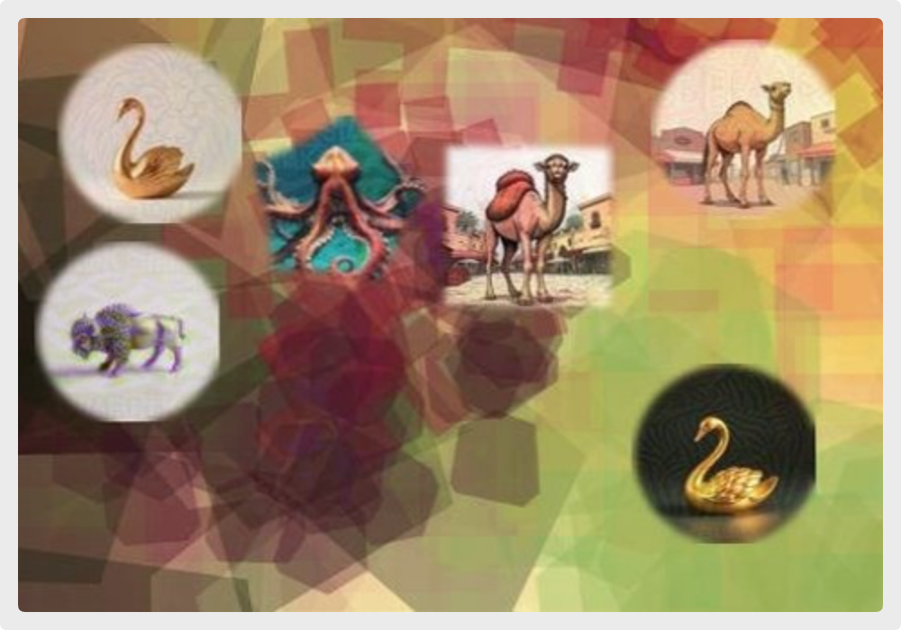
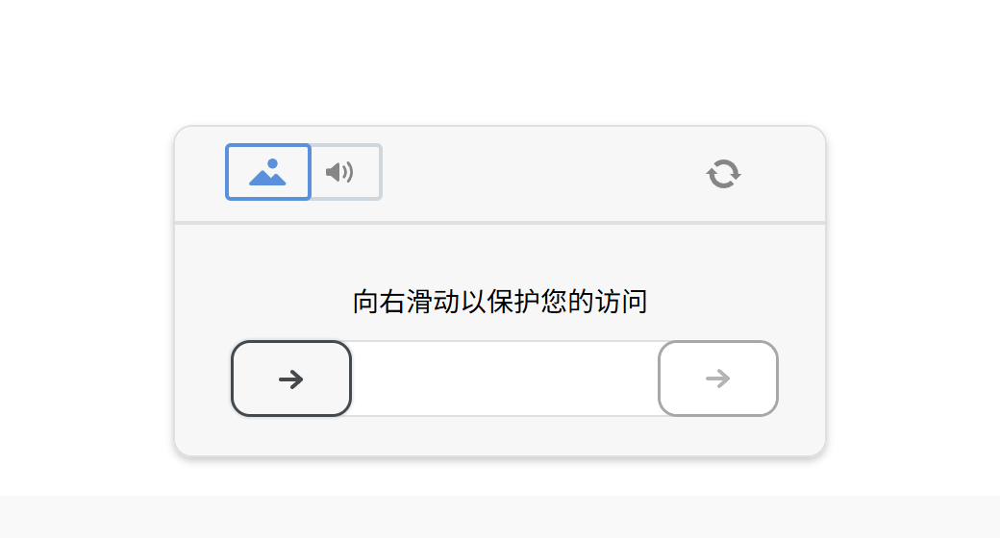

# eg_captcha — 零代码验证码知识库

> **16 家厂商 · 88 个厂商×类型 · 896 组真实样本 · 0 行代码**
>
> 一个不发放武器、只沉淀知识的验证码档案库：样本、方法、成本、失败原因，按厂商与类型整理。
>
> 样本版权归各厂商，仅用于研究与教学，禁止商用；权利人可通过 Issue 要求删除。

**一句话**：按厂商/类型查样本，按方法/成本选路线，按审查状态看可信度。

**English**：A zero-code CAPTCHA knowledge base — 16 vendors, 88 vendor×type combinations, 896 real samples, method tags (CV/DET/OCR/VLM/ASR/PROTO/ACT), cost notes, and honest failure records.

> ⭐ 如果这个库帮你省下收集样本或技术选型的时间，点个 Star，让更多人找到它。

## 为什么值得收藏

- **16 家厂商，一张地图**：极验、易盾、腾讯、数美、顶象、天爱、银联、企讯通、凯格、美团、Amazon、reCAPTCHA、hCaptcha、HUMAN、DataDome、MTCaptcha，主流与长尾都在。
- **896 组真实样本，不是手绘示意图**：来自公开 demo、体验页或公开挑战页；每组都有来源、类型、方法和状态。
- **方法 + 成本，一起给**：CV / DET / OCR / VLM / ASR / PROTO / ACT，标明是否借助多模态 LLM，以及量大时该不该换路线。
- **失败也归档**：29 个类型暂无求解器、7 个效果差、7 个部分进展；为什么没解，往往比“能解”更有信息量。
- **0 行代码，分享无压力**：没有 solver、token、密钥或原始报文；适合在公司内部、课堂和团队里传阅。
- **AI 也能直接用**：自带 Claude Code skill，按厂商/类型/方法检索，不用把整库塞进上下文。

不敢说全网最全，但在“零代码 + 厂商×类型 + 方法/成本 + 失败档案”这四个维度同时做到的，应该不多。

## 30 秒看懂

| 指标 | 数值 |
|---|---|
| 厂商 | 16 家 |
| 厂商×类型 | 88 个（41 个主类型，含无图/仅文档类型） |
| 案例 | 896 组（824 个纯样本 + 72 个结果待审） |
| 有求解器记录 | 43 个类型 |
| 暂无求解器 | 29 个类型 |
| 效果差 / 部分进展 / 需浏览器 | 7 / 7 / 2 个类型 |
| 文档 | 26 篇 Markdown |
| 代码 | 0 行（无 py/js/html/sh） |
| 体积 | 约 77 MB（以图片、音频为主） |

> 这些数字不是 KPI：`sample-only` 只代表有样本，`result-pending-review` 也不代表已通过。准确率来自源记录，未经本库复核；`review.state` 初始为 `pending` 或 `not-applicable`，等待人工回填。

**第一次来？** 先看下面的厂商图，再从[厂商总览](#厂商总览)点进 `docs/<vendor>.md`，最后看一个案例目录里的 `meta.json`。

## 它是什么，不是什么

| 是 | 不是 |
|---|---|
| 公开验证码样本与方法档案 | 求解器、SDK、脚本库 |
| 厂商 × 类型 × 方法 × 成本索引 | 可直接运行的代码或命令 |
| 带来源、状态、审查占位的案例 | 密钥、token、签名实现、完整绕过步骤 |
| 适合选型、教学、团队分享的知识库 | 打码 API 或验证码绕过服务 |

**适合谁**：爬虫/逆向工程师、安全研究与风控、QA、研究者与学生、做 AI Agent 的工具作者。

**不适合谁**：想直接拿现成打码 API 或绕过服务的人；想商用或再分发样本的人。

## 仓库长什么样

| 路径 | 内容 |
|---|---|
| `cases/<vendor>/<type>/<NNN>/` | 一组样本 + `meta.json`，有结果时再加答案、结果和标注 |
| `docs/<vendor>.md` | 该厂商的类型表、方法、成本与失败记录 |
| `docs/types.md` / `docs/demos.md` | 全量类型清单 / 官方与第三方体验入口 |
| `skill/eg-captcha/` | 给 Claude Code 用的检索 skill（纯 Markdown） |

## 16 家厂商，一眼看全

每家厂商一张代表图；完整图库见 `docs/<vendor>.md`。

| 极验 | 网易易盾 | 腾讯云 | 数美 |
|---|---|---|---|
|  |  |  |  |

| 顶象 | 天爱 | 中国银联 | 企讯通 |
|---|---|---|---|
|  |  |  |  |

| 凯格 | 美团 Yoda | Amazon AWS WAF | Google reCAPTCHA |
|---|---|---|---|
|  |  |  |  |

| hCaptcha | HUMAN Security | DataDome | MTCaptcha |
|---|---|---|---|
|  |  |  |  |

## 先看哪里

| 你想 | 去哪里 |
|---|---|
| 实际体验验证码 | 下面的[热门入口](#热门体验入口)，完整列表见 [docs/demos.md](docs/demos.md) |
| 查某家厂商 | 从[厂商总览](#厂商总览)进入对应 `docs/<vendor>.md` |
| 查全部类型 | [docs/types.md](docs/types.md) |
| 选方法 / 看成本 | [docs/00-methodology.md](docs/00-methodology.md) 的“方法标签与成本” |
| 找没解 / 效果差的类型 | 各厂商文档的“无求解器”“效果差”节 |
| 回填人工审查 | [skill/eg-captcha/references/review-workflow.md](skill/eg-captcha/references/review-workflow.md) |
| 让 Claude 用这套知识 | [skill/eg-captcha/SKILL.md](skill/eg-captcha/SKILL.md) |
| 参与整理 | [CONTRIBUTING.md](CONTRIBUTING.md) |

## 方法地图：CV、OCR、VLM 怎么选

| 方法 | 用 LLM？ | 适合 | 代表类型 / 厂商 | 成本 |
|---|---|---|---|---|
| `CV` | 否 | 缺口、边缘、几何、模板 | 极验 slide / 易盾 jigsaw / 顶象 jigsaw | 最低；量大更省 |
| `DET` | 否 | 图标、网格、字符框 | 易盾 text-click / 腾讯 text-click / 天爱 icon-click | 中；需权重/标注 |
| `OCR` | 否 | 文字点选、字体、语序 | 易盾 text-click / 腾讯 text-click / MTCaptcha（OCR 兜底） | 低-中 |
| `VLM` | **是** | 语义点选、空间推理、网格、长尾 | reCAPTCHA grid / Amazon grid / 易盾 word-group | **起步最便宜；按调用计费** |
| `ASR` | 否 | 音频听写、语音验证 | Amazon audio / reCAPTCHA audio / DataDome audio | 中 |
| `PROTO` | 否 | 棋盘枚举、token、PoW | 极验 gobang / Amazon token / reCAPTCHA v3 | 低 |
| `ACT` | 否 | 轨迹、按压、无感 | 银联 no-image / HUMAN press-hold | 低 |
| `NONE` | — | 未做，括号内为建议路线 | 凯格 / hCaptcha / 企讯通 | — |

**选型口诀**：坐标题先 CV/DET，文字题先 OCR/DET，语义与长尾题先 VLM，声音题先 ASR，无题面题看 PROTO/ACT。

**成本判断**：VLM 不需要训练数据和标注，适合语义题、长尾题、网格题；量大时 CV 更便宜、更稳定。常见组合是 CV/OCR 先定位，VLM 只对分歧点或语义点调用（如 `DET+OCR+VLM`）。

## 案例解剖：一组样本包含什么

以 `cases/geetest/slide/001` 为例：

| 原始样本 | 求解标注 |
|---|---|
|  |  |

| 文件 | 作用 |
|---|---|
| `meta.json` | 来源、类型、变体、媒体、`method`、`solver`、`review` |
| `bg.*` / `aux-01.*` / `audio.*` | 原始主图、辅助图、音频 |
| `annotated.png` | 答案可视化，仅 `result-pending-review` 案例有 |
| `answer.txt` / `result.json` | 答案与原始结果，仅 `result-pending-review` 案例有 |

案例 `001`：`CV`（Canny + NCC），12/12 离线，无线上记录，审查 `pending`。`sample-only` 案例只有 `meta.json` + 媒体，没有答案。

## 厂商总览

| 厂商 | 类型 | 案例 | 方法重点 | 文档 |
|---|---:|---:|---|---|
| 极验 GeeTest | 4 | 48 | CV / PROTO | [geetest.md](docs/geetest.md) |
| 网易易盾 | 10 | 96 | CV / VLM / DET+OCR+VLM | [yidun.md](docs/yidun.md) |
| 腾讯云验证码 | 5 | 48 | CV / DET+OCR+VLM | [tencent.md](docs/tencent.md) |
| 数美 | 5 | 50 | CV / DET+OCR+VLM（效果差） | [shumei.md](docs/shumei.md) |
| 顶象 | 13 | 156 | CV / VLM / CV+VLM | [dingxiang.md](docs/dingxiang.md) |
| 天爱 | 13 | 132 | CV / VLM / DET+OCR+VLM | [tianai.md](docs/tianai.md) |
| 中国银联 | 5 | 48 | CV / VLM / PROTO+ACT | [cup.md](docs/cup.md) |
| 企讯通 | 7 | 84 | CV / NONE | [qingtongbu.md](docs/qingtongbu.md) |
| 凯格 | 5 | 45 | NONE（建议 CV/OCR+VLM） | [kgcaptcha.md](docs/kgcaptcha.md) |
| 美团 Yoda | 5 | 60 | CV / DET+OCR（部分进展） | [meituan.md](docs/meituan.md) |
| Amazon AWS WAF | 3 | 24 | VLM / ASR / PROTO | [amazon.md](docs/amazon.md) |
| Google reCAPTCHA | 4 | 36 | VLM / ASR / PROTO | [recaptcha.md](docs/recaptcha.md) |
| hCaptcha | 3 | 36 | NONE（建议 VLM） | [hcaptcha.md](docs/hcaptcha.md) |
| HUMAN Security | 3 | 8 | ACT / NONE | [human-security.md](docs/human-security.md) |
| DataDome | 2 | 13 | AUDIO+ASR / NONE | [datadome.md](docs/datadome.md) |
| MTCaptcha | 1 | 12 | ASR+OCR+VLM | [mtcaptcha.md](docs/mtcaptcha.md) |

## 最近更新

- **2026-11-08**：仓库公开；新增 Claude Code skill；README 重构为速览、图像索引、FAQ 与关键词。
- **2026-11-07**：Google reCAPTCHA 扩到 4 类：新增音频 12 组、v3 documented-only；Amazon 新增音频 12 组；全部案例补方法标签。
- 当前 72 个结果待人工审查；审查结果会回填到案例 `meta.json`。

## 热门体验入口

| 厂商 / 服务 | 入口 | 可体验 |
|---|---|---|
| 极验 GeeTest | <https://www.geetest.com/en/adaptive-captcha-demo> | slide / icon / gobang / iconcrush |
| 网易易盾 | <https://dun.163.com/trial/jigsaw> | 滑动拼图、无感、推理拼图 |
| Google reCAPTCHA | <https://www.google.com/recaptcha/api2/demo> | 图片 / 音频 / v3 |
| hCaptcha | <https://accounts.hcaptcha.com/demo> | area-select / binary / drag-drop |
| 顶象 | <https://www.dingxiang-inc.com/business/captcha> | 13 种验证方式 |
| Cap.guru / 2Captcha | <https://test.cap.guru/demo/hcap#hcap2> · <https://2captcha.com/demo> | hCaptcha / reCAPTCHA / GeeTest 等 |

> 完整官方/第三方入口、无公开 demo 的厂商说明见 [docs/demos.md](docs/demos.md)。第三方 demo 仅用于体验题面形态，不代表本库推荐其服务。

## 作为 Claude Code Skill 使用

装了这个 skill，Claude 会先查本库再回答，而不是凭记忆编“这个验证码用某某模型就能解”。

`skill/eg-captcha/` 是给 Claude Code 用的薄 skill（仅 Markdown），不包含求解器代码，也不需要 Python 环境。

### 安装

**方式一：仓库内使用（不复制）**

让 Claude 直接读取 `skill/eg-captcha/SKILL.md`，或在提问时说明“使用 eg-captcha skill”。

**方式二：安装到全局（推荐长期使用）**

把 `skill/eg-captcha/` 整个目录复制到 Claude Code 的全局 skills 目录：

- Windows：`%USERPROFILE%\.claude\skills\eg-captcha`
- macOS / Linux：`~/.claude/skills/eg-captcha`

复制后重启 Claude Code 会话，可用 skill 列表中应出现 `eg-captcha`。

**路径设置**

安装在全局时，skill 需要知道仓库位置：设置环境变量 `EG_CAPTCHA_ROOT` 指向本仓库根目录；或在全局 skill 的 `references/local-path.md` 写明路径（该文件不随仓库分发，避免写入个人路径）。

### 使用

- 直接问带触发词的问题，例如“eg_captcha 里极验 slide 用什么方法？成本怎么样？”
- 或显式调用 `/eg-captcha`。
- 它只读 README、`docs/` 与 `cases/`，负责方法选型、成本与审查回填；实际编写求解器代码请用 `captcha-solver`。

## 常见问题

**Q：这个库能直接帮我过验证码吗？**

不能。它是知识库，不含求解器、API、token、签名或调用代码；它帮你判断题型、方法、成本与可信度。需要实现请自行编写或使用对应的 solver 项目。

**Q：896 组样本都能商用吗？**

不能。样本版权归各厂商，仅用于研究与教学；文档采用 CC BY-NC-SA 4.0，样本不在文档许可范围内。

**Q：为什么有的类型没有求解器？**

有的是服务端风控或无题面，有的是投入产出不划算，有的是源项目没做。类型表用 `NONE(...)` 标注，并给出建议路线，通常先试 VLM。

**Q：准确率数字可信吗？**

文档里的准确率来自源记录，未经本库复核；72 个结果待人工审查。`sample-only` 只代表有样本，不代表已解；`result-pending-review` 也不代表已通过。

**Q：和 solver / 模型仓库有什么区别？**

其他仓库多半直接给求解器或模型；这里给可读的知识索引：样本、方法、成本、失败原因，连“没解出来”也归档，适合选型、教学和团队分享。

**Q：怎么贡献新厂商或新类型？**

按 [CONTRIBUTING.md](CONTRIBUTING.md)：一个案例 = `meta.json` + 媒体；只收公开来源；不写代码；先补覆盖，再谈求解器。发现错误或想补充，直接开 Issue。

## 边界与许可

- 仓库内没有源码、脚本、SDK、密钥、token 或原始报文；需要实际求解请使用对应的求解器项目。
- 文档 CC BY-NC-SA 4.0；验证码样本版权归各厂商，仅用于研究与教学，禁止商用与再分发。
- 本库按“公开非商业研究档案”发布，不是 OSI 许可意义上的开源软件；样本不在文档许可范围内。
- 完整来源、删除渠道与免责声明见 [NOTICE.md](NOTICE.md)。

## 关键词

> 验证码、验证码识别、验证码样本、验证码数据集、滑块验证码、点选验证码、九宫格验证码、音频验证码、行为验证码、人机验证、风控、极验、网易易盾、腾讯云验证码、数美、顶象、天爱、中国银联、企讯通、凯格、美团 Yoda、HUMAN Security、DataDome、MTCaptcha。

> CAPTCHA, CAPTCHA dataset, CAPTCHA recognition, CAPTCHA solver benchmark, reCAPTCHA, hCaptcha, GeeTest, AWS WAF, DataDome, MTCaptcha, visual reasoning, multimodal LLM.

## 延伸阅读

| 文档 | 内容 |
|---|---|
| [docs/types.md](docs/types.md) | 全量类型清单（按交互族） |
| [docs/demos.md](docs/demos.md) | 全部官方 / 第三方 demo 入口 |
| [docs/00-methodology.md](docs/00-methodology.md) | 方法标签、成本、证据、失败档案 |
| [CONTRIBUTING.md](CONTRIBUTING.md) | 目录/命名/案例契约/审查规则 |
| [NOTICE.md](NOTICE.md) | 来源、版权、免责、删除渠道 |
| [skill/eg-captcha/SKILL.md](skill/eg-captcha/SKILL.md) | Claude Code skill |

---

**觉得有用？点右上角 Star ⭐；发现问题？提 Issue；想补充厂商/类型？看 [CONTRIBUTING.md](CONTRIBUTING.md)。**
