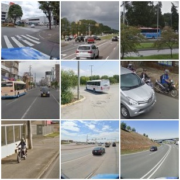

# eg_captcha

> **16 家厂商 · 88 个厂商×类型 · 896 个验证码案例 · 0 行代码**
>
> 一个零代码验证码知识库：样本、方法、成本、审查状态，按厂商与类型组织。
> 样本版权归各厂商，仅用于研究与教学，禁止商用；权利人可通过 Issue 要求删除。

**一句话**：按厂商/类型查样本，按方法/成本选路线，按审查状态看可信度。

| 是 | 不是 |
|---|---|
| 验证码形态与题面样本的公开档案 | 求解器、SDK、脚本库 |
| 方法标签、成本判断、失败原因 | 可直接运行的代码或命令 |
| 带求解器状态与审查占位的案例 | 密钥、签名实现、完整加密步骤 |
| 按厂商与类型组织的知识索引 | 验证码绕过服务或 API |

## 项目全景

每家厂商一张代表图；完整图库见 `docs/<vendor>.md`。

| 极验 | 网易易盾 | 腾讯云 | 数美 |
|---|---|---|---|
|  |  |  |  |

| 顶象 | 天爱 | 中国银联 | 企讯通 |
|---|---|---|---|
|  |  |  |  |

| 凯格 | 美团 Yoda | Amazon AWS WAF | Google reCAPTCHA |
|---|---|---|---|
|  |  |  |  |

| hCaptcha | HUMAN Security | DataDome | MTCaptcha |
|---|---|---|---|
|  |  |  |  |

## 先看哪里

| 你想 | 去哪里 |
|---|---|
| 实际体验验证码 | 下面的[热门入口](#热门体验入口)，完整列表见 [docs/demos.md](docs/demos.md) |
| 查某家厂商 | 从[厂商总览](#厂商总览)进入对应 `docs/<vendor>.md` |
| 查全部类型 | [docs/types.md](docs/types.md) |
| 选方法 / 看成本 | [docs/00-methodology.md](docs/00-methodology.md) 的“方法标签与成本” |
| 找没解 / 效果差的类型 | 各厂商文档的“无求解器”“效果差”节 |
| 回填人工审查 | [skill/eg-captcha/references/review-workflow.md](skill/eg-captcha/references/review-workflow.md) |
| 让 Claude 用这套知识 | [skill/eg-captcha/SKILL.md](skill/eg-captcha/SKILL.md) |
| 参与整理 | [CONTRIBUTING.md](CONTRIBUTING.md) |

## 数据快照

| 指标 | 数值 |
|---|---|
| 厂商 | 16 家 |
| 厂商×类型 | 88 个（41 个主类型，含无图/仅文档类型） |
| 案例 | 896 组（824 个纯样本 + 72 个结果待审） |
| 求解器状态 | 有结果待审 43 / 无求解器 29 / 效果差 7 / 部分进展 7 / 需浏览器 2 |
| 代码 | 0 行（无 py/js/html/sh） |

> 数字以当前仓库为准；准确率为源记录，未经本库复核；`review.state` 初始为 `pending` 或 `not-applicable`。

## 方法地图

| 方法 | 用 LLM？ | 适合 | 代表类型 / 厂商 | 成本 |
|---|---|---|---|---|
| `CV` | 否 | 缺口、边缘、几何、模板 | 极验 slide / 易盾 jigsaw / 顶象 jigsaw | 最低；量大更省 |
| `DET` | 否 | 图标、网格、字符框 | 易盾 text-click / 腾讯 text-click / 天爱 icon-click | 中；需权重/标注 |
| `OCR` | 否 | 文字点选、字体、语序 | 易盾 text-click / 腾讯 text-click / MTCaptcha（OCR 兜底） | 低-中 |
| `VLM` | **是** | 语义点选、空间推理、网格、长尾 | reCAPTCHA grid / Amazon grid / 易盾 word-group | **起步最便宜；按调用计费** |
| `ASR` | 否 | 音频听写、语音验证 | Amazon audio / reCAPTCHA audio / DataDome audio | 中 |
| `PROTO` | 否 | 棋盘枚举、token、PoW | 极验 gobang / Amazon token / reCAPTCHA v3 | 低 |
| `ACT` | 否 | 轨迹、按压、无感 | 银联 no-image / HUMAN press-hold | 低 |
| `NONE` | — | 未做，括号内为建议路线 | 凯格 / hCaptcha / 企讯通 | — |

**成本判断**：VLM 不需要训练数据和标注，适合语义题、长尾题、网格题；量大时 CV 更便宜、更稳定。常见组合是 CV/OCR 先定位，VLM 只对分歧点或语义点调用（如 `DET+OCR+VLM`）。

## 案例解剖

以 `cases/geetest/slide/001` 为例：

| 原始样本 | 求解标注 |
|---|---|
|  |  |

| 文件 | 作用 |
|---|---|
| `meta.json` | 来源、类型、变体、媒体、`method`、`solver`、`review` |
| `bg.*` / `aux-01.*` / `audio.*` | 原始主图、辅助图、音频 |
| `annotated.png` | 答案可视化，仅 `result-pending-review` 案例有 |
| `answer.txt` / `result.json` | 答案与原始结果，仅 `result-pending-review` 案例有 |

案例 `001`：`CV`（Canny + NCC），12/12 离线，无线上记录，审查 `pending`。`sample-only` 案例只有 `meta.json` + 媒体，没有答案。

## 厂商总览

| 厂商 | 类型 | 案例 | 方法重点 | 文档 |
|---|---:|---:|---|---|
| 极验 GeeTest | 4 | 48 | CV / PROTO | [geetest.md](docs/geetest.md) |
| 网易易盾 | 10 | 96 | CV / VLM / DET+OCR+VLM | [yidun.md](docs/yidun.md) |
| 腾讯云验证码 | 5 | 48 | CV / DET+OCR+VLM | [tencent.md](docs/tencent.md) |
| 数美 | 5 | 50 | CV / DET+OCR+VLM（效果差） | [shumei.md](docs/shumei.md) |
| 顶象 | 13 | 156 | CV / VLM / CV+VLM | [dingxiang.md](docs/dingxiang.md) |
| 天爱 | 13 | 132 | CV / VLM / DET+OCR+VLM | [tianai.md](docs/tianai.md) |
| 中国银联 | 5 | 48 | CV / VLM / PROTO+ACT | [cup.md](docs/cup.md) |
| 企讯通 | 7 | 84 | CV / NONE | [qingtongbu.md](docs/qingtongbu.md) |
| 凯格 | 5 | 45 | NONE（建议 CV/OCR+VLM） | [kgcaptcha.md](docs/kgcaptcha.md) |
| 美团 Yoda | 5 | 60 | CV / DET+OCR（部分进展） | [meituan.md](docs/meituan.md) |
| Amazon AWS WAF | 3 | 24 | VLM / ASR / PROTO | [amazon.md](docs/amazon.md) |
| Google reCAPTCHA | 4 | 36 | VLM / ASR / PROTO | [recaptcha.md](docs/recaptcha.md) |
| hCaptcha | 3 | 36 | NONE（建议 VLM） | [hcaptcha.md](docs/hcaptcha.md) |
| HUMAN Security | 3 | 8 | ACT / NONE | [human-security.md](docs/human-security.md) |
| DataDome | 2 | 13 | AUDIO+ASR / NONE | [datadome.md](docs/datadome.md) |
| MTCaptcha | 1 | 12 | ASR+OCR+VLM | [mtcaptcha.md](docs/mtcaptcha.md) |

## 最近更新

- **2026-11-07**：Google reCAPTCHA 扩到 4 类：新增音频 12 组、v3 documented-only；Amazon 新增音频 12 组；全部案例补方法标签。
- **2026-11-08**：新增 `skill/eg-captcha/`；补 `.gitignore` 与顶部版权提示；README 改为“总结 + 图像索引 + 任务导航”。
- 当前 72 个结果待人工审查；审查结果会回填到案例 `meta.json`。

## 热门体验入口

| 厂商 / 服务 | 入口 | 可体验 |
|---|---|---|
| 极验 GeeTest | <https://www.geetest.com/en/adaptive-captcha-demo> | slide / icon / gobang / iconcrush |
| 网易易盾 | <https://dun.163.com/trial/jigsaw> | 滑动拼图、无感、推理拼图 |
| Google reCAPTCHA | <https://www.google.com/recaptcha/api2/demo> | 图片 / 音频 / v3 |
| hCaptcha | <https://accounts.hcaptcha.com/demo> | area-select / binary / drag-drop |
| 顶象 | <https://www.dingxiang-inc.com/business/captcha> | 13 种验证方式 |
| Cap.guru / 2Captcha | <https://test.cap.guru/demo/hcap#hcap2> · <https://2captcha.com/demo> | hCaptcha / reCAPTCHA / GeeTest 等 |

> 完整官方/第三方入口、无公开 demo 的厂商说明见 [docs/demos.md](docs/demos.md)。第三方 demo 仅用于体验题面形态，不代表本库推荐其服务。

## 作为 Claude Code Skill 使用

`skill/eg-captcha/` 是给 Claude Code 用的薄 skill（仅 Markdown），不包含求解器代码，也不需要 Python 环境。

### 安装

**方式一：仓库内使用（不复制）**

让 Claude 直接读取 `skill/eg-captcha/SKILL.md`，或在提问时说明“使用 eg-captcha skill”。

**方式二：安装到全局（推荐长期使用）**

把 `skill/eg-captcha/` 整个目录复制到 Claude Code 的全局 skills 目录：

- Windows：`%USERPROFILE%\.claude\skills\eg-captcha`
- macOS / Linux：`~/.claude/skills/eg-captcha`

复制后重启 Claude Code 会话，可用 skill 列表中应出现 `eg-captcha`。

**路径设置**

安装在全局时，skill 需要知道仓库位置：设置环境变量 `EG_CAPTCHA_ROOT` 指向本仓库根目录；或在全局 skill 的 `references/local-path.md` 写明路径（该文件不随仓库分发，避免写入个人路径）。

### 使用

- 直接问带触发词的问题，例如“eg_captcha 里极验 slide 用什么方法？成本怎么样？”
- 或显式调用 `/eg-captcha`。
- 它只读 README、`docs/` 与 `cases/`，负责方法选型、成本与审查回填；实际编写求解器代码请用 `captcha-solver`。

## 边界与许可

- 仓库内没有源码、脚本、SDK、密钥、token 或原始报文；需要实际求解请使用对应的求解器项目。
- 文档 CC BY-NC-SA 4.0；验证码样本版权归各厂商，仅用于研究与教学，禁止商用与再分发。
- 本库按“公开非商业研究档案”发布，不是 OSI 许可意义上的开源软件；样本不在文档许可范围内。
- 完整来源、删除渠道与免责声明见 [NOTICE.md](NOTICE.md)。

## 延伸阅读

| 文档 | 内容 |
|---|---|
| [docs/types.md](docs/types.md) | 全量类型清单（按交互族） |
| [docs/demos.md](docs/demos.md) | 全部官方 / 第三方 demo 入口 |
| [docs/00-methodology.md](docs/00-methodology.md) | 方法标签、成本、证据、失败档案 |
| [CONTRIBUTING.md](CONTRIBUTING.md) | 目录/命名/案例契约/审查规则 |
| [NOTICE.md](NOTICE.md) | 来源、版权、免责、删除渠道 |
| [skill/eg-captcha/SKILL.md](skill/eg-captcha/SKILL.md) | Claude Code skill |
