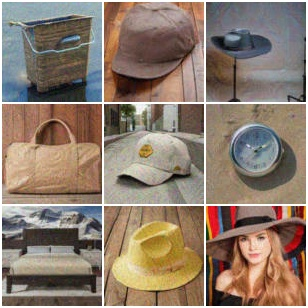
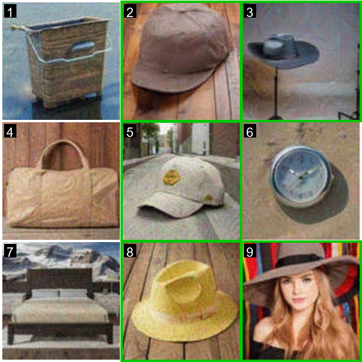
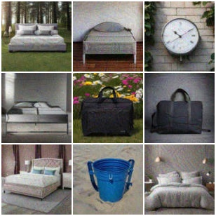
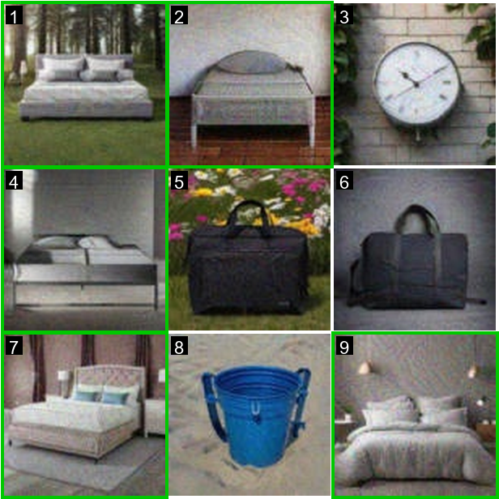
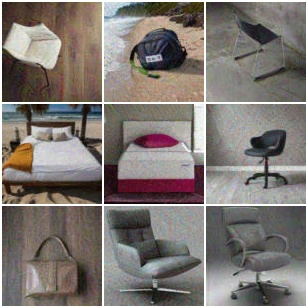
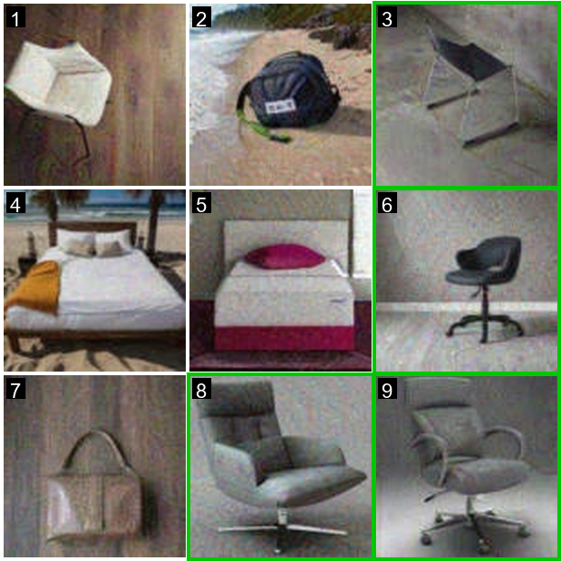
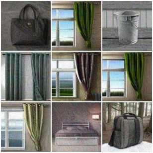
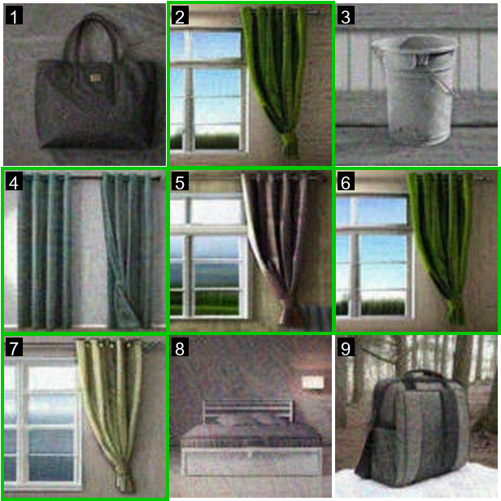

# Amazon AWS WAF · 九宫格多选（grid）

> 3×3 九张独立照片 + 一句中文短题（「选择全部 帽子」这类），让视觉 LLM 直接输出选中格号；源记录 30/30 离线、20/20 线上，本库只收题面与源标注。
>
> 返回：[Amazon 索引](../../../docs/amazon.md) · [全量类型](../../../docs/types.md) · [方法论](../../../docs/00-methodology.md)

## 一、速览

| 项 | 值 |
|---|---|
| 厂商 | Amazon AWS WAF（`amazon`） |
| 类型 / 变体 | `grid` / grid-5 |
| 中文 | 九宫格多选 |
| 媒体 | 图片（`bg.jpg` 题面 + `solved.png` 源标注） |
| 样本 | 12 组（001–012） |
| 答案格式 | `indices`：选中格子编号（1–9） |
| 方法 | `VLM`（视觉 LLM 直接输出格号；无需训练检测器） |
| 求解器 | `exists` · 高（源记录 30/30 离线、20/20 线上） |
| 人工审查 | 待审 12（截至 2026-11-21） |
| 证据等级 | `sample-only`（样本中立收录，结果未纳入） |

## 二、题面与判定

每次挑战是一张 3×3 网格，每格一张独立照片；题面是一句很短的中文，指定要选的目标类别。用户点选所有含目标的格子，再提交。

| 案例 | 题面（`meta.prompt`） | 通过条件 | 目标类别 |
|---|---|---|---|
| [001](001/) | 选择全部 帽子 | 该批案例未记录 `pass_criteria`；按题面选中全部含目标的格子 | 帽子 |
| [002](002/) | 选择全部 水桶 | 同上 | 水桶 |
| [004](004/) | 选择全部 床 | 同上 | 床 |
| [007](007/) | 选择全部 椅子 | 同上 | 椅子 |

> 12 组题面共 7 个类别：帽子（001/011）、水桶（002/006/012）、时钟（003/008）、床（004）、袋子（005/009）、椅子（007）、窗帘（010）。答案空间是 1–9 的格子编号集合。

## 三、样本长什么样

`bg.jpg` 是 308×308 的 3×3 拼图；`solved.png` 是 616×616 的源标注图，给每格编号并给选中格加绿框。绿框是源求解标注，不是本库复核过的官方答案。

| 001 题面（帽子） | 001 源标注 | 004 题面（床） | 004 源标注 |
|---|---|---|---|
|  |  |  |  |
|  |  |  |  |

- 左列是原始题面，右列是源标注；编号 1–9 按从上到下、从左到右排列。
- 同一题面下 9 格都是独立照片，格与格之间没有场景连续性；部分格子是干扰物（如 001 的袋子、床等异类物体）。

## 四、形态与难点

- **固定 3×3**：12 组 `bg.jpg` 都是 308×308，九格等分；`solved.png` 统一放大到 616×616 再编号。
- **短题面、固定类别**：题面只有「选择全部 X」，类别在 12 组中重复出现，适合按类别建提示词。
- **相似干扰**：同类物体形态差异大（帽子有棒球帽、礼帽、遮阳帽），异类物体也可能局部相似（如袋子与帽子）。
- **目标数量不定**：命中格数不固定，不能按固定数量猜；以逐格判断为准。
- **无逐题真值**：本库只有 `bg.jpg` / `solved.png` / `meta.json`，没有 `answer.txt` 或 `result.json`，不能离线重算准确率。

## 五、求解思路

源记录的做法很直接：把九格当作九张独立小图，让视觉 LLM 结合题面输出格号。下面是可复用的步骤，具体模型与提示词源记录未展开。

| 步骤 | 做法 | 关键判据 / 参数 | 说明 |
|---|---|---|---|
| 1 读题 | 从 `meta.prompt` 取目标类别 | 中文短题，如「帽子」「水桶」 | 类别明确，不需要开放语义推理 |
| 2 拆格 | 按 3×3 等分原图 | 308×308 → 每格约 102×102 | 保留格线，避免把相邻格内容带进裁片 |
| 3 读格 | 对每格问「是否含目标」，或一次让 VLM 输出全部命中格号 | 输出 `indices` | 源记录是视觉 LLM 直接读格，无需训练检测器 |
| 4 映射 | 按从上到下、从左到右编号 | 1–9 | 与 `solved.png` 的编号一致 |
| 5 复核 | 对低置信格二次询问，或换模型投票 | 只对分歧格调用 | 控制成本 |
| 6 提交 | 输出选中格号集合 | 1–9 的子集 | 本库未复制逐题提交结果 |

```text
格子编号（与 solved.png 一致）：

1 2 3
4 5 6
7 8 9
```

> 这是源记录路线的直译；模型名称、温度、提示词模板没有写入本库，类型页不做补脑。

## 六、结果与审查

- **源记录**：30/30 离线、20/20 线上（`meta.solver.notes`）；这是源求解器的历史成绩，不是本库 12 组的逐题结果。
- **本库结果**：12 组都是 `status=sample-only`、`sample_state=neutral`；没有 `answer.txt` / `result.json`，`solved.png` 只是源标注截图。
- **人工审查**：12 组 `review.state=pending`，无通过/错误记录；不能把源记录的成绩写成已审查。

| 组 | 题面 | 源标注 | 审查 |
|---|---|---|---|
| [001](001/) | 选择全部 帽子 | `solved.png` | 待审 |
| [002](002/) | 选择全部 水桶 | `solved.png` | 待审 |
| [003](003/) | 选择全部 时钟 | `solved.png` | 待审 |
| [004](004/) | 选择全部 床 | `solved.png` | 待审 |
| [005](005/) | 选择全部 袋子 | `solved.png` | 待审 |
| [006](006/) | 选择全部 水桶 | `solved.png` | 待审 |
| [007](007/) | 选择全部 椅子 | `solved.png` | 待审 |
| [008](008/) | 选择全部 时钟 | `solved.png` | 待审 |
| [009](009/) | 选择全部 袋子 | `solved.png` | 待审 |
| [010](010/) | 选择全部 窗帘 | `solved.png` | 待审 |
| [011](011/) | 选择全部 帽子 | `solved.png` | 待审 |
| [012](012/) | 选择全部 水桶 | `solved.png` | 待审 |

## 七、失败与边界

| 现象 | 根因 | 证据 | 结论 |
|---|---|---|---|
| 无法复算 30/30 | 本库没有逐题 `answer.txt` / `result.json` | 12 组只有 `bg.jpg` / `solved.png` / `meta.json` | 源记录只作参考，不当成本库成绩 |
| `solved.png` 的绿框不一定等于真值 | 它是源求解标注截图 | `meta.notes`：样本中立收录，结果未纳入 | 不能用绿框反推官方答案 |
| 相似物体与局部干扰 | 袋子/帽子、床/椅子等形态接近 | 001、004、007 的 9 格中都有异类干扰 | 逐格判断，不按整图语义猜 |
| 裁切边界影响判断 | 九格是独立照片，拆格偏差会把相邻格内容带进来 | 本批 `bg` 是整张 3×3 拼图，不是九张独立文件 | 严格按 3×3 等分，保留原边界再送 VLM |
| 审查全 pending | 维护者尚未逐题回填 | `meta.review.state=pending` | 页面不写通过率，只写待审 |

**边界**：本页只覆盖「怎么读格、怎么输出编号」。真实提交还需要页面会话、点选时序与风控环境，本库没有这部分记录；源记录的线上 20/20 不能迁移到新批次。

## 八、相关

- 厂商索引：[docs/amazon.md](../../../docs/amazon.md)
- 全量类型：[docs/types.md](../../../docs/types.md) · 方法论：[docs/00-methodology.md](../../../docs/00-methodology.md)
- 同厂商对照：[audio](../audio/)（双人混音听写，ASR）
- 案例：[001](001/) – [012](012/)（每组含 `meta.json` / `bg.jpg` / `solved.png`）
- 来源：Amazon AWS WAF 公开挑战页 <https://www.amazon.com/>，001 采集于 2026-10-31，002–012 采集于 2026-11-01；样本版权归 Amazon 所有，仅用于研究与教学。
