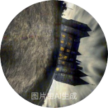
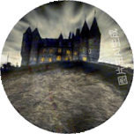
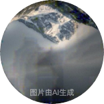
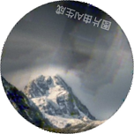

# 百度 · 旋转验证（rotate）

> 爱企查 `wappass` 的 spin 旋转题：拖动滑块把圆图转正；角度用 ConvNeXt Tiny 回归 `sin/cos`，提交走 PoW + 轨迹 + 双层 AES 的纯协议链路。
>
> 返回：[百度索引](../../../docs/baidu.md) · [全量类型](../../../docs/types.md) · [方法论](../../../docs/00-methodology.md)

## 一、速览

| 项 | 值 |
|---|---|
| 厂商 | 百度（`baidu`，站点为爱企查 `aiqicha.baidu.com`） |
| 类型 / 变体 | `rotate` / spin（`wappass`） |
| 中文 | 旋转验证 |
| 媒体 | 图片（152×152 圆形图） |
| 样本 | 12 组（001–012），从 200 张人工标注真机图中选取 |
| 答案格式 | `angle`：当前旋转角度（度） |
| 方法 | `CV+PROTO`（ConvNeXt Tiny 角度识别 + 纯协议提交） |
| 求解器 | `exists` · 高（源记录 200 张 MAE 10.50°、acc@10° 81.0%） |
| 人工审查 | `pending`（12/12 待审） |
| 证据等级 | `manual`（人工标注真值 + 模型离线预测，无线上提交记录） |

## 二、题面与判定

`meta.prompt` 为「拖动滑块，将图片旋转到正确方向」；用户拖动滑块，把圆框里的图片转到正视方向。12 组案例都没有记录 `pass_criteria`，源文档记录的通过标志是服务端返回 `op=1`。

| 案例 | 题面（`meta.prompt`） | 真值角度 | 通过条件 |
|---|---|---|---|
| [001](001/) | 拖动滑块，将图片旋转到正确方向 | 60° | 该批案例未记录；源文档记录服务端 `op=1` 为通过 |
| [004](004/) | 同上 | 106° | 同上 |
| [012](012/) | 同上 | 301° | 同上 |

> 角度约定：真值 = 图片**当前被旋转的角度**；回正 = `rotate(+angle)`（PIL 逆时针）；协议里客户端提交的比例为 `angle / 360`。答案空间是 0°–360°，不是像素坐标。

## 三、样本长什么样

| 001 原图 | 001 模型回正 | 004 原图 | 004 模型回正 |
|---|---|---|---|
|  |  |  |  |

| 007 原图 | 007 模型回正 | 012 原图 | 012 模型回正 |
|---|---|---|---|
|  |  |  |  |

- 八张图都是 152×152 的圆形裁切；001 是白色跑车，原图逆时针偏转 60°，`solved.png` 是模型按预测角 64.01° 回正的结果；004 是黑色城堡，真值 106°、预测 101.10°。
- 007 真值 165°、预测 161.73°；012 是真值最大的样本，301°、预测 296.42°。两者回正后仍残留 3.27° / 4.58° 的倾斜，正好对应误差列。
- `solved.png` 是**模型预测回正**，不是真值回正；原图与结果图的差异只应表现为旋转，不应出现裁剪或缩放。
- 原始素材右下角带「图片由AI生成」水印；这是样本来源特征，不是验证码元素。

## 四、形态与难点

- **图幅固定**：152×152 圆图，内容为 AI 生成的车辆/建筑/风景；圆外区域被裁掉，旋转后四角会露出空白或黑边。
- **角度范围**：12 组覆盖 60°–301°，不是只测小角度；模型必须做全周回归，而不是分类到几个固定角度。
- **连续角度**：答案是连续值，误差容忍未知；源记录用 MAE、acc@10°、acc@15° 评价，说明 10° 是常用参考阈值。
- **交互线**：滑块拖动是表象，真正的提交依赖 `wappass` 协议；角度对了但 PoW/轨迹不对仍会失败。
- **会话约束**：在线提交依赖新鲜会话与当前 Cookie/UA；历史 `op=1` 证据来自源目录，不代表任意时刻可复现。

## 五、求解思路

图像线的核心是「回归当前旋转角」，协议线是「把角度按 wappass 要求签名并提交」；两条线缺一不可。

| 步骤 | 做法 | 关键判据 / 参数 |
|---|---|---|
| 1 init | 初始化 `wappass` 会话，拿到挑战参数 | 需要新鲜会话；源记录未展开字段 |
| 2 style | 获取样式/配置，确认挑战类型为 spin | 与后续取图、提交参数配套 |
| 3 取图 | 下载 152×152 圆图 | 原图即当前旋转态，不需要额外旋转 |
| 4 角度识别 | ConvNeXt Tiny 回归 `sin/cos`，`atan2` 得到角度 | 模型 `conv_0203_ft_0205_pl_0206`；200 张标注 MAE 10.50°、acc@10° 81.0%、acc@15° 84.5% |
| 5 PoW | 按挑战参数计算工作量证明 | 协议门槛；源记录未展开算法细节 |
| 6 轨迹 | 生成滑块拖动轨迹 | 协议门槛；与角度一起提交 |
| 7 双层 AES | 对提交数据做两层加密 | 源记录只给「双层 AES」，未展开密钥/模式 |
| 8 log | 上报日志/结果，等待 `op=1` | `op=1` 表示通过；失败需重新取题 |

```text
# 角度回归与回正（ConvNeXt Tiny，sin/cos 双输出）

img = resize(bg, 152 x 152)
sin_t, cos_t = convnext_tiny(img)
theta = atan2(sin_t, cos_t) mod 360      # 当前旋转角，单位：度
corrected = rotate(bg, +theta)            # PIL rotate，逆时针回正
submit_ratio = theta / 360                # wappass 协议提交的比例
```

> `sin/cos` 双输出让 0°/360° 在输出空间连续，`atan2` 还原后不会把接近 0° 的样本硬分到 359°；源记录只给出 `sin/cos` head，没有展开选择理由。
>
> 模型线是「微调 + 伪标签半监督」：在 200 张真机标注图上微调，再用伪标签扩展；上游项目报告 1500 次真实通过率 73.33%，本库 200 张标注的离线指标更保守。ResNet50 基线 MAE 82.97°，已弃用。

## 六、结果与审查

- **源记录**：200 张人工标注图 MAE 10.50°、acc@10° 81.0%、acc@15° 84.5%；12 组选样误差均 ≤ 4.90°，平均误差 2.96°（按 `result.json` 现算）。
- **本库**：12 组 `answer.txt` / `result.json` / `solved.png` 齐全，`evidence=manual`、`confidence=high`；真值来自人工标注，预测来自模型，**没有线上 `op=1` 记录**。
- **人工审查**：12 组 `review.state=pending`，尚无通过/错误结论；`result.status=solved` 只表示离线推理完成。

| 组 | 真值 | 预测 | 误差 | 源文件 |
|---|---:|---:|---:|---|
| [001](001/) | 60° | 64.01° | 4.01° | `100_rot60_00_100.png` |
| [002](002/) | 73° | 76.12° | 3.12° | `121_rot73_00_121.png` |
| [003](003/) | 92° | 92.99° | 0.99° | `48_rot92_00_48.png` |
| [004](004/) | 106° | 101.10° | 4.90° | `95_rot106_00_95.png` |
| [005](005/) | 132° | 136.07° | 4.07° | `11_rot132_00_11.png` |
| [006](006/) | 151° | 148.97° | 2.03° | `31_rot151_00_31.png` |
| [007](007/) | 165° | 161.73° | 3.27° | `167_rot165_00_167.png` |
| [008](008/) | 180° | 178.97° | 1.03° | `123_rot180_00_123.png` |
| [009](009/) | 199° | 196.83° | 2.17° | `72_rot199_00_72.png` |
| [010](010/) | 236° | 237.77° | 1.77° | `135_rot236_00_135.png` |
| [011](011/) | 278° | 274.38° | 3.62° | `2_rot278_00_2.png` |
| [012](012/) | 301° | 296.42° | 4.58° | `129_rot301_00_129.png` |

> 这 12 组是按角度区间覆盖选出的样例，不是随机评测；「12 组全部 ≤ 4.90°」不能替代 200 张的 MAE 10.50° 与 acc@10° 81.0%。

## 七、失败与边界

| 现象 | 根因 | 证据 | 结论 |
|---|---|---|---|
| 角度正确但仍不通过 | PoW 或轨迹与服务端不匹配 | 源文档：PoW 与轨迹是协议门槛 | 图像正确 ≠ 提交通过；需要完整协议链 |
| 会话过期 / 被拒 | Cookie/UA/时间与服务端不一致 | 源文档：在线提交依赖新鲜会话 | 每轮取题与提交必须同会话、及时完成 |
| 个别样本角度偏差大 | 200 张中 acc@10° 仅 81.0% | `docs/baidu.md` 指标 | 12 组选样偏容易；不要宣称 100% |
| 没有线上通过证据 | 历史 `op=1` 来自源目录，不在本库 | `evidence=manual`，无提交日志 | 不能把离线指标写成线上通过率 |
| `solved.png` 看似正了 | 它是模型预测回正，不是真值 | 预测误差 0.99°–4.90° | 看图不能代替角度核对 |

**边界**：本页覆盖「角度识别 + 协议链路说明」，不包含 PoW 算法、双层 AES 的密钥细节和轨迹生成参数；这些源记录未展开。旋转题的图像线可以离线评价，协议线必须在真实会话里验证。

## 八、相关

- 厂商索引：[docs/baidu.md](../../../docs/baidu.md)
- 全量类型：[docs/types.md](../../../docs/types.md) · 方法论：[docs/00-methodology.md](../../../docs/00-methodology.md)
- 案例：[001](001/) – [012](012/)（每组含 `meta.json` / `answer.txt` / `result.json` / `bg.png` / `solved.png`）
- 来源：`solve_CAPTCHA/samples/other/baidu/rotate/sets/labeled`（200 张标注真机图）；指标来自同目录 `sets/demo/predictions_convnext.json`；协议与模型说明见源目录 README。样本版权归百度所有，仅用于研究与教学。
