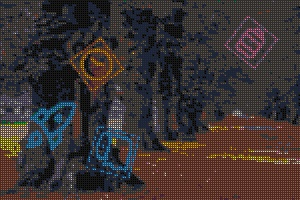
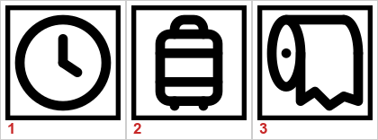
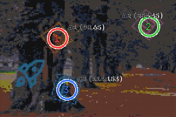
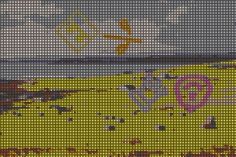
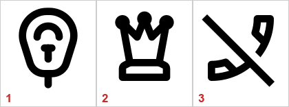
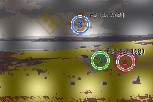
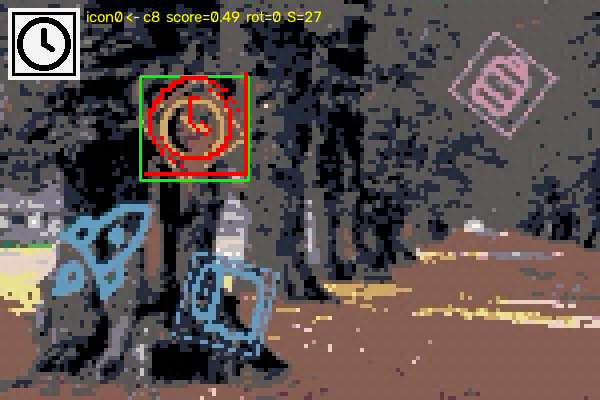

# 哔哩哔哩 B站 · 图标点选（icon-click）

> 300×200 像素画背景 + 3 个图标，按 `icon0→icon1→icon2` 顺序点击；B站定制渲染（2×2 网点、单色空心描边、随机旋转），用 Lab k-means 颜色分离 + 描边带旋转 IoU 做启发式求解。
>
> 返回：[B站索引](../../../docs/bilibili.md) · [全量类型](../../../docs/types.md) · [方法论](../../../docs/00-methodology.md)

## 一、速览

| 项 | 值 |
|---|---|
| 厂商 | 哔哩哔哩 B站（`bilibili`） |
| 类型 / 变体 | `icon-click` / geetest-v4/icon-pixel |
| 中文 | 图标点选 |
| 媒体 | 图片 |
| 样本 | 12 组（001–012） |
| 答案格式 | `points`：3 个有序点击坐标 |
| 方法 | `CV`（颜色分离 + 形状匹配，无 LLM） |
| 求解器 | `exists` · 中（启发式；5 组直接命中、7 组人工/VLM 复核修正） |
| 人工审查 | **12 通过 / 0 错误 / 0 待审**（截至 2026-11-21，按 `meta.review`） |
| 证据等级 | `offline` 5 组（001/002/003/009/011）/ `manual-review` 7 组（004/005/006/007/008/010/012；无线上提交） |

## 二、题面与判定

题面给出像素画背景和 3 个目标图标，用户按 `icon0→icon1→icon2` 的顺序，在背景中依次点击对应图标。该批案例记录了 `pass_criteria`：顺序错误不通过。

| 案例 | 题面（`meta.prompt`） | 通过条件 | 答案（1→3） |
|---|---|---|---|
| [001](001/) | 按图标顺序，依次点击背景图中的 3 个对应图标 | 按 icon0→icon1→icon2 顺序点击 3 个图标；顺序错误不通过 | 1:(98,65); 2:(254,45); 3:(114,153) |
| [002](002/) | 同上 | 同上 | 1:(38,59); 2:(143,39); 3:(232,41) |
| [004](004/) | 同上 | 同上 | 1:(246,121); 2:(196,118); 3:(157,48) |

> 答案空间是「3 个图标的一种位置指派 + 点击顺序」。B站这一变体还有一个站点级事实：`/load` 对 `risk_type`（word/click/icon/slide/winlinze/match/ai/nine/obstacle）、`client_type`、`pt`、`lang` 的全组合都返回 `captcha_type=icon`、`captcha_mode=adaptive`，即题型由服务端固定，`risk_type` 无效（2026-11-21 复测）。

## 三、样本长什么样

| 原始题面 | 目标图标 | 求解结果 |
|---|---|---|
|  |  |  |
|  |  |  |

- 第 1 列是 300×200 题面：像素画背景上散布单色空心描边图标，肉眼看有 2×2 网点；第 2 列是 3 个目标图标，顺序即点击顺序；第 3 列是启发式求解器的标注结果。
- 004/005/006/007/008/010/012 共 7 组经人工/VLM 复核修正（004 的 crown 人工补点、005 调整顺序、006–008/010/012 修正候选/顺序）；12 组均已复审通过。修正答案保存在 `override.json` 与案例 `evidence=manual-review`，不代表自动求解器命中。
- 每组还含过程图 `process-01-restore.png` … `process-06-final.png`（人工组为 3 张），可在 viewer 的「求解过程」区查看； 展示了 icon0 的描边带匹配。

## 四、形态与难点

- **2×2 网点**：背景是 150×100 像素画按 2×2 放大，每块仅右下角（绝对奇行奇列）保留原色，其余 3 格压暗约 55%；取 `bg[1::2, 1::2]` 可还原无网点清晰图（源记录 30/30 组验证）。
- **空心描边图标**：图标按 alpha 轮廓画单色空心描边（不是实心填充），随机旋转；90 张模板中有 28 张自带画布边框，旋转后呈方形/菱形框。
- **尺寸归一化**：3 个目标图标为 128×128，内容约 48px、按内容尺寸归一化渲染；模板画布等效尺寸随内容 bbox 变化。
- **干扰多**：背景像素画边缘密集，描边颜色可能与场景接近；还存在题面之外的图标状干扰图形。
- **不能直接套官方 demo 的 CV 链**：B站渲染与极验官方 demo 差异很大，官方 demo 的颜色连通 + chamfer 链不能直接复用。

## 五、求解思路

先把网点图还原成清晰图，再用 Lab 颜色聚类把「单色描边」从背景中分离出来，得到候选连通域；然后按候选 bbox 反推模板缩放，旋转搜索描边带 IoU；最后把 3 个模板指派到 3 个不同候选。

| 步骤 | 做法 | 关键判据 / 参数 |
|---|---|---|
| 1 网点还原 | 取 `bg[1::2, 1::2]`，得到 150×100 清晰图 | 源记录 30/30 组验证 |
| 2 颜色分离 | Lab 空间 k-means 色簇，闭运算重连，取 18–42px 连通域 | 单色空心描边 |
| 3 候选生成 | 每个连通域的外接框作为候选，记录色簇编号 | 3 个图标对应 3 个候选 |
| 4 形状匹配 | 按候选 bbox 反推模板 scale，旋转搜索描边带 IoU | 得到「模板 × 候选」得分 |
| 5 指派与输出 | 3 个模板指派到 3 个不同候选，按 `icon0→icon1→icon2` 输出中心 | 本批 12 组已生成 `solve.png` |

```text
# B站 icon-pixel：网点还原 → Lab 分离 → 描边带旋转 IoU → 三模板指派（伪代码，对应源方案）

clean = bg[1::2, 1::2]                    # 2×2 网点还原，150×100
cands = []
for cluster in lab_kmeans(clean):
    mask = close(cluster)                 # 闭运算重连
    for comp in connected_components(mask, size=18..42px):
        cands.append(bbox(comp))

for tpl in templates[0..2]:
    for c in cands:
        scale = estimate_scale(tpl, c.bbox)          # 按内容 bbox 反推
        for angle in rotation_candidates:
            score[tpl][c] = stroke_band_iou(rotate(tpl, angle, scale), c)

assign = best_one_to_one(score)           # 3 模板 ↔ 3 个不同候选
click(order=template_order, points=centers(assign))
```

> 这里的 `best_one_to_one` 是源文档「对 3 个模板做不同候选的指派」的直译，源记录未展开具体指派算法；不要把它当成已确认的匈牙利实现。

## 六、结果与审查

- **源记录**：2×2 网点还原在 30/30 组上验证；5 组（001/002/003/009/011）由求解器直接命中，另 7 组（004/005/006/007/008/010/012）经人工/VLM 复核修正（004 补 crown、005 调顺序、006–008/010/012 修正候选/顺序）。
- **本库结果**：12 组 `answer.txt` / `result.json` / `solve.png` 齐全；`evidence` 为 `offline` 5 组 + `manual-review` 7 组；无线上提交。
- **人工审查**：按 `meta.review` 现算为 **12 通过 / 0 错误 / 0 待审**（截至 2026-11-21）。注意：12/12 通过包含 7 组人工/VLM 修正，**不代表自动求解器 12/12**；自动命中为 5/12。

| 组 | 1→3 点击坐标 | 匹配分 | 来源 | 审查 |
|---|---|---|---|---|
| [001](001/) | (98,65); (254,45); (114,153) | 0.49 / 0.62 / 0.73 | solver | 通过 |
| [002](002/) | (38,59); (143,39); (232,41) | 0.80 / 0.81 / 0.70 | solver | 通过 |
| [003](003/) | (188,135); (141,50); (62,38) | 0.78 / 0.84 / 0.48 | solver | 通过 |
| [004](004/) | (246,121); (196,118); (157,48) | — | manual | 通过 |
| [005](005/) | (73,85); (132,134); (197,145) | — | manual | 通过 |
| [006](006/) | (110,97); (183,75); (253,134) | — | manual | 通过 |
| [007](007/) | (172,92); (175,39); (91,47) | — | manual | 通过 |
| [008](008/) | (64,135); (139,35); (213,111) | — | manual | 通过 |
| [009](009/) | (130,76); (235,88); (53,46) | 0.70 / 0.76 / 0.56 | solver | 通过 |
| [010](010/) | (167,130); (195,63); (67,119) | — | manual | 通过 |
| [011](011/) | (125,114); (64,98); (231,94) | 0.84 / 0.70 / 0.57 | solver | 通过 |
| [012](012/) | (189,103); (99,124); (39,113) | — | manual | 通过 |

> 人工修正案例的 `result.json` 为 override 结构（`source=override`，无匹配分）；审查按 `meta.review` 现算，截至 2026-11-21。

## 七、失败与边界

| 现象 | 根因 | 证据 | 结论 |
|---|---|---|---|
| 描边与场景近色，候选被漏掉或并错 | 单色描边落在近色背景上 | 12 组中 7 组需人工/VLM 修正（004–008/010/012） | Lab 颜色分离是结构性瓶颈，不是参数问题 |
| 带画布边框的模板 vs 干扰项 | 90 张模板中 28 张自带边框；干扰项可能带不同框 | 007 的黄色 P 方框是干扰项，真正 P 标志在蓝色菱形；012 的蓝 X 无框为干扰项 | 用「模板是否有框 ↔ 候选是否有框」做硬约束 |
| 题面外干扰图形被选中 | 背景有图标状干扰物 | 006 的篮子形、007 的黄色 P 方框、012 的蓝 X | 形状匹配 + 框一致性，不能只靠颜色 |
| 顺序/点位错，需人工修正 | 形状相近/近色时启发式不稳 | 005、012 顺序互换；006/008/010 点位错 | 修正后复审通过，但不能算作自动命中 |

**适用边界**：这条链适合「描边与背景可分、3 个目标形状差异明显」的题面；近色、带框模板、干扰图形和形状相近是结构性边界。本库 12 组答案中 5 组来自自动求解、7 组来自人工/VLM 复核；所有答案均为离线/人工判断，不是服务端真值；线上提交还需要轨迹与环境，本库不覆盖。

## 八、相关

- 厂商索引：[docs/bilibili.md](../../../docs/bilibili.md)
- 全量类型：[docs/types.md](../../../docs/types.md) · 方法论：[docs/00-methodology.md](../../../docs/00-methodology.md)
- 同站对照：[text-click](../text-click/)（v3 word 历史样本，已停发）
- 同产品对照：[geetest/icon-click](../../geetest/icon-click/)（极验官方 demo 图标点选，3 个 48×48 图标、300×200 背景）
- 案例：[001](001/) – [012](012/)（每组含 `meta.json` / `answer.txt` / `result.json` / `bg.jpg` / `aux-01.png` / `icon0.png` / `icon1.png` / `icon2.png` / `solve.png` / `process-01…06` 过程图）
- 来源：<https://passport.bilibili.com/login>；采集于 2026-11-21；样本版权归哔哩哔哩/极验所有，仅用于研究与教学。
