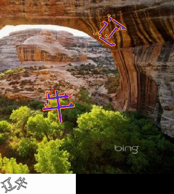
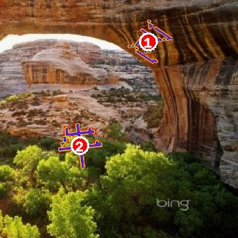
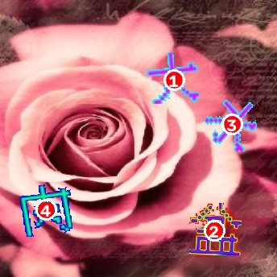

# 哔哩哔哩 B站 · 文字点选（text-click）

> 344×384 图（上 344×344 背景 + 下 344×40 提示条），按提示文字顺序点击 2–4 个字符；YOLO 字符检测 + Siamese 相似度匹配 + 贪心唯一分配。该题型来自极验 v3，B站现已不再下发。
>
> 返回：[B站索引](../../../docs/bilibili.md) · [全量类型](../../../docs/types.md) · [方法论](../../../docs/00-methodology.md)

## 一、速览

| 项 | 值 |
|---|---|
| 厂商 | 哔哩哔哩 B站（`bilibili`） |
| 类型 / 变体 | `text-click` / geetest-v3/word |
| 中文 | 文字点选 |
| 媒体 | 图片 |
| 样本 | 6 组（001–006） |
| 答案格式 | `points`：2–4 个有序点击坐标 |
| 方法 | `CV`（YOLO 字符检测 + Siamese 匹配） |
| 求解器 | `exists` · 高（源记录 6/6 离线输出，未线上验证） |
| 人工审查 | 6 通过 / 0 错误（截至 2026-11-21） |
| 证据等级 | `offline` 6 组（元数据值为 `offline`，无线上提交） |

## 二、题面与判定

题面上方是合成背景，下方是提示文字条。用户按提示文字的顺序，在上方背景中依次点击对应字符；顺序错误不通过。这是 B站 2026-07 采集的极验 v3 `word` 历史样本，当前已无法复采。

| 案例 | 题面（`meta.prompt`） | 通过条件 | 字符数 / 答案（按提示序） |
|---|---|---|---|
| [001](001/) | 按提示文字顺序，依次点击背景图中对应的字符 | 按提示文字顺序点击对应字符；顺序错误不通过 | 2 字：1:(214,60); 2:(115,210) |
| [002](002/) | 同上 | 同上 | 4 字：1:(216,99); 2:(266,286); 3:(288,154); 4:(57,260) |
| [003](003/) | 同上 | 同上 | 3 字：1:(242,196); 2:(271,266); 3:(137,114) |

> 答案空间是「提示文字的一种排列」：提示条给出 2–4 个字符，背景中每个字符对应一个位置，点击顺序由提示条决定。

## 三、样本长什么样

| 提示文字条 | 原始题面 | 求解结果 |
|---|---|---|
|  |  |  |
|  |  |  |

- 第 1 列是底部提示条（要点的字及其顺序）；第 2 列是完整题面，字符散落在背景中；第 3 列是求解器输出的点击位置。
- 坐标参考系是上方 344×344 的背景区；`answer.txt` 里统一标 `unit: px (344x344)`。

## 四、形态与难点

- **图幅固定**：344×384 整图 = 344×344 背景 + 344×40 提示条。
- **字符数不固定**：6 组中 2 字 2 组、3 字 3 组、4 字 1 组；答案长度随提示条变化。
- **字形匹配**：求解器不做像素比对，而是用 Siamese 计算提示字与背景字符框的字形相似度（`pre_model_v7.onnx`）。
- **题型已停发**：2026-11-21 复测，B站 v3 配置接口仍返回 `gt/challenge`，但 `/get.php` 不再下发 `pic/pic_type`，文字点选无法从 B站复采；这 6 组是历史样本。
- **无线上验证**：6 组只有离线输出，服务端是否接受未实测。

## 五、求解思路

先用 YOLO 把背景中的字符框全部检测出来，再用 Siamese 网络计算「每个提示字 × 每个字符框」的相似度，最后做贪心唯一分配：每个提示字占一个不同的框，按提示顺序输出框中心。

| 步骤 | 做法 | 关键判据 / 参数 |
|---|---|---|
| 1 读提示 | 从提示条取字符序列与顺序 | 2–4 个字 |
| 2 字符检测 | YOLO `best_v3.onnx` 检测背景字符框 | 输出全部候选框 |
| 3 相似度 | Siamese `pre_model_v7.onnx` 计算提示字与候选框的字形相似度 | 得到「提示字 × 候选框」矩阵 |
| 4 唯一分配 | 贪心取最大相似度，每个提示字分配一个不同候选框 | 不允许一个框被点两次 |
| 5 输出 | 按提示顺序点击各框中心 | 6/6 离线输出 |

```text
# 文字点选：YOLO 检测 → Siamese 相似度 → 贪心唯一分配（伪代码，对应源方案）

chars = prompt_chars(text_prompt)          # 提示条字符，按顺序
boxes = yolo(best_v3, bg)                  # 字符候选框
S[i][j] = siamese(pre_model_v7, chars[i], crop(boxes[j]))

assign = greedy_unique_max(S)              # 每个提示字一个不同框
click([center(boxes[assign[i]]) for i in order(chars)])
```

> 6 组的匹配分大多在 0.94–0.95；002 的第 1 个提示字只有 0.1909，是全部结果里唯一的异常低分，源记录没有解释原因。

## 六、结果与审查

- **源记录**：6/6 离线输出，未线上验证（`meta.solver.notes`）。
- **本库结果**：6 组 `answer.txt` / `result.json` / `solve_result.jpg` / `text_prompt.png` 齐全；`evidence` 统一为 `offline`（不是 `offline-verified`），没有任何线上提交记录。
- **人工审查**：6 组 `review.state=pass`、`result=correct`（2026-11-21 复核）；核对的是离线点击位置与提示顺序，不等同线上通过率。

| 组 | 字符数 | 点击坐标（提示序） | 最低匹配分 | 审查 |
|---|---:|---|---:|---|
| [001](001/) | 2 | (214,60); (115,210) | 0.9497 | 通过 |
| [002](002/) | 4 | (216,99); (266,286); (288,154); (57,260) | 0.1909 | 通过 |
| [003](003/) | 3 | (242,196); (271,266); (137,114) | 0.9458 | 通过 |
| [004](004/) | 2 | (107,87); (36,73) | 0.9484 | 通过 |
| [005](005/) | 3 | (114,127); (157,233); (228,216) | 0.9480 | 通过 |
| [006](006/) | 3 | (229,161); (161,91); (214,286) | 0.8020 | 通过 |

## 七、失败与边界

| 现象 | 根因 | 证据 | 结论 |
|---|---|---|---|
| 题型已无法复采 | B站切到极验 v4 `icon` | 2026-11-21 复测：`/get.php` 不再下发 `pic/pic_type` | 6 组仅作历史样本，不能扩充 |
| 002 首字匹配分只有 0.1909 | meta 未记录原因；该点显著低于其余匹配 | `result.json` 中该点分数 0.1909，其余点 0.94+ | 低分点仍被贪心选中，使用前应人工复核 |
| 6 组都无线上记录 | 未做提交闭环 | `evidence` 统一为 `offline` | 离线坐标正确 ≠ 服务端接受 |
| 题型与 v4 图标点选不同 | 产品线已换代 | B站当前只出 v4 `icon` | 不要把 v3 结论套到 v4 `icon-pixel` |

**适用边界**：本页只覆盖 2026-07 的历史 v3 文字点选。由于题型已停发，样本无法增加，也不能在 B站做新的闭环验证；若需要当前 B站题型，请看 [icon-click](../icon-click/)。

## 八、相关

- 厂商索引：[docs/bilibili.md](../../../docs/bilibili.md)
- 全量类型：[docs/types.md](../../../docs/types.md) · 方法论：[docs/00-methodology.md](../../../docs/00-methodology.md)
- 同站对照：[icon-click](../icon-click/)（v4 icon-pixel，当前题型）
- 同产品对照：[geetest/icon-click](../../geetest/icon-click/)（极验官方 demo 图标点选）
- 案例：[001](001/) – [006](006/)（每组含 `meta.json` / `answer.txt` / `result.json` / `bg.jpg` / `text_prompt.png` / `solve_result.jpg`）
- 来源：<https://passport.bilibili.com/login>；采集于 2026-07-03；样本版权归哔哩哔哩/极验所有，仅用于研究与教学。
