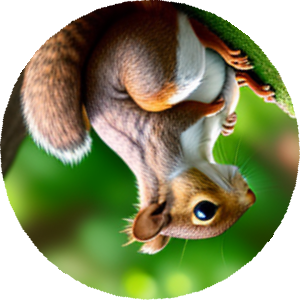
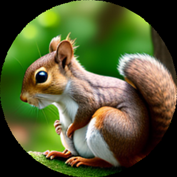
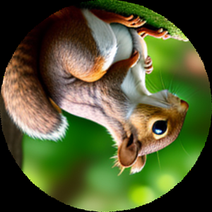
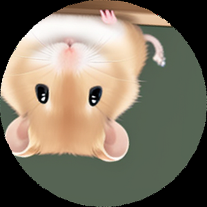
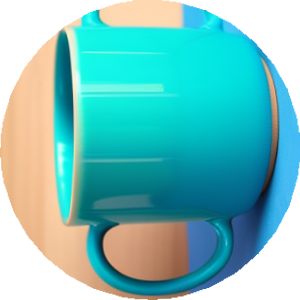

# 中国银联 · 旋转验证（rotate）

> 300×300 圆形照片被旋转到任意角度，滑块把它转回正立；源记录尝试 CV 与 VLM 两条路线都未达可用标准，12 组里只有 1 组审查通过、5 组错误、6 组仍待审。
>
> 返回：[银联索引](../../../docs/cup.md) · [全量类型](../../../docs/types.md) · [方法论](../../../docs/00-methodology.md)

## 一、速览

| 项 | 值 |
|---|---|
| 厂商 | 中国银联（`cup`） |
| 类型 / 变体 | `rotate` / classic |
| 中文 | 旋转验证 |
| 媒体 | 图片 |
| 样本 | 12 组（001–012） |
| 答案格式 | `angle` |
| 方法 | `CV+VLM`（LLM 与 CV 均未达可用标准） |
| 求解器 | `weak` · 低（源记录待优化；参考价值有限） |
| 人工审查 | 1 通过 / 5 错误 / 6 待审（按 `meta.review`，截至 2026-11-21） |
| 证据等级 | 无（没有 `answer.txt` / `result.json`；001–006 只有 `solved.png`） |

## 二、题面与判定

图片被旋转后放进 300×300 圆形遮罩，用户拖动滑块把图片转回正立方向。通过条件应是图片内容方向正确；本库没有记录具体角度答案，也没有服务端通过记录。

| 案例 | 题面 | 结果图 | 审查 |
|---|---|---|---|
| [001](001/) | 拖动滑块，将图片旋转到正确方向 | `solved.png`：松鼠回正 | 通过 |
| [002](002/) | 同上 | `solved.png`：松鼠仍侧躺 | 错误 |
| [005](005/) | 同上 | `solved.png`：仓鼠仍倒置 | 错误 |
| [010](010/) | 同上 | 无 `solved.png` | 待审 |

> 007–012 没有 `solved.png`，只有 `bg.png`；这些组不是「求解成功但未审」，而是根本没有求解输出。

## 三、样本长什么样

| 原图 001（侧躺） | 回正 001（通过） | 原图 002 |
|---|---|---|
|  |  |  |
| **回正 002（仍侧躺）** | **回正 005（仍倒置）** | **原图 010（待审）** |
|  |  |  |

- 001/002 是同一只松鼠，旋转角度不同；001 回正后松鼠头朝上，002 回正后仍侧躺。
- 005 是仓鼠，回正后仍上下颠倒；010 是马克杯，画面横躺且没有结果图。
- 圆形遮罩外是黑色；旋转后四角可能出现黑边，不能把黑边方向当作图像方向。

## 四、形态与难点

- **任意角度**：旋转范围覆盖全周，没有刻度或参考线。
- **低分辨率**：300×300 加圆形裁切，纹理细节少，方向线索弱。
- **语义方向**：动物、杯子、风景的「正立」定义不同；仓鼠倒置和正立都可能看起来自然。
- **结果不可靠**：001 通过，但 002 / 005 的回正结果仍明显倾斜；说明源方案不稳定。
- **证据不足**：没有角度文件，无法判断是「角度算错」还是「旋转方向用反」。

## 五、求解思路

源记录同时试过 CV 与 VLM，结论是两者都未达可用标准。可复述的只有失败结论，没有可验证的参数或伪代码：

| 路线 | 可能做法 | 结果 |
|---|---|---|
| CV | 估计图像主方向/边缘方向，再把主方向转到竖直 | 未达可用标准 |
| VLM | 让视觉模型判断「怎样旋转才正立」 | 未达可用标准 |

> 本页不提供伪代码：源记录没有留下可复现的角度算法、阈值或模型输出。002 / 005 的 `solved.png` 是反例，说明「看起来像回正」不能替代角度校验。

## 六、结果与审查

- **源记录**：`solver.status=weak`、`accuracy=low`，notes 写「源记录待优化；参考价值有限」。
- **本库审查**：001 通过；002–006 错误；007–012 待审（且没有 `solved.png`）。
- **产物**：001–006 有 `bg.png` + `solved.png`；007–012 只有 `bg.png`；全部没有 `answer.txt` / `result.json`。
- **结论**：这 12 组只能作为「失败样本」参考，不能当作可用求解器；审查通过率 1/12（按已审组算是 1/6）。

| 组 | `solved.png` | 审查 | 说明 |
|---|---|---|---|
| [001](001/) | 有 | 通过 | 松鼠回正 |
| [002](002/) | 有 | 错误 | 仍侧躺 |
| [003](003/) | 有 | 错误 | 回正不成立 |
| [004](004/) | 有 | 错误 | 回正不成立 |
| [005](005/) | 有 | 错误 | 仓鼠仍倒置 |
| [006](006/) | 有 | 错误 | 回正不成立 |
| [007](007/) | 无 | 待审 | 只有原图 |
| [008](008/) | 无 | 待审 | 只有原图 |
| [009](009/) | 无 | 待审 | 只有原图 |
| [010](010/) | 无 | 待审 | 只有原图 |
| [011](011/) | 无 | 待审 | 只有原图 |
| [012](012/) | 无 | 待审 | 只有原图 |

## 七、失败与边界

| 现象 | 根因 | 证据 | 结论 |
|---|---|---|---|
| 回正后仍侧躺 | 角度估计错误或旋转方向用反 | 002 `solved.png` | CV/VLM 路线都不可靠 |
| 动物倒置被当正立 | 「正立」语义判断失败 | 005 `solved.png` | 需要内容级方向判断 |
| 6 组没有结果 | 源方案未产出或未纳入 | 007–012 只有 `bg.png` | 不能算作待审成绩 |
| 没有角度文件 | 未记录 `answer.txt` / `result.json` | 12 组目录 | 无法重算误差或回放 |
| 无线上记录 | 未做提交闭环 | 无 `evidence` | 离线「看起来正」≠ 线上通过 |

**边界**：本页只记录失败现状，不提供可用解法。若后续重做，至少需要角度真值、回正前后对比和一组线上提交，才能把 `weak` 改掉。

## 八、相关

- 厂商索引：[docs/cup.md](../../../docs/cup.md)
- 全量类型：[docs/types.md](../../../docs/types.md) · 方法论：[docs/00-methodology.md](../../../docs/00-methodology.md)
- 同厂商对照：[slide](../slide/)（有源求解器）、[click](../click/)（无求解器）、[scene-click](../scene-click/)（VLM 场景点选）
- 跨厂商对照：[企讯通 angle](../../qingtongbu/angle/)（有双模型对比）、[企讯通 rotate](../../qingtongbu/rotate/)（无求解器）
- 案例：[001](001/) – [012](012/)（001–006 有 `solved.png`；全部只有 `bg.png` + `meta.json`）
- 来源：<https://captcha.cup.com.cn/>；样本版权归中国银联所有，仅用于研究与教学。
