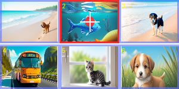
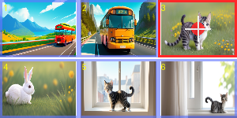
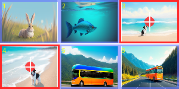

# 中国银联 · 场景语义点选（scene-click）

> 300×150 画布排成 3×2 六张 AI 场景图，题面是一句中文场景描述（如「鱼在水中」）；用户要点中所有符合描述的图片。源记录有 LLM 求解器但已搁置，本库只有 `annotated.png` 标注，没有结果文件。
>
> 返回：[银联索引](../../../docs/cup.md) · [全量类型](../../../docs/types.md) · [方法论](../../../docs/00-methodology.md)

## 一、速览

| 项 | 值 |
|---|---|
| 厂商 | 中国银联（`cup`） |
| 类型 / 变体 | `scene-click` / classic |
| 中文 | 场景语义点选 |
| 媒体 | 图片 |
| 样本 | 12 组（001–012） |
| 答案格式 | `points`：命中面板的点击点 |
| 方法 | `VLM`（视觉 LLM 场景语义判断） |
| 求解器 | `exists` · 高（源记录；但结果未纳入，notes 写「源记录已搁置」） |
| 人工审查 | 12 通过 / 0 错误（按 `meta.review`，审的是标注） |
| 证据等级 | 无（没有求解结果文件，只有 `annotated.png`） |

## 二、题面与判定

一次挑战由 6 张独立场景图（3 列 × 2 行）和一句中文描述组成。用户需要点击**所有**符合描述的图片；漏选或误选都不通过。命中的面板数量不固定，可能只有 1 张，也可能有 2 张。

| 题面族 | `meta.prompt` | 案例 | 通过条件 |
|---|---|---|---|
| 鱼在水中 | 请点击所有鱼在水中的图片 | 001、007 | 全部选中，漏选/误选不通过 |
| 小猫在草地 | 请点击所有小猫在草地的图片 | 002、005、012 | 同上 |
| 兔子在草地 | 请点击所有兔子在草地的图片 | 003 | 同上 |
| 鸟在天上飞 | 请点击所有鸟在天上飞的图片 | 004、008、011 | 同上 |
| 公交车在马路上 | 请点击所有公交车在马路上的图片 | 006 | 同上 |
| 小猫在窗边 | 请点击所有小猫在窗边的图片 | 009 | 同上 |
| 小狗在海边 | 请点击所有小狗在海边的图片 | 010 | 同上 |

> `meta.pass_criteria` 原文：「点击所有符合场景描述的图片；漏选或误选均不通过。」7 个题面族覆盖动物、交通工具与场景关系，不是固定类别表。

## 三、样本长什么样

| 背景 001（鱼在水中） | 标注 001 | 背景 002（小猫在草地） |
|---|---|---|
|  |  |  |
| **标注 002** | **背景 010（小狗在海边）** | **标注 010（命中 2 张）** |
|  |  |  |

- 画布 300×150，六张图等分排布；每格左上角有 1–6 的白色编号，方便定位。
- 命中面板用红框 + 红色十字准星标出；001 只命中第 2 格，002 只命中第 3 格，010 同时命中第 3、4 格。
- 图像是 AI 生成的场景，细节可能有伪影；题面语义与画面主体通常很直接，但「所有」要求遍历全部 6 格。

## 四、形态与难点

- **全遍历**：必须逐格判断，不能找到第一张就停；010 说明可能有多张命中。
- **开放语义**：描述包含「水中」「草地」「天上飞」「马路上」「窗边」「海边」等关系，模型要同时识别主体与场景。
- **AI 图伪影**：动物肢体、车辆透视可能不自然，细看反而干扰判断，应以整体场景关系为主。
- **同题复采**：小猫在草地有 3 组、鸟在天上飞 3 组，图不同但语义相同，可用于观察同一 prompt 下的分布。
- **无结果文件**：`annotated.png` 是标注，不是求解器输出；无法从它计算模型准确率。

## 五、求解思路

源记录路线是「VLM 逐格判断 + 汇总所有 yes」：把 6 个面板分别与题面一起发给视觉模型，要求输出 yes/no，再点击所有 yes 面板的中心。这个路线与本库其他 VLM 类型一致，成本低、无需训练。

| 步骤 | 做法 | 说明 |
|---|---|---|
| 1 切格 | 按 3×2 等分裁切，保留格子编号 | 300×150 → 6 个约 100×75 面板 |
| 2 逐格判断 | 对每格问「题面 + 这张图是否匹配？yes/no」 | 固定输出格式，temperature=0 |
| 3 汇总 | 收集所有 yes，漏选/误选都算错 | 必须遍历 6 格 |
| 4 点击 | 取命中面板中心或语义主体中心 | 与 `points` 对齐 |

```text
# 场景语义点选（建议伪代码，源求解器未纳入）
panels = split_grid(bg, rows=2, cols=3)
selected = []
for i, panel in enumerate(panels, start=1):
    verdict = vlm(prompt + " 这张图是否符合？yes/no", image=panel, temperature=0)
    if verdict == "yes":
        selected.append(i)
answer = [center_of(panels[i-1]) for i in selected]
```

> 源记录称有 LLM 求解器且准确率高，但该结果没有进入本库；上述伪代码是按题面与现有标注重建的起步路线，不是对源求解器的复刻。

## 六、结果与审查

- **源记录**：`solver.status=exists`、`accuracy=high`，notes 写「源 LLM 求解器；待审」，另一条 notes 写「源记录已搁置」；没有 `answer.txt` / `result.json`。
- **本库审查**：12 组 `review.state=pass`、`result=correct`；审查的是 `annotated.png` 中的红框/准星是否覆盖所有命中面板。
- **题面分布**：7 个题面族，最多的是小猫在草地（3 组）和鸟在天上飞（3 组），其余各 1–2 组；不能把 12 组当成 12 个独立语义类别。
- **命中数**：并非每题只有 1 张；010 命中第 3、4 格两张海边小狗，说明「所有」是实质要求。

| 组 | 题面族 | 审查 | 命中面板（按标注） |
|---|---|---|---|
| [001](001/) | 鱼在水中 | 通过 | 第 2 格 |
| [002](002/) | 小猫在草地 | 通过 | 第 3 格 |
| [003](003/) | 兔子在草地 | 通过 | 标注覆盖命中格 |
| [004](004/) | 鸟在天上飞 | 通过 | 第 5 格 |
| [005](005/) | 小猫在草地 | 通过 | 标注覆盖命中格 |
| [006](006/) | 公交车在马路上 | 通过 | 标注覆盖命中格 |
| [007](007/) | 鱼在水中 | 通过 | 标注覆盖命中格 |
| [008](008/) | 鸟在天上飞 | 通过 | 第 3 格 |
| [009](009/) | 小猫在窗边 | 通过 | 标注覆盖命中格 |
| [010](010/) | 小狗在海边 | 通过 | 第 3、4 格 |
| [011](011/) | 鸟在天上飞 | 通过 | 标注覆盖命中格 |
| [012](012/) | 小猫在草地 | 通过 | 第 3 格 |

> 表中只列了核对过的命中格；其余组的标注命中格未逐一记录，避免把「有红框」误写成具体编号。

## 七、失败与边界

| 现象 | 根因 | 证据 | 结论 |
|---|---|---|---|
| 只点一张就提交 | 题面要求「所有」，可能命中多张 | 010 的第 3、4 格都命中 | 必须遍历 6 格 |
| 语义关系错判 | 「水中/草地/窗边/海边」是场景关系，不是单物体检测 | 7 个题面族 | 用 VLM 读关系，不用固定类别表 |
| AI 图伪影干扰 | 动物肢体、车辆结构不自然 | AI 生成场景 | 以整体场景为主，不抠细节 |
| 标注不等于求解结果 | 只有 `annotated.png`，没有 `answer/result` | 12 组目录 | 12 通过不是求解器准确率 |
| 源求解器已搁置 | notes 明确写「源记录已搁置」 | `meta.notes` | 不要写成可复用的高准确率方案 |

**边界**：本页覆盖「逐格语义判断 + 全选点击」，不覆盖源求解器实现与提交链路。12 组审查通过只说明标注可用；没有模型输出，也没有线上通过记录。

## 八、相关

- 厂商索引：[docs/cup.md](../../../docs/cup.md)
- 全量类型：[docs/types.md](../../../docs/types.md) · 方法论：[docs/00-methodology.md](../../../docs/00-methodology.md)
- 同厂商对照：[click](../click/)（文字点选，无求解器）、[slide](../slide/)（有源求解器）、[rotate](../rotate/)（弱求解器）
- 跨厂商对照：[hCaptcha binary](../../hcaptcha/binary/)（九宫格语义二分类）
- 案例：[001](001/) – [012](012/)（每组含 `meta.json`、`bg.png`、`annotated.png`）
- 来源：<https://captcha.cup.com.cn/>；样本版权归中国银联所有，仅用于研究与教学。
