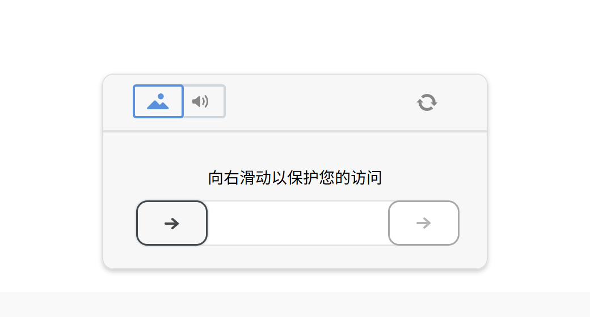
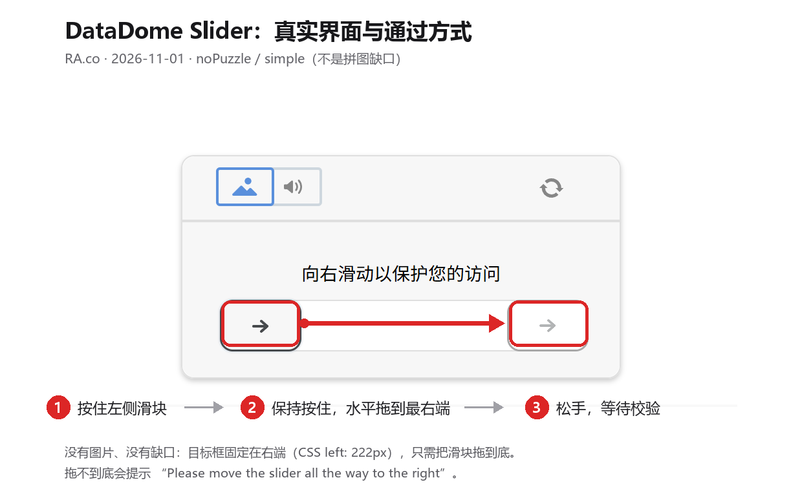

# DataDome · 滑动验证（slide）

> 实际是 `noPuzzle` 的「向右滑到底」验证：没有背景图、没有拼图缺口，目标框固定在轨道右端；本库只有 1 组样本，源记录仅有机制说明、无提交闭环。
>
> 返回：[DataDome 索引](../../../docs/datadome.md) · [全量类型](../../../docs/types.md) · [方法论](../../../docs/00-methodology.md)

## 一、速览

| 项 | 值 |
|---|---|
| 厂商 | DataDome（`datadome`） |
| 类型 / 变体 | `slide` / simple/noPuzzle |
| 中文 | 滑动验证（无图滑块） |
| 媒体 | 图片 |
| 样本 | 1 组（001） |
| 答案格式 | `offset-x`：水平位移 |
| 方法 | `NONE(CV)`（未撰写；建议 CV 滑块定位） |
| 求解器 | `none` · 未知 |
| 人工审查 | `not-applicable`（1/1，无求解结果可审） |
| 证据等级 | `sample-only`（只有界面截图与说明图） |

## 二、题面与判定

`meta.prompt` 写「拖动滑块，将拼图块补入缺口」，但样本实际是无图滑块：卡片里只有一句「向右滑动以保护您的访问」、一条轨道和左右两个箭头框，没有背景图或缺口。通过条件是**把滑块拖到轨道最右端**；未拖到底会提示 `Please move the slider all the way to the right`（见 `aux` 说明图）。案例没有记录 `pass_criteria`。

| 案例 | 题面（`meta.prompt`） | 实际界面 | 通过条件 |
|---|---|---|---|
| [001](001/) | 拖动滑块，将拼图块补入缺口 | 无图 noPuzzle：向左/右箭头框 + 轨道 + 刷新按钮 | 该批案例未记录；源图说明为「把滑块拖到底」 |

> **口径提醒**：类型名 `slide` 与 `meta.prompt` 的「拼图块/缺口」描述不适用于这组样本；`variant=simple/noPuzzle` 与 `aux` 上的 `noPuzzle / simple（不是拼图缺口）` 才是实际形态。不要把它当极验式缺口滑块。

## 三、样本长什么样

| 真实界面（`bg`） | 机制说明（`aux`） |
|---|---|
|  |  |

- `bg.png` 是 1040×560 的挑战卡片：顶部有图片/音量两个图标与刷新按钮，中部是「向右滑动以保护您的访问」，底部是左箭头滑块和右箭头目标框。
- `aux-01.png` 是 1240×760 的说明图，标题为「DataDome Slider: 真实界面与通过方式」，标注了三步：按住左侧滑块 → 保持按住水平拖到最右端 → 松手等待校验；并写明目标框固定在右端（CSS `left: 222px`）、拖不到底会提示 `Please move the slider all the way to the right`。
- 两张图都没有背景照片、拼图块或缺口；`aux` 是人工说明图，不是服务端下发的题目素材。

## 四、形态与难点

- **无图**：没有可匹配的背景与缺口，传统「找缺口 x 坐标」的 CV 路线不适用。
- **目标固定**：`aux` 说明目标框固定在轨道右端，滑块的终点就是轨道末端；难点不在定位，而在交互是否被接受。
- **行为校验**：说明图强调「保持按住、水平拖到最右端、松手等待」，说明服务端会看拖拽过程，而不是只看最终 offset。
- **单样本**：只有 1 组，无法覆盖不同布局、不同轨道长度或不同语言文案；CSS `left: 222px` 只是这张图的说明值，不能当通用常量。
- **无提交闭环**：`meta.solver.notes` 写「仅有机制说明，无提交闭环」，没有任何通过/失败结果。

## 五、建议路线（未实现）

| 步骤 | 建议做法 | 说明 |
|---|---|---|
| 1 识别形态 | 先判断是 `noPuzzle` 还是带图缺口滑块 | 本组没有图片/缺口，直接套缺口检测会失败 |
| 2 定位轨道 | 用 CV 找轨道左右端点与滑块/目标框 | 目标框固定在右端；可用边框/箭头做模板 |
| 3 计算位移 | `offset-x = 目标框中心 - 滑块中心`，本组约为整条轨道长度 | `aux` 记录的 CSS `left: 222px` 只作参考，不写死 |
| 4 生成拖拽 | 按住滑块、水平移动到右端、松手，轨迹保持人类化 | 说明图要求「保持按住、拖到底」；轨迹参数源记录未展开 |
| 5 处理失败 | 若提示 `Please move the slider all the way to the right`，说明未到端点，应重拖 | 该提示来自 `aux` 说明图 |
| 6 提交闭环 | 记录松手后的响应、Cookie 与会话状态 | 本库未实现；没有闭环就不能评价通过率 |

> 这类题的图像部分很浅，真正的门槛是交互轨迹与风控；`NONE(CV)` 只是说「可以用 CV 找轨道」，不代表 CV 能找到通过条件。

## 六、为什么没有结果

- 只有 1 组样本，`status=sample-only`；没有 `answer.txt` / `result.json`。
- `meta.solver` 为 `none`，备注「仅有机制说明，无提交闭环」；源记录没有给出任何成功次数或准确率。
- `aux` 是人工说明图，不是服务端判定结果；它只能证明界面形态与通过方式，不能证明某次拖拽被接受。
- 因此本页只写形态与建议路线，不写准确率。

## 七、边界

- **不是缺口拼图**：没有背景图、没有拼图块；不要用极验/易盾的缺口定位方案硬套。
- **不要写死 `left: 222px`**：这是说明图记录的单个布局值，换页面/换语言/换分辨率都可能变。
- **不要只算 offset**：拖拽轨迹、按住时长、释放位置都可能参与判定；静态截图无法覆盖。
- **单样本不外推**：1 组不能代表 DataDome 的全部滑块形态；源目录同时有 `simple/noPuzzle` 变体名，说明还有其他分支。
- **审查口径**：`review=not-applicable` 表示没有求解结果可审，不是「已验证通过」。

## 八、相关

- 厂商索引：[docs/datadome.md](../../../docs/datadome.md)
- 全量类型：[docs/types.md](../../../docs/types.md) · 方法论：[docs/00-methodology.md](../../../docs/00-methodology.md)
- 同厂商对照：[audio](../audio/)（音频听写，源方案 20/20）
- 案例：[001](001/)（`sample-only`，`bg` + `aux`）
- 来源：<https://www.klook.com/>；样本版权归 DataDome 所有，仅用于研究与教学。
