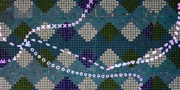
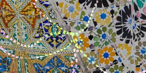
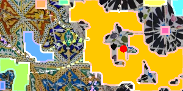
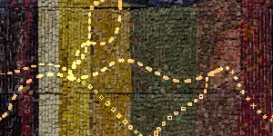
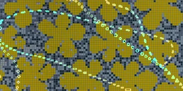

# 顶象 · 面积验证（area）

> 300×150 的马赛克拼贴图上分布着若干色块，题面要求点击面积符合指定值的区域；源记录用 K-Means 聚类加 Watershed 分水岭切出连通区域，再按面积选目标。
>
> 返回：[顶象索引](../../../docs/dingxiang.md) · [全量类型](../../../docs/types.md) · [方法论](../../../docs/00-methodology.md)

## 一、速览

| 项 | 值 |
|---|---|
| 厂商 | 顶象（`dingxiang`） |
| 类型 / 变体 | `area` / classic |
| 中文 | 面积验证 |
| 媒体 | 图片 |
| 样本 | 12 组（001–012） |
| 答案格式 | `points`：目标区域内的一个点 |
| 方法 | `CV`（K-Means + Watershed；无 LLM） |
| 求解器 | `exists` · 高（源记录“已攻克”，未展开） |
| 人工审查 | 12 条 `pass` / 0 错误（2026-11-15） |
| 证据等级 | 未标注（`meta.evidence` 缺失；无 `answer.txt` / `result.json`） |

## 二、题面与判定

12 组题面完全一致：“点击指定面积的区域”。题面只给出“面积”这一约束，颜色和位置都不固定；答案空间是目标区域内任意一点。

| 案例 | 题面（`meta.prompt`） | 通过条件 | 答案 |
|---|---|---|---|
| [001](001/) | 点击指定面积的区域 | 该批案例未记录通过条件 | 目标色块内一点 |
| [006](006/) | 点击指定面积的区域 | 该批案例未记录通过条件 | 目标色块内一点 |
| [012](012/) | 点击指定面积的区域 | 该批案例未记录通过条件 | 目标色块内一点 |

> `meta.pass_criteria` 在本类型 12 组中均缺失，不能从题面反推容差；`answer_format=points` 只说明答案形状，具体坐标没有落盘。

## 三、样本长什么样

| 原始题面 | 分割与答案 | 原始题面 | 分割与答案 |
|---|---|---|---|
|  |  |  |  |
|  |  |  |  |

- 左列是原始题面：马赛克/拼贴纹理，颜色相近、边界呈阶梯状，肉眼很难直接比较面积。
- 右列是分割可视化：每个连通区域被涂成一种平色，红点落在被选中的区域内；它不是原始界面截图，而是求解过程图。
- 001 的目标是上方大片橙色区域，002/006 的目标也是大块区域，012 则是被浅色环带包围的橙色区域；四组都说明“面积”是区域属性，不是某个固定颜色。

## 四、形态与难点

- **图幅固定、纹理碎**：300×150，边界由马赛克像素构成，直接按颜色阈值会把同一区域切碎。
- **相邻区域颜色接近**：拼贴纹理里存在同色系小块，K-Means 需要足够的簇数，Watershed 负责把接触区域分开。
- **目标是面积而非颜色**：同一颜色可能出现多次，不能按颜色直接点；必须比较分割后的区域面积。
- **区域形状不规则**：有弧边、窄颈和孔洞，面积计算要在闭合轮廓内完成。
- **题面信息少**：指定面积的具体数值没有记录在 `meta`，只能确认“按面积选一个区域”这一层。

## 五、求解思路

源记录只有一句方法摘要“K-Means + Watershed；无 LLM”，下面按这句话展开可验证的步骤，不补源记录没有的参数。

| 步骤 | 做法 | 关键判据 / 参数 | 依据 |
|---|---|---|---|
| 1 颜色聚类 | 在颜色空间做 K-Means，把相近颜色归并为候选区域 | 簇数需覆盖图中主要色块；源记录未给具体 K 与色彩空间 | `method_note` |
| 2 分水岭切分 | 对聚类结果做 Watershed，切断颜色相近但实际相邻的区域 | 以局部极小/标记点为种子 | `method_note` |
| 3 区域度量 | 统计每个连通区域的像素面积、轮廓与外接框 | 面积按像素计，窄颈处需保持连通 | `answer_format=points` |
| 4 面积匹配 | 把区域面积与题面给定值比较，选最接近的一个 | 容差未记录 | `prompt` + 源记录“已攻克” |
| 5 输出点位 | 取目标区域内一点（通常为质心或内点）作为答案 | 点必须落在区域内 | `answer_format=points` |

> 本类型属于 B 档：源记录只有方法名和“已攻克”，没有阈值、簇数或逐组坐标，因此不写伪代码，也不把 K-Means/Watershed 的常规参数当成源记录事实。

## 六、结果与审查

- **源记录**：求解器 `exists`、准确率 `high`，备注“源记录已攻克；待审”；没有给出 12 组的逐组结果。
- **本库结果**：12 组只有 `bg.webp` + `solved.png`，没有 `answer.txt` / `result.json`；`notes` 明确写“结果未纳入”。
- **人工审查**：12 组 `review.state=pass`、`result=correct`，审查日期 2026-11-15；审查针对的是标注图，不是可复算的坐标文件。

| 组 | 图幅 | 结果文件 | 审查 |
|---|---|---|---|
| [001](001/) – [012](012/) | 300×150 | 无 `answer.txt` / `result.json`，仅 `solved.png` | 12/12 `pass` |

> 这里存在口径冲突：`solver.status=exists`、`accuracy=high` 与 `notes` 的“结果未纳入”、`status=sample-only` 同时出现。本页按“有源记录、但本库没有可复算结果”处理，不把 `high` 当成已复核准确率。

## 七、失败与边界

| 现象 | 根因 | 证据 | 结论 |
|---|---|---|---|
| 同色区域被合并 | K-Means 只看颜色，不看空间连通性 | 方法必须再接 Watershed | 聚类与切分不能省任一步 |
| 窄颈处区域断裂 | 分水岭对细连接敏感 | 区域形状不规则，存在窄颈 | 面积统计前要检查连通性 |
| 无法复核具体点位 | 没有 `answer.txt` / `result.json` | 12 组均只有 `solved.png` | 只能确认“有解”，不能复算 12/12 |
| 题面面积值缺失 | `meta` 未记录指定面积 | 12 组 `prompt` 只有一句通用描述 | 不能反推容差或目标大小 |
| 源记录与本库口径不一致 | `notes` 说结果未纳入，`solver` 说已攻克 | 同一份 `meta.json` 内并存 | 引用准确率时必须标“源记录” |

**边界**：本页只覆盖“分割区域、按面积选点”的离线思路；没有点击时序、容差和线上判定记录，也没有逐组面积值。

## 八、相关

- 厂商索引：[docs/dingxiang.md](../../../docs/dingxiang.md)
- 全量类型：[docs/types.md](../../../docs/types.md) · 方法论：[docs/00-methodology.md](../../../docs/00-methodology.md)
- 同厂商对照：[diff-click](../diff-click/)（差异定位）、[font](../font/)（字体识别）
- 案例：[001](001/) – [012](012/)（每组含 `meta.json`、`bg.webp`、`solved.png`）
- 来源：<https://www.dingxiang-inc.com/business/captcha>；样本版权归顶象所有，仅用于研究与教学。
