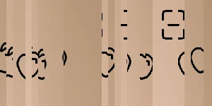
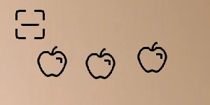
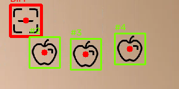
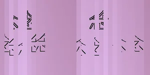
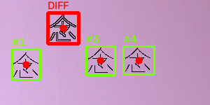
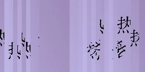
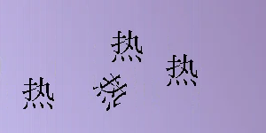
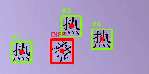

# 顶象 · 差异点击（diff-click）

> 300×150 画面里重复出现 4 个相同墨迹图形，其中 1 个被旋转、镜像或替换；先还原条带背景，再用 Canny 墨迹掩膜做平移对齐 IoU，最低的那个就是差异。
>
> 返回：[顶象索引](../../../docs/dingxiang.md) · [全量类型](../../../docs/types.md) · [方法论](../../../docs/00-methodology.md)

## 一、速览

| 项 | 值 |
|---|---|
| 厂商 | 顶象（`dingxiang`） |
| 类型 / 变体 | `diff-click` / classic |
| 中文 | 差异点击 |
| 媒体 | 图片 |
| 样本 | 12 组（001–012） |
| 答案格式 | `points`：差异图形上的一个点 |
| 方法 | `CV`（Canny + 墨迹掩膜平移对齐 IoU 离群；无 LLM） |
| 求解器 | `exists` · 高（源记录 12/12 墨迹 IoU 校验） |
| 人工审查 | 12 条 `pass` / 0 错误（2026-11-19） |
| 证据等级 | 未标注（`meta.evidence` 缺失；无 `answer.txt` / `result.json`） |

## 二、题面与判定

题面固定为“找出并点击差异位置”。每张图有 4 个同源墨迹图形，其中 1 个与其余 3 个不同；答案空间是差异图形上的任意一点，不是差异像素的包围框。

| 案例 | 题面（`meta.prompt`） | 通过条件 | 差异类型 |
|---|---|---|---|
| [001](001/) | 找出并点击差异位置 | 该批案例未记录通过条件 | 3 个苹果 + 1 个方格图标 |
| [003](003/) | 找出并点击差异位置 | 该批案例未记录通过条件 | 3 个正置“离” + 1 个旋转“离” |
| [009](009/) | 找出并点击差异位置 | 该批案例未记录通过条件 | 3 个正置“热” + 1 个旋转“热” |

> 12 组没有 `pass_criteria`，点偏多少算错、是否接受图形边缘都不明确；只能确认“点中差异图形”这一层。

## 三、样本长什么样

| 原始题面 | 还原图 | 候选与答案 |
|---|---|---|
|  |  |  |
|  | — |  |
|  |  |  |

- 第 1 列是带竖向条带错位的原始题面；第 2 列是还原后的干净墨迹图；第 3 列用绿色框标候选、红色框标最终差异（标签写着 `DIFF`）。
- 001 的差异是“方格图标”混在 3 个苹果里；009 的差异是旋转了约 45° 的“热”，其余 3 个正置；003 同样是旋转“离”。
- 008 的 `solved.png` 在 git 工作区中被单独修改过，是 12 组里唯一有修正痕迹的标注图。

## 四、形态与难点

- **图幅与图形数固定**：300×150，4 个同源图形；差异可能来自旋转、镜像、局部缺失或整体替换。
- **原始图被条带打乱**：不还原就直接比对，条带边缘会产生大量伪差异。
- **墨迹是线稿**：Canny 边缘细、断点多，掩膜要先闭合再做对齐。
- **只允许平移对齐**：源记录用平移对齐 IoU；旋转差异正是靠“对齐后 IoU 仍然低”暴露出来。
- **分离度未落盘**：源记录只说 12/12 IoU 校验通过，没有逐组分离度；低分组可能只比正常图形低一点。

## 五、求解思路

源记录的方法链是“Canny + 墨迹掩膜对齐 IoU 离群”，即先得到每个图形的墨迹掩膜，再两两平移对齐算 IoU，最后取平均 IoU 最低的那个作为离群点。

| 步骤 | 做法 | 关键判据 / 参数 | 依据 |
|---|---|---|---|
| 1 背景还原 | 按条带错位量拼回 300×150 干净图 | 条带接缝连续 | `roles.restored` + `restored.png` |
| 2 墨迹掩膜 | Canny 提取线稿边缘，闭合后得到每个图形的墨迹区域 | 每个图形一个掩膜，共 4 个 | `method_note` |
| 3 平移对齐 | 以图形质心/外接框对齐，逐对计算 IoU | 只做平移，不做旋转归一化 | `method_note`“对齐 IoU” |
| 4 离群判定 | 每个图形对其余 3 个求平均 IoU，取最低者 | 源记录 12/12 IoU 校验 | `solver.notes` |
| 5 输出点位 | 取离群图形内部一点 | 点落在差异图形上 | `answer_format=points` |

> 源记录只给“12/12 墨迹 IoU 校验”，没有逐组 IoU 或分离度；本库无法复算阈值。

## 六、结果与审查

- **源记录**：12/12 墨迹 IoU 校验通过；求解器 `exists`、`high`。没有逐组 IoU 值落盘。
- **本库结果**：12 组只有 `bg.webp` / `restored.png` / `solved.png`，没有 `answer.txt` / `result.json`；`notes` 写“结果未纳入”。
- **人工审查**：12 组 `review.state=pass`、`result=correct`，审查日期 2026-11-19；008 的 `solved.png` 有修正记录。

| 组 | 文件 | 审查 | 备注 |
|---|---|---|---|
| [001](001/) – [007](007/) | `bg` + `restored` + `solved` | `pass` | 无逐组坐标 |
| [008](008/) | `bg` + `restored` + `solved` | `pass` | `solved.png` 工作区修正过 |
| [009](009/) – [012](012/) | `bg` + `restored` + `solved` | `pass` | 无逐组坐标 |

> 12/12 是源记录的 IoU 校验结论，不是本库重新跑出来的；本库没有保存 12 组的差异坐标，无法复算。

## 七、失败与边界

| 现象 | 根因 | 证据 | 结论 |
|---|---|---|---|
| 条带边缘被当成差异 | 原始图有竖向错位 | `roles.restored` 表明必须先还原 | 还原是前置步骤，不能直接 Canny |
| 旋转差异被平移对齐漏掉 | 只做平移，旋转后墨迹不重合 | 003/009 的差异就是旋转字形 | 平移 IoU 低正是判据，不要先做旋转归一化 |
| 低分离度误选 | 正常图形之间也有笔画差异，平均 IoU 接近 | 源记录未给分离度，本库无逐组 IoU | 低分样本需人工复核 |
| 008 曾修正 | 旧标注与修正后答案不一致 | git 工作区仅 008 的 `solved.png` 被修改 | 以当前 `solved.png` 为准，旧图不可引用 |
| 无法复核点位 | 没有 `answer.txt` / `result.json` | 12 组均无结果文件 | 只能确认“有解”，不能复算 12/12 |

**边界**：本页只覆盖“4 个图形找 1 个差异”的离线判定；没有点击容差、提交记录或线上通过率，也没有逐组 IoU。

## 八、相关

- 厂商索引：[docs/dingxiang.md](../../../docs/dingxiang.md)
- 全量类型：[docs/types.md](../../../docs/types.md) · 方法论：[docs/00-methodology.md](../../../docs/00-methodology.md)
- 同厂商对照：[font](../font/)（8 张字卡找目标字体）、[area](../area/)（按面积选区域）
- 案例：[001](001/) – [012](012/)（每组含 `meta.json`、`bg.webp`、`restored.png`、`solved.png`）
- 来源：<https://www.dingxiang-inc.com/business/captcha>；样本版权归顶象所有，仅用于研究与教学。
