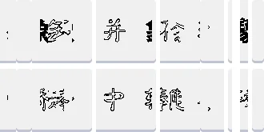
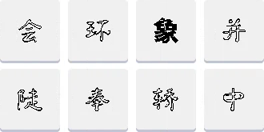
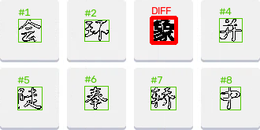
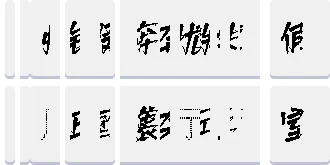
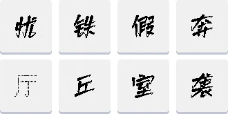
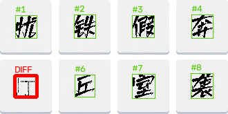

# 顶象 · 字体识别（font）

> 330×165 画面排成 4×2 共 8 张字卡，每张是一个汉字、一种书法风格；题面要求点击指定字体的那张，源记录用风格特征加稳健离群挑出目标。
>
> 返回：[顶象索引](../../../docs/dingxiang.md) · [全量类型](../../../docs/types.md) · [方法论](../../../docs/00-methodology.md)

## 一、速览

| 项 | 值 |
|---|---|
| 厂商 | 顶象（`dingxiang`） |
| 类型 / 变体 | `font` / classic |
| 中文 | 字体识别 |
| 媒体 | 图片 |
| 样本 | 12 组（001–012） |
| 答案格式 | `points/text`：目标字卡的位置/文字 |
| 方法 | `CV`（风格特征 + 稳健离群；无 LLM） |
| 求解器 | `exists` · 高（类型表称已攻克；`meta.notes` 又称未撰写） |
| 人工审查 | 12 条 `pass` / 0 错误（2026-11-15） |
| 证据等级 | 未标注（`meta.evidence` 缺失；无 `answer.txt` / `result.json`） |

## 二、题面与判定

12 组题面都是“识别并点击指定字体”。画面里没有单独的目标样例，具体字体名也没有写进 `meta`；只能确认答案空间是 8 张字卡中的一张。

| 案例 | 题面（`meta.prompt`） | 通过条件 | 答案 |
|---|---|---|---|
| [001](001/) | 识别并点击指定字体 | 该批案例未记录通过条件 | 8 张字卡中的目标卡 |
| [002](002/) | 识别并点击指定字体 | 该批案例未记录通过条件 | 8 张字卡中的目标卡 |
| [012](012/) | 识别并点击指定字体 | 该批案例未记录通过条件 | 8 张字卡中的目标卡 |

> 题面里“指定字体”的具体名称在 12 组 `meta` 中都没有记录；`answer_format=points/text` 也只说明可能返回位置或文字，没有落盘。

## 三、样本长什么样

| 原始题面 | 还原字卡 | 答案标注 |
|---|---|---|
|  |  |  |
|  |  |  |

- 第 1 列是带竖向条带错位的原始题面；第 2 列是还原后的 8 张白卡，每张一个汉字、一种书写风格；第 3 列用绿色框标出全部 8 张候选，红色框（标签 `DIFF`）标出选中的字卡。
- 001 的红框在第 3 张（粗黑字形），002 的红框在第 5 张（细笔字形）；两组的答案卡在风格上都与多数卡不同，和“稳健离群”的方法描述一致。
- 8 张卡是不同汉字，不是同一个字换字体；因此不能靠 OCR 读字义，必须比较笔画粗细、倾斜、收笔等风格特征。

## 四、形态与难点

- **图幅固定**：330×165，4 列 × 2 行，每卡约 82×82；卡间有留白，便于切分。
- **字不同、风格才是标签**：8 个汉字各不相同，OCR 识别字义对选字体没有帮助。
- **风格差异细微**：有的卡只是笔画粗细或倾斜不同，低分辨率下容易混淆。
- **原始图有条带**：不还原会把字切成两段，风格特征失真。
- **题面信息缺失**：具体字体名未记录，无法从 `meta` 复现“指定字体”的判断。

## 五、求解思路

源记录只有一句“风格特征 + 稳健离群；无 LLM”。可以确认的是：先切出 8 张字卡，再提取风格特征，最后用离群度选出一张；具体特征与阈值没有展开。

| 步骤 | 做法 | 关键判据 / 参数 | 依据 |
|---|---|---|---|
| 1 背景还原 | 按条带错位拼回 330×165 | 字卡边缘连续、字不被切断 | `roles.restored` |
| 2 字卡切分 | 按 4×2 网格切出 8 张卡 | 每卡一个字，尺寸约 82×82 | `bg.webp` 的固定版式 |
| 3 风格特征 | 提取笔画粗细、倾斜、结构松紧等风格特征 | 不使用字义；源记录未给具体特征 | `method_note` |
| 4 稳健离群 | 以 8 张卡的特征分布找离群卡 | “稳健”意在对少量异常不敏感；阈值未记录 | `method_note` |
| 5 输出 | 输出离群卡的位置/文字 | 12 组源记录称已攻克 | `solver.notes` |

> 本类型是 B 档：`method_note` 只有方法名，没有特征维度、距离度量或阈值，因此不写伪代码；也不把“离群”解释成具体的欧氏距离或标准差。

## 六、结果与审查

- **源记录**：求解器 `exists`、`high`，备注“风格特征 + 稳健离群；类型表称已攻克”。
- **口径冲突**：同一份 `meta.notes` 写“源记录为待做，未撰写求解器”，与 `solver.status=exists` 矛盾；本页两者都保留，不替源侧裁决。
- **本库结果**：12 组只有 `bg.webp` / `restored.png` / `solved.png`，没有 `answer.txt` / `result.json`。
- **人工审查**：12 组 `review.state=pass`、`result=correct`，审查日期 2026-11-15；审查对象是标注图。

| 组 | 文件 | 审查 | 备注 |
|---|---|---|---|
| [001](001/) – [012](012/) | `bg` + `restored` + `solved` | 12/12 `pass` | 无逐组答案；无准确率分母 |

> 没有 12 组的字体名、选中卡编号或特征距离，无法复核“12/12”这一说法的计算过程。

## 七、失败与边界

| 现象 | 根因 | 证据 | 结论 |
|---|---|---|---|
| 字义识别帮不上忙 | 8 张卡是不同汉字 | 001/002 的 8 个字互不相同 | 必须做风格特征，不是 OCR |
| 条带切断字卡 | 原始图竖向错位 | `roles.restored` 与 `restored.png` | 先还原再切卡 |
| 风格差异太小 | 低分辨率、笔画接近 | 8 卡同为书法体，仅粗细/倾斜不同 | 阈值需按源侧数据调，不能拍脑袋 |
| 题面字体名缺失 | `meta.prompt` 只有通用句 | 12 组 `prompt` 完全一致 | 无法从本库复现“指定字体”的具体判定 |
| 源记录自相矛盾 | `notes` 说未写求解器，`solver` 说已攻克 | 同一条 `meta.json` | 引用时标“源记录”，不当作已复核 |

**边界**：本页只覆盖“8 张字卡选 1 张”的离线思路；没有逐组字体名、选中卡编号、特征距离和线上提交记录。

## 八、相关

- 厂商索引：[docs/dingxiang.md](../../../docs/dingxiang.md)
- 全量类型：[docs/types.md](../../../docs/types.md) · 方法论：[docs/00-methodology.md](../../../docs/00-methodology.md)
- 同厂商对照：[diff-click](../diff-click/)（同类离群判定）、[word-order](../word-order/)（文字识别 + 语序）
- 案例：[001](001/) – [012](012/)（每组含 `meta.json`、`bg.webp`、`restored.png`、`solved.png`）
- 来源：<https://www.dingxiang-inc.com/business/captcha>；样本版权归顶象所有，仅用于研究与教学。
