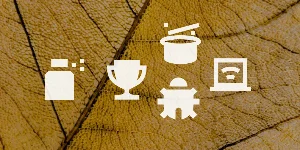
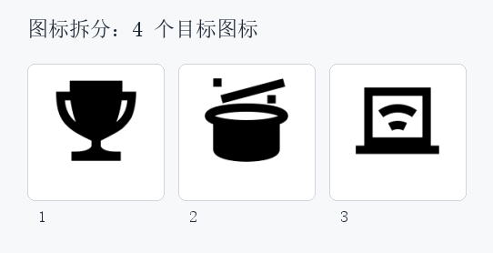
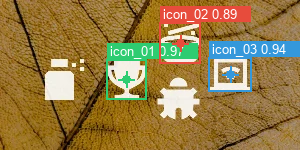
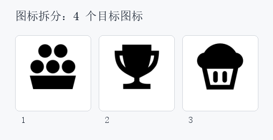
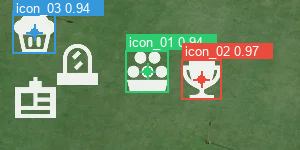

# 顶象 · 图标点选（icon-click）

> 300×150 纹理背景上散落 4–6 个白色图标，题面给出 3 个目标图标；源记录用白色墨迹多尺度模板匹配，按 IoU 取最高位置，再按题面顺序点击。
>
> 返回：[顶象索引](../../../docs/dingxiang.md) · [全量类型](../../../docs/types.md) · [方法论](../../../docs/00-methodology.md)

## 一、速览

| 项 | 值 |
|---|---|
| 厂商 | 顶象（`dingxiang`） |
| 类型 / 变体 | `icon-click` / classic |
| 中文 | 图标点选 |
| 媒体 | 图片 |
| 样本 | 12 组（001–012） |
| 答案格式 | `points`：按题面顺序的 3 个图标中心 |
| 方法 | `CV+VLM`（CV 白色图标多尺度模板匹配为主；LLM whole3x 仅对照） |
| 求解器 | `exists` · 高（源记录 IoU 0.90–0.97） |
| 人工审查 | 12 条 `pass` / 0 错误（2026-11-18） |
| 证据等级 | 未标注（`meta.evidence` 缺失；无 `answer.txt` / `result.json`） |

## 二、题面与判定

题面固定为“按顺序点击图中图标”。原图有 4–6 个白色图标，题面另给 3 个目标图标；答案空间是 3 个目标图标的中心，顺序由题面决定。

| 案例 | 题面（`meta.prompt`） | 通过条件 | 目标 |
|---|---|---|---|
| [001](001/) | 按顺序点击图中图标 | 该批案例未记录通过条件 | 奖杯 → 锅具 → 显示器 |
| [012](012/) | 按顺序点击图中图标 | 该批案例未记录通过条件 | 蛋糕 → 浆果碗 → 奖杯 |

> 12 组都没有 `pass_criteria`；目标图标由源目录的拆分图给出，`meta` 没有记录目标名称与顺序。

## 三、样本长什么样

| 原始题面 | 目标图标拆分 | 点击结果 |
|---|---|---|
|  |  |  |
|  |  |  |

- 第 1 列是纹理背景上的白色图标；第 2 列把 3 个目标图标拆成白底黑图（页眉写“4 个目标图标”，但页内实际只有 3 张，存在计数不一致）；第 3 列用彩色框标出匹配位置，框上写 `icon_01/02/03` 与 IoU 分数。
- 001 的三个匹配分是 0.97 / 0.89 / 0.94；012 是 0.94 / 0.97 / 0.94，其中奖杯（`icon_02`）为 0.97，是任务里提到的“012 奖杯修正”后的结果。

## 四、形态与难点

- **白色图标 + 彩色纹理**：图标本身无颜色，不能按颜色分割；要先做白色掩膜。
- **图标数量多于目标数**：原图 4–6 个图标，目标只有 3 个；要先在拆分图里定目标，再在原图里找对应实例。
- **尺度与位置变化**：同一图标可能大小不同，必须多尺度模板匹配。
- **相似图标**：锅具/碗、蛋糕/奖杯等轮廓接近时，IoU 差距会缩小。
- **LLM 落空风险**：源记录明确“LLM whole 1x 有落空风险，已改用 CV”，whole3x 只作对照。

## 五、求解思路

源记录的主线是 CV 模板匹配，LLM 不是主路径。模板来自源目录拆出的白底黑图，匹配对象是原图的白色图标掩膜。

| 步骤 | 做法 | 关键判据 / 参数 | 依据 |
|---|---|---|---|
| 1 目标拆分 | 读取源目录给出的 3 个目标图标 | 白底黑图，单图标一张 | `roles.process` + `process-01-split.png` |
| 2 白色掩膜 | 在原图中提取近白像素，得到图标候选连通域 | 纹理背景不能是纯白 | 源记录“白色图标模板匹配” |
| 3 多尺度匹配 | 对每个目标图标做多尺度模板匹配 | 尺度范围未记录；取 IoU 最高位置 | `method_note` |
| 4 顺序指派 | 按题面顺序把 3 个目标分配到 3 个匹配位置 | 每个目标一个位置，不重复 | `answer_format=points` |
| 5 输出 | 输出 3 个图标的中心点 | 12 组源记录 IoU 0.90–0.97 | `solver.notes` |

> `solved.png` 上的 `icon_01 0.97` 等数字是匹配 IoU，不是模型置信概率；源记录只给区间 0.90–0.97，没有逐组完整表。

## 六、结果与审查

- **源记录**：CV 白色图标多尺度模板匹配，IoU 0.90–0.97；LLM whole 1x 有落空风险，whole3x 仅对照；无训练依赖。
- **本库结果**：12 组有 `bg.webp` / `process-01-split.png` / `solved.png`，没有 `answer.txt` / `result.json`；`notes` 写“结果未纳入”。
- **人工审查**：12 组 `review.state=pass`、`result=correct`，审查日期 2026-11-18。

| 组 | 目标数（拆分图） | 匹配分（solved 标注） | 审查 |
|---|---|---|---|
| [001](001/) | 3（页眉写 4） | 0.97 / 0.89 / 0.94 | `pass` |
| [012](012/) | 3（页眉写 4） | 0.94 / 0.97 / 0.94 | `pass` |
| 其余 10 组 | 3 | 未逐组记录 | `pass` |

> 012 的奖杯匹配分 0.97 是修正后的标注；001 的锅具 0.89 是已见最低分，说明相似图标仍有区分压力。

## 七、失败与边界

| 现象 | 根因 | 证据 | 结论 |
|---|---|---|---|
| 相似图标选错 | 锅具/碗、蛋糕/奖杯轮廓接近 | 001 最低分 0.89 | 低分目标要人工复核 |
| LLM 整图点空 | whole 1x 分辨率下图标太小 | 源记录明确“已改用 CV” | LLM 不作主路径，whole3x 仅对照 |
| 目标数记录不一致 | 拆分页眉写 4，页内只有 3 张 | 001/012 均如此 | 以页内图标与 solved 标注为准，计数待源侧修正 |
| 无法复算 12/12 | 没有答案坐标与逐组 IoU | 12 组均无 `answer.txt` / `result.json` | 只能引用源记录区间，不能重算 |
| 顺序信息缺失 | `meta` 未记录目标名称与顺序 | 题面只有一句通用描述 | 顺序只能从拆分图与 solved 标签推断 |

**边界**：本页只覆盖“白色图标模板匹配 + 顺序点击”的离线思路；没有点击容差、轨迹、服务端回执，也没有 12 组的完整匹配表。

## 八、相关

- 厂商索引：[docs/dingxiang.md](../../../docs/dingxiang.md)
- 全量类型：[docs/types.md](../../../docs/types.md) · 方法论：[docs/00-methodology.md](../../../docs/00-methodology.md)
- 同厂商对照：[text-click](../text-click/)（文字点选，live-pass）、[diff-click](../diff-click/)（差异定位）
- 案例：[001](001/) – [012](012/)（每组含 `meta.json`、`bg.webp`、`process-01-split.png`、`solved.png`）
- 来源：<https://www.dingxiang-inc.com/business/captcha>；样本版权归顶象所有，仅用于研究与教学。
