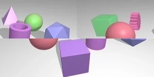
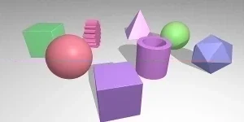
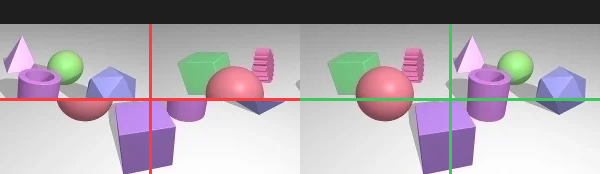
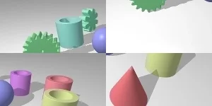
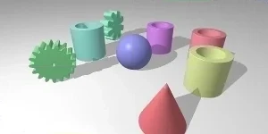
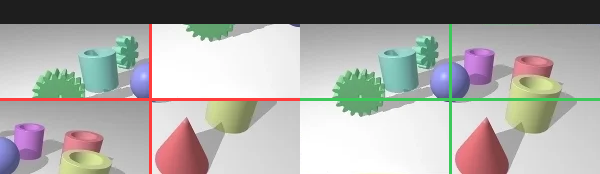

# 顶象 · 乱序拼图（jigsaw）

> 300×150 画面被切成 2×2 四块并打乱，要求交换拼块还原图像；源记录用切缝连续性、半边一致性和阴影先验三路信号给排列打分，12/12 选出正确顺序。
>
> 返回：[顶象索引](../../../docs/dingxiang.md) · [全量类型](../../../docs/types.md) · [方法论](../../../docs/00-methodology.md)

## 一、速览

| 项 | 值 |
|---|---|
| 厂商 | 顶象（`dingxiang`） |
| 类型 / 变体 | `jigsaw` / classic |
| 中文 | 乱序拼图 |
| 媒体 | 图片 |
| 样本 | 12 组（001–012） |
| 答案格式 | `swap/order`：拼块交换或最终排列 |
| 方法 | `CV`（切缝 + 半边 + 阴影先验；无 LLM） |
| 求解器 | `exists` · 高（源记录 12/12） |
| 人工审查 | 12 条 `pass` / 0 错误（2026-11-16） |
| 证据等级 | 未标注（`meta.evidence` 缺失；无 `answer.txt` / `result.json`） |

## 二、题面与判定

题面固定为“交换拼图块，还原完整图像”。画面是 2×2 的四块拼图，初始顺序被打乱；答案空间是一个交换方案或最终排列，不是单个坐标。

| 案例 | 题面（`meta.prompt`） | 通过条件 | 答案 |
|---|---|---|---|
| [001](001/) | 交换拼图块，还原完整图像 | 该批案例未记录通过条件 | 交换方案 / 最终排列 |
| [002](002/) | 交换拼图块，还原完整图像 | 该批案例未记录通过条件 | 交换方案 / 最终排列 |
| [012](012/) | 交换拼图块，还原完整图像 | 该批案例未记录通过条件 | 交换方案 / 最终排列 |

> 12 组没有 `pass_criteria`，也没有记录“允许交换几次”；`answer_format=swap/order` 只说明答案类型。

## 三、样本长什么样

| 原始题面 | 还原结果 | 切缝调试图 |
|---|---|---|
|  |  |  |
|  |  |  |

- 第 1 列是打乱后的 2×2 画面；第 2 列是还原后的完整图像；第 3 列是 600×174 的左右对照图，左半是原始排列、右半是还原排列，红线表示高成本切缝、绿线表示低成本切缝。
- 001 的原图里球体和立方体被切到不同块，还原后几何体重新连续；002 的齿轮和圆柱跨块，切缝线在还原侧全部变绿。
- `annotated.png` 是切缝/阴影的调试可视化，不是最终答案图；最终排列看 `restored.webp`。

## 四、形态与难点

- **固定 2×2**：4 块、每块 150×75；排列空间只有 4! = 24 种，可以穷举。
- **切缝是主信号**：正确相邻块在切缝两侧的颜色、边缘、纹理应连续；错误排列会出现断裂。
- **半边一致性**：同一物体的左右/上下半边在正确拼接时应对齐，错位时轮廓断开。
- **阴影先验**：3D 渲染场景有方向一致的阴影，错误排列会让阴影方向突变。
- **低纹理块**：天空、桌面等纯色区域缺少边缘，切缝成本区分度低，需要阴影和半边补足。

## 五、求解思路

源记录的方法链是“切缝 + 半边 + 阴影先验”，三路信号共同给每个候选排列打分，取总成本最低的排列。

| 步骤 | 做法 | 关键判据 / 参数 | 依据 |
|---|---|---|---|
| 1 切块 | 按 2×2 网格把原图切成 4 块 | 每块 150×75；边界位置固定 | `bg.webp` 版式 |
| 2 切缝成本 | 对相邻块边界计算颜色/梯度连续性 | 断裂越大成本越高 | `method_note`“切缝” |
| 3 半边一致性 | 检查跨块物体的轮廓是否在边界两侧对齐 | 轮廓错位越大成本越高 | `method_note`“半边” |
| 4 阴影先验 | 检查阴影方向/长度是否一致 | 方向突变视为错误排列 | `method_note`“阴影先验” |
| 5 排列搜索 | 在 24 种排列中取三路加权成本最低者 | 权重未记录；源记录 12/12 | `solver.notes` |
| 6 输出 | 输出交换方案或最终排列 | 以 `restored.webp` 为准 | `roles.solved=restored.webp` |

> 本类型是 B 档：三路信号的权重、归一化方式和搜索细节没有展开，因此不写伪代码；24 种排列是可从 2×2 版式直接推出的事实。

## 六、结果与审查

- **源记录**：三信号切缝 + 阴影先验，12/12；求解器 `exists`、`high`。
- **本库结果**：12 组有 `bg.webp` / `restored.webp` / `annotated.png`，没有 `answer.txt` / `result.json`；`notes` 写“结果未纳入”。
- **人工审查**：12 组 `review.state=pass`、`result=correct`，审查日期 2026-11-16。

| 组 | 文件 | 审查 | 备注 |
|---|---|---|---|
| [001](001/) – [012](012/) | `bg` + `restored` + `annotated` | 12/12 `pass` | 无交换序列/排列编号落盘 |

> `restored.webp` 是结果图，但没有记录“从哪个排列换到哪个排列”；无法从文件反推交换步骤，只能确认最终画面正确。

## 七、失败与边界

| 现象 | 根因 | 证据 | 结论 |
|---|---|---|---|
| 纯色块切缝无区分度 | 天空/桌面缺少纹理 | 低纹理区域边缘弱 | 需要半边与阴影补足，不能只看切缝 |
| 阴影方向被忽略 | 只比颜色会接受阴影突变的排列 | 方法专门列了“阴影先验” | 三路信号缺一不可 |
| 排列数虽小但成本接近 | 错误排列在低纹理处也可能连续 | 源记录未给逐组成本 | 24 选 1 仍可能选错，需低分复核 |
| 无交换步骤 | 只有最终还原图 | 12 组均无 `answer.txt` / `result.json` | 不能复核“12/12”的搜索过程 |
| 调试图易误读 | `annotated.png` 是切缝可视化 | `process_note` 明确说明 | 最终答案看 `restored.webp` |

**边界**：本页只覆盖 2×2 拼图的离线排列判定；没有拖拽/交换轨迹、服务端回执和逐组成本表。

## 八、相关

- 厂商索引：[docs/dingxiang.md](../../../docs/dingxiang.md)
- 全量类型：[docs/types.md](../../../docs/types.md) · 方法论：[docs/00-methodology.md](../../../docs/00-methodology.md)
- 同厂商对照：[rotate](../rotate/)（旋转补圆，未解）、[slide](../slide/)（缺口定位）
- 案例：[001](001/) – [012](012/)（每组含 `meta.json`、`bg.webp`、`restored.webp`、`annotated.png`）
- 来源：<https://www.dingxiang-inc.com/business/captcha>；样本版权归顶象所有，仅用于研究与教学。
