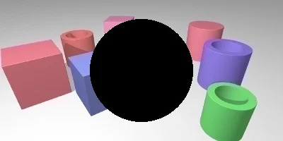
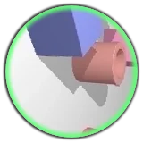
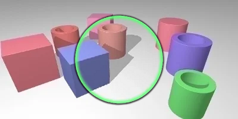
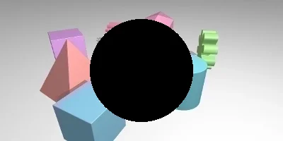
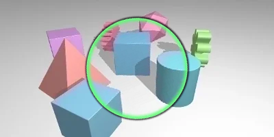

# 顶象 · 旋转验证（rotate）

> 400×200 的 3D 场景中央被挖掉一个圆形区域，旁边给出一块 160×160 的圆形补片；拖动滑块把补片旋转到与场景一致的角度。源记录为待做，未撰写求解器。
>
> 返回：[顶象索引](../../../docs/dingxiang.md) · [全量类型](../../../docs/types.md) · [方法论](../../../docs/00-methodology.md)

## 一、速览

| 项 | 值 |
|---|---|
| 厂商 | 顶象（`dingxiang`） |
| 类型 / 变体 | `rotate` / classic |
| 中文 | 旋转验证 |
| 媒体 | 图片 |
| 样本 | 12 组（001–012） |
| 答案格式 | `angle`：补片旋转角 |
| 方法 | `NONE(CV+VLM)`（建议 CV 角度估计 + VLM 兜底） |
| 求解器 | `none` · 未知（源记录未撰写） |
| 人工审查 | 12 条 `pass` / 0 错误（2026-11-17） |
| 证据等级 | 未标注（无 `answer.txt` / `result.json` / `evidence`） |

## 二、题面与判定

题面固定为“拖动滑块，将图片旋转到正确方向”。场景中央是黑色圆洞，`aux-01.webp` 是同一场景的圆形补片，但被旋转过；答案是一个角度值。

| 案例 | 题面（`meta.prompt`） | 通过条件 | 答案 |
|---|---|---|---|
| [001](001/) | 拖动滑块，将图片旋转到正确方向 | 该批案例未记录通过条件 | 旋转角 `angle` |
| [002](002/) | 拖动滑块，将图片旋转到正确方向 | 该批案例未记录通过条件 | 旋转角 `angle` |

> 12 组没有 `pass_criteria`，角度范围、容差和正方向都未记录。

## 三、样本长什么样

| 原始题面 | 圆形补片 | 补入结果 |
|---|---|---|
|  |  |  |
|  | — |  |

- 第 1 列是场景：多个 3D 几何体围绕一个纯黑圆洞；第 2 列是待旋转的圆形补片，内容与洞口一致但方向错了；第 3 列是补片旋正后放回洞口的结果，绿色圆环标出补片边界。
- 001 的补片里能看到立方体与圆柱的边缘，旋正后与周围几何体的轮廓、阴影方向连续；002 的补片含锥体与立方体，旋正后接缝处阴影一致。

## 四、形态与难点

- **圆形补片**：160×160，旋转是绕圆心的平面旋转，不涉及缩放。
- **角度连续**：答案是一个连续角度，不是离散选项；容差未记录。
- **接缝线索**：补片边缘与洞口周围的几何体轮廓、阴影方向必须连续，这是判断角度的主要依据。
- **场景干扰**：周围有多个相似圆柱/立方体，局部颜色匹配可能出现多个角度峰。

## 五、建议路线

源记录只给出方向“CV 角度估计 + VLM 兜底”，没有实现细节。合理路线是先做旋转搜索，再用接缝连续性选角，最后让 VLM 在低置信时复核。

| 步骤 | 建议做法 | 关键判据 | 依据 |
|---|---|---|---|
| 1 定位圆洞 | 在 400×200 场景中检测黑色圆洞的圆心与半径 | 圆洞边界清晰 | `bg.webp` 可直接观察 |
| 2 旋转搜索 | 把 160×160 补片按 0–360° 逐角旋转，贴回圆洞 | 搜索步长未记录 | 源记录“CV 角度估计” |
| 3 接缝评分 | 比较补片边缘一圈与洞口周围像素的连续性，取评分最高且峰最尖锐的角度 | 轮廓/阴影在接缝处连续 | 补片内容与场景同源 |
| 4 VLM 兜底 | 对低置信角度，让视觉模型看“补片旋正后是否合理” | 只作复核，不作主路径 | 源记录“VLM 兜底” |

> 没有源实现，不能写伪代码；上表是依据 `method_note` 与题面结构给出的建议路线，不是已实现算法。

## 六、为什么没有结果

- `solver.status=none`、`accuracy=unknown`，`notes` 明确“源记录为待做，未撰写求解器”。
- 12 组没有 `answer.txt` / `result.json`，也没有 `angle` 数值；`solved.png` 是补片旋正后的结果图，但角度未落盘。
- 人工审查 12/12 `pass` 只说明结果图看起来正确，不能替代角度复算。

## 七、边界

- **只有结果图、没有角度**：无法知道每组转了多少度，也无法验证容差。
- **圆形接缝可能退化**：若补片内容以圆心对称，多个角度都能接上，单靠接缝会选错。
- **审查口径**：`review=pass` 与 `solver=none` 并存，说明审查针对的是结果图，不是求解器输出。

## 八、相关

- 厂商索引：[docs/dingxiang.md](../../../docs/dingxiang.md)
- 全量类型：[docs/types.md](../../../docs/types.md) · 方法论：[docs/00-methodology.md](../../../docs/00-methodology.md)
- 案例：[001](001/) – [012](012/)（每组含 `meta.json`、`bg.webp`、`aux-01.webp`、`solved.png`）；同厂商对照：[jigsaw](../jigsaw/)、[slide-restore](../slide-restore/)
- 来源：<https://www.dingxiang-inc.com/business/captcha>；样本版权归顶象所有，仅用于研究与教学。
