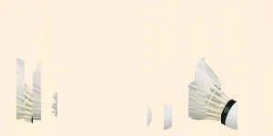
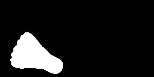
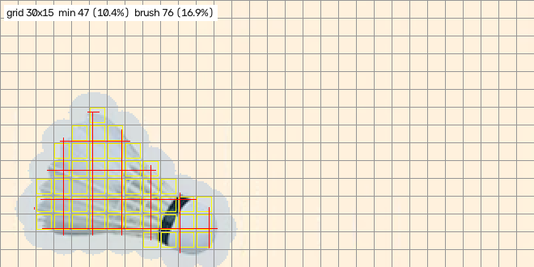
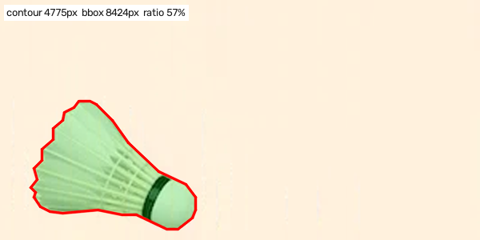
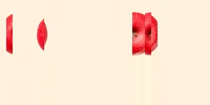
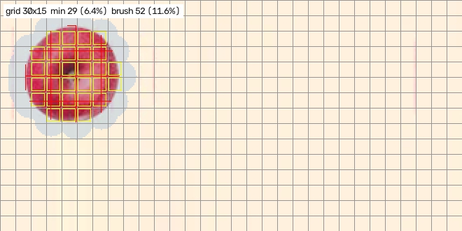
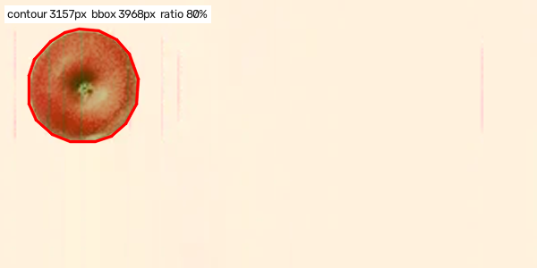

# 顶象 · 刮刮卡（scratch）

> 用尽量少的刮开面积露出完整图案；U²-Netp 先分割显著目标，取完整轮廓，再量化为 30×15 位图并生成 23px 笔刷路径。
>
> 返回：[顶象索引](../../../docs/dingxiang.md) · [全量类型](../../../docs/types.md) · [方法论](../../../docs/00-methodology.md)

## 一、速览

| 项 | 值 |
|---|---|
| 厂商 | 顶象（`dingxiang`） |
| 类型 / 变体 | `scratch` / classic |
| 中文 | 刮刮卡 |
| 媒体 | 图片 |
| 样本 | 12 组（001–012） |
| 答案格式 | `contour/bitmap`：目标轮廓 + 最小刮擦位图 |
| 方法 | `CV+DET`（U²-Netp 显著性分割 + 完整轮廓 + 最小刮擦位图） |
| 求解器 | `exists` · 未知（源记录离线 12/12，未实机提交） |
| 人工审查 | 12 通过 / 0 错误（截至 2026-11-21；结果待再核） |
| 证据等级 | `offline-verified`（12 组 `confidence=high`） |

## 二、题面与判定

题面要求“用尽量少的区域，刮出完整图案”，判定同时看两件事：图案必须完整露出，刮开面积不能过大。它不是点选，而是给出一条覆盖目标轮廓的刮擦路径。

| 案例 | 题面（`meta.prompt`） | 通过条件 |
|---|---|---|
| [001](001/) | 请使用尽量少的区域，刮出完整图案 | 用尽量少的刮开面积露出完整图案；图案不完整或刮开区域过大不通过 |
| [006](006/) | 同上 | 同上 |
| [012](012/) | 同上 | 同上 |

> 12 组题面与 `pass_criteria` 完全一致；答案空间是“目标轮廓 + 位图覆盖方案”，不是单个坐标。

## 三、样本长什么样

| 原始题面 | 目标掩膜 | 刮擦方案 | 结果轮廓 |
|---|---|---|---|
|  |  |  |  |
|  |  |  |  |

- 第 1 列是覆盖层碎片，目标图案只露出零散边缘；第 2 列是 U²-Netp 分割出的完整目标（白=目标）；第 3 列是 30×15 网格：黄格=最小位图单元，蓝格=23px 笔刷擦除区，红线=扫描路径；第 4 列把轮廓套回原图，红色闭合线即最小刮擦区。
- 001 的目标是羽毛球，006 是小目标，二者面积相差约 1.5 倍，用来观察网格量化在大小目标上的差异。

## 四、形态与难点

- **目标大小差异大**：12 组目标面积 3,156–6,067px，bbox 面积占比 0.567–0.854；小目标更容易被网格量化放大。
- **覆盖层碎片化**：原始图只露出目标的零散条带，不能靠颜色阈值直接抠图，必须做显著目标分割。
- **“完整轮廓”而非 bbox**：判定看图案是否完整，bbox 会多刮大量背景；本方案输出闭合轮廓。
- **刮擦面积约束**：题面要求尽量少；方案用 30×15 位图控制覆盖率，再按 18% 提交线补格。
- **无线上记录**：12 组只做离线覆盖校验，没有真实刮擦轨迹与服务端回执。

## 五、求解思路

源记录把问题拆成“分割 → 轮廓 → 位图 → 笔刷路径”四步。关键不是找目标框，而是得到完整闭合轮廓，并把轮廓压到可提交的网格粒度。

| 步骤 | 做法 | 关键判据 / 参数 | 依据 |
|---|---|---|---|
| 1 显著分割 | U²-Netp（ONNX，Apache-2.0）输出目标显著图 | 取最大显著目标 | `result.json` 的 `model` / `method` |
| 2 完整轮廓 | 对掩膜取闭合轮廓，保留弧边与凹口 | 轮廓面积、bbox、周长、质心 | `object` 字段 |
| 3 网格量化 | 330×165 画布切 30×15 格，每格 11px | 格内目标占比 ≥ 0.5 记为最小位图单元 | `cell_px=11`、`cell_threshold=0.5` |
| 4 笔刷覆盖 | 用 23px 笔刷把最小位图膨胀成可执行路径 | 刷到 18% 提交线；不足则补格 | `brush_width_px=23`、`submit_percent=18` |
| 5 输出 | 输出轮廓点、min/brush 位图与补格数 | 12/12 离线完整覆盖 | `answer.txt` |

```text
# 刮刮卡：显著分割 → 完整轮廓 → 最小位图（伪代码，按 result.json 直译）
mask      = u2netp_saliency(bg)                 # 300 x 150
contour   = largest_closed_contour(mask)        # 完整轮廓，不是 bbox
grid      = quantize(contour, canvas=330x165, cell=11, grid=30x15)
min_bits  = cells_with_coverage(grid, threshold=0.5)
brush     = dilate(min_bits, brush_width=23)
if coverage(brush) < 18%:
    brush = pad_to(brush, 18%)                  # 补格，不扩大轮廓本身
path      = scan_path(brush)                    # 红线扫描路径
```

> 001 的最小位图是 47/450 格（10.4%），笔刷覆盖 76/450 格（16.9%），再补 5 格到 18%；006 目标更小，最小位图 29/450 格（6.4%），需要补 29 格才到提交线。

## 六、结果与审查

- **源记录**：离线 12/12 完整覆盖，全部 `confidence=high`、`evidence=offline-verified`；未做实机刮擦提交。
- **本库结果**：12 组 `answer.txt` / `result.json` / `mask.png` / `scratch.png` / `solved.png` 齐全。
- **人工审查**：12 组 `review.state=pass`、`result=correct`；`status=result-pending-review`，结果保留待复核标记。

| 组 | 目标面积 | bbox | 最小位图 | 笔刷覆盖 | 补格 |
|---|---:|---|---:|---:|---:|
| [001](001/) | 4,775 | 19,63,104,81 | 47（10.4%） | 76（16.9%） | 5 |
| [002](002/) | 5,274 | 118,28,82,81 | 52（11.6%） | 79（17.6%） | 2 |
| [003](003/) | 5,314 | 144,53,82,82 | 51（11.3%） | 89（19.8%） | 0 |
| [004](004/) | 5,314 | 144,53,82,82 | 51（11.3%） | 89（19.8%） | 0 |
| [005](005/) | 5,307 | 18,15,82,82 | 54（12.0%） | 79（17.6%） | 2 |
| [006](006/) | 3,157 | 16,16,62,64 | 29（6.4%） | 52（11.6%） | 29 |
| [007](007/) | 5,260 | 15,26,82,82 | 51（11.3%） | 81（18.0%） | 0 |
| [008](008/) | 4,161 | 61,52,80,71 | 43（9.6%） | 64（14.2%） | 17 |
| [009](009/) | 3,178 | 97,33,62,65 | 33（7.3%） | 53（11.8%） | 28 |
| [010](010/) | 6,067 | 46,52,106,67 | 62（13.8%） | 91（20.2%） | 0 |
| [011](011/) | 3,654 | 145,93,81,55 | 37（8.2%） | 53（11.8%） | 28 |
| [012](012/) | 3,156 | 22,39,62,64 | 30（6.7%） | 53（11.8%） | 28 |

> 覆盖率按 450 格计算（30×15）。最小位图是“轮廓内必须刮到”的格子，笔刷覆盖是实际 23px 笔刷扫过的格子；补格只发生在笔刷覆盖不足 18% 时。

## 七、失败与边界

| 现象 | 根因 | 证据 | 结论 |
|---|---|---|---|
| 小目标被网格放大 | 11px 格对小目标过粗，最小位图占比低 | 006/009/012 最小位图仅 6.4%–7.3%，需补 28–29 格 | 小目标要优先检查补格后是否超出“尽量少” |
| 只给 bbox 会多刮 | 判定看完整图案，bbox 含大量背景 | `process_note` 明确“轮廓内即最小刮擦区” | 输出闭合轮廓，而不是矩形框 |
| 003 与 004 数值完全相同 | 两组 `result.json` 的 area/bbox/contour 一致 | 003/004 均为 5,314px、bbox 144,53,82,82、51 格 | 疑为重复样本，统计按 12 组计，但独立样本或只有 11 组，待源侧确认 |
| 只有离线覆盖校验 | 未跑真实刮擦与服务端判定 | 12 组均未实机提交 | 离线完整覆盖 ≠ 线上通过，不能写成成功率 |

**边界**：本页覆盖目标分割与最小刮擦位图，不包含真实鼠标轨迹、刮擦速度与服务端判定；“完整覆盖”指离线掩膜校验，不是线上验收。

## 八、相关

- 厂商索引：[docs/dingxiang.md](../../../docs/dingxiang.md)
- 全量类型：[docs/types.md](../../../docs/types.md) · 方法论：[docs/00-methodology.md](../../../docs/00-methodology.md)
- 同厂商对照：[slide](../slide/)（缺口定位）、[diff-click](../diff-click/)（差异定位）
- 案例：[001](001/) – [012](012/)（每组含 `meta.json`、`answer.txt`、`result.json`、`mask.png`、`scratch.png`、`solved.png`）
- 模型说明：U²-Netp salient object detection（ONNX，Apache-2.0），见 `result.json` 的 `model` 字段
- 来源：<https://www.dingxiang-inc.com/business/captcha>；样本版权归顶象所有，仅用于研究与教学。
