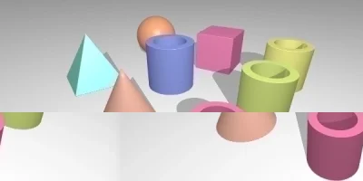
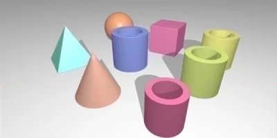
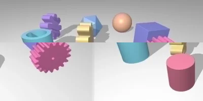
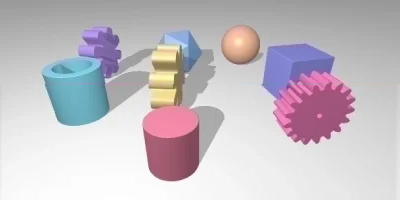
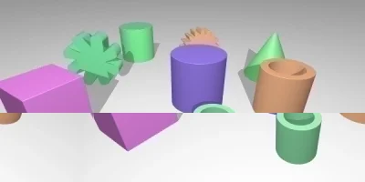
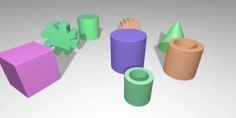

# 顶象 · 滑动还原（slide-restore）

> 400×200 画面被一条水平接缝分成上下两半，下半边整体横移；要求拖动滑块把接缝对齐，源记录用接缝上下窄带做匹配，再以接缝连续性裁决位移量。
>
> 返回：[顶象索引](../../../docs/dingxiang.md) · [全量类型](../../../docs/types.md) · [方法论](../../../docs/00-methodology.md)

## 一、速览

| 项 | 值 |
|---|---|
| 厂商 | 顶象（`dingxiang`） |
| 类型 / 变体 | `slide-restore` / classic |
| 中文 | 滑动还原 |
| 媒体 | 图片 |
| 样本 | 12 组（001–012） |
| 答案格式 | `shift`：水平位移量 |
| 方法 | `CV`（窄带匹配 + 接缝裁决；无 LLM） |
| 求解器 | `exists` · 高（类型表称已攻克；`meta.notes` 又称未写） |
| 人工审查 | 12 条 `pass` / 0 错误（2026-11-16） |
| 证据等级 | 未标注（`meta.evidence` 缺失；无 `answer.txt` / `result.json`） |

## 二、题面与判定

题面固定为“拖动滑块，将错位图像还原”。图像本身是一条水平接缝，上下两半在水平方向错开；答案是一个水平位移量（`shift`），不是点击坐标。

| 案例 | 题面（`meta.prompt`） | 通过条件 | 答案 |
|---|---|---|---|
| [001](001/) | 拖动滑块，将错位图像还原 | 该批案例未记录通过条件 | 水平 `shift` |
| [002](002/) | 拖动滑块，将错位图像还原 | 该批案例未记录通过条件 | 水平 `shift` |
| [006](006/) | 拖动滑块，将错位图像还原 | 该批案例未记录通过条件 | 水平 `shift` |

> 12 组没有 `pass_criteria`，也没有记录 `shift` 的正负方向与容差；只能确认“把上下半边水平对齐”。

## 三、样本长什么样

| 原始题面 | 还原结果 | 原始题面 | 还原结果 |
|---|---|---|---|
|  |  |  |  |
|  |  | — | — |

- 左列是错位图：约在画面中部有一条水平接缝，接缝上下内容相同但水平位置错开，形成明显断裂。
- 右列是还原图：接缝对齐后，圆柱、立方体、齿轮等几何体的轮廓跨接缝连续。
- 001/006 都是 3D 渲染场景，阴影和几何边缘提供强匹配信号；002 是齿轮与圆柱，接缝两侧的齿形对齐更明显。

## 四、形态与难点

- **图幅固定**：400×200，接缝大致在画面中部，上下两半各占一部分高度。
- **只有水平位移**：上下不移动，只做水平平移；答案是一个 `shift` 值。
- **接缝位置要先找**：不同图的接缝行可能略有差异，不能写死 y。
- **重复纹理误导**：桌面、墙面等低纹理区域可能出现多个相似峰，单靠窄带匹配会选错。
- **接缝裁决**：候选位移要在接缝处检查颜色/边缘是否连续，避免“整体相关高但接缝断裂”的结果。

## 五、求解思路

源记录的方法链是“窄带匹配 + 接缝裁决”：先取接缝上下各一条窄带，对下半边做水平平移搜索，再用接缝连续性在候选位移中裁决。

| 步骤 | 做法 | 关键判据 / 参数 | 依据 |
|---|---|---|---|
| 1 找接缝 | 检测水平方向梯度/断裂最强的行 | 接缝行 y；12 组大致居中 | `bg.webp` 观察 |
| 2 取窄带 | 在接缝上下各取一条窄带 | 窄带高度未记录；要覆盖可匹配纹理 | `method_note`“窄带匹配” |
| 3 窄带匹配 | 下半边相对上半边做水平平移，计算窄带相似度 | 搜索范围覆盖整幅宽度；相似度度量未记录 | `method_note` |
| 4 候选峰 | 取相似度最高的若干位移 | 低纹理处可能出现多个峰 | 方法需要“裁决”即说明存在多峰 |
| 5 接缝裁决 | 在候选位移中检查接缝两侧颜色/边缘连续性 | 接缝连续者胜出 | `method_note`“接缝裁决” |
| 6 输出 | 输出水平 `shift` | 正负方向未记录 | `answer_format=shift` |

> 本类型是 B 档：窄带高度、相关度量和裁决阈值都没有展开，因此不写伪代码。

## 六、结果与审查

- **源记录**：求解器 `exists`、`high`，备注“窄带匹配 + 接缝裁决；类型表称已攻克”。
- **口径冲突**：同一份 `meta.notes` 写“背景还原已完成，求解器未写”，与 `solver.status=exists` 矛盾；本页两者都保留。
- **本库结果**：12 组只有 `bg.webp` / `solved.png`，没有 `answer.txt` / `result.json`；`notes` 写“结果未纳入”。
- **人工审查**：12 组 `review.state=pass`、`result=correct`，审查日期 2026-11-16。

| 组 | 文件 | 审查 | 备注 |
|---|---|---|---|
| [001](001/) – [012](012/) | `bg` + `solved` | 12/12 `pass` | 无 `shift` 数值；无法复算 |

> 没有 12 组的位移量，无法确认 `solved.png` 是用求解器生成还是人工还原；只能确认最终画面接缝对齐。

## 七、失败与边界

| 现象 | 根因 | 证据 | 结论 |
|---|---|---|---|
| 接缝位置写死 | 不同图接缝行略有差异 | 12 组均为 400×200，但接缝未记录 | 先检测接缝行，再取窄带 |
| 低纹理多峰 | 桌面/墙面周期纹理产生多个相似峰 | 方法需要“接缝裁决” | 不能只取相似度最大值 |
| 方向判断错误 | `shift` 正负未记录 | `answer_format=shift` 无符号约定 | 提交前需确认左右方向 |
| 源记录与本库不一致 | `notes` 说求解器未写，`solver` 说已攻克 | 同一份 `meta.json` | 引用准确率标“源记录” |
| 无法复算 12/12 | 没有 `shift` 数值 | 12 组均无 `answer.txt` / `result.json` | 只能确认“有还原图”，不能重算 |

**边界**：本页只覆盖水平接缝的离线位移估计；没有拖动轨迹、松手判定、服务端回执和逐组 `shift`。

## 八、相关

- 厂商索引：[docs/dingxiang.md](../../../docs/dingxiang.md)
- 全量类型：[docs/types.md](../../../docs/types.md) · 方法论：[docs/00-methodology.md](../../../docs/00-methodology.md)
- 同厂商对照：[slide](../slide/)（缺口定位）、[rotate](../rotate/)（旋转补圆，未解）
- 案例：[001](001/) – [012](012/)（每组含 `meta.json`、`bg.webp`、`solved.png`）
- 来源：<https://www.dingxiang-inc.com/business/captcha>；样本版权归顶象所有，仅用于研究与教学。
