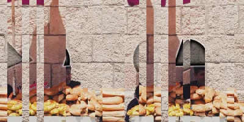
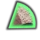
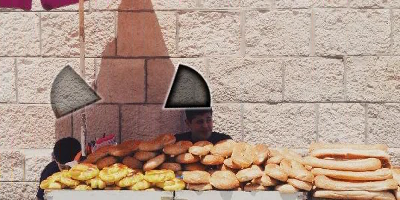
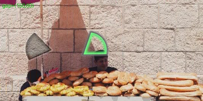
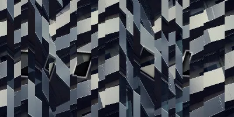
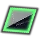
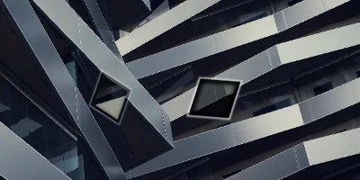
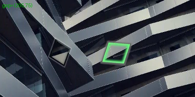

# 顶象 · 滑动拼图（slide）

> 400×200 背景被竖向条带打乱，旁边给一块 68×68 的扇形拼块；先还原背景，再用 Canny 候选、色差斑块与局部 Sobel 梯度定位缺口。
>
> 返回：[顶象索引](../../../docs/dingxiang.md) · [全量类型](../../../docs/types.md) · [方法论](../../../docs/00-methodology.md)

## 一、速览

| 项 | 值 |
|---|---|
| 厂商 | 顶象（`dingxiang`） |
| 类型 / 变体 | `slide` / classic |
| 中文 | 滑动拼图 |
| 媒体 | 图片 |
| 样本 | 12 组（001–012） |
| 答案格式 | `offset-x`：缺口左上角 `(gap_x, gap_y)` |
| 方法 | `CV`（Canny 候选 + 色差斑块判别 + Sobel 梯度精修） |
| 求解器 | `exists` · 高（源记录已攻克） |
| 人工审查 | 12 通过 / 0 错误（截至 2026-11-21；结果仍标待审） |
| 证据等级 | `offline-verified`（12 组 `result.json` 均为 high） |

## 二、题面与判定

用户拖动滑块，把扇形拼块补进背景缺口；题面接口只给“补入缺口”，不给缺口坐标。12 组的答案都是缺口的左上角，纵向也由题目布局决定，不像极验那样另给 `ypos`。

| 案例 | 题面（`meta.prompt`） | 通过条件 | 答案 |
|---|---|---|---|
| [001](001/) | 拖动滑块，将拼图块补入缺口 | 该批案例未记录通过条件 | `gap_x=150, gap_y=60` |
| [005](005/) | 同上 | 同上 | `gap_x=205, gap_y=75` |
| [012](012/) | 同上 | 同上 | `gap_x=207, gap_y=95` |

> 答案空间是二维左上角坐标，但真正决定成败的是水平位移；12 组的 `gap_y` 分布在 35–95 之间，说明纵向位置随背景变化，不能沿用固定值。

## 三、样本长什么样

| 原始题面 | 拼图块 | 背景还原 | 缺口标注 |
|---|---|---|---|
|  |  |  |  |
|  |  |  |  |

- 第 1 列是竖向条带错位的原始背景；第 2 列是带缺口的扇形拼块；第 3 列是还原后的完整背景（缺口仍空着）；第 4 列用绿色扇形框出缺口，左上角标注 `gap` 坐标。
- 005 的背景是深色建筑立面，条带干扰强、缺口边缘弱，是 12 组里匹配分最低的一组（0.854）。

## 四、形态与难点

- **图幅固定**：400×200 背景，68×68 扇形拼块；缺口不是矩形，而是带弧边的扇形，轮廓形状本身就是判据。
- **背景被打乱**：原始题面是竖向条带错位，直接做模板匹配会把条带边缘当成缺口；必须先还原背景。
- **干扰边缘多**：建筑窗格、砖缝、招牌文字都会产生 Canny 边缘，缺口可能被淹没。
- **坐标依赖还原质量**：还原偏差 1–2px 就会让缺口左上角偏移，答案必须以还原图为坐标系。
- **无线上记录**：12 组只有离线坐标与匹配分，没有轨迹或服务端回执。

## 五、求解思路

源记录把流程拆成四段：背景还原、Canny 候选、色差斑块判别、局部 Sobel 梯度精修。前两步负责“找像缺口的地方”，后两步负责在候选里选“真正缺了一块”的位置。

| 步骤 | 做法 | 关键判据 / 参数 | 依据 |
|---|---|---|---|
| 1 背景还原 | 按竖向条带的错位量重新拼回 400×200 背景 | 还原后条带接缝应连续 | `method_note`：背景还原 |
| 2 边缘候选 | 对还原图做 Canny，提取轮廓候选 | 候选形状需与 68×68 扇形拼块一致 | `result.json` 的 `method` 含 `canny-candidate` |
| 3 色差判别 | 比较候选内外的色差斑块，排除只是纹理边缘的候选 | 缺口内部与周围存在色差 | `method_note`：色差斑块判别 |
| 4 梯度精修 | 在候选邻域做局部 Sobel 梯度，取梯度响应最强、形状最贴合的左上角 | 匹配分越高越可信 | `result.json` 的 `method` 含 `gradient-refine` |
| 5 输出 | 输出缺口左上角 `(gap_x, gap_y)` | 12 组全部 high | `answer.txt` / `result.json` |

```text
# 滑动拼图：还原 → 候选 → 判别 → 精修（伪代码，按源记录直译）
restored = restore_background(bg)              # 400 x 200，消除竖向条带错位
cands    = canny_contours(restored)            # 候选缺口轮廓
cands    = filter_shape_ratio(cands, piece)    # 形状/尺寸与 68x68 拼块一致
cands    = filter_color_diff(cands, restored)  # 缺口内外的色差斑块
best     = argmax(cands, local_sobel_gradient(restored, cand))
answer   = top_left(best)                      # (gap_x, gap_y)
```

> `result.json` 里的 `score` 是候选匹配分（0.854–2.42），不是概率，也不是线上通过率；它只用于在同一张图的候选之间排序。

## 六、结果与审查

- **源记录**：12/12 组给出缺口坐标，全部 `confidence=high`、`evidence=offline-verified`。
- **本库结果**：12 组 `answer.txt` / `result.json` / `restored.png` / `solved.png` 齐全；无线上提交记录。
- **人工审查**：12 组 `review.state=pass`、`result=correct`；`status` 仍为 `result-pending-review`，即审查通过但结果保留待复核标记。

| 组 | gap_x | gap_y | 匹配分 | 证据 |
|---|---:|---:|---:|---|
| [001](001/) | 150 | 60 | 2.039 | offline-verified |
| [002](002/) | 166 | 35 | 1.708 | offline-verified |
| [003](003/) | 205 | 60 | 1.349 | offline-verified |
| [004](004/) | 273 | 68 | 2.313 | offline-verified |
| [005](005/) | 205 | 75 | 0.854 | offline-verified |
| [006](006/) | 209 | 35 | 1.227 | offline-verified |
| [007](007/) | 264 | 89 | 1.046 | offline-verified |
| [008](008/) | 289 | 50 | 2.420 | offline-verified |
| [009](009/) | 177 | 56 | 1.763 | offline-verified |
| [010](010/) | 223 | 90 | 1.614 | offline-verified |
| [011](011/) | 247 | 69 | 1.665 | offline-verified |
| [012](012/) | 207 | 95 | 1.433 | offline-verified |

> 最高分 008（2.420）与最低分 005（0.854）相差近三倍，说明不同背景的可分性差异很大；低分组的答案应优先人工复核。

## 七、失败与边界

| 现象 | 根因 | 证据 | 结论 |
|---|---|---|---|
| 不还原背景直接匹配 | 竖向条带边缘被当成缺口 | 原始题面就是错位条带；`method` 第一步是背景还原 | 还原是必要前置，不能省 |
| 矩形缺口假设失效 | 顶象缺口是扇形/弧边，不是方形 | `aux-01.webp` 为扇形拼块；`solved` 以扇形框标注 | 候选筛选要带形状比例，而非只比矩形 |
| 低对比背景匹配分低 | 深色立面、纹理弱化缺口边缘 | 005 匹配分仅 0.854 | 低分组人工复核；必要时换梯度窗口 |
| 只有离线坐标 | 未做轨迹与服务端提交 | 12 组 `evidence=offline-verified` | 坐标正确不等于线上通过，不能冒充成功率 |

**边界**：本页只覆盖缺口定位。真实提交还需要拖动轨迹、时序和风控环境；轨迹被拒的情况不在本库的验证范围内。

## 八、相关

- 厂商索引：[docs/dingxiang.md](../../../docs/dingxiang.md)
- 全量类型：[docs/types.md](../../../docs/types.md) · 方法论：[docs/00-methodology.md](../../../docs/00-methodology.md)
- 同厂商对照：[slide-restore](../slide-restore/)（错位还原）、[jigsaw](../jigsaw/)（拼块交换）
- 案例：[001](001/) – [012](012/)（每组含 `meta.json`、`answer.txt`、`result.json`、`restored.png`、`solved.png`）
- 来源：<https://www.dingxiang-inc.com/business/captcha>；样本版权归顶象所有，仅用于研究与教学。
