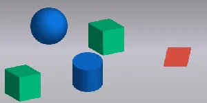
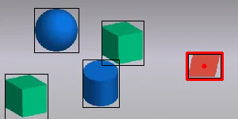
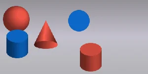
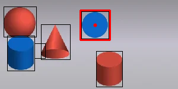
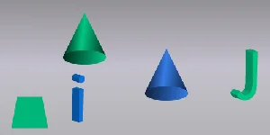
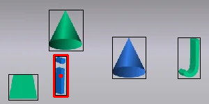
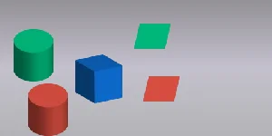
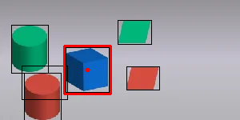

# 顶象 · 空间推理（spatial）

> 300×150 的 3D 渲染场景里混放球、柱、锥、立方体、平面片和字母，题面按颜色、平面/立体、大小写或相对位置指定唯一对象；源记录用受光比判别平面与立体，再做字形匹配。
>
> 返回：[顶象索引](../../../docs/dingxiang.md) · [全量类型](../../../docs/types.md) · [方法论](../../../docs/00-methodology.md)

## 一、速览

| 项 | 值 |
|---|---|
| 厂商 | 顶象（`dingxiang`） |
| 类型 / 变体 | `spatial` / classic |
| 中文 | 空间推理 |
| 媒体 | 图片 |
| 样本 | 12 组（001–012） |
| 答案格式 | `points`：唯一正确对象的中心 |
| 方法 | `CV`（受光比平面/立体判别 + 字形匹配；无 LLM） |
| 求解器 | `exists` · 高（源总表称 12/12，类型表标 —） |
| 人工审查 | 12 条 `pass` / 0 错误（2026-11-16/17） |
| 证据等级 | 未标注（`meta.evidence` 缺失；无 `answer.txt` / `result.json`） |

## 二、题面与判定

12 组不是同一道题，而是 6 族指令：平面/立体、颜色匹配、大小写字母、相对位置、蓝色立体。判定条件在 `pass_criteria` 中写明：按提示点击唯一正确的对象，点错或点多均不通过。

| 案例 | 题面（`meta.prompt`） | 通过条件 | 答案对象 |
|---|---|---|---|
| [001](001/) | 请点击平面图形 | 按提示点击唯一正确的对象；点错或点多均不通过 | 红色平行四边形（平面片） |
| [002](002/) | 请点击三角形左侧的字母 | 同上 | 三角形左侧的小写 `f` |
| [003](003/) | 请点击平面图形 | 同上 | 蓝色圆片（平面） |
| [005](005/) | 请点击颜色与立方体一致的图形 | 同上 | 蓝色圆柱 |
| [006](006/) | 请点击小写的字母 | 同上 | 蓝色小写 `i` |
| [011](011/) | 请点击蓝色的立体图形 | 同上 | 蓝色立方体 |

> 6 族指令的完整分布：平面图形 001/003/004/009；三角形左侧字母 002；颜色与立方体一致 005/012；小写字母 006/007；大写字母 008/010；蓝色立体 011。原题面比类型名“空间推理”更具体，不能只按类型名推断。

## 三、样本长什么样

| 原始题面 | 答案标注 | 原始题面 | 答案标注 |
|---|---|---|---|
|  |  |  |  |
|  |  |  |  |

- 左列是原始 3D 场景；右列用黑框标出所有候选对象，红框+红点标出答案。
- 001 的场景有球、立方体、圆柱和一个红色平行四边形，答案是平面片；003 有球、圆柱、锥和一个蓝色圆片，答案同样是平面；两组的干扰项都是“看起来像 3D”的实体。
- 006 的目标是小写字母：场景里有绿色大写 `J` 和蓝色小写 `i`，红框落在 `i`；011 的目标是蓝色立体：蓝色立方体是唯一同时满足“蓝色 + 立体”的对象。

## 四、形态与难点

- **6 族指令共用一套场景**：同一张图可能同时含平面片、立体、字母和颜色，必须先解析指令再选对象。
- **平面/立体靠受光比**：3D 实体有明暗渐变和阴影，平面片颜色均匀；源记录用受光比判别。
- **颜色不是唯一线索**：005/012 要求“颜色与立方体一致”，要先找立方体再取色，不能直接找蓝色。
- **大小写与相对位置**：002 要判断“三角形左侧”，006/007/008/010 要区分 `f/F`、`i/I` 等字形。
- **唯一性约束**：`pass_criteria` 明确“唯一正确”；若两个对象都满足，说明指令解析错了。

## 五、求解思路

源记录只有“受光比平面/立体判别 + 字形匹配；无 LLM”。可以确认的是：先分割候选对象，再按指令逐项过滤，最后输出唯一对象中心。

| 步骤 | 做法 | 关键判据 / 参数 | 依据 |
|---|---|---|---|
| 1 候选分割 | 按颜色/边缘把场景中的对象分割成独立区域 | 每个对象一个轮廓/外接框 | `annotated.png` 的黑框 |
| 2 平面/立体 | 用受光比（区域内的明暗变化与阴影）区分平面片和 3D 实体 | 平面颜色均匀，实体有渐变 | `method_note` |
| 3 字形匹配 | 对字母对象识别大小写与字形 | `f/F`、`i/I` 等 | `method_note`“字形匹配” |
| 4 指令解析 | 按题面过滤：平面、颜色=立方体、大小写、相对位置、蓝色立体 | 每族指令一条过滤链 | `prompt` 的 6 族分布 |
| 5 唯一性检查 | 确保只剩一个候选 | 多于一个说明过滤条件用错 | `pass_criteria` |
| 6 输出 | 输出该对象中心点 | 12 组源记录称 12/12 | `solver.notes` |

> 本类型是 B 档：受光比的具体计算、字形分类器和过滤顺序没有展开，因此不写伪代码。

## 六、结果与审查

- **源记录**：`solver.notes` 写“源总表称 12/12，类型表标 —；待人工审查”；`meta.notes` 写“受光比判别 + 字形匹配，12/12”。
- **本库结果**：12 组只有 `bg.webp` / `annotated.png`，没有 `answer.txt` / `result.json`；`notes` 写“结果未纳入”。
- **人工审查**：12 组 `review.state=pass`、`result=correct`，审查日期 2026-11-16/17（001 为 16 日，其余 17 日）；`pass_criteria` 是 13 类中少数完整记录的。
- **口径冲突**：源总表 12/12 与类型表“—”并存；本库没有逐组答案，无法裁决哪个口径正确。

| 组 | 指令族 | 审查 | 备注 |
|---|---|---|---|
| [001](001/) / [003](003/) / [004](004/) / [009](009/) | 平面图形 | `pass` | 平面片颜色均匀 |
| [002](002/) | 三角形左侧字母 | `pass` | 需相对位置 |
| [005](005/) / [012](012/) | 颜色与立方体一致 | `pass` | 先找立方体再取色 |
| [006](006/) / [007](007/) | 小写字母 | `pass` | 字形匹配 |
| [008](008/) / [010](010/) | 大写字母 | `pass` | 字形匹配 |
| [011](011/) | 蓝色立体图形 | `pass` | 颜色 + 立体双条件 |

> 12/12 是源记录结论；本库没有答案坐标，审查通过针对的是 `annotated.png` 的红框标注。

## 七、失败与边界

| 现象 | 根因 | 证据 | 结论 |
|---|---|---|---|
| 平面片被当成实体 | 仅看颜色/轮廓无法区分薄片与立方体 | 001/003 的答案都是平面片 | 必须用受光比/阴影，不能只看形状 |
| 颜色匹配找错基准 | 005/012 要求与立方体同色，不是固定蓝色 | 题面明确“颜色与立方体一致” | 先定位立方体，再取色 |
| 相对位置歧义 | 002 的“左侧”依赖观察方向 | 题面只给“三角形左侧” | 需按图像坐标定义左右 |
| 候选不唯一 | 多个对象同时满足指令 | `pass_criteria` 要求唯一 | 多候选说明过滤链有误 |
| 源记录口径冲突 | 总表 12/12，类型表 — | 同一份 `meta` 并存 | 引用时标“源记录”，不当作已复核 |

**边界**：本页只覆盖 6 族空间指令的离线判定；没有逐组答案、点击容差和线上提交记录，也没有受光比的具体阈值。

## 八、相关

- 厂商索引：[docs/dingxiang.md](../../../docs/dingxiang.md)
- 全量类型：[docs/types.md](../../../docs/types.md) · 方法论：[docs/00-methodology.md](../../../docs/00-methodology.md)
- 同厂商对照：[icon-click](../icon-click/)（图标顺序点选）、[text-click](../text-click/)（文字点选）
- 案例：[001](001/) – [012](012/)（每组含 `meta.json`、`bg.webp`、`annotated.png`）
- 来源：<https://www.dingxiang-inc.com/business/captcha>；样本版权归顶象所有，仅用于研究与教学。
