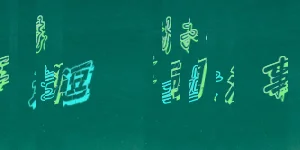
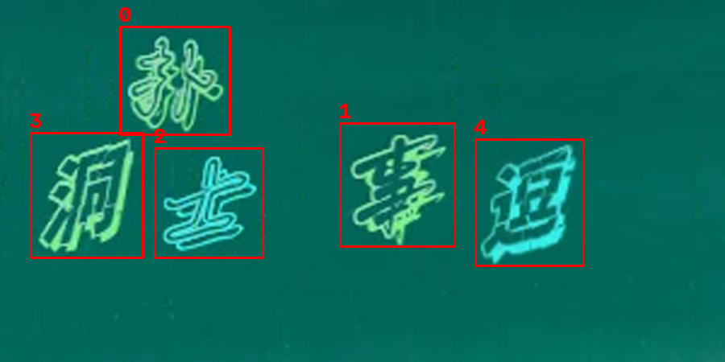
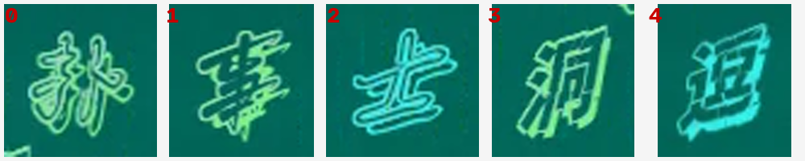
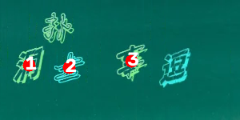
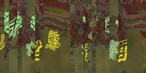
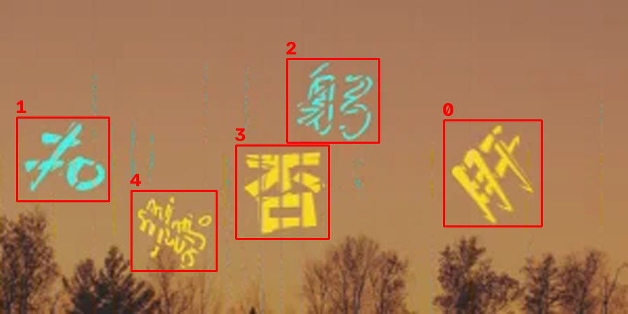
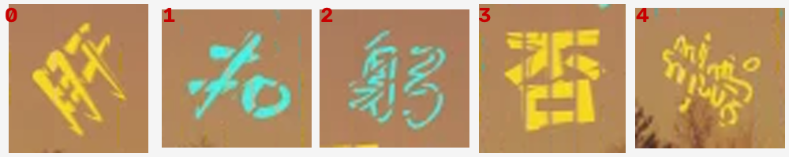
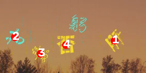

# 顶象 · 文字点选（text-click）

> 背景先被竖向条带打乱，题面给出 3–4 个目标字；YOLO `best_v3` 多尺度检测字符框，视觉模型按四视角投票识别，再按题面顺序一对一指派。
>
> 返回：[顶象索引](../../../docs/dingxiang.md) · [全量类型](../../../docs/types.md) · [方法论](../../../docs/00-methodology.md)

## 一、速览

| 项 | 值 |
|---|---|
| 厂商 | 顶象（`dingxiang`） |
| 类型 / 变体 | `text-click` / classic |
| 中文 | 文字点选 |
| 媒体 | 图片 |
| 样本 | 12 组（001–012），其中 9 组 3 字、3 组 4 字 |
| 答案格式 | `points`：按题面顺序的点击坐标 |
| 方法 | `CV+VLM`（YOLO 检测 + 四视角识别投票 + direct 兜底） |
| 求解器 | `exists` · 高（发布 12/12 live-pass） |
| 人工审查 | 12 条 `pass`；001、012 备注“原审核结论失效，待重新审核” |
| 证据等级 | `live-pass`（2026-11-19 官方 demo 服务端 verify success） |

## 二、题面与判定

题面直接给出目标字与顺序（如“洞 → 士 → 事”），用户按序点击；顺序错误不通过。每张图里除了目标字，还会有干扰字，检测阶段往往框出比目标更多的字符。

| 案例 | 题面（`meta.prompt`） | 通过条件 | 目标字序列 |
|---|---|---|---|
| [001](001/) | 请依次点击：洞 → 士 → 事 | 按提示顺序依次点击 3 个目标字；顺序错误不通过 | 洞、士、事 |
| [003](003/) | 请依次点击：肝 → 扣 → 素 → 否 | 按提示顺序依次点击 4 个目标字；顺序错误不通过 | 肝、扣、素、否 |
| [012](012/) | 请依次点击：的 → 笔 → 残 | 按提示顺序依次点击 3 个目标字；顺序错误不通过 | 的、笔、残 |

> 答案空间是“目标字 → 图中字符框”的一对一指派；题面已给顺序，真正的难点是把每个字读对、框对。

## 三、样本长什么样

| 原始题面 | YOLO 检测 | 字符裁片 | 点击结果 |
|---|---|---|---|
|  |  |  |  |
|  |  |  |  |

- 第 1 列是条带错位的原始题面；第 2 列在还原图上画出多尺度 YOLO 的字符框，编号 0–4 含干扰字（001 只有 3 个目标，却检出 5 个框）；第 3 列把每个框裁出放大，作为视觉模型输入；第 4 列按题面顺序标 ①②③。
- 001 的目标是“洞、士、事”，检测框里的“辨”等字是干扰项；003 是 4 字题，点击序为“肝 → 扣 → 素 → 否”。

## 四、形态与难点

- **背景条带**：原始图有竖向错位，检测前要先还原背景（`restored.png`），否则字符会被条带切断。
- **字数是可变的**：9 组 3 字、3 组 4 字；不能把“固定 3 字”写死。
- **干扰字多**：检测结果常多于目标数，需要按题面序列做一对一筛选。
- **细字漏检**：一、丨这类细笔画字容易被多尺度检测漏掉，源记录用 direct 整图坐标兜底。
- **形近字**：局部裁片放大后仍可能混淆，靠四视角投票与序列约束收敛。

## 五、求解思路

源记录把检测与识别解耦：YOLO 只负责“哪里有字”，视觉模型负责“这个字是什么”，最后用题面序列做一对一指派。direct 整图坐标既作为额外一票，也负责细字漏检时的直接落点。

| 步骤 | 做法 | 关键判据 / 参数 | 依据 |
|---|---|---|---|
| 1 背景还原 | 把条带错位图还原成可读背景 | 字符笔画连续 | `restored.png`；001 的检测在还原图上 |
| 2 字符检测 | YOLO `best_v3.onnx` 多尺度检测字符框 | 返回框可多于目标数，保留全部候选 | `solver.notes` |
| 3 裁片放大 | 每个框裁出并放大，作为识别输入 | 单字一图，保留笔画细节 | `process-02-crops.png` |
| 4 四视角投票 | 视觉模型按“逐格受限 / 序列 / 双图 / 逐字”四个视角识别，权重 2/1/2/1 | 票数合并后得到每框候选字 | `method_note` + 批次任务记录 |
| 5 一对一指派 | 把题面目标字与字符框做一对一匹配 | 序列约束 + 票数；direct 整图坐标补充投票 | `solver.notes` |
| 6 输出 | 按题面顺序输出每个字的框中心 | 12/12 服务端接受 | `result.json` 的 `clicks` |

```text
# 文字点选：检测 → 裁片 → 四视角投票 → 一对一指派（伪代码，按源记录直译）
restored = restore_background(bg)
boxes    = yolo_multiscale("best_v3.onnx", restored)
crops    = [enlarge(crop(restored, b)) for b in boxes]

votes = {}
for view in [cell_constrained, sequence, dual_image, per_char]:
    votes += weight(view) * vlm_read(crops, cw, view)   # 权重 2 / 1 / 2 / 1
votes += direct_whole_image(restored, cw)               # 补充投票 + 细字兜底

assign = one_to_one(votes, cw)                          # 目标字 -> 字符框
click([center(assign[ch]) for ch in cw])                # 按题面顺序点击
```

> 四个视角不是四个模型，而是同一视觉模型的不同提问/约束方式；权重 2/1/2/1 来自批次任务记录，案例 `meta` 未落盘。direct 不是主路径，只在投票分歧或细字漏检时起作用。

## 六、结果与审查

- **源记录**：12 组均为 2026-11-19 实机 `verify success`（`live-pass`），`result.json` 记录 `success=true`；`accuracy=high` 是源记录，本库没有独立复算准确率。
- **本库结果**：12 组 `solution.json` / `result.json` / `solved.png` / 两张过程图齐全；`result.json` 记录 `success=true` 与“点击坐标即服务端接受的序列”。
- **人工审查**：12 条 `review.state=pass`；其中 001、012 备注“2026-11-19 求解器更新并重生成结果图，原审核结论失效，待重新审核”，其余 10 条备注为 live-pass。

| 组 | 题面 | 点击序（坐标） | 证据 |
|---|---|---|---|
| [001](001/) | 洞 → 士 → 事 | 洞(36,81) → 士(86,84) → 事(164,76) | live-pass |
| [002](002/) | 冲 → 俗 → 透 | 冲(35,82) → 俗(188,92) → 透(172,34) | live-pass |
| [003](003/) | 肝 → 扣 → 素 → 否 | 肝(235,83) → 扣(30,76) → 素(83,110) → 否(135,92) | live-pass |
| [004](004/) | 肢 → 学 → 召 → 旨 | 肢(98,50) → 学(92,110) → 召(248,78) → 旨(30,102) | live-pass |
| [005](005/) | 扮 → 余 → 牢 | 扮(68,93) → 余(179,84) → 牢(122,102) | live-pass |
| [006](006/) | 召 → 否 → 首 | 召(158,106) → 否(233,75) → 首(109,73) | live-pass |
| [007](007/) | 光 → 扁 → 谷 | 光(146,39) → 扁(39,98) → 谷(198,114) | live-pass |
| [008](008/) | 相 → 耳 → 恩 → 找 | 相(69,101) → 耳(241,77) → 恩(140,84) → 找(56,46) | live-pass |
| [009](009/) | 打 → 引 → 堆 | 打(168,108) → 引(28,75) → 堆(152,46) | live-pass |
| [010](010/) | 竟 → 欲 → 片 | 竟(204,107) → 欲(97,54) → 片(172,51) | live-pass |
| [011](011/) | 河 → 能 → 仙 | 河(70,93) → 能(253,80) → 仙(122,77) | live-pass |
| [012](012/) | 的 → 笔 → 残 | 的(114,83) → 笔(58,32) → 残(138,36) | live-pass |

> 12 组点击序列都是服务端接受过的坐标，这是本厂商唯一有 `live-pass` 的类型；001/012 的“待重新审核”只涉及结果图，不改变样本的 `live-pass` 证据。

## 七、失败与边界

| 现象 | 根因 | 证据 | 结论 |
|---|---|---|---|
| 检测框多于目标数 | 图中有干扰字 | 001 只点 3 字，检测图有 5 个框（0–4） | 必须做一对一筛选，不能按框直接点击 |
| 细字被漏检 | 一、丨等细笔画在多尺度下响应弱 | 源记录用 direct 整图坐标对漏检细字直接落点 | 检测不是唯一入口，保留 direct 兜底 |
| 四视角投票仍分歧 | 局部裁片相似、笔画被条带切断 | 源记录权重 2/1/2/1，说明单一视角不够 | 以票数 + 序列约束收敛，不承诺单模型全对 |
| 001、012 审查结论失效 | 求解器更新后重生成结果图 | `review.notes` 明确“待重新审核” | 这两组需重新人工核对，不能沿用旧 pass |
| live-pass 只覆盖 12 组 | 未做大样本线上统计 | 发布案例为 2026-11-19 成功样本 | 不要把 12/12 当成通用线上通过率 |

**边界**：本页只覆盖“看清字、点对序”。真实环境还需要还原图的坐标对齐、点击时序与风控；发布 12 组是成功样本，不代表所有顶象文字点选都能一次通过。

## 八、相关

- 厂商索引：[docs/dingxiang.md](../../../docs/dingxiang.md)
- 全量类型：[docs/types.md](../../../docs/types.md) · 方法论：[docs/00-methodology.md](../../../docs/00-methodology.md)
- 同厂商对照：[word-order](../word-order/)（语序点选，未解）、[icon-click](../icon-click/)（图标点选）
- 案例：[001](001/) – [012](012/)（每组含 `meta.json`、`solution.json`、`result.json`、`process-01-detect.png`、`process-02-crops.png`、`solved.png`）
- 来源：<https://www.dingxiang-inc.com/business/captcha>；样本版权归顶象所有，仅用于研究与教学。
