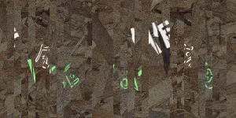
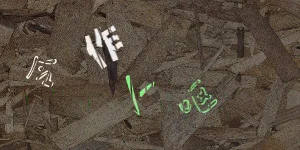
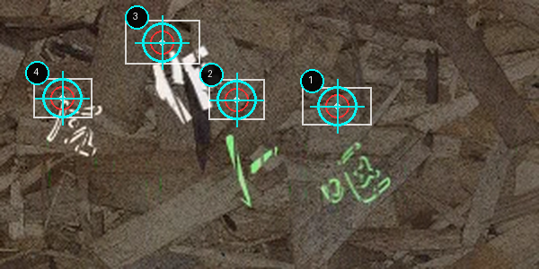
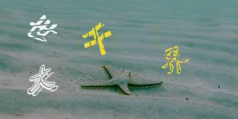
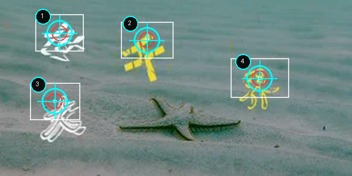

# 顶象 · 语序点选（word-order）

> 300×150 照片背景上散布 4 个毛笔字，条带错位把字切碎；题面要求按正确语序依次点击。源记录为待做，建议 OCR + VLM 语序。
>
> 返回：[顶象索引](../../../docs/dingxiang.md) · [全量类型](../../../docs/types.md) · [方法论](../../../docs/00-methodology.md)

## 一、速览

| 项 | 值 |
|---|---|
| 厂商 | 顶象（`dingxiang`） |
| 类型 / 变体 | `word-order` / classic |
| 中文 | 语序点选 |
| 媒体 | 图片 |
| 样本 | 12 组（001–012） |
| 答案格式 | `points+order`：按语序的点击序列 |
| 方法 | `NONE(OCR+VLM)`（建议 OCR + VLM 语序） |
| 求解器 | `none` · 未知（源记录未撰写） |
| 人工审查 | `not-applicable`（12/12，无答案可审） |
| 证据等级 | 未标注（无 `answer.txt` / `result.json` / `evidence`） |

## 二、题面与判定

题面固定为“按正确语序点击文字”。画面散布 4 个目标字，彼此没有标号；用户要先读出字、判断它们能组成什么短语，再按语序点击。答案空间是 4 个点的有序序列。

| 案例 | 题面（`meta.prompt`） | 通过条件 | 答案 |
|---|---|---|---|
| [001](001/) | 按正确语序点击文字 | 该批案例未记录通过条件 | 4 个点的有序序列 |
| [002](002/) | 按正确语序点击文字 | 该批案例未记录通过条件 | 4 个点的有序序列 |

> 12 组没有 `pass_criteria`，也没有记录“按什么语序”（成语、诗句还是词语）；只能从画面和目标数确认是 4 字排序。

## 三、样本长什么样

| 原始题面 | 去条带还原 | 语序标注 |
|---|---|---|
|  |  |  |
|  |  |  |

- 第 1 列是原始题面：照片背景（沙滩、木纹、墙面等）上叠着 4 个毛笔字，竖向条带错位把字切成几段。
- 第 2 列是去条带后的还原图，字迹连续但仍需辨认；第 3 列是 600×300 的标注图，青色十字/白框标出 4 个目标，黑底数字 ①②③④ 表示正确点击顺序。
- 001 的标注顺序是 3 → 4 → 2 → 1（按图的几何位置），002 是 1 → 2 → 3 → 4；顺序取决于字义组成的短语，不是从左到右或从上到下。

## 四、形态与难点

- **条带切字**：原始图竖向错位，字被切成几段；不还原很难认字。
- **背景干扰**：沙滩、木纹、墙面纹理与毛笔笔画混在一起，直接 OCR 容易漏字。
- **4 字排序**：目标数固定为 4（已核 001/002/003/012），但正确顺序由语义决定，不是固定空间顺序。
- **无候选词**：界面不给词表，必须自己判断能组成哪个短语。

## 五、建议路线

源记录只给“建议 OCR + VLM 语序”，没有实现。合理路线是先还原并切出 4 个字，再做 OCR，最后用语言模型/VLM 判断语序。

| 步骤 | 建议做法 | 关键判据 | 依据 |
|---|---|---|---|
| 1 去条带 | 按竖向错位量还原 300×150 背景 | 笔画在接缝处连续 | `roles.restored` |
| 2 目标定位 | 用边缘/颜色/连通域找出 4 个毛笔字 | 每个字一个外接框 | `annotated.png` 的白框 |
| 3 单字识别 | 对每个裁片做 OCR，保留多候选 | 毛笔体、低对比，需多候选 | 源记录“OCR” |
| 4 语序判断 | 用语言模型/VLM 在 4! = 24 种排列中选最通顺的，输出对应中心点 | 语义通顺且点落在字上 | 源记录“VLM 语序” |

> 没有源实现，不能写伪代码；上表是依据“建议 OCR + VLM 语序”和 4 字结构给出的路线，不是已实现算法。

## 六、为什么没有结果

- `solver.status=none`、`accuracy=unknown`，源记录“未撰写求解器”。
- 12 组没有 `answer.txt` / `result.json`，也没有 4 个字的文本、坐标或排序结果。
- `annotated.png` 用编号标了顺序，但编号是标注者给的，不是求解器输出；`review.state=not-applicable`，没有可审的求解结果。

## 七、边界

- **只有顺序标注、没有文字**：无法复核 OCR 是否正确，也无法知道组成的是哪个短语。
- **语序依赖语义**：同一组字可能有多种排列，必须靠词库/语言模型，纯 CV 不够。

## 八、相关

- 厂商索引：[docs/dingxiang.md](../../../docs/dingxiang.md)
- 全量类型：[docs/types.md](../../../docs/types.md) · 方法论：[docs/00-methodology.md](../../../docs/00-methodology.md)
- 案例：[001](001/) – [012](012/)（每组含 `meta.json`、`bg.webp`、`restored.png`、`annotated.png`）；同厂商对照：[text-click](../text-click/)、[font](../font/)
- 来源：<https://www.dingxiang-inc.com/business/captcha>；样本版权归顶象所有，仅用于研究与教学。
