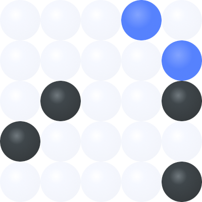
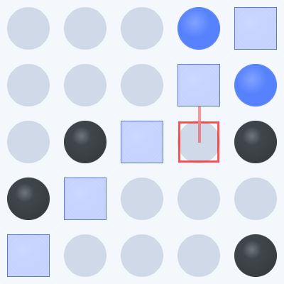
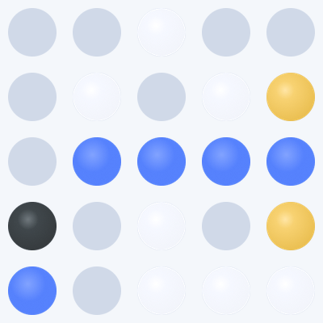
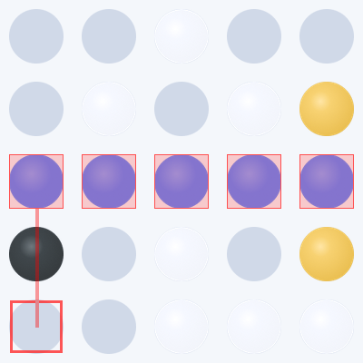
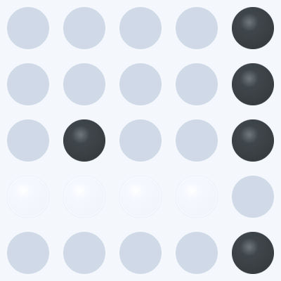
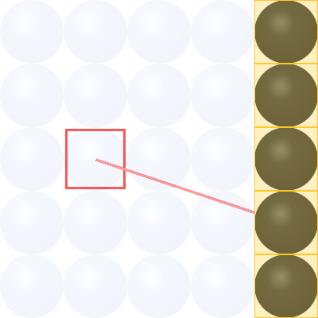
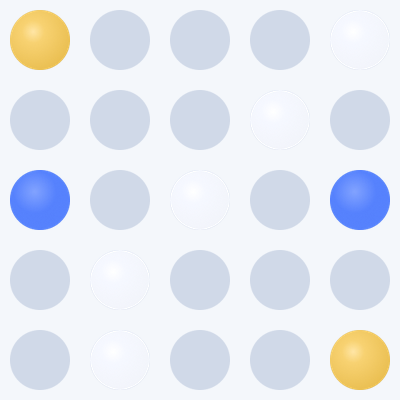
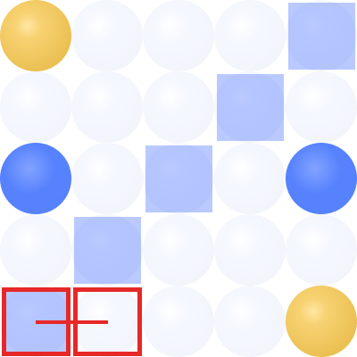

# 极验 GeeTest · 五子棋（gobang）

> 5×5 棋盘、5 种棋子，交换两个棋子使同色五连；棋盘矩阵直接枚举全部交换对，纯枚举、零视觉模型。
>
> 返回：[极验索引](../../../docs/geetest.md) · [全量类型](../../../docs/types.md) · [方法论](../../../docs/00-methodology.md)

## 一、速览

| 项 | 值 |
|---|---|
| 厂商 | 极验 GeeTest（`geetest`） |
| 类型 / 变体 | `gobang` / winlinze |
| 中文 | 五子棋 |
| 媒体 | 图片 |
| 样本 | 12 组（001–012） |
| 答案格式 | `swap`：交换的两个格子 + `win_color` + `win_line` |
| 方法 | `PROTO`（棋盘矩阵枚举） |
| 求解器 | `exists` · 高（源记录 12/12 经枚举校验） |
| 人工审查 | 12 通过 / 0 错误（截至 2026-11-21） |
| 证据等级 | `offline-verified` 12 组（无线上提交） |

## 二、题面与判定

题面是一张 5×5 棋盘，格子中放 5 种棋子（`img0`–`img4`）。用户交换两个棋子，使某一种颜色在横、纵或斜方向上形成五连。该批案例没有记录 `pass_criteria`；判定取自题面与厂商文档：只能交换一对棋子，交换后必须出现同色五连。

| 案例 | 题面（`meta.prompt`） | 通过条件 | 答案 |
|---|---|---|---|
| [001](001/) | 交换两个棋子，使同色棋子五连 | 该批案例未记录 `pass_criteria`；交换一对后同色五连 | swap=(1,3)↔(2,3); win_color=3; 斜线 (0,4)-(1,3)-(2,2)-(3,1)-(4,0) |
| [002](002/) | 同上 | 同上 | swap=(2,0)↔(4,0); win_color=1; 横线 (2,0)-(2,1)-(2,2)-(2,3)-(2,4) |
| [004](004/) | 同上 | 同上 | swap=(2,1)↔(3,4); win_color=4; 竖线 (0,4)-(1,4)-(2,4)-(3,4)-(4,4) |

> 答案空间是「25 个格子中任选 2 个」= 300 种交换，再乘以获胜颜色与五连线路；本批 12 组的 `result.json` 都记录 `total=1`，即解唯一。

## 三、样本长什么样

| 原始题面 | 答案标注 | 原始题面 | 答案标注 |
|---|---|---|---|
|  |  |  |  |
|  |  |  |  |

- 每组只有题面与答案标注两类图：题面是完整棋盘；标注图标出要交换的两个棋子以及获胜五连线。
- 棋子共 5 种颜色/图案，题目要求的是「某一种颜色的五连」，不限定必须交换成哪一种颜色。

## 四、形态与难点

- **棋盘固定**：5×5 = 25 格，5 种棋子；交换后五连可以横、纵、斜任意方向。
- **解唯一性**：本批 12 组的 `result.json` 均记录 `total=1`；厂商机制上仍可能存在多解，多解时只要求给出其一。
- **两批来源不同**：001–006 的源解经暴力枚举校验一致；007–012 由棋盘矩阵与棋子图重建后求解（`meta.notes`）。重建组的结果同样是 `offline-verified`。
- **真正的难点不在求解**：棋盘矩阵一旦可读，枚举是常数级；难的是把界面坐标映射到行列、以及提交流程，本库不覆盖后者。

## 五、求解思路

把棋盘读成 5×5 的整数矩阵后，答案空间只有 300 种交换。逐个交换、检查四个方向是否存在同色五连，取第一个有效解即可。

| 步骤 | 做法 | 关键判据 / 参数 |
|---|---|---|
| 1 读棋盘 | 从题面接口字段 `ques` 取 5×5 矩阵，取值 0–4 | 厂商文档记录 `ques` 直接给出棋盘 |
| 2 枚举交换 | 枚举 25 格中任取 2 格，共 300 种 | 交换后要还原，保证互不影响 |
| 3 判五连 | 对每种颜色检查横、纵、两条斜线 | 连续 5 格同色 |
| 4 取解 | 取第一个有效交换，输出两个格子与获胜线路 | 本批全部 `total=1` |

```text
# 五子棋：棋盘矩阵枚举（伪代码，对应源方案）

board = read_ques_matrix()                 # 5×5，0..4
for (a, b) in combinations(cells, 2):      # C(25,2) = 300
    swap(board, a, b)
    for color in 0..4:
        if exists_five(board, color, dirs=[row, col, diag_down, diag_up]):
            return (a, b, color, five_cells)
    swap(board, a, b)                      # 还原，继续下一对
```

> 求解器没有用视觉模型：棋盘由接口矩阵给出，图像只用于展示。007–012 的矩阵由棋子图重建，属于离线补录，不是接口原样。

## 六、结果与审查

- **源记录**：12/12 棋盘解经枚举校验；001–006 的源解与枚举结果完全一致，007–012 为矩阵重建后求解。全部 `evidence=offline-verified`，无线上提交。
- **人工审查**：12 组 `review.state=pass`、`result=correct`（截至 2026-11-21）；核对的是棋盘解本身，不包含线上提交是否被接受。

| 组 | 交换 | 获胜颜色 | 五连线 | 解数 | 审查 |
|---|---|---|---|---:|---|
| [001](001/) | (1,3)↔(2,3) | 3 | (0,4)-(1,3)-(2,2)-(3,1)-(4,0) | 1 | 通过 |
| [002](002/) | (2,0)↔(4,0) | 1 | (2,0)-(2,1)-(2,2)-(2,3)-(2,4) | 1 | 通过 |
| [003](003/) | (0,4)↔(1,0) | 1 | (0,0)-(1,0)-(2,0)-(3,0)-(4,0) | 1 | 通过 |
| [004](004/) | (2,1)↔(3,4) | 4 | (0,4)-(1,4)-(2,4)-(3,4)-(4,4) | 1 | 通过 |
| [005](005/) | (2,1)↔(3,2) | 4 | (0,2)-(1,2)-(2,2)-(3,2)-(4,2) | 1 | 通过 |
| [006](006/) | (1,1)↔(2,1) | 2 | (0,0)-(1,1)-(2,2)-(3,3)-(4,4) | 1 | 通过 |
| [007](007/) | (4,0)↔(4,1) | 3 | (0,4)-(1,3)-(2,2)-(3,1)-(4,0) | 1 | 通过 |
| [008](008/) | (2,1)↔(4,0) | 2 | (4,0)-(4,1)-(4,2)-(4,3)-(4,4) | 1 | 通过 |
| [009](009/) | (2,3)↔(4,0) | 3 | (2,0)-(2,1)-(2,2)-(2,3)-(2,4) | 1 | 通过 |
| [010](010/) | (1,3)↔(4,4) | 3 | (0,4)-(1,4)-(2,4)-(3,4)-(4,4) | 1 | 通过 |
| [011](011/) | (3,1)↔(4,3) | 2 | (0,1)-(1,1)-(2,1)-(3,1)-(4,1) | 1 | 通过 |
| [012](012/) | (1,1)↔(3,2) | 3 | (1,0)-(1,1)-(1,2)-(1,3)-(1,4) | 1 | 通过 |

> 坐标均为 0-based `(row, col)`，与 `answer.txt` / `result.json` 一致。

## 七、失败与边界

| 现象 | 根因 | 证据 | 结论 |
|---|---|---|---|
| 理论上可能存在多个有效交换 | 棋盘结构允许不同交换各自成五连 | 厂商文档提示多解；本批 12 组 `total=1` | 多解时取第一个即可，题目只要求其一 |
| 007–012 的矩阵来自重建 | 这 6 组没有可直接读取的接口矩阵 | `meta.notes`：07–12 由棋盘矩阵重建并求解 | 重建结果仍是离线校验，不等于接口原样 |
| 棋盘解正确但界面点击可能错位 | 行列与屏幕坐标不是同一坐标系 | 厂商文档把 UI 坐标映射列为难点 | 求解与提交要分开评估 |
| 全部案例无线上记录 | 未做提交闭环 | `evidence` 统一为 `offline-verified` | 离线解正确 ≠ 线上通过 |

**适用边界**：本页只覆盖「棋盘已知」的求解。若棋盘只能从截图识别，还需要先做棋子分类与网格定位；本库未记录这类识别流程，不能把页面结论外推到纯视觉场景。

## 八、相关

- 厂商索引：[docs/geetest.md](../../../docs/geetest.md)
- 全量类型：[docs/types.md](../../../docs/types.md) · 方法论：[docs/00-methodology.md](../../../docs/00-methodology.md)
- 同厂商对照：[slide](../slide/)（滑动拼图）、[icon-click](../icon-click/)（图标点选）、[icon-crush](../icon-crush/)（图标消除）
- 案例：[001](001/) – [012](012/)（每组含 `meta.json` / `answer.txt` / `result.json` / `bg.png` / `annotated.png`）
- 来源：<https://www.geetest.com/en/adaptive-captcha-demo>；样本采集于 2026-07-23/24，版权归极验所有，仅用于研究与教学。
