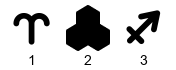
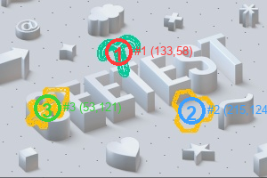
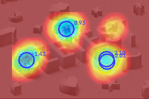
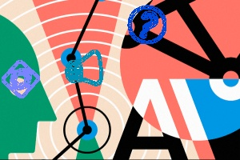
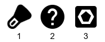
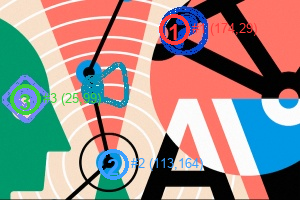
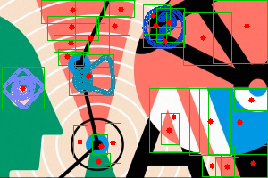

# 极验 GeeTest · 图标点选（icon-click）

> 300×200 主题背景 + 3 个 48×48 图标，按 `icon0→icon1→icon2` 顺序点击；颜色连通域 + 轮廓距离 chamfer + 匈牙利指派，纯 CV、零 LLM。
>
> 返回：[极验索引](../../../docs/geetest.md) · [全量类型](../../../docs/types.md) · [方法论](../../../docs/00-methodology.md)

## 一、速览

| 项 | 值 |
|---|---|
| 厂商 | 极验 GeeTest（`geetest`） |
| 类型 / 变体 | `icon-click` / v4/icon |
| 中文 | 图标点选 |
| 媒体 | 图片 |
| 样本 | 12 组（001–012） |
| 答案格式 | `points`：3 个有序点击坐标 |
| 方法 | `CV`（颜色连通 + 轮廓 chamfer + 匈牙利） |
| 求解器 | `exists` · 中（源记录 23/27 ≈ 85%，±20px 计命中） |
| 人工审查 | **1 通过 / 11 错误**（截至 2026-11-21，按 `meta.review`） |
| 证据等级 | `offline-verified` 9 组 / `unverified` 3 组（无线上提交） |

## 二、题面与判定

题面给出一张主题背景和一条目标图标条，用户按图标条给出的顺序，在背景中依次点击 3 个对应图标。该批案例没有记录 `pass_criteria`；下列判定取自题面与厂商文档：点击顺序必须与 `icon0→icon1→icon2` 一致，每个图标落在背景中对应图形的位置。

| 案例 | 题面（`meta.prompt`） | 通过条件 | 答案（1→3） |
|---|---|---|---|
| [001](001/) | 按顺序点击背景图中的 3 个图标 | 该批案例未记录 `pass_criteria`；按图标顺序点击判定 | 1:(133,58); 2:(215,124); 3:(53,121) |
| [002](002/) | 同上 | 同上 | 1:(174,29); 2:(113,164); 3:(25,99) |
| [004](004/) | 同上 | 同上 | 1:(80,106); 2:(156,106); 3:(211,56) |

> 答案空间是「3 个有序点」而不是自由框选；顺序或对应图标出错，答案即不成立。

## 三、样本长什么样

| 原始题面 | 目标图标条 | 答案标注 | 过程示例 |
|---|---|---|---|
|  |  |  |  |
|  |  |  |  |

- 第 1 列是 300×200 背景；第 2 列是题面附带的图标条，顺序就是点击顺序；第 3 列按 1→3 标出应点击的位置；第 4 列是求解过程，组内还有 `process-01-split.png`（图标拆分）、`process-02-regions.png`（区域检测）、`process-03-contour.png`（轮廓距离场）、`process-04/05/06-match-*.png`（逐个模板匹配）。
- 过程图能直接看出这条 CV 链的中间态：先把背景拆成候选区域，再看轮廓距离场，最后逐图标匹配。

## 四、形态与难点

- **图幅固定**：300×200 背景；目标图标 48×48，本批匹配到的旋转角覆盖 0°–350°（每 5° 搜索）。
- **同色与遮挡**：图标可能与场景色带几乎同色而被并入背景；也可能被画幅裁剪或与其他图形重叠。
- **干扰**：场景中可能有形状相似的干扰物，纯颜色分割会把它们当成候选。
- **唯一指派**：3 个图标必须落在 3 个不同区域，不能靠逐图标取最大分简单拼接，因此最后需要匈牙利指派。

## 五、求解思路

核心是「先找所有可能的实心区域，再把图标轮廓旋转着贴上去」：颜色连通域负责召回，轮廓距离/chamfer 负责形状相似度，匈牙利负责保证一对一。

| 步骤 | 做法 | 关键判据 / 参数 |
|---|---|---|
| 1 区域分割 | 对背景做颜色连通域，保留纯色实心区域 | 纯色实心区域 |
| 2 轮廓表示 | 取区域轮廓做距离变换；目标图标取 alpha 外轮廓 | 轮廓只保留形状，不带颜色 |
| 3 旋转匹配 | 图标轮廓按 72 个旋转角（每 5°）与区域轮廓做 chamfer 距离 | 取每个「图标 × 区域」的最小代价 |
| 4 唯一指派 | 匈牙利算法把 3 个图标分配到 3 个不同区域 | 不允许两个图标共用一个区域 |
| 5 输出 | 点击区域质心，顺序按 `icon0→icon1→icon2` | 本批记录每个点的匹配分 |

```text
# 图标点选：颜色连通 → 轮廓距离 → 旋转 chamfer → 匈牙利（伪代码，对应源方案）

regions = color_connected_components(bg)          # 纯色实心区域

for icon in icons:                                 # 3 个目标图标
    contour = alpha_outer_contour(icon)
    dist    = distance_transform(contour)
    for r in regions:
        cost[icon][r] = min over 72 angles of
                        chamfer(dist, rotate(contour, angle))

assign = hungarian(cost)                           # 3 图标 ↔ 3 个不同区域
click(order=icons, points=[centroid(regions[assign[i]]) for i in icons])
```

> 源记录的整体命中率是 23/27 ≈ 85%（±20px 计命中）；本批 12 组中，001/006/009 没有该组真值（`unverified`），其余 9 组有同场景差分真值（`offline-verified`）。

## 六、结果与审查

- **源记录**：可验证集 23/27 ≈ 85%（±20px 计命中）；002/004/007/008/012 的 `meta.notes` 记录源方案 3/3 命中，003/005/010/011 记录 2/3 命中，001/006/009 无该组真值。
- **本库结果**：12 组 `answer.txt` / `result.json` / `annotated.png` / `process-*.png` 齐全；`evidence` 为 `offline-verified` 9 组、`unverified` 3 组，无线上提交。
- **人工审查**：按 `meta.review` 现算为 **1 通过 / 11 错误**——只有 001 通过，002–012 全部 `incorrect`。这与 `docs/geetest.md` 旧汇总里的 `pending` 不同，本页以 `meta.review` 为准。

| 组 | 1→3 点击坐标 | 匹配分 | 旋转（°） | 证据 | 审查 |
|---|---|---|---|---|---|
| [001](001/) | (133,58); (215,124); (53,121) | 0.845 / 0.829 / 0.772 | 10 / 50 / 350 | unverified | 通过 |
| [002](002/) | (174,29); (113,164); (25,99) | 0.798 / 0.723 / 0.747 | 30 / 185 / 320 | offline-verified | 错误 |
| [003](003/) | (126,160); (128,29); (53,63) | 0.760 / 0.764 / 0.881 | 260 / 285 / 10 | offline-verified | 错误 |
| [004](004/) | (80,106); (156,106); (211,56) | 0.805 / 0.691 / 0.821 | 90 / 10 / 30 | offline-verified | 错误 |
| [005](005/) | (255,77); (110,25); (134,81) | 0.713 / 0.841 / 0.834 | 225 / 170 / 200 | offline-verified | 错误 |
| [006](006/) | (140,121); (113,97); (39,75) | 0.765 / 0.789 / 0.832 | 0 / 115 / 100 | unverified | 错误 |
| [007](007/) | (226,135); (69,61); (244,160) | 0.778 / 0.768 / 0.677 | 25 / 165 / 210 | offline-verified | 错误 |
| [008](008/) | (29,33); (244,44); (121,89) | 0.889 / 0.820 / 0.745 | 315 / 0 / 315 | offline-verified | 错误 |
| [009](009/) | (235,64); (24,163); (202,115) | 0.768 / 0.782 / 0.854 | 55 / 345 / 100 | unverified | 错误 |
| [010](010/) | (39,61); (173,92); (130,78) | 0.733 / 0.461 / 0.855 | 45 / 35 / 160 | offline-verified | 错误 |
| [011](011/) | (173,92); (185,43); (50,46) | 0.583 / 0.735 / 0.639 | 255 / 65 / 35 | offline-verified | 错误 |
| [012](012/) | (158,127); (211,88); (77,66) | 0.756 / 0.724 / 0.748 | 60 / 25 / 170 | offline-verified | 错误 |

> **口径说明**：002/004/007/008/012 的 `meta.notes` 写「源方案 3/3 命中」，但 `meta.review` 仍为 `incorrect`；12 组的 `review.notes` 均为空，meta 没有记录判错原因。本页不推断原因，只按 `review` 字段统计。

## 七、失败与边界

| 现象 | 根因 | 证据 | 结论 |
|---|---|---|---|
| 图标与场景同色，候选区域被并入背景 | 颜色连通域分不开同色像素 | 厂商文档记录的失败模式；3 组无同场景真值 | 颜色分割只能召回，不能保证正确 |
| 图标被裁剪、相互重叠 | 目标只保留部分轮廓 | 厂商文档记录的失败模式 | chamfer 对残缺轮廓敏感，需人工复核 |
| 相似干扰物被选中 | 纯形状匹配没有语义 | 本批 11 组审查错误 | 3 个图标的一对一指派仍不足以消除歧义 |
| `meta.notes` 与 `meta.review` 结论不一致 | meta 未记录审查判据 | 002 等 5 组 notes 写 3/3 命中但 review 为错误 | 页面以 `meta.review` 为准，不把源自评当审查通过 |
| 全部案例无线上记录 | 未做提交闭环 | `evidence` 仅 `offline-verified` / `unverified` | 离线坐标正确 ≠ 线上通过，不冒充成功率 |

**适用边界**：这条 CV 链适合「背景色块清晰、图标与背景可分」的题面；同色带、裁剪、重叠和相似干扰物是结构性边界，不是调参能完全消除的。审查结论显示当前启发式离稳定可用还有距离，使用前应逐组复核。

## 八、相关

- 厂商索引：[docs/geetest.md](../../../docs/geetest.md)
- 全量类型：[docs/types.md](../../../docs/types.md) · 方法论：[docs/00-methodology.md](../../../docs/00-methodology.md)
- 同厂商对照：[slide](../slide/)（masked Sobel + NCC）、[gobang](../gobang/) / [icon-crush](../icon-crush/)（棋盘枚举）
- 跨站变体：B站登录的 v4 `icon-pixel` 渲染不同，见 [bilibili/icon-click](../../bilibili/icon-click/)
- 案例：[001](001/) – [012](012/)（每组含 `meta.json`；有结果的含 `answer.txt` / `result.json` / `annotated.png` / `process-*.png`）
- 来源：<https://www.geetest.com/en/adaptive-captcha-demo>；样本采集于 2026-07-23，版权归极验所有，仅用于研究与教学。
