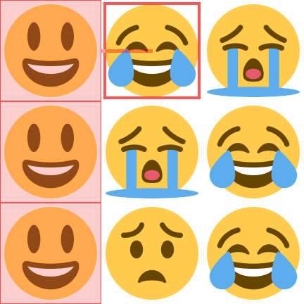
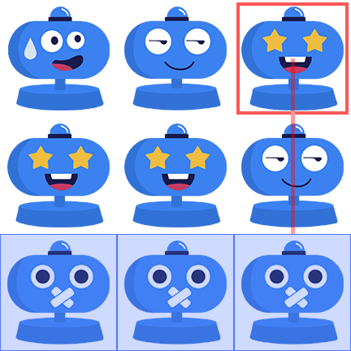
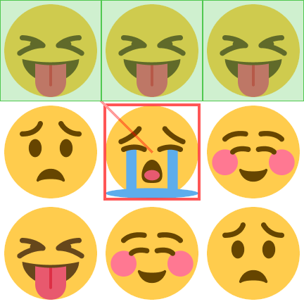
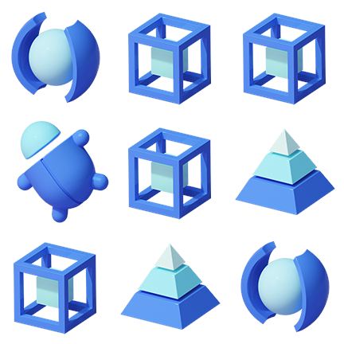
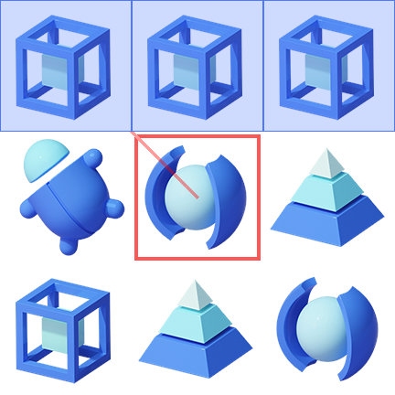

# 极验 GeeTest · 图标消除（icon-crush）

> 3×3 棋盘、4 种图标，交换两个图标使同色三连；棋盘矩阵直接枚举 36 种交换，纯枚举、零视觉模型。
>
> 返回：[极验索引](../../../docs/geetest.md) · [全量类型](../../../docs/types.md) · [方法论](../../../docs/00-methodology.md)

## 一、速览

| 项 | 值 |
|---|---|
| 厂商 | 极验 GeeTest（`geetest`） |
| 类型 / 变体 | `icon-crush` / match |
| 中文 | 图标消除 |
| 媒体 | 图片 |
| 样本 | 12 组（001–012） |
| 答案格式 | `swap`：交换的两个格子 + `win_color` + `win_line` |
| 方法 | `PROTO`（棋盘矩阵枚举） |
| 求解器 | `exists` · 高（源记录 12/12 经枚举校验） |
| 人工审查 | 12 通过 / 0 错误（截至 2026-11-21） |
| 证据等级 | `offline-verified` 12 组（无线上提交） |

## 二、题面与判定

题面是一张 3×3 棋盘，格子中放 4 种图标（`img0`–`img3`）。用户交换两个相邻或任意两个图标，使同色图标在横向或纵向形成三连。该批案例没有记录 `pass_criteria`；判定取自题面与厂商文档：只能交换一对图标，交换后必须出现同色三连。

| 案例 | 题面（`meta.prompt`） | 通过条件 | 答案 |
|---|---|---|---|
| [001](001/) | 交换两个图标，使同色图标三连 | 该批案例未记录 `pass_criteria`；交换一对后同色三连 | swap=(0,0)↔(0,1); win_color=1; 竖线 (0,0)-(1,0)-(2,0) |
| [002](002/) | 同上 | 同上 | swap=(0,2)↔(2,2); win_color=3; 横线 (2,0)-(2,1)-(2,2) |
| [004](004/) | 同上 | 同上 | swap=(0,0)↔(1,1); win_color=2; 横线 (0,0)-(0,1)-(0,2) |

> 答案空间是「9 格中任取 2 格」= 36 种交换，再乘以获胜颜色与三连线路；本批 12 组共记录 23 个有效解，其中 004 与 008 各有 4 个解。

## 三、样本长什么样

| 原始题面 | 答案标注 | 原始题面 | 答案标注 |
|---|---|---|---|
|  |  |  |  |
|  |  |  |  |

- 第 1、3 列是 3×3 棋盘题面；第 2、4 列是答案标注，标出交换的两个图标与三连线。
- 004 与 008 是「多解」样本：`result.json` 各记录 4 个有效交换，页面展示的是源方案取的第一个。

## 四、形态与难点

- **棋盘固定**：3×3 = 9 格，4 种图标；本批 12 组的三连全部是横向或纵向（源文档形态段写「横向或纵向」，求解段写「四方向」，两处不一致）。
- **多解常见**：12 组里 10 组只有 1–2 个解，004 与 008 各有 4 个解；多解不影响正确性，取其一即可。
- **难点不在枚举**：真正的难点是把棋盘读成矩阵（图标分类 + 网格定位）以及 UI 交换坐标映射；本批案例以棋盘矩阵为输入，图像只用于展示。
- **与五子棋的差异**：棋盘更小、目标更短（三连），但解更容易不唯一。

## 五、求解思路

把棋盘读成 3×3 的整数矩阵后，答案空间只有 36 种交换。逐个交换、检查每一行和每一列是否存在同色三连，取第一个有效解即可。

| 步骤 | 做法 | 关键判据 / 参数 |
|---|---|---|
| 1 读棋盘 | 取 3×3 矩阵，取值 0–3 | 厂商文档记录棋盘矩阵由接口字段 `board` 给出 |
| 2 枚举交换 | 枚举 9 格中任取 2 格，共 36 种 | 交换后要还原 |
| 3 判三连 | 只检查横向三行与纵向三列 | 连续 3 格同色 |
| 4 取解 | 取第一个有效交换，输出两个格子与三连线路 | 多解时只报第一个 |

```text
# 图标消除：棋盘矩阵枚举（伪代码，对应源方案）

board = read_board_matrix()                # 3×3，0..3
for (a, b) in combinations(cells, 2):      # C(9,2) = 36
    swap(board, a, b)
    for color in 0..3:
        if exists_three(board, color, dirs=[row, col]):  # 本批均为横/纵；源文档另处写「四方向」
            return (a, b, color, three_cells)
    swap(board, a, b)                      # 还原，继续下一对
```

> 源码思路里棋盘矩阵来自题面接口（厂商文档记录为 `board` 字段）；本库只记录结果，不记录接口调用方式。

## 六、结果与审查

- **源记录**：12/12 源解经枚举校验，交换后均形成三连；全部 `evidence=offline-verified`，无线上提交。
- **本库结果**：12 组 `answer.txt` / `result.json` / `annotated.png` / `bg.png` 齐全；004、008 的 `result.json` 记录 4 个有效解，其余组为 1–2 个。
- **人工审查**：12 组 `review.state=pass`、`result=correct`（截至 2026-11-21）；核对的是棋盘解本身，不包含线上提交是否被接受。

| 组 | 交换 | 获胜颜色 | 三连线 | 解数 | 审查 |
|---|---|---|---|---:|---|
| [001](001/) | (0,0)↔(0,1) | 1 | (0,0)-(1,0)-(2,0) | 2 | 通过 |
| [002](002/) | (0,2)↔(2,2) | 3 | (2,0)-(2,1)-(2,2) | 2 | 通过 |
| [003](003/) | (1,1)↔(1,2) | 3 | (0,1)-(1,1)-(2,1) | 1 | 通过 |
| [004](004/) | (0,0)↔(1,1) | 2 | (0,0)-(0,1)-(0,2) | 4 | 通过 |
| [005](005/) | (0,2)↔(2,0) | 1 | (2,0)-(2,1)-(2,2) | 2 | 通过 |
| [006](006/) | (0,0)↔(1,2) | 2 | (0,2)-(1,2)-(2,2) | 2 | 通过 |
| [007](007/) | (0,2)↔(2,1) | 3 | (2,0)-(2,1)-(2,2) | 2 | 通过 |
| [008](008/) | (0,0)↔(1,1) | 3 | (0,0)-(0,1)-(0,2) | 4 | 通过 |
| [009](009/) | (0,1)↔(1,1) | 2 | (1,0)-(1,1)-(1,2) | 1 | 通过 |
| [010](010/) | (0,2)↔(1,2) | 2 | (0,0)-(0,1)-(0,2) | 1 | 通过 |
| [011](011/) | (0,2)↔(2,2) | 3 | (2,0)-(2,1)-(2,2) | 1 | 通过 |
| [012](012/) | (0,1)↔(0,2) | 2 | (0,1)-(1,1)-(2,1) | 1 | 通过 |

> 坐标均为 0-based `(row, col)`；「解数」取自 `result.json` 的 `solution.total`。

## 七、失败与边界

| 现象 | 根因 | 证据 | 结论 |
|---|---|---|---|
| 同一棋盘有多个有效交换 | 3×3 太小，多个交换都能凑出三连 | 004、008 各有 4 个解 | 取第一个即可，题目只要求其一 |
| 棋盘解正确但界面交换可能错位 | 行列与屏幕坐标不是同一坐标系 | 厂商文档把图标识别与 UI 映射列为难点 | 求解与提交要分开评估 |
| 纯图像输入时可能读错图标 | 本批以棋盘矩阵为输入，没有图标分类结果 | 12 组图像只作展示 | 不要把枚举结论外推到纯视觉识别 |
| 全部案例无线上记录 | 未做提交闭环 | `evidence` 统一为 `offline-verified` | 离线解正确 ≠ 线上通过 |

**适用边界**：本页覆盖「棋盘已知」的枚举求解。真实提交还需要图标分类、网格定位与交换动作；这些环节不在本库的验证范围内。

## 八、相关

- 厂商索引：[docs/geetest.md](../../../docs/geetest.md)
- 全量类型：[docs/types.md](../../../docs/types.md) · 方法论：[docs/00-methodology.md](../../../docs/00-methodology.md)
- 同厂商对照：[slide](../slide/)（滑动拼图）、[icon-click](../icon-click/)（图标点选）、[gobang](../gobang/)（五子棋）
- 案例：[001](001/) – [012](012/)（每组含 `meta.json` / `answer.txt` / `result.json` / `bg.png` / `annotated.png`）
- 来源：<https://www.geetest.com/en/adaptive-captcha-demo>；样本采集于 2026-07-23，版权归极验所有，仅用于研究与教学。
