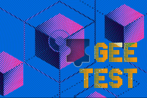
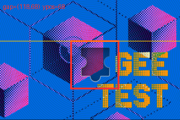
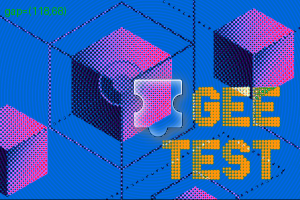
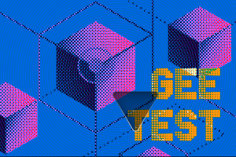
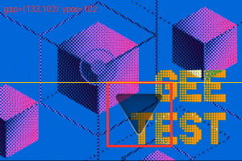
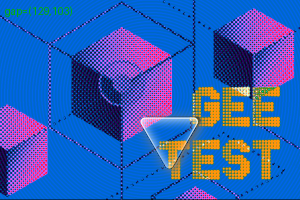

# 极验 GeeTest · 滑动拼图（slide）

> 300×200 背景 + 80×80 拼图块，服务端给出缺口纵向位置 `ypos`；用 masked Sobel 梯度 + alpha 掩膜 NCC 定位缺口，纯 CV、零 LLM。
>
> 返回：[极验索引](../../../docs/geetest.md) · [全量类型](../../../docs/types.md) · [方法论](../../../docs/00-methodology.md)

## 一、速览

| 项 | 值 |
|---|---|
| 厂商 | 极验 GeeTest（`geetest`） |
| 类型 / 变体 | `slide` / v4/slide |
| 中文 | 滑动拼图 |
| 媒体 | 图片 |
| 样本 | 12 组（001–012） |
| 答案格式 | `gap`：缺口左上角 + `ypos` |
| 方法 | `CV`（masked 梯度 + NCC，无 LLM） |
| 求解器 | `exists` · 高（源记录离线 12/12） |
| 人工审查 | 12 通过 / 0 错误（截至 2026-11-21） |
| 证据等级 | `offline-verified`（无线上提交记录） |

## 二、题面与判定

用户拖动滑块，把左侧的拼图块水平移动，补进背景中的缺口。`ypos` 由题面接口直接给出，因此只需要求缺口的水平坐标 `gap_x`；通过条件是拼图块与缺口重合（纵向由 `ypos` 约束）。

| 案例 | 题面（`meta.prompt`） | 通过条件 | 答案 |
|---|---|---|---|
| [001](001/) | 拖动滑块，将拼图块补入缺口 | 该批案例未记录 `pass_criteria`；按缺口重合判定 | `gap_x=118, gap_y=68, ypos=68` |
| [002](002/) | 同上 | 同上 | `gap_x=103, gap_y=111, ypos=111` |
| [004](004/) | 同上 | 同上 | `gap_x=133, gap_y=102, ypos=102` |

> 答案空间是一维水平位移；`gap_y` 与 `ypos` 只用于校验纵向对齐，正常不会偏差超过 ±4px。

## 三、样本长什么样

| 背景题面 | 拼图块（alpha） | 答案标注 | 拼合结果 |
|---|---|---|---|
|  |  |  |  |
|  |  |  |  |
|  |  |  |  |

- 第 2 列是带 alpha 通道的拼图块；透明区在匹配时必须屏蔽，否则会把拼图块的背景色当成特征。
- 第 3 列框出缺口左上角；第 4 列是把拼图块贴回缺口后的效果，便于肉眼核对。

## 四、形态与难点

- **图幅固定**：300×200 背景，80×80 拼图块；`ypos` 由接口给出，搜索空间被压到一维。
- **缺口不明显**：缺口像素与拼图块颜色并不一致，缺口可能是半透明、偏暗或被背景纹理淹没。
- **干扰**：背景有大量纹理和重复边缘，直接做像素相关性容易落在错误位置。
- **坐标**：显示尺寸、缩放、DPR 变化都会让 `gap_x` 偏移，必须固定坐标系。

## 五、求解思路

核心是「只比边缘结构，不比颜色」：对背景和拼图块都做 Sobel 梯度，用拼图块的 alpha 掩膜屏蔽透明区，再在 `ypos ± 4` 的约束下沿 x 轴做归一化互相关，取峰值。

| 步骤 | 做法 | 关键判据 / 参数 |
|---|---|---|
| 1 预处理 | 背景与拼图块转灰度；拼图块取 alpha 掩膜 | 透明区不参与匹配 |
| 2 边缘 | 两侧分别做 Sobel，取梯度幅值 | 保留边缘强弱，弱化颜色差异 |
| 3 匹配 | 以 `ypos` 对齐，沿 x 轴滑动做 masked NCC | 搜索范围 `ypos ± 4`，步长 1px |
| 4 取值 | 取相关峰值对应的 x 为 `gap_x` | 低置信时用 Canny 二值轮廓回退 |
| 5 提交 | 水平拖动 `gap_x`，纵向由 `ypos` 对齐 | 轨迹/时序不在本库范围内 |

```text
# 缺口定位（伪代码，对应源方案 masked 梯度 + NCC）

bg_gray   = gray(bg)                       # 300 x 200
tile_gray = gray(tile)                     # 80 x 80
alpha     = alpha_channel(tile)            # 透明区 = 0

g_bg   = sobel_magnitude(bg_gray)
g_tile = sobel_magnitude(tile_gray)

best_x, best_score = 0, -inf
for x in 0 .. (W - w):
    for dy in -4 .. +4:                    # ypos 容差
        y = ypos + dy
        patch = g_bg[y : y+h, x : x+w]
        score = masked_ncc(g_tile, patch, mask=alpha)
        if score > best_score:
            best_x, best_score = x, score

answer = (best_x, ypos)                    # gap_x, gap_y
```

> 直接 RGB/SSD 匹配在这类题上得分很低：缺口偏暗、拼图块是彩色，像素分布不一致；保留边缘强弱后，缺口内部结构才成为稳定特征。

## 六、结果与审查

- **源记录**：离线 12/12，纵向偏差 `Δy ≤ 4px`；无线上提交记录。
- **本库**：12 组 `answer.txt` / `result.json` / `annotated.png` / `solved.png` 齐全，`evidence: offline-verified`。
- **人工审查**：12 组 `review.state=pass`、`result=correct`（核对的是缺口坐标，不包含轨迹是否被服务端接受）。

| 组 | gap_x | gap_y | ypos | 置信度 | 证据 |
|---|---:|---:|---:|---|---|
| [001](001/) | 118 | 68 | 68 | high | offline-verified |
| [002](002/) | 103 | 111 | 111 | high | offline-verified |
| [003](003/) | 108 | 23 | 23 | high | offline-verified |
| [004](004/) | 133 | 102 | 102 | high | offline-verified |
| [005](005/) | 191 | 40 | 40 | high | offline-verified |
| [006](006/) | 186 | 97 | 97 | high | offline-verified |
| [007](007/) | 131 | 94 | 94 | high | offline-verified |
| [008](008/) | 132 | 100 | 102 | high | offline-verified |
| [009](009/) | 195 | 23 | 24 | high | offline-verified |
| [010](010/) | 112 | 52 | 52 | high | offline-verified |
| [011](011/) | 133 | 62 | 62 | high | offline-verified |
| [012](012/) | 118 | 69 | 69 | high | offline-verified |

## 七、失败与边界

| 现象 | 根因 | 证据 | 结论 |
|---|---|---|---|
| 直接 RGB 匹配得分极低 | 缺口偏暗、拼图块是彩色，像素分布不一致 | 源方案早期试验 | 改用 Sobel 梯度 + alpha mask |
| 缺口被背景纹理淹没时匹配分下降 | 局部边缘弱、重复纹理 | 12 组中个别组相关峰值不够尖锐 | 保留 Canny 轮廓回退；必要时人工复核 |
| `gap_y` 与 `ypos` 有 1–2px 差 | 显示缩放 / 取整 | 008、009 的 `gap_y` 与 `ypos` 相差 1–2px | 以 `ypos` 为纵向基准，水平位移才是答案 |
| 全部案例无线上记录 | 未做轨迹与提交闭环 | 统一标 `offline-verified` | 离线坐标正确 ≠ 线上通过；不要冒充成功率 |

**边界**：本页只覆盖缺口定位。真实提交还需要轨迹生成、时序与风控环境；答案坐标正确但轨迹被拒的情况不在本库的验证范围内。

## 八、相关

- 厂商索引：[docs/geetest.md](../../../docs/geetest.md)
- 全量类型：[docs/types.md](../../../docs/types.md) · 方法论：[docs/00-methodology.md](../../../docs/00-methodology.md)
- 同厂商对照：[icon-click](../icon-click/)（颜色连通 + chamfer）、[gobang](../gobang/) / [icon-crush](../icon-crush/)（棋盘枚举）
- 案例：[001](001/) – [012](012/)（每组含 `meta.json`；有结果的含 `answer.txt` / `result.json` / `annotated.png` / `solved.png`）
- 来源：<https://www.geetest.com/en/adaptive-captcha-demo>；样本版权归极验所有，仅用于研究与教学。
