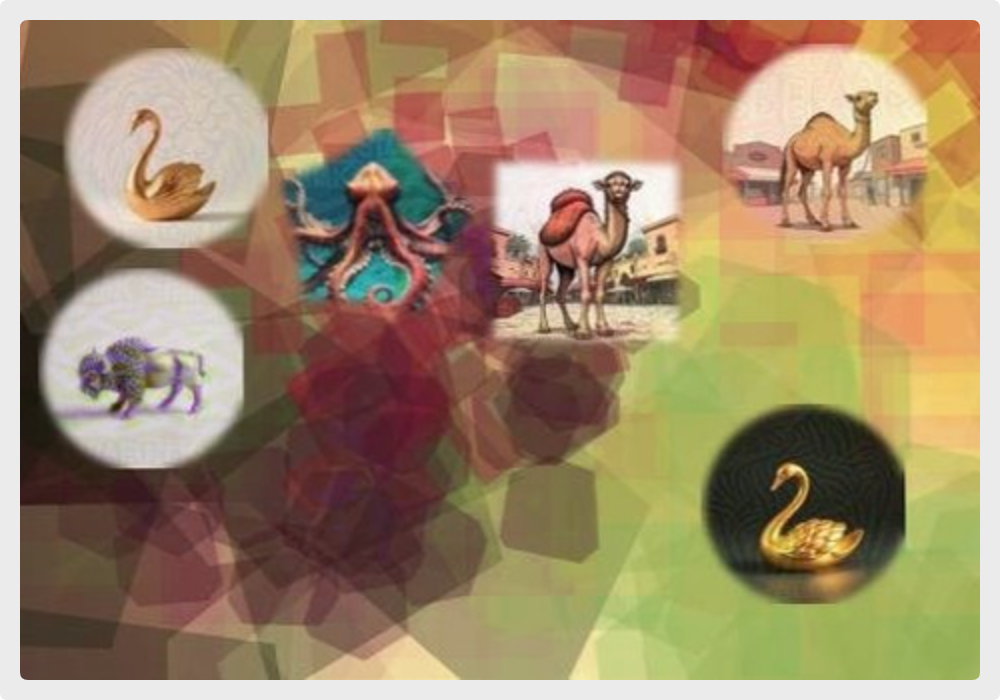
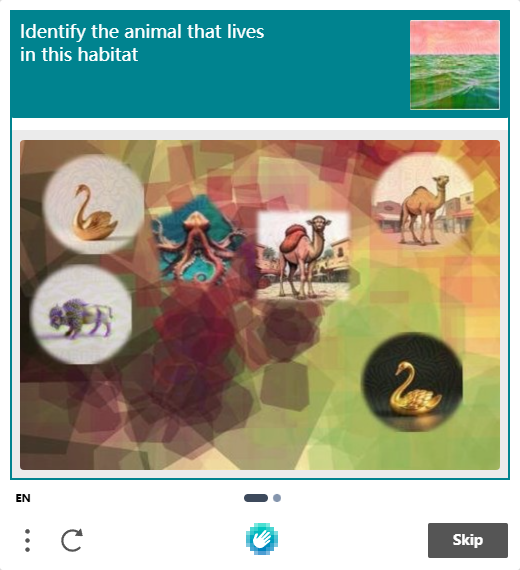
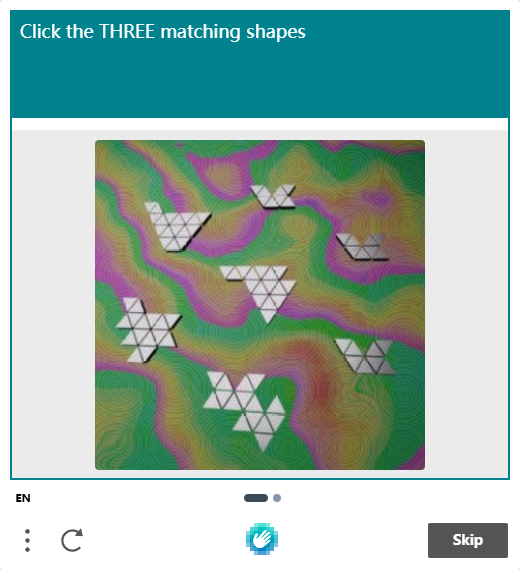
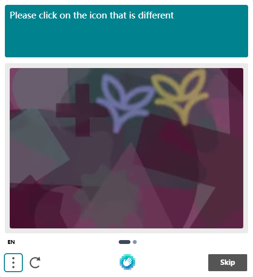
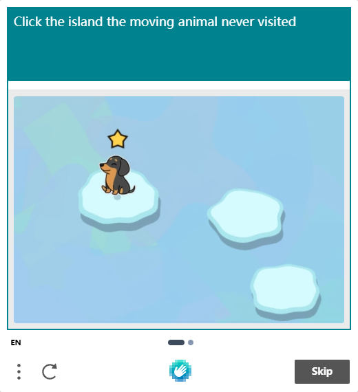
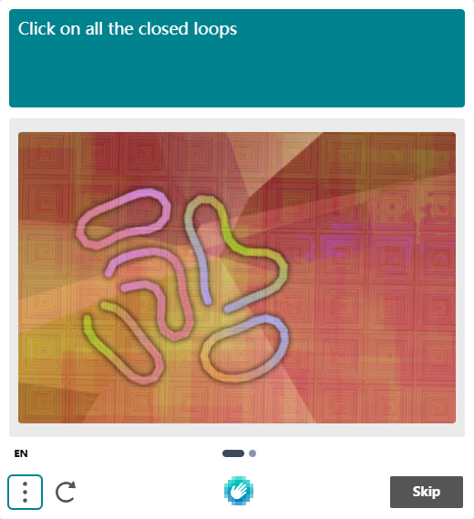

# hCaptcha · 区域点选（area-select）

> 一张整页题面 + 一句英文指令，点击图中全部符合条件的区域；11 个题面族、12 组样本，本库只收题面，建议路线是 VLM 整图读题并输出点坐标。
>
> 返回：[hCaptcha 索引](../../../docs/hcaptcha.md) · [全量类型](../../../docs/types.md) · [方法论](../../../docs/00-methodology.md)

## 一、速览

| 项 | 值 |
|---|---|
| 厂商 | hCaptcha（`hcaptcha`） |
| 类型 / 变体 | `area-select` / animal_habitat、camping、closed_loops、different_icon、icon_not_following_pattern、identical、incomplete_tower、island_not_visited、number_group、odd_shape_grid、three_matching_shapes |
| 中文 | 区域点选 |
| 媒体 | 图片 |
| 样本 | 12 组（001–012），11 个题面族，animal_habitat 有 2 组 |
| 答案格式 | `points`：目标区域内的点坐标 |
| 方法 | `NONE(VLM)`（未撰写；建议 VLM 直接读图） |
| 求解器 | `none` · 未知 |
| 人工审查 | `not-applicable`（12/12，无求解结果可审） |

## 二、题面与判定

题面是英文指令，目标藏在插画或图形里；有的题只点 1 个目标，有的要求「全部」「所有」「三个」。通过条件在 12 组 `meta.json` 中一致：**按题目要求点击全部符合条件的区域，漏选或多选不通过**。

| 案例 | 题面族 | 题面（`meta.prompt`） |
|---|---|---|
| [001](001/) | animal_habitat | Identify the animal that lives in this habitat |
| [002](002/) | camping | Find the thing you take camping |
| [003](003/) | closed_loops | Click on all the closed loops |
| [004](004/) | different_icon | Please click on the icon that is different |
| [005](005/) | icon_not_following_pattern | Identify the icon that does not follow the pattern |
| [006](006/) | identical | Please click on the elements that are identical |
| [007](007/) | incomplete_tower | Click the tower that is not complete |
| [008](008/) | island_not_visited | Click the island the moving animal never visited |
| [009](009/) | number_group | Click on the number that is part of this group: 789 |
| [010](010/) | odd_shape_grid | Click on the shape that breaks the pattern in the grid |
| [011](011/) | three_matching_shapes | Click the THREE matching shapes |
| [012](012/) | animal_habitat | Identify the animal that lives in this habitat |

> 答案空间是图像坐标点，不是类别名；目标数量由题面和服务端共同决定，题面里的 `THREE` / `all` 是数量约束，不能默认只点 1 个。`number_group` 还把数字串写进指令，需要先读文字再找目标。

## 三、样本长什么样

| 整页题面（`bg`） | 交互卡片（`aux`） | 另一族题面 |
|---|---|---|
|  |  |  |
|  |  |  |

- 第 1 列 `bg.png` 是 1000×700 的题面主体，**不含英文指令**；第 2 列 `aux-01.png` 是 520×570 的完整挑战卡片，指令、图像、`EN`、进度点和 `Skip` 都在卡片里。
- 第 3 列是同一批的其他题面族：011 要求找三个相同形状，003 要求点出所有闭合环；画面风格、目标形态差异很大，说明不能用固定类别表。
- 008 的 `aux` 只是「移动动物」动画的一帧（狗站在一个岛上，另一个岛空着）；完整判定依赖后续帧，单张截图不足以知道「从未访问」的岛。

## 四、形态与难点

- **图幅与裁切**：整页图 1000×700，卡片 520×570；同一挑战存在「纯图」和「带指令卡片」两种截图，坐标体系不同，换算时必须先确定以哪张为基准。
- **开放语义**：目标不是固定类别，而是「这个栖息地的动物」「野营要带的东西」「不符合规律的那个」等关系判断。
- **抽象图形**：闭合环、相同图形、破坏规律的形状、三个匹配形状，都要求几何与模式推理；传统检测器没有稳定类别可训。
- **时序题**：`island_not_visited` 依赖动物移动过程，静态图上只能看到一帧。
- **文字题**：`number_group` 把数字串放在指令里，需要 OCR/读题与目标定位联合。
- **无真值**：本库没有答案标注，也没有服务端反馈，不能离线计算准确率。

## 五、建议路线（未实现）

按「VLM 整图读题 + 结构化点坐标」起步最省，适合这种语义长尾、目标数量不固定的题。

| 步骤 | 建议做法 | 说明 |
|---|---|---|
| 1 取题面 | 从 `aux` 或页面 DOM 读取英文指令 | `bg` 不含指令，单独送 `bg` 会丢题面 |
| 2 整图理解 | 把「指令 + 整张图」交给 VLM，要求返回目标中心点或框 | 不要先套固定类别表；关系判断正是 VLM 的强项 |
| 3 数量约束 | 解析 `THREE` / `all` / 单数名词，要求模型先报目标数再给点 | 数量错误是这类题最常见的失败形态 |
| 4 坐标换算 | 输出归一化坐标，按实际截图尺寸换算成像素 | 整页图与卡片尺寸不同，必须固定基准 |
| 5 复核 | 对低置信目标裁剪放大二次询问，或用第二个模型投票 | 只对分歧点调用，控制成本 |

> 纯 CV 路线可用于闭合环、相同图形等几何题（轮廓/颜色聚类），但 11 个题面族里多数是语义题，统一走 CV 不划算；源文档也只给了 VLM 建议。

## 六、为什么没有结果

- 本库对 hCaptcha 的策略是「先覆盖题面」：三类交互都只采集样本，没有提交闭环。
- hCaptcha 的正确答案在服务端，本库没有保存逐题真值，也没有人工逐区域标注，因此任何模型输出都不能写成准确率。
- 12 组只覆盖 11 个题面族，同一族只取 1–2 组；题面会随服务端策略变化，这批样本不代表完整题面空间。

## 七、边界

- **不要把 VLM 输出当真值**：它只是建议路线；没有人工确认前，`review` 保持 `not-applicable`。
- **不要只看 `bg`**：指令只在 `aux` 卡片里；拿 `bg` 单独读题会不知道要选什么。
- **不要忽略时序**：008 这类「移动动物」题需要多帧或视频，静态 `aux` 只是一帧。
- **不要硬编码目标数**：`all` 类题的目标数可变，`THREE` 是显式三目标；两者不能用同一套后处理。
- **不要猜坐标基准**：009 的整图和卡片里都有叠加的数字/图形，无法从单张截图判断它是题面元素还是选中态；这类叠加不要直接当目标框。

## 八、相关

- 厂商索引：[docs/hcaptcha.md](../../../docs/hcaptcha.md)
- 全量类型：[docs/types.md](../../../docs/types.md) · 方法论：[docs/00-methodology.md](../../../docs/00-methodology.md)
- 同厂商对照：[binary](../binary/)（九宫格二分类）、[drag-drop](../drag-drop/)（拖拽拼块）
- 案例：[001](001/) – [012](012/)（均为 `sample-only`，每组含 `meta.json` + `bg.png` + `aux-01.png`）
- 来源：<https://accounts.hcaptcha.com/demo>；样本版权归 hCaptcha 所有，仅用于研究与教学。
