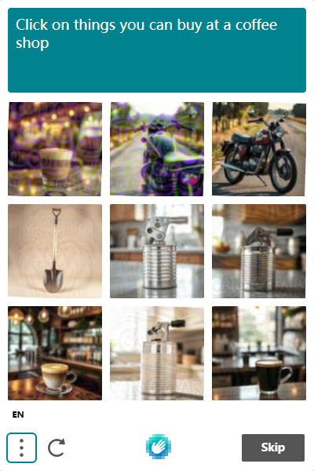
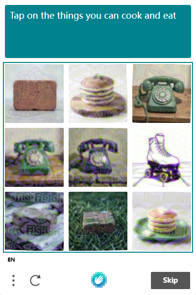
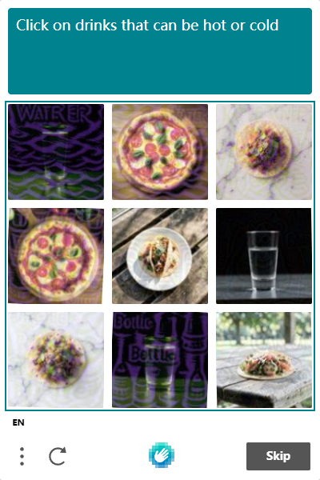
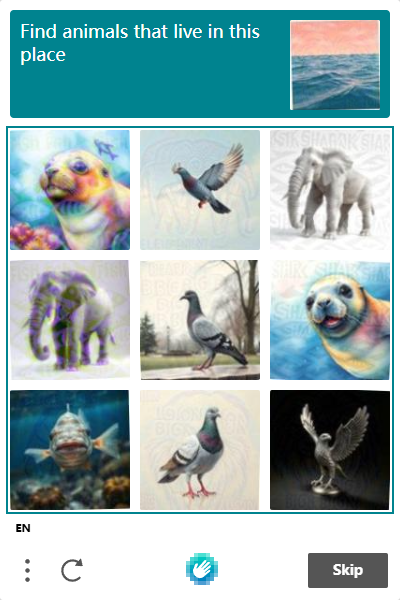
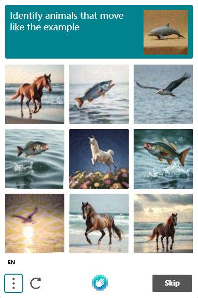
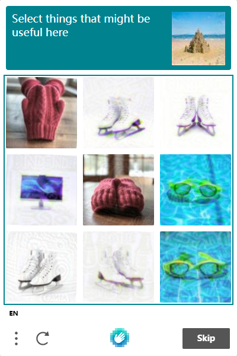

# hCaptcha · 九宫格二分类（binary）

> 3×3 网格 + 一句英文描述，逐格判断「符合 / 不符合」；本库只收题面，未撰写求解器，建议路线是 VLM 逐格读图。
>
> 返回：[hCaptcha 索引](../../../docs/hcaptcha.md) · [全量类型](../../../docs/types.md) · [方法论](../../../docs/00-methodology.md)

## 一、速览

| 项 | 值 |
|---|---|
| 厂商 | hCaptcha（`hcaptcha`） |
| 类型 / 变体 | `binary` / coffee_shop、cook_and_eat、hot_or_cold、live_in_this_place、motion_example、useful_here |
| 中文 | 九宫格二分类 |
| 媒体 | 图片 |
| 样本 | 12 组（001–012），6 个题面族各 2 组 |
| 答案格式 | `indices`：选中的格子编号 |
| 方法 | `NONE(VLM)`（未撰写；建议 VLM 读格） |
| 求解器 | `none` · 未知 |
| 人工审查 | `not-applicable`（无求解结果可审） |

## 二、题面与判定

一次挑战由 9 张子图和一句英文描述组成。用户需要对每个格子做二元判断：符合描述就选中，不符合就不选；选错不通过。题目不是固定类别，而是开放语义（「咖啡店能买到的东西」「冷热都能喝的饮料」），因此没有稳定的类别表。

| 案例 | 题面族 | 题面（`meta.prompt`） | 通过条件 |
|---|---|---|---|
| [001](001/) | coffee_shop | Click on things you can buy at a coffee shop | 对网格中每个符合描述的格子做出正确选择；错选不通过 |
| [003](003/) | cook_and_eat | Tap on the things you can cook and eat | 同上 |
| [005](005/) | hot_or_cold | Click on drinks that can be hot or cold | 同上 |
| [007](007/) | live_in_this_place | Find animals that live in this place | 同上 |
| [009](009/) | motion_example | Identify animals that move like the example | 同上 |
| [011](011/) | useful_here | Select things that might be useful here | 同上 |

> 前 6 个题面族覆盖：咖啡店商品、可烹饪食物、冷热饮、栖息地动物、按示例判断运动方式、场景中有用之物。每个族 2 组样本，用于观察同一 prompt 下的图像分布差异。

## 三、样本长什么样

| 题面 | 题面 | 题面 |
|---|---|---|
|  |  |  |
|  |  |  |

- 每张图是 400×600 的整页截图：上方是英文指令，主体是 3×3 九宫格；部分格子有勾选态。
- 本类型只有 `bg`，没有 `annotated` / `answer.txt` / `result.json`：这是 `sample-only` 的典型形态，只收题面。

## 四、形态与难点

- **开放语义**：同一个格子是否命中，取决于 prompt 的常识含义，不是固定类别（「热或冷都能喝的饮料」需要常识，而不是物体检测）。
- **细粒度**：9 个格子可能是同一类物体的不同实例，差异在材质、场景、状态。
- **示例依赖**：`motion_example` 族要先看示例图/动作，再把「像示例一样运动」迁移到其他格子。
- **无真值**：hCaptcha 的正确答案在服务端，本库只保存题面，因此不能离线算准确率。

## 五、建议路线（未实现）

按「VLM 逐格判断 + 结构化输出」起步最省；不需要训练数据，适合这类语义长尾题。

| 步骤 | 建议做法 | 说明 |
|---|---|---|
| 1 拆格 | 按 3×3 等分裁切，保留 prompt 文本 | 注意页面缩放与勾选态，格子边界以实际渲染为准 |
| 2 逐格读图 | 对每格发「prompt + 该格图像」，要求输出 `yes/no` + 一句理由 | 一次调用可只问一格，也可 9 格批量；批量需固定输出格式 |
| 3 汇总 | 取 `yes` 的格子编号，按从上到下、从左到右排序 | 与 `answer_format: indices` 对齐 |
| 4 复核 | 对低置信格二次询问，或用第二个模型投票 | 只对分歧点调用，控制成本 |

```text
# 建议路线（伪代码，尚未实现、无准确率）

prompt = read_instruction(page)
cells  = split_grid(page, rows=3, cols=3)

selected = []
for index, cell in enumerate(cells, start=1):
    verdict = vlm(prompt + " Does this cell match? yes/no",
                  image=cell, temperature=0)
    if verdict == "yes":
        selected.append(index)

answer = sorted(selected)          # indices，从上到下、从左到右
```

> 这条路线没有在本库落地，也没有样本级人工答案；它只是基于题型和现有厂商文档给出的起步建议。

## 六、为什么没有结果

- 本库对 hCaptcha 的策略是「先覆盖题面」：三类交互（area-select / binary / drag-drop）都只采集样本，未做提交闭环。
- 没有服务端返回的正确答案，也没有人工逐格标注，因此不能把任何模型输出写成「准确率」。
- hCaptcha 的题面会随服务端策略变化（同一 prompt 族下的图像分布不同），12 组只用于观察形态，不代表完整题面空间。

## 七、边界

- **不要把 VLM 输出当真值**：它只是建议路线；没有人工确认前，`review` 保持 `not-applicable`。
- **不要用固定类别表硬套**：prompt 是开放语义，固定类别表会漏掉「场景中有用」「像示例一样运动」这类关系判断。
- **不要忽略勾选态**：截图里可能已有选中格子，拆格时要区分「题目图像」与「用户选择状态」。

## 八、相关

- 厂商索引：[docs/hcaptcha.md](../../../docs/hcaptcha.md)
- 全量类型：[docs/types.md](../../../docs/types.md) · 方法论：[docs/00-methodology.md](../../../docs/00-methodology.md)
- 同厂商对照：[area-select](../area-select/)（区域点选）、[drag-drop](../drag-drop/)（拖拽拼块）
- 案例：[001](001/) – [012](012/)（均为 `sample-only`，只有 `meta.json` + `bg.png`）
- 来源：<https://accounts.hcaptcha.com/demo>；样本版权归 hCaptcha 所有，仅用于研究与教学。
