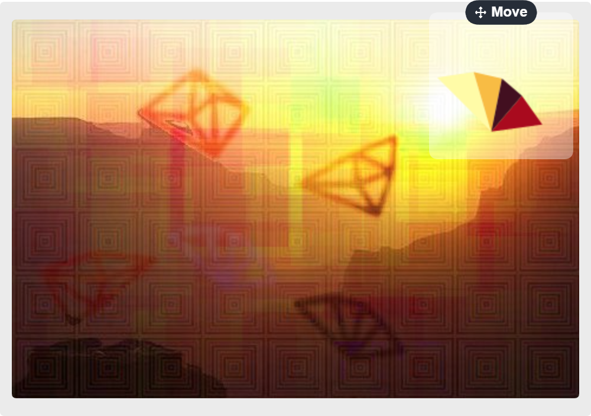
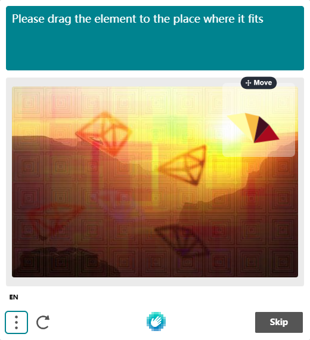
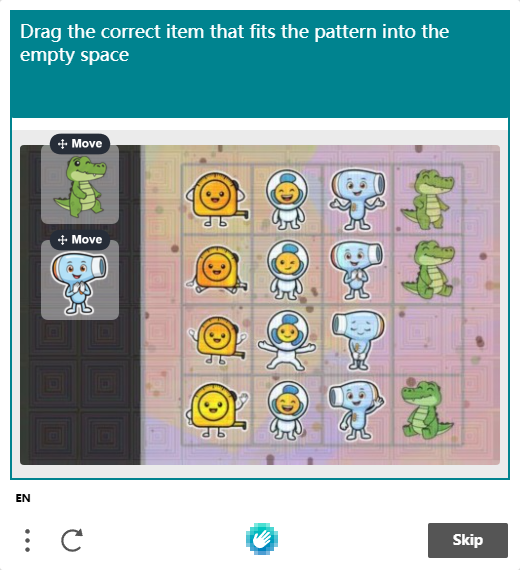
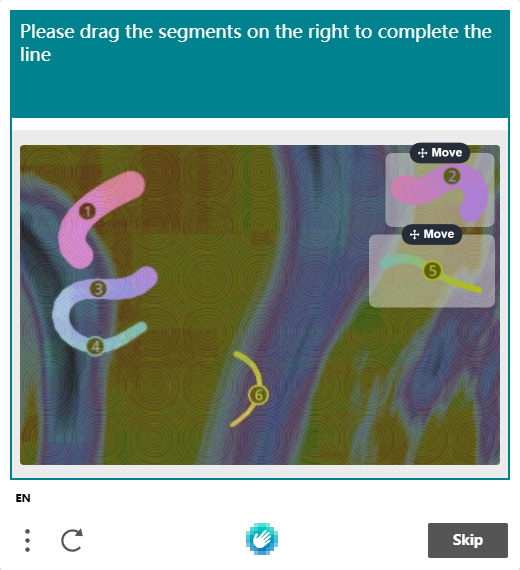
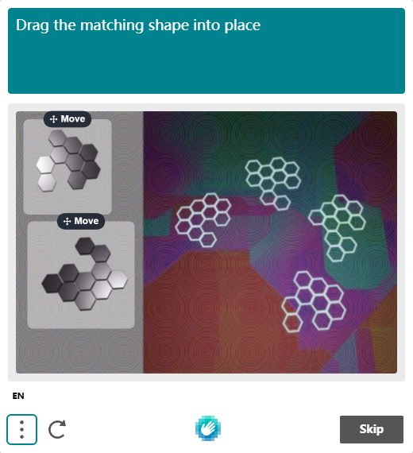
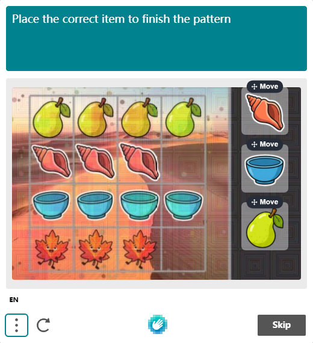

# hCaptcha · 拖拽拼块（drag-drop）

> 把右侧候选块拖到画面中匹配的空位；5 个题面族、12 组样本，本库只收题面，建议路线是 VLM/形状匹配先配对、再生成拖拽动作。
>
> 返回：[hCaptcha 索引](../../../docs/hcaptcha.md) · [全量类型](../../../docs/types.md) · [方法论](../../../docs/00-methodology.md)

## 一、速览

| 项 | 值 |
|---|---|
| 厂商 | hCaptcha（`hcaptcha`） |
| 类型 / 变体 | `drag-drop` / element_fit、line_segments、pattern_fill、pattern_fill_2_items、shape_match |
| 中文 | 拖拽拼块 |
| 媒体 | 图片 |
| 样本 | 12 组（001–012），5 个题面族 |
| 答案格式 | `points`：目标放置位置的坐标 |
| 方法 | `NONE(VLM)`（未撰写；建议 VLM 读图 + 拖拽） |
| 求解器 | `none` · 未知 |
| 人工审查 | `not-applicable`（12/12，无求解结果可审） |

## 二、题面与判定

题面要求把候选块拖到正确位置。通过条件在 12 组 `meta.json` 中一致：**把正确的元素拖到目标位置，放置错误不通过**。答案格式记为 `points`，但真实动作是「选中块 → 拖到空位」；点坐标只描述落点，不包含拖拽轨迹。

| 案例 | 题面族 | 题面（`meta.prompt`） | 候选块 |
|---|---|---|---|
| [001](001/) | element_fit | Please drag the element to the place where it fits | 1 个（雨伞） |
| [003](003/) | line_segments | Please drag the segments on the right to complete the line | 2 个（编号 2、5） |
| [005](005/) | pattern_fill | Place the correct item to finish the pattern | 3 个候选，选 1 |
| [007](007/) | pattern_fill_2_items | Drag the correct item that fits the pattern into the empty space | 2 个候选 |
| [009](009/) | shape_match | Drag the matching shape into place | 2 个（六边形组合） |

> 族内重复：element_fit 4 组（001/002/011/012），line_segments、pattern_fill、pattern_fill_2_items、shape_match 各 2 组。候选块数量从 1 到 3 不等，题面不会直接给出落点坐标。

## 三、样本长什么样

| 整页题面（`bg`） | 交互卡片（`aux`） | 另一族题面 |
|---|---|---|
|  |  |  |
|  |  |  |

- `bg.png` 是 1000×700 左右的题面主体，不含指令；`aux-01.png` 是 520×570 的完整卡片，指令、画面、候选块、`EN`、进度点和 `Skip` 都在卡片里。
- 候选块位于右侧或左侧的深色托盘里，带 `+ Move` 标签；001 的雨伞块、003 的编号 2/5 线段、009 的两个六边形组合，都是需要拖走的对象。
- 001 的候选块看起来是带透明边缘的抠图；空位没有明显的框线，只能靠轮廓和背景延续判断「哪里合适」。

## 四、形态与难点

- **无空位标注**：目标区域没有画框或高亮，图案补全要从行列规律推断空格；形状匹配要从轮廓契合度推断位置。
- **候选块干扰**：005 有 3 个候选（海螺、蓝碗、梨），只有 1 个能补全图案；007 有 2 个候选，需要先判断图案规律再选块。
- **线段题**：003 的线段带编号，左右两侧都有可拖动块，需要同时完成「哪一段接哪里」和「两端顺序」。
- **形状匹配**：009 的目标是六边形拼成的簇，候选块是不同轮廓的子集，必须做几何/轮廓比对，而不是颜色匹配。
- **动作未记录**：截图只有静止状态，没有拖拽轨迹、按下时长和落点容差；这些是服务端判定的一部分，静态样本无法覆盖。

## 五、建议路线（未实现）

| 步骤 | 建议做法 | 说明 |
|---|---|---|
| 1 读题 | 从 `aux` 取指令，解析「单块 / 多块 / 选一」 | 候选块数量决定后续是单选还是多选 |
| 2 找候选块 | 定位带 `+ Move` 标签的缩略块，裁出块图与轮廓 | 标签是稳定的 UI 线索；也可用右侧托盘的深色背景分割 |
| 3 找空位 | 图案补全看行列规律；线段题看断口；形状题看轮廓缺口 | 空位没有显式框线，需要用背景连续性/轮廓闭合度推断 |
| 4 配对 | VLM 判断「块 → 空位」，或用轮廓/边缘做形状匹配 | 多候选时要求模型给出排除理由，降低误配 |
| 5 落点与拖拽 | 输出空位中心像素，再生成按下、移动、释放动作 | 轨迹与时长不在本库范围内；`answer_format` 只记录落点 |
| 6 复核 | 拖拽前对候选块与空位做局部放大核对 | 一块放错通常整题不通过 |

> 形状匹配类可以用轮廓矩/倒角距离做零 LLM 配对；但 pattern_fill 与 line_segments 依赖语义和顺序，统一走 VLM 更省。

## 六、为什么没有结果

- 本库对 hCaptcha 只做「题面覆盖」，没有提交闭环，也没有保存服务端判定。
- 12 组没有逐题答案，没有人工标注落点，也没有拖拽过程数据；无法计算「配对准确率」或「通过率」。
- 同一题面族内的图像分布不同（001/002/011/012 都是 element_fit，但候选块与场景不同），12 组只用于观察形态，不代表完整题面空间。

## 七、边界

- **不要把它当滑块**：这是「选块 + 放置」，不是沿一维轨道滑动；用缺口检测的思路会找错目标。
- **不要只输出点**：`answer_format: points` 只描述落点；真实通过还取决于拖拽轨迹、按下时长与释放位置。
- **不要忽略多块**：003/007/009 各有 2 个可拖动块，005 的托盘有 3 个候选；只有 001 是单块。按「一块」写死会漏操作。
- **不要把 `+ Move` 当题面内容**：它是 UI 拖拽手柄，不是图案的一部分，裁块时要排除。
- **不要用静态截图验证放置结果**：截图是挑战开始态，放对/放错后的状态不在样本里。

## 八、相关

- 厂商索引：[docs/hcaptcha.md](../../../docs/hcaptcha.md)
- 全量类型：[docs/types.md](../../../docs/types.md) · 方法论：[docs/00-methodology.md](../../../docs/00-methodology.md)
- 同厂商对照：[area-select](../area-select/)（区域点选）、[binary](../binary/)（九宫格二分类）
- 案例：[001](001/) – [012](012/)（均为 `sample-only`，每组含 `meta.json` + `bg.png` + `aux-01.png`）
- 来源：<https://accounts.hcaptcha.com/demo>；样本版权归 hCaptcha 所有，仅用于研究与教学。
