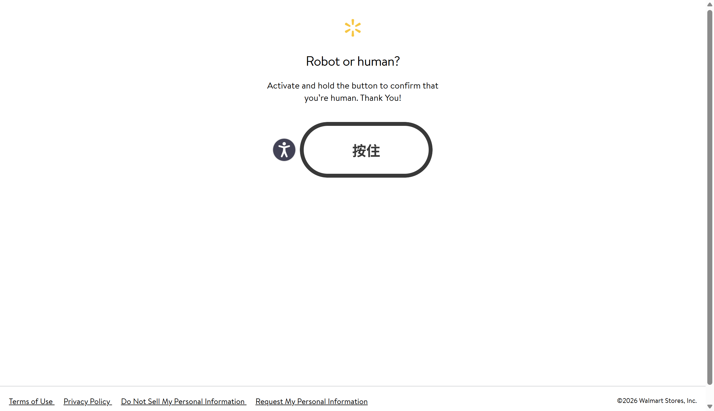
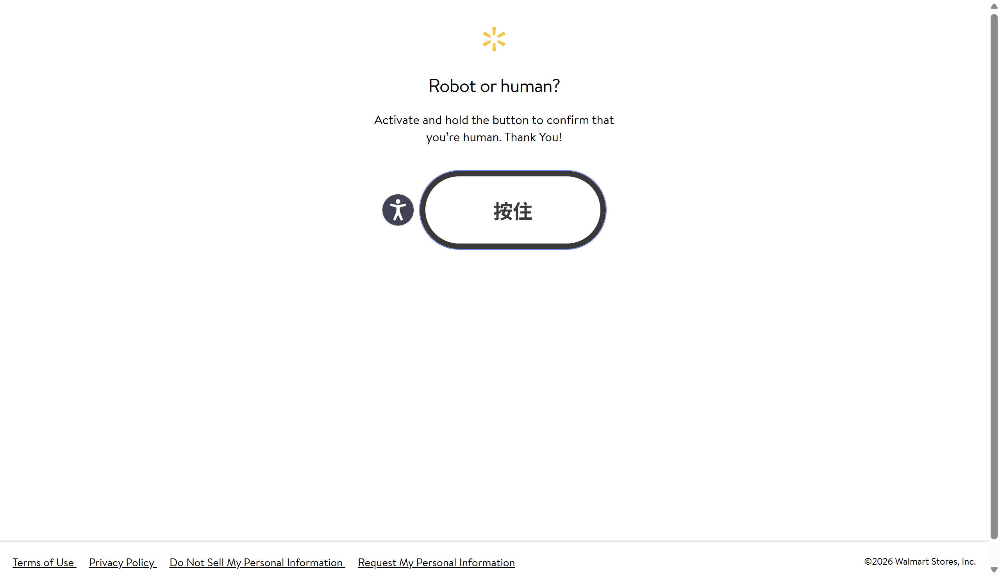

# HUMAN Security · 无障碍邮件码（accessible-email）

> 面向无障碍流程的邮箱验证码题：`meta.prompt` 记录「输入邮箱验证码」，但现有唯一截图是「按住」入口页，没有出现邮件码；本库只有 1 组样本，未复现。
>
> 返回：[HUMAN Security 索引](../../../docs/human-security.md) · [全量类型](../../../docs/types.md) · [方法论](../../../docs/00-methodology.md)

## 一、速览

| 项 | 值 |
|---|---|
| 厂商 | HUMAN Security（`human-security`） |
| 类型 / 变体 | `accessible-email` / accessible-email |
| 中文 | 无障碍邮件码 |
| 媒体 | 图片（页面截图） |
| 样本 | 1 组（001） |
| 答案格式 | `text`：邮件中的验证码 |
| 方法 | `NONE(OCR/VLM)`（未撰写；建议 OCR/VLM） |
| 求解器 | `none` · 未知 |
| 人工审查 | `not-applicable`（1/1，无求解结果可审） |
| 证据等级 | `sample-only`（只有入口页截图） |

## 二、题面与判定

`meta.prompt` 只写「输入邮箱验证码」，没有记录验证码长度、字符集、有效期或触发方式；`pass_criteria` 也缺失。按类型名与答案格式，答案应当是邮件正文/邮件页里的验证码文本，而不是页面上的图形题。

| 案例 | 题面（`meta.prompt`） | 实际截图 | 通过条件 |
|---|---|---|---|
| [001](001/) | 输入邮箱验证码 | `Robot or human?` +「按住」按钮的入口页 | 该批案例未记录；源记录为「形态确认，未复现」 |

> **数据事实**：001 的 `bg.png` 与 `human-security/press-hold/003/bg.png` 逐字节一致（同为 2560×1476 的入口页），`aux-01.png` 也是同一入口页的另一张截图。现有样本没有拍到邮件码输入框或邮件正文，因此不能从图像推断验证码形态。

## 三、样本长什么样

| 入口页（`bg`） | 入口页（`aux`） |
|---|---|
|  |  |

- 两张图都是 Walmart 的 `Robot or human?` 页：黄色加载图标、英文说明、深色「按住」按钮、无障碍小人图标；没有邮箱输入框、没有验证码图片、没有邮件正文。
- `bg` 与 `aux` 的哈希不同，但显示的是同一个挑战入口；差异只在截图尺寸/内容细节，不构成「题面 + 答案」的配对。
- 因此第 3 节只能展示入口页；真正的邮件码界面在本库中缺失。

## 四、形态与难点

- **样本缺失**：唯一的案例没有拍到邮件码，无法观察码长、字体、干扰线、背景或输入框布局。
- **流程依赖**：邮件码通常需要先触发发送、再访问邮箱取码，存在时效与邮箱权限问题；本库没有记录这些环节。
- **无障碍分支**：该类型属于无障碍替代流程，触发条件可能与普通视觉挑战不同；源记录未展开。
- **单样本**：1 组不足以覆盖不同邮件模板、不同码长或不同语言。
- **不可离线判定**：没有服务端返回值，也没有人工标注的码值；即使 OCR 出文本，也无法确认是否正确。

## 五、建议路线（未实现）

当前第一优先级不是写 OCR，而是**补采真正的邮件码界面**；在拿到码图之前，任何 OCR/VLM 方案都没有可验证的输入。

| 步骤 | 建议做法 | 说明 |
|---|---|---|
| 1 补采界面 | 在真实浏览器触发无障碍邮件流程，保存「验证码输入框 + 提示文字」和邮件正文 | 现有 001 只有入口页，不能作为邮件码样本 |
| 2 明确码源 | 判断验证码显示在页面、邮件正文还是邮件链接中 | 三种来源对应三种提取方式，不能混为一谈 |
| 3 取码 | 页面码用 OCR/VLM 读图；邮件码用邮箱 API/IMAP 读取正文 | 需要邮箱访问权限与时效控制；本库未实现 |
| 4 提交 | 把码填入输入框，记录通过/失败与服务端响应 | 没有提交闭环就无法评价 OCR 准确率 |
| 5 复核 | 人工核对码值与截图，标注 `review` | 在补采与复核前保持 `not-applicable` |

> 建议路线来自类型定义与 `method_note`（「未撰写；建议 OCR/VLM」），不是已经跑通的方案；本库没有该类型的求解结果。

## 六、为什么没有结果

- 只有 1 组样本，状态 `sample-only`；`meta.solver.notes` 明确写「形态确认，未复现」。
- 现有截图是「按住」入口页，不是邮件码界面；没有码图、没有码值、没有邮件正文。
- `review.state=not-applicable`，没有人工审查对象；也没有服务端返回值。
- 因此本页不写 OCR 准确率，也不把入口页截图当作邮件码样本。

## 七、边界

- **不要把入口页当邮件码**：001 的图与 `press-hold` 共用入口页；用它训练 OCR 会把「按住」按钮误当验证码。
- **不要反推码长/字符集**：`meta` 没有记录，截图也没有显示；任何「6 位数字」之类的说法都无依据。
- **不要跳过邮箱环节**：邮件码的获取依赖邮箱权限与时效，纯页面 OCR 可能根本不涉及答案。
- **不要复用为 press-hold 证据**：虽然图片相同，但两个类型的题面、答案格式和判定不同；案例状态应按各自 `meta.json` 记录。
- **补采优先**：在拿到真实邮件码界面之前，该类型应保持「未复现」，不做效果宣称。

## 八、相关

- 厂商索引：[docs/human-security.md](../../../docs/human-security.md)
- 全量类型：[docs/types.md](../../../docs/types.md) · 方法论：[docs/00-methodology.md](../../../docs/00-methodology.md)
- 同厂商对照：[press-hold](../press-hold/)（按压）、[invisible](../invisible/)（无感）
- 案例：[001](001/)（`sample-only`，`bg` + `aux` 均为入口页）
- 来源：<https://www.walmart.com/blocked>；样本版权归 HUMAN Security / Walmart 所有，仅用于研究与教学。
