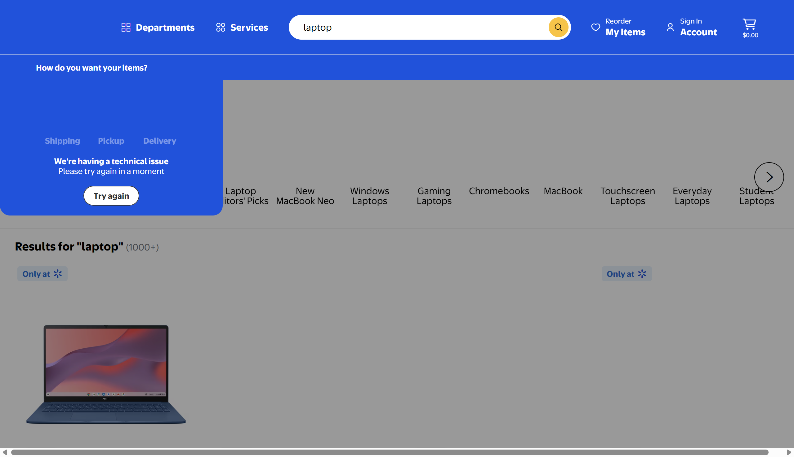
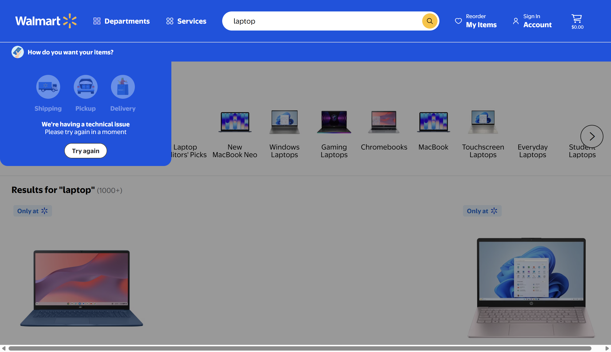
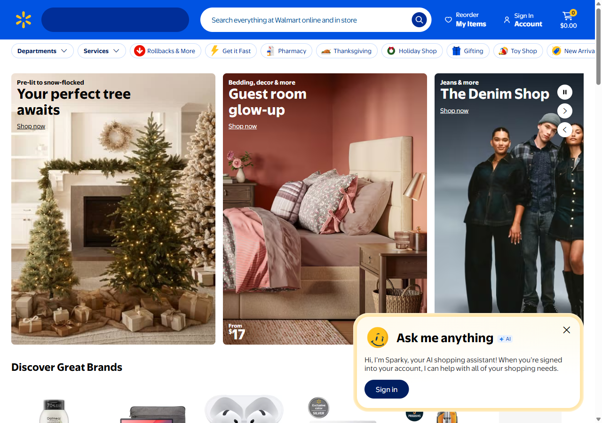

# HUMAN Security · 无感（invisible）

> Walmart 风控页的无感验证：没有题面、没有可提交答案，靠浏览器环境与行为直接放行；2 组样本只记录页面状态。
>
> 返回：[HUMAN Security 索引](../../../docs/human-security.md) · [全量类型](../../../docs/types.md) · [方法论](../../../docs/00-methodology.md)

## 一、速览

| 项 | 值 |
|---|---|
| 厂商 | HUMAN Security（`human-security`） |
| 类型 / 变体 | `invisible` / invisible |
| 中文 | 无感 |
| 媒体 | 图片（页面截图） |
| 样本 | 2 组（001–002） |
| 答案格式 | `none`：没有答案 |
| 方法 | `ACT`（浏览器环境/行为） |
| 求解器 | `browser` · 高（源记录，未给数字） |
| 人工审查 | `pending`（2/2 待审） |
| 证据等级 | `sample-only`（只有页面截图） |

## 二、题面与判定

两组 `meta.prompt` 都是「无感验证，无题面」，`answer_format` 为 `none`。这不是一个可以填写或点击的题目；页面要么正常加载，要么被拦截到「technical issue」提示。通过条件就是**让页面按正常流程放行**，但案例没有记录 `pass_criteria`，也没有服务端返回值。

| 案例 | 题面（`meta.prompt`） | 页面状态 | 通过条件 |
|---|---|---|---|
| [001](001/) | 无感验证，无题面 | 左侧「We're having a technical issue」提示，右侧内容从空白到出现搜索结果 | 该批案例未记录；源记录为零注入 Chrome 可过 |
| [002](002/) | 无感验证，无题面 | Walmart 首页正常加载（搜索框、分类、商品横幅） | 同上 |

> 答案空间是空集：没有 `points`、`text` 或 `angle` 可提交。能记录的只有「页面是否放行」这一状态。

## 三、样本长什么样

| 拦截/加载中 | 加载后 | 另一组 |
|---|---|---|
|  |  |  |

- 001 的 `bg`/`aux` 都是 2560×1476 的 Walmart 搜索页：左侧蓝色栏提示技术问题并提供 `Try again`，右侧商品区在 `bg` 里是空白，在 `aux` 里已经出现搜索结果与推荐图。
- 002 是 1280×900 的 Walmart 首页，已经正常显示导航、搜索框和促销横幅；这一组只有 `bg`，没有 `aux`。
- 两组都没有验证码控件、没有题目文字、没有可点击的挑战按钮；这是「无感」与 `press-hold` 的直观区别。

## 四、形态与难点

- **无题面**：没有可以识别或提交的内容，任何 OCR/CV/VLM 都没有目标。
- **页面级判定**：样本记录的是整页状态，不是局部控件；「通过」与「普通页面加载」在视觉上不可区分。
- **环境依赖**：源记录写「零注入 Chrome 可过」，说明关键在浏览器环境与行为，而不是某个可计算的 token。
- **样本极少**：只有 2 组，且 001 的两个状态是同一流程的两个时刻；不能据此估计成功率或覆盖不同风控分支。
- **状态混淆**：001 的「technical issue」提示可能来自页面自身加载失败，也可能是风控拦截；单凭截图无法区分。

## 五、建议路线（browser，未做离线结果）

无感验证没有「解」的动作，路线是让真实浏览器完整走完页面流程；源记录给出的结论是零注入 Chrome 可过。

| 步骤 | 建议做法 | 说明 |
|---|---|---|
| 1 真实浏览器 | 用未注入脚本的真实 Chrome 打开 Walmart 页面 | 源记录强调「零注入」；补环境脚本可能反而暴露自动化特征 |
| 2 完整加载 | 等待页面脚本、Cookie 和子资源自然完成，不要提前抓取或中断 | 无感判定发生在页面加载过程中，抢跑会拿不到放行状态 |
| 3 观察状态 | 以页面是否出现正常内容（商品区、导航）作为放行判据 | 001 的 `bg`/`aux` 给出「空白 → 内容」的对照 |
| 4 复用会话 | 放行后复用同一浏览器上下文访问目标页 | Cookie/会话是后续请求的前提；不要新建无状态会话 |
| 5 记录证据 | 保存页面截图、最终 URL、Cookie 状态和一次完整访问的时间线 | 本库的两组截图只能证明页面形态，不能证明稳定性 |

> 这条路线不产生「答案」，也不能离线重放；它的产出是「浏览器会话是否被放行」。

## 六、为什么没有结果

- 2 组都是 `sample-only`，`review.state` 为 `pending`，没有逐组通过/失败结论。
- `meta.solver.accuracy` 只写「高」，没有测试次数、成功率或环境清单；不能写成准确率。
- 没有答案、没有提交接口、没有服务端返回码；截图只能证明页面曾经加载到某个状态。
- 因此本页只记录形态与浏览器路线，不给出离线指标。

## 七、边界

- **无感不等于无防护**：没有题面不代表没有风控；环境、Cookie、IP、行为都可能参与判定。
- **不要用 001 的提示当失败判据**：`technical issue` 也可能是页面自身错误；需要结合网络日志与会话状态判断。
- **不要做离线分类器**：两组页面截图不是「通过/不通过」的标注样本，训练分类器没有意义。
- **不要忽略会话**：放行后的 Cookie/会话才是后续访问的凭证；单次截图不能复现。
- **审查口径**：`pending` 表示尚未人工复核，不是失败；`accuracy=high` 只是源记录标签。

## 八、相关

- 厂商索引：[docs/human-security.md](../../../docs/human-security.md)
- 全量类型：[docs/types.md](../../../docs/types.md) · 方法论：[docs/00-methodology.md](../../../docs/00-methodology.md)
- 同厂商对照：[press-hold](../press-hold/)（按压）、[accessible-email](../accessible-email/)（无障碍邮件码）
- 案例：[001](001/) – [002](002/)（001 含 `bg` + `aux`，002 只有 `bg`）
- 来源：<https://www.walmart.com/blocked>；样本版权归 HUMAN Security / Walmart 所有，仅用于研究与教学。
