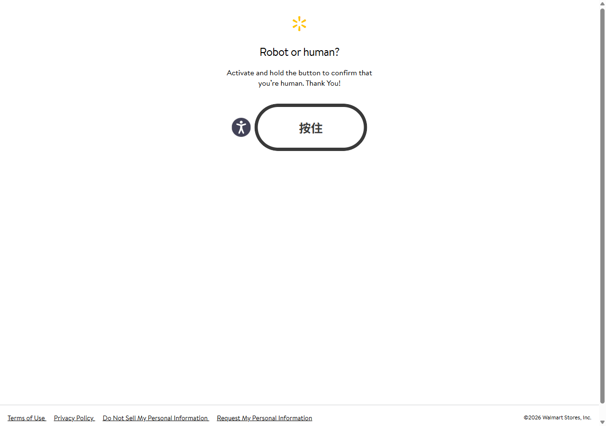
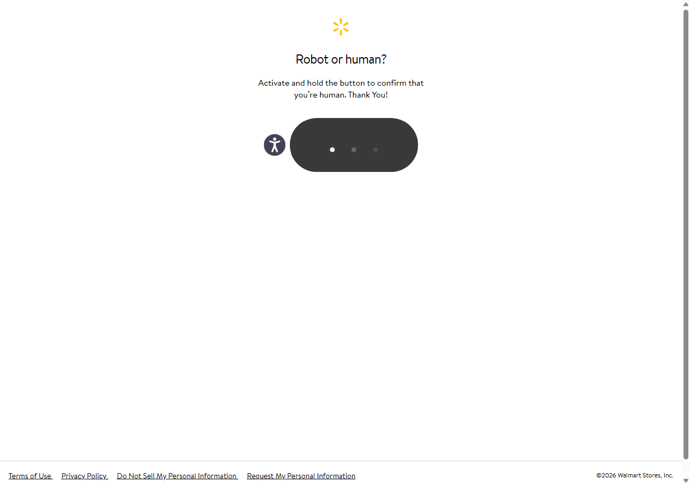
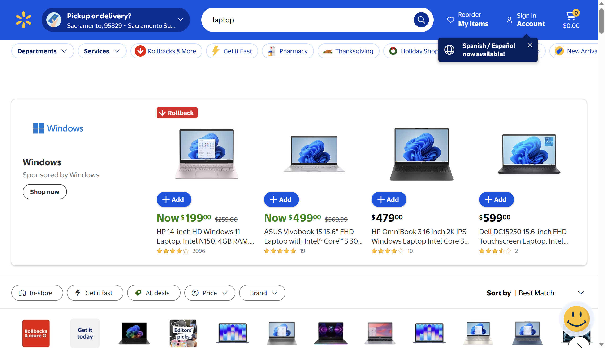

# HUMAN Security · 按压（press-hold）

> Walmart 风控页的「按住按钮」挑战：没有图像题面，靠真实浏览器的持续按压与行为信号放行；5 组样本，纯协议不可行。
>
> 返回：[HUMAN Security 索引](../../../docs/human-security.md) · [全量类型](../../../docs/types.md) · [方法论](../../../docs/00-methodology.md)

## 一、速览

| 项 | 值 |
|---|---|
| 厂商 | HUMAN Security（`human-security`） |
| 类型 / 变体 | `press-hold` / press-hold |
| 中文 | 按压 |
| 媒体 | 图片（页面截图） |
| 样本 | 5 组（001–005） |
| 答案格式 | `hold-ms`：按住时长 |
| 方法 | `ACT`（真实浏览器行为） |
| 求解器 | `browser` · 高（源记录，未给数字） |
| 人工审查 | `pending`（5/5 待审） |
| 证据等级 | `sample-only`（只有截图，无逐组结果） |

## 二、题面与判定

题面不是图像识别，而是一条交互指令。5 组 `meta.prompt` 都是「按住按钮完成验证」；页面上的英文是 `Robot or human?` / `Activate and hold the button to confirm that you're human. Thank You!`，按钮文字为「按住」。

| 案例 | 题面（`meta.prompt`） | 页面状态 | 通过条件 |
|---|---|---|---|
| [001](001/) | 按住按钮完成验证 | 静止，按钮为空心「按住」 | 该批案例未记录 `pass_criteria`；源记录为真实浏览器按住后放行 |
| [002](002/) | 同上 | 按住中，按钮变深并出现进度点 | 同上 |
| [005](005/) | 同上 | 按住后进入 Walmart 商品页 | 同上 |

> 答案空间是「按住时长 + 真实指针事件」，不是坐标或文字。源记录只给了「高」的定性结论，没有给出最短按住毫秒数、容差和失败样本。

## 三、样本长什么样

| 静止态 | 按住态 | 通过后的页面 |
|---|---|---|
|  |  |  |

- 001 的 `bg.png` 与 `aux-01.png` **完全相同**（同一张 1280×900 截图），说明这一组只保存了静止态；002 的 `bg` 也是同一张静止态，只有 `aux` 出现深色按钮与三个进度点，是按住中的状态。
- 003/004 共用另一张 2560×1476 的静止态截图（四张图逐字节一致）；它与 `accessible-email/001/bg.png` 也逐字节一致，说明该邮件码案例复用了这张入口页。
- 005 的 `bg`/`aux` 是 2560×1476 的 Walmart 商品列表页，已经没有验证码按钮，属于通过后的页面。
- 页面底部有 Walmart 的条款链接和版权行；挑战主体在页面中上部，按钮左侧有一个无障碍小人图标。

## 四、形态与难点

- **无图像题面**：没有待识别目标，传统 CV/OCR 没有用武之地；能做的是定位按钮并执行交互。
- **行为判定**：源记录明确写「真实浏览器可解；纯 HTTP 被拒」，说明服务端看的是浏览器环境与指针行为，不是提交某个答案。
- **阈值未知**：界面只显示进度点，不显示需要按多久；001–004 的静止截图无法反推毫秒数。
- **状态差异**：001/002 是 1280×900 的验证页，003/004 是 2560×1476 的另一张验证页，005 是 2560×1476 的通过后页面；把 005 当题面会误判为「没有验证码」。
- **本地化**：同一个挑战的按钮文字可以是中文「按住」，英文说明保持不变。

## 五、建议路线（browser，未做离线结果）

这类题的路线不是「识别」，而是「用真实浏览器完成交互」；源记录给出的结论是真实浏览器可解，纯协议不可行。

| 步骤 | 建议做法 | 说明 |
|---|---|---|
| 1 启动浏览器 | 用真实 Chrome/Firefox 打开 Walmart blocked 页，保持正常 UA、语言、时区 | 不要用纯 HTTP 请求模拟；源记录明确纯 HTTP 被拒 |
| 2 等挑战出现 | 等待 `Robot or human?` 和「按住」按钮可见 | 页面可能先加载商品内容再弹挑战，不能只等固定延时 |
| 3 定位按钮 | 用可访问性树或按钮文本定位中心点 | 按钮左侧无障碍图标不是点击目标 |
| 4 按住 | 发送真实指针按下，保持按住直到进度完成/按钮状态变化，再释放 | 按住阈值源记录未给；以页面反馈为准，不要写死毫秒数 |
| 5 等待放行 | 观察页面跳转或 Cookie/会话变化，再复用同一浏览器会话访问目标 | 通过后的 005 页面可作为「已放行」的形态参照 |

> 这不是一个可以离线提交的协议：没有答案串、没有签名参数可算；把截图喂给模型也不会产生 `hold-ms`。

## 六、为什么没有结果

- 5 组状态都是 `sample-only`，`meta.review.state` 全为 `pending`，没有逐组通过/失败记录。
- `meta.solver.accuracy` 只写「高」，没有数字；源记录也没有给出测试次数、按住时长或成功率。
- 001–004 是静止/按住截图，005 是通过后页面；没有服务端返回值，无法离线复核「按多久算通过」。
- 因此本页只记录形态与浏览器路线，不写准确率。

## 七、边界

- **不是纯协议题**：没有可计算的答案；任何「离线识别」方案都不适用。
- **不要从截图猜阈值**：进度点只表示进行中，不暴露毫秒数；001–004 无法反推通过条件。
- **不要把 005 当题面**：它是通过后的商品页；训练/评测时要把「挑战页」和「放行页」分开。
- **不要忽略环境**：真实浏览器只是必要条件，UA、Cookie、IP、自动化标记仍可能影响放行；源记录未展开具体风控项。
- **审查口径**：`review=pending` 表示没有人工复核结果，不代表失败；`accuracy=high` 只是源记录标签。

## 八、相关

- 厂商索引：[docs/human-security.md](../../../docs/human-security.md)
- 全量类型：[docs/types.md](../../../docs/types.md) · 方法论：[docs/00-methodology.md](../../../docs/00-methodology.md)
- 同厂商对照：[invisible](../invisible/)（无感验证）、[accessible-email](../accessible-email/)（无障碍邮件码）
- 案例：[001](001/) – [005](005/)（每组含 `meta.json` + `bg.png` + `aux-01.png`）
- 来源：<https://www.walmart.com/blocked>；样本版权归 HUMAN Security / Walmart 所有，仅用于研究与教学。
