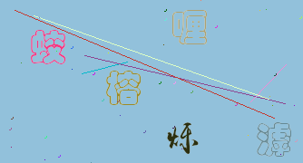
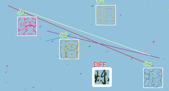
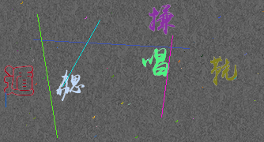
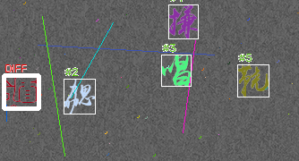
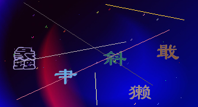
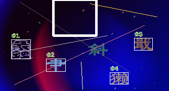

# 凯格 · 字体识别（font）

> 334×180 背景上散落 5–6 个风格各异的汉字，标注用 `DIFF` 指出其中字体不同的那个；本库只收题面与标注，未撰写求解器，建议 OCR 读字 + VLM 比较字体风格。
>
> 返回：[凯格索引](../../../docs/kgcaptcha.md) · [全量类型](../../../docs/types.md) · [方法论](../../../docs/00-methodology.md)

## 一、速览

| 项 | 值 |
|---|---|
| 厂商 | 凯格（`kgcaptcha`） |
| 类型 / 变体 | `font` / classic |
| 中文 | 字体识别 |
| 媒体 | 图片 |
| 样本 | 12 组（001–012） |
| 答案格式 | `points/text`：点击坐标，可能带字体名 |
| 方法 | `NONE(OCR+VLM)`（未撰写） |
| 求解器 | `none` · 未知 |
| 人工审查 | 9 通过 / 3 不适用（截至 2026-11-21） |
| 证据等级 | 无求解结果；只有题面与标注 |

## 二、题面与判定

12 组共用一句题面「识别并点击指定字体」，但题面文字没有给出具体字体名；图中是 5–6 个不同字体、不同颜色、不同描边方式的汉字，`pass_criteria` 在该批案例中未记录。

| 案例 | 题面（`meta.prompt`） | 图中字形 | 标注 |
|---|---|---|---|
| [001](001/) | 识别并点击指定字体 | 5 个：粉描边、灰描边、黄描边、黑实心、灰描边 | `DIFF` 落在黑实心「桦」 |
| [012](012/) | 同上 | 6 个：蓝白描边、青、绿、棕等 | `DIFF` 落在中央「斜」 |

> 从标注形态看，任务是在一组汉字中找出字体与其余不同的那个；本库没有页面上的「指定字体」参考样本，因此不反推字体名称。

## 三、样本长什么样

| 原始题面 | 标注（编号 + DIFF） | 原始题面 | 标注（编号 + DIFF） |
|---|---|---|---|
|  |  |  |  |
|  |  | — | — |

- 两列一组：左边题面、右边标注；`DIFF` 用橙红色文字标出目标，其余候选用 `#1`–`#5` 编号。背景多为纯色/渐变/纹理，描边字有时比实心字更容易定位。

## 四、形态与难点

- **字体维度多**：实心/描边、衬线/无衬线、粗细、手写/印刷、颜色和纹理都会变化。
- **同图异字**：5–6 个字通常不是同一个字，不能靠「同字比对」直接找差异，需要先读字再比风格。
- **背景干扰 + 无参考样本**：彩色渐变/树叶会遮住细笔画；题面没有单独参考字块，字体类别只能从字形特征推断。

## 五、建议路线（未实现）

`meta.method_note` 给的方向是「OCR + VLM」。最省的做法是让 VLM 直接比较「哪一笔的字体风格不同」，OCR 只负责给出候选字与框。

| 步骤 | 建议做法 | 说明 |
|---|---|---|
| 1 定位 | 连通域/文本框找出所有汉字，过滤背景装饰 | 描边字需要先闭合再取框 |
| 2 读字 | OCR 读出每个候选字，允许低置信 | 读字不是最终目的，只用于描述候选 |
| 3 比字体 | 对每个候选提取笔画粗细、实心/描边、衬线、倾斜等特征，或直接交给 VLM 比较 | 关键是「与其余候选不同」而不是识别字体名称 |
| 4 输出 | 返回目标字的中心坐标；若页面要求字体名，再补一个类别标签 | 与 `answer_format=points/text` 对齐 |

> 这条路线没有在本库落地，也没有逐组准确率；`DIFF` 是源标注，不是模型输出。

## 六、为什么没有结果

- 12 组只有 `bg` / `annotated`，没有 `answer.txt` / `result.json`，无法计算准确率。
- `meta.status=sample-only`，`solver.status=none`、`accuracy=unknown`；本页不写成功率。
- `review` 现算为 9 组 `pass/correct`、3 组 `not-applicable`（010–012）；无求解器，`pass` 只代表样本/标注审查。统计截至 2026-11-21，以 `meta.json` 为准。

## 七、边界

- **不要猜字体名**：截图没有参考样本，把「黑体/楷体」写死会引入未记录的事实。
- **不要只比颜色**：颜色与字体风格是两个维度，同色不同体、同体不同色都存在。
- **不要忽略描边**：描边字在浅背景上可能只剩轮廓，连通域面积会偏小。
- **没有提交记录**：本页只覆盖图像侧的选择；点击顺序、轨迹与服务端判定不在范围内。

## 八、相关

- 厂商索引：[docs/kgcaptcha.md](../../../docs/kgcaptcha.md) · 全量类型：[docs/types.md](../../../docs/types.md) · 方法论：[docs/00-methodology.md](../../../docs/00-methodology.md)
- 同厂商对照：[text-click](../text-click/)（唯一有求解器）、[spatial](../spatial/) / [word-order](../word-order/)（仅样本）
- 案例：[001](001/) – [012](012/)（每组含 `meta.json` + `bg.png` / `annotated.png`）
- 来源：<https://www.kgcaptcha.com/>；样本版权归凯格所有，仅用于研究与教学。
