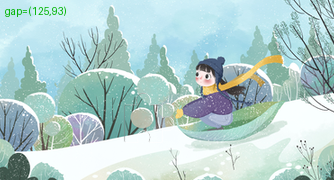

# 凯格 · 滑动拼图（slide）

> 334×180 场景图中央有一个白色拼图剪影，拖动滑块把它补进缺口；本库只收题面与 `solved` 参考图，未撰写求解器，建议走边缘/模板匹配的轻量 CV 路线。
>
> 返回：[凯格索引](../../../docs/kgcaptcha.md) · [全量类型](../../../docs/types.md) · [方法论](../../../docs/00-methodology.md)

## 一、速览

| 项 | 值 |
|---|---|
| 厂商 | 凯格（`kgcaptcha`） |
| 类型 / 变体 | `slide` / classic |
| 中文 | 滑动拼图 |
| 媒体 | 图片 |
| 样本 | 12 组（001–012） |
| 答案格式 | `offset-x`：水平拖动量 |
| 方法 | `NONE(CV)`（未撰写；建议 CV 边缘/模板） |
| 求解器 | `none` · 未知 |
| 人工审查 | 9 通过 / 3 不适用（截至 2026-11-21） |
| 证据等级 | 无求解结果；`solved` 仅作参考图 |

## 二、题面与判定

12 组共用一句题面，页面没有文字答案；用户拖动滑块，让左侧的拼图块水平移动并补进背景缺口。`meta.prompt` 只描述动作，`pass_criteria` 在该批案例中未记录。

| 案例 | 题面（`meta.prompt`） | 通过条件 | `solved` 参考标注 |
|---|---|---|---|
| [001](001/) | 拖动滑块，将拼图块补入缺口 | 该批案例未记录通过条件 | `gap=(163,73)` |
| [012](012/) | 同上 | 同上 | `gap=(125,93)` |

> 答案空间是水平偏移量 `offset-x`；`solved` 左上角的 `(x, y)` 是缺口位置参考，纵向 `y` 不参与提交。

## 三、样本长什么样

| 原始背景 | 拼图块条带（alpha） | 参考拼合 |
|---|---|---|
|  |  |  |
|  |  |  |

- 第 1 列是 334×180 的题面，缺口为半透明白色剪影；第 2 列是 72×180 的 RGBA 条带，保留纵向位置，透明区需屏蔽。
- 第 3 列只用于肉眼核对拼合结果；本库没有对应的 `answer.txt` / `result.json`。

## 四、形态与难点

- **白色剪影贴白背景**：001 的缺口落在高亮沙地上，012 的缺口落在白雪上，边缘对比很弱。
- **缺口形态固定**：拼图块是标准凸凹形，但缺口是剪影而不是带颜色的块，颜色相关性不可靠。
- **图幅小**：334×180，缺口宽约 60–80px；12 组只覆盖 `classic`，没有旋转、缩放或多缺口变体。

## 五、建议路线（未实现）

`meta.method_note` 给的方向是「CV 边缘/模板，成本低」。落地时建议先定位白色剪影，再用 alpha 掩膜做归一化匹配，只求水平偏移。

| 步骤 | 建议做法 | 说明 |
|---|---|---|
| 1 掩膜 | 取 `aux` 的 alpha 通道，裁掉透明区 | 透明区不参与匹配，避免白底带偏 |
| 2 缺口候选 | 在背景中找高亮、低纹理的拼图形连通域 | 白色剪影与亮背景易混，需结合形状约束 |
| 3 匹配 | 以拼图块边缘/二值轮廓沿 x 轴滑窗，做 masked NCC 或 chamfer | 纵向按 `aux` 的原始位置固定 |
| 4 输出 | 取峰值对应的 `x` 作为 `offset-x` | 用 `solved` 的 `gap` 标签做离线抽检 |

> 这条路线没有在本库落地，也没有逐组准确率；`solved` 上的 `gap` 是参考标注，不是求解器输出。

## 六、为什么没有结果

- 12 组案例只有 `bg` / `aux` / `solved` 三类媒体，没有 `answer.txt` / `result.json`，无法计算逐组答案。
- `meta.status=sample-only`，`solver.status=none`、`accuracy=unknown`；本页不写任何成功率。
- `review` 现算为 9 组 `pass/correct`、3 组 `not-applicable`（010–012）；无求解器，`pass` 只代表样本/参考图审查。统计截至 2026-11-21，以 `meta.json` 为准。

## 七、边界

- **不要把 `solved` 的 `gap` 当成服务端真值**：它只是参考标注，且只有 `(x, y)` 两个数，不能证明线上通过。
- **不要用纯颜色匹配**：白色剪影与亮背景同色，颜色差分会把沙地、雪地一起选进来。
- **注意坐标映射与提交**：334×180 的题面图可能被页面缩放，提交前要换算；本页不覆盖滑块轨迹、时序与风控。

## 八、相关

- 厂商索引：[docs/kgcaptcha.md](../../../docs/kgcaptcha.md)
- 全量类型：[docs/types.md](../../../docs/types.md) · 方法论：[docs/00-methodology.md](../../../docs/00-methodology.md)
- 同厂商对照：[text-click](../text-click/)（唯一有求解器的类型）、[font](../font/) / [spatial](../spatial/) / [word-order](../word-order/)（仅样本）
- 案例：[001](001/) – [012](012/)（每组含 `meta.json` + `bg.png` / `aux-01.png` / `solved.png`）
- 来源：<https://www.kgcaptcha.com/>；样本版权归凯格所有，仅用于研究与教学。
