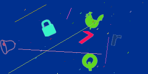
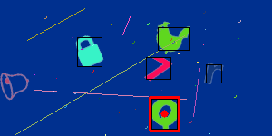
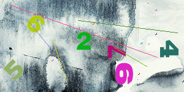
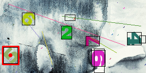
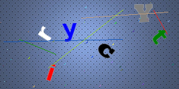
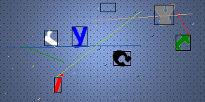

# 凯格 · 空间推理（spatial）

> 300×150 的深色场景里散落字母、数字和图形，题面要求按颜色、倾斜角、距离或大小写关系点中一个目标；本库只收题面与标注，未撰写求解器，建议 VLM 读题 + 空间推理。
>
> 返回：[凯格索引](../../../docs/kgcaptcha.md) · [全量类型](../../../docs/types.md) · [方法论](../../../docs/00-methodology.md)

## 一、速览

| 项 | 值 |
|---|---|
| 厂商 | 凯格（`kgcaptcha`） |
| 类型 / 变体 | `spatial` / classic |
| 中文 | 空间推理 |
| 媒体 | 图片 |
| 样本 | 12 组（001–012） |
| 答案格式 | `points`：1 个点击坐标 |
| 方法 | `NONE(VLM)`（未撰写；建议 VLM 空间推理） |
| 求解器 | `none` · 未知 |
| 人工审查 | 12 组 `not-applicable`（截至 2026-11-21） |
| 证据等级 | 无求解结果；只有题面与标注 |

## 二、题面与判定

12 组题面各不相同，覆盖颜色匹配、倾斜角、距离、大小写转换等关系。`meta.pass_criteria` 统一写为「按提示点击符合描述的对象；点错或点多均不通过」。

| 案例 | 题面（`meta.prompt`） | 需要判断的关系 | 标注目标 |
|---|---|---|---|
| [001](001/) | 请点击颜色与小鸡一致的大写字母 | 颜色 + 大小写 | 绿色 Q 形字母 |
| [003](003/) | 请点击一个角度倾斜的数字 | 倾斜角 | 倾斜数字 |
| [011](011/) | 请点击灰色字母对应的小写 | 颜色 + 大小写映射 | 灰色 Y 对应的小写 y |

> 题面是中文自然语言，答案不是固定类别；必须先读懂关系，再在图中找到唯一满足的对象。

## 三、样本长什么样

| 001 题面 | 001 标注 | 005 题面 | 005 标注 | 011 题面 | 011 标注 |
|---|---|---|---|---|---|
|  |  |  |  |  |  |

- 每两列一组：左题面、右标注；红框是唯一目标，黑框只是候选。001 有小鸡、锁、铃铛、Q/r；005 有多个旋转数字；011 有灰色 Y 与彩色字母，目标是小写 y。

## 四、形态与难点

- **关系类型多**：颜色、角度、距离、大小写、形状相似度交替出现，没有单一模板。
- **同色/同类干扰**：001 的绿色 Q 与绿色小鸡同色；005 的多个数字都倾斜，只有角度符合「逆时针 45°」。
- **参考对象**：题面中的「小鸡」「小鱼」「灰色字母」本身也是候选对象，需要先定位参考物再算关系。
- **图幅小、语义重**：300×150，彩色干扰线会切断连通域；还要理解「逆时针」「最近」「对应的小写」，不能只做颜色直方图。

## 五、建议路线（未实现）

`meta.method_note` 给的方向是「VLM 空间推理」。这类题不适合硬编码规则，最省的是把整图与题面一起交给 VLM，让它输出一个坐标。

| 步骤 | 建议做法 | 说明 |
|---|---|---|
| 1 读题 | 解析中文 prompt，抽取参考对象、关系词、目标属性 | 例：颜色=小鸡、属性=大写字母 |
| 2 候选 | 分割/描述图中的字母、数字、图形与参考物 | 可使用检测框或 VLM 自带定位 |
| 3 关系推理 | 按颜色、角度、距离或大小写逐一筛选 | 先找参考物，再算候选与参考物的关系 |
| 4 输出 | 返回唯一目标的中心坐标 | `points`，单点 |

> 这条路线没有在本库落地，也没有准确率；`annotated` 是源标注，不是模型预测。

## 六、为什么没有结果

- 12 组只有 `bg` / `annotated`，没有 `answer.txt` / `result.json`，无法计算逐组答案。
- `meta.status=sample-only`，`solver.status=none`、`accuracy=unknown`；本页不写成功率。
- `review` 12 组全部为 `not-applicable`，没有人工解题结论；统计截至 2026-11-21，以 `meta.json` 为准。

## 七、边界

- **不要用固定类别表**：12 组 prompt 覆盖不同关系，固定「颜色匹配」会漏掉角度、距离和大小写题。
- **不要把干扰线当笔画**：彩色线条会切断字母/数字的连通域，定位前要先过滤细长结构。
- **不要忽略参考物**：001 的小鸡、006 的小鱼、011 的灰色 Y 都是关系的一部分，必须先定位。
- **没有提交记录**：本页只覆盖图像侧的选点，服务端判定与轨迹不在范围内。

## 八、相关

- 厂商索引：[docs/kgcaptcha.md](../../../docs/kgcaptcha.md) · 全量类型：[docs/types.md](../../../docs/types.md) · 方法论：[docs/00-methodology.md](../../../docs/00-methodology.md)
- 同厂商对照：[text-click](../text-click/)（唯一有求解器）、[font](../font/) / [word-order](../word-order/)（仅样本）
- 案例：[001](001/) – [012](012/)（每组含 `meta.json` + `bg.png` / `annotated.png`）
- 来源：<https://www.kgcaptcha.com/>；样本版权归凯格所有，仅用于研究与教学。
