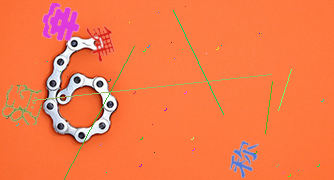
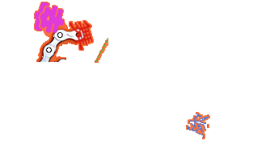
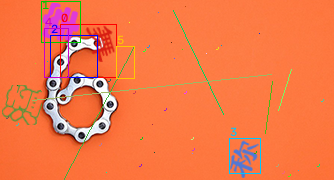
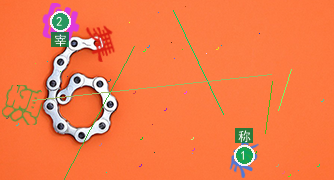
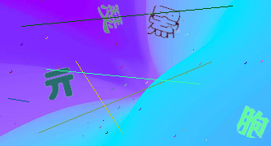
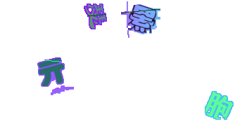
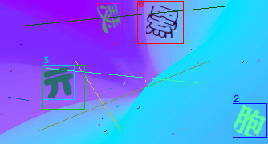
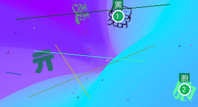

# 凯格 · 文字点选（text-click）

> 334×180 橙底场景里混着大量干扰字与线条，按提示顺序点中 2 个目标字；本库有一条纯本地弱求解器：DBNet 文本框 + 颜色拆分 + Canny 边缘候选 + 多字体多角度 chamfer + RapidOCR 加分。
>
> 返回：[凯格索引](../../../docs/kgcaptcha.md) · [全量类型](../../../docs/types.md) · [方法论](../../../docs/00-methodology.md)

## 一、速览

| 项 | 值 |
|---|---|
| 厂商 | 凯格（`kgcaptcha`） |
| 类型 / 变体 | `text-click` / classic |
| 中文 | 文字点选 |
| 媒体 | 图片 |
| 样本 | 12 组（001–012） |
| 答案格式 | `points`：2 个有序点击坐标 |
| 方法 | `DET+CV+OCR`（全本地、无 LLM、无训练） |
| 求解器 | `weak` · 低（源记录；最新版待复核） |
| 人工审查 | 5 通过 / 7 未通过（截至 2026-11-21，对应更早版本） |
| 证据等级 | `unverified`（无 `answer.txt` / `result.json`，仅有标注图） |

## 二、题面与判定

题面直接给出两个字及顺序，例如「请依次点击：称 → 宰」。图中同时存在大量干扰字、图形和彩色施工线，目标字可能中空、极细、旋转或带波变形变；`pass_criteria` 在该批案例中未记录。

| 案例 | 题面（`meta.prompt`） | 目标 | 审查 |
|---|---|---|---|
| [001](001/) | 请依次点击：称 → 宰 | 称、宰 | pass / correct |
| [002](002/) | 请依次点击：埽 → 互 | 埽、互 | pass / correct |
| [010](010/) | 请依次点击：罴 → 胞 | 罴、胞 | fail / incorrect（旧版） |
| [012](012/) | 请依次点击：骇 → 泖 | 骇、泖 | fail / incorrect（旧版） |

> 答案空间是 2 个点及其顺序；题面已经给出字与顺序，难点完全在「在干扰中找对这两个字形」。

## 三、样本长什么样

| 原始题面 | 候选字形掩码（denoised） | 候选框（mark） | 点击标注（annotated） |
|---|---|---|---|
|  |  |  |  |
|  |  |  |  |

- 第 1 列是题面：橙底或渐变底，目标字与干扰字同场，部分字被线条穿过。
- 第 2 列只保留候选字形像素；第 3 列是去重后的候选框，框数远多于 2 个。
- 第 4 列按提示顺序画绿色点击点，标签为提示字；001 的「称」在右下、「宰」在左上，说明顺序与空间位置无关。

## 四、形态与难点

- **干扰量大**：同一画面里有 10 个以上汉字、图形与彩色线段，候选框必须做互斥分配。
- **字体极端**：中空描边、极细黑体、实心粗体、手写体混用；同一目标字可能只以其中一种出现。
- **几何形变**：旋转、波变、局部遮挡、跨线条；单纯 OCR 对单字经常不确定。
- **颜色/背景**：橙底、渐变底、彩色描边都会影响颜色拆分；目标字与干扰字可能同色。
- **顺序约束**：两个目标必须按提示顺序点击，不能只求「找到两个字」。

## 五、求解思路

源记录里的 v2 是纯本地流水线：先拿到尽量全的候选框，再用「字形模板 + OCR 票数」决定哪两个框是目标。核心不是单个模型，而是多信号互补。

| 步骤 | 做法 | 关键判据 / 参数 |
|---|---|---|
| 1 文本框先验 | DBNet 检测所有文字候选框 | 先保证召回，允许误报 |
| 2 框内拆分 | 颜色聚类 + 双核残差图，把字从背景/干扰中拆出 | 残差高的像素更可能是笔画 |
| 3 边缘候选 | Canny 边缘补中空字、细线字候选 | 解决字腔被填满、细笔画被当碎片 |
| 4 掩码收紧 | 墨迹收紧、背景字腔剔除、骨架与子区域过滤 | 去掉只剩边框或碎片的假候选 |
| 5 模板匹配 | 20+ 字体 × 24 角度，实心/描边两套模板，双向 chamfer | 平移搜索 ±6px；取最小 chamfer 距离 |
| 6 OCR 加分 | RapidOCR 对旋转裁片读字，命中提示字则加分 | 只作加分项，不单独定案 |
| 7 分配 | 两目标互斥、不重叠，按提示顺序输出 | 同时约束「字对」与「框不重复」 |

> 源记录没有给出各步权重、阈值和每组的 chamfer 分数；本页只保留可追溯的做法与参数。RapidOCR 在这里是「读字加分」，不是主定位器。

## 六、结果与审查

- **源记录**：v2 纯本地求解器，效果标为「低」；2026-11-20 针对中空/极细字体补了墨迹收紧、边缘候选、细体字体和子区域过滤。
- **逐组人工结论**：001/002/003/005/006 通过，004/007/008/009/010/011/012 未通过。`meta` 注明该 `review` 对应更早结果；010 的中空「罴」与 012 的「骇」在 2026-11-20 已修正，新结果待复核。
- **仍受限的组**：004、007、008、009、011 以及 012 的「泖」仍可能判错；主要形态是形近字和中空/细体。
- **证据**：12 组均无 `answer.txt` / `result.json`，只有 `bg` / `denoised` / `mark` / `annotated` 四类图；`status=sample-only`，不能把标注图当成服务端真值。
- 统计截至 2026-11-21，以案例 `meta.json` 为准。

| 组 | 提示字 | 审查 | 备注 |
|---|---|---|---|
| [001](001/) | 称 → 宰 | pass / correct | 票数稳定 |
| [002](002/) | 埽 → 互 | pass / correct | 「埽」易混「場」 |
| [003](003/) | 碱 → 葵 | pass / correct | — |
| [004](004/) | 贲 → 烀 | fail / incorrect | 形近/字体限制 |
| [005](005/) | 厣 → 谱 | pass / correct | — |
| [006](006/) | 键 → 患 | pass / correct | — |
| [007](007/) | 逸 → 徵 | fail / incorrect | 「徵」易混「徽」 |
| [008](008/) | 郾 → 肉 | fail / incorrect | 形近 |
| [009](009/) | 缰 → 醅 | fail / incorrect | 「醅」易混「酷」 |
| [010](010/) | 罴 → 胞 | fail / incorrect | 「罴」已修正，审查为旧版 |
| [011](011/) | 怿 → 檄 | fail / incorrect | 「怿」易混「檄」 |
| [012](012/) | 骇 → 泖 | fail / incorrect | 「骇」已修正；「泖」易混「扑」 |

## 七、失败与边界

| 现象 | 根因 | 证据 | 结论 |
|---|---|---|---|
| 中空字的字腔被填满 | 颜色/残差把内部背景算进笔画 | 2026-11-20 更新专门补了中空/极细 | 用 Canny 边缘候选 + 墨迹收紧兜底 |
| 极细笔画被当碎片过滤 | 连通域面积阈值过严 | 细黑/等线 Light 仍可能失败 | 保留子区域候选，不只用整字连通域 |
| 形近字判错 | 单字模板与 OCR 票数都不占优 | 埽/場、徵/徽、酷/醅、罴/罳、怿/檄、泖/扑 | 仍需更强字形特征或人工复核 |
| 标注图不等于答案文件 | 本批未生成机器可读结果 | 12 组只有 `annotated.png` | 准确率只能按 `review` 表述，不能重算 |
| 最新结果未复核 | 算法在审查之后又更新 | `meta.notes` 明确说明 | 010/012 的修正尚未进入 `review` |

**边界**：本页覆盖的是图像侧的「找字 + 定序」；凯格的提交参数、轨迹与风控不在本库范围内。即使两个字都点对，也不能据此声称线上通过。

## 八、相关

- 厂商索引：[docs/kgcaptcha.md](../../../docs/kgcaptcha.md)
- 全量类型：[docs/types.md](../../../docs/types.md) · 方法论：[docs/00-methodology.md](../../../docs/00-methodology.md)
- 同厂商对照：[slide](../slide/)（未解）、[font](../font/) / [spatial](../spatial/) / [word-order](../word-order/)（仅样本）
- 案例：[001](001/) – [012](012/)（每组含 `meta.json` + `bg.png` / `denoised.png` / `mark.png` / `annotated.png`）
- 来源：<https://www.kgcaptcha.com/>；样本版权归凯格所有，仅用于研究与教学。
