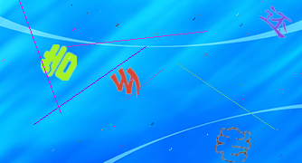
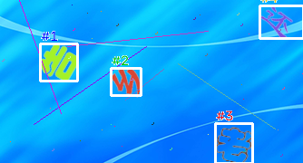
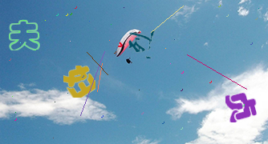
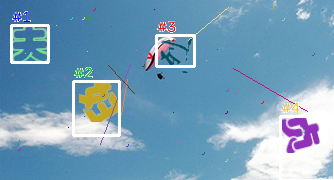
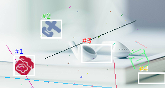

# 凯格 · 语序点选（word-order）

> 334×180 场景里散落 4 个描边/实心/纹理化汉字，按正确语序依次点击；本库只收题面与标注，未撰写求解器，建议 OCR 逐字读取 + VLM 判断语序。
>
> 返回：[凯格索引](../../../docs/kgcaptcha.md) · [全量类型](../../../docs/types.md) · [方法论](../../../docs/00-methodology.md)

## 一、速览

| 项 | 值 |
|---|---|
| 厂商 | 凯格（`kgcaptcha`） |
| 类型 / 变体 | `word-order` / classic |
| 中文 | 语序点选 |
| 媒体 | 图片 |
| 样本 | 12 组（001–012） |
| 答案格式 | `points+order`：4 个有序坐标 |
| 方法 | `NONE(OCR+VLM)`（未撰写；建议 OCR + VLM 语序） |
| 求解器 | `none` · 未知 |
| 人工审查 | 12 组 `not-applicable`（截至 2026-11-21） |
| 证据等级 | 无求解结果；只有题面与标注 |

## 二、题面与判定

12 组共用一句题面「按正确语序点击文字」。图中固定给出 4 个散落字形，标注按 `#1`–`#4` 编号；`pass_criteria` 在该批案例中未记录。

| 案例 | 题面（`meta.prompt`） | 图中字形 | 标注顺序 |
|---|---|---|---|
| [001](001/) | 按正确语序点击文字 | 4 个：绿色描边、红色、蓝色描边、棕色纹理 | `#1`–`#3` 可见，`#4` 在下方 |
| [011](011/) | 同上 | 4 个：红色、蓝灰实心、绿色描边、白色字形 | `#1` 左下 → `#4` 右下 |

> 答案空间是「4 个字的排列」，不只是 4 个坐标；必须先把字读对，再确定语序。本库没有记录每组的目标词/成语。

## 三、样本长什么样

| 001 题面 | 001 标注 | 002 题面 | 002 标注 | 011 题面 | 011 标注 |
|---|---|---|---|---|---|
|  |  |  |  |  |  |

- 每两列一组：左题面、右标注；白/绿框圈出 4 个字，`#1`–`#4` 标出点击顺序。背景是照片，字形有描边/实心/渐变/纹理，个别与背景物体混在一起。

## 四、形态与难点

- **字形风格差异大**：描边、实心、手写、纹理化混用，单字 OCR 的置信度不稳定。
- **4 字关系**：4 个字需要组成词/短语/成语；只读对单字不够，还要知道排列，且 `#1` 可能在任何角落，不能按位置顺序点。
- **背景干扰**：彩色施工线、照片纹理、亮部会切断笔画或把背景并入字形。
- **无答案文件**：12 组没有记录目标词，只能从标注顺序反推点击路径，不能反推语义。

## 五、建议路线（未实现）

`meta.method_note` 给的方向是「OCR + VLM 语序」。推荐让 OCR 先给出 4 个候选字，再让 VLM 在候选词库里选排列；比整图直接猜更可控。

| 步骤 | 建议做法 | 说明 |
|---|---|---|
| 1 定位 | 连通域/文本框找出 4 个字形，按空间编号 | 过滤彩色线条与背景装饰 |
| 2 读字 | OCR 对每个字形读字，保留 top-k 候选 | 描边/纹理字需要多角度或多掩码变体 |
| 3 组词 | 把 4 个候选字交给词库/语言模型，枚举合理排列 | 若成语/词语库命中，直接得到语序 |
| 4 输出 | 按语序返回 4 个中心坐标 | `points+order`，顺序即答案的一部分 |

> 这条路线没有在本库落地，也没有准确率；标注图只给出点击顺序，不给出目标词，不能用它反推 OCR 准确率。

## 六、为什么没有结果

- 12 组只有 `bg` / `annotated`，没有 `answer.txt` / `result.json`，无法计算逐组答案。
- `meta.status=sample-only`，`solver.status=none`、`accuracy=unknown`；本页不写成功率。
- `review` 12 组全部为 `not-applicable`，没有人工解题结论；统计截至 2026-11-21，以 `meta.json` 为准。

## 七、边界

- **不要假定 4 字一定是成语**：本库没有记录目标词；把它当固定成语库会引入未证实的前提。
- **不要按空间顺序点**：标注顺序与位置无关，语序才是判定依据。
- **不要只做单字 OCR**：即使 4 个字都读对，排列错仍然不通过；必须有组词/语序约束。
- **没有提交记录**：本页只覆盖图像侧的读字与排序，服务端判定与轨迹不在范围内。

## 八、相关

- 厂商索引：[docs/kgcaptcha.md](../../../docs/kgcaptcha.md) · 全量类型：[docs/types.md](../../../docs/types.md) · 方法论：[docs/00-methodology.md](../../../docs/00-methodology.md)
- 同厂商对照：[text-click](../text-click/)（唯一有求解器）、[font](../font/) / [spatial](../spatial/)（仅样本）
- 案例：[001](001/) – [012](012/)（每组含 `meta.json` + `bg.png` / `annotated.png`）
- 来源：<https://www.kgcaptcha.com/>；样本版权归凯格所有，仅用于研究与教学。
