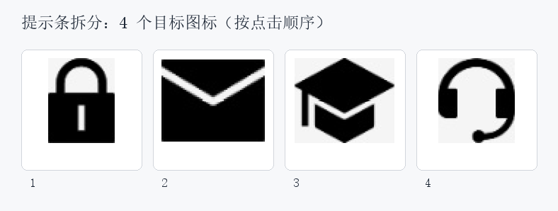
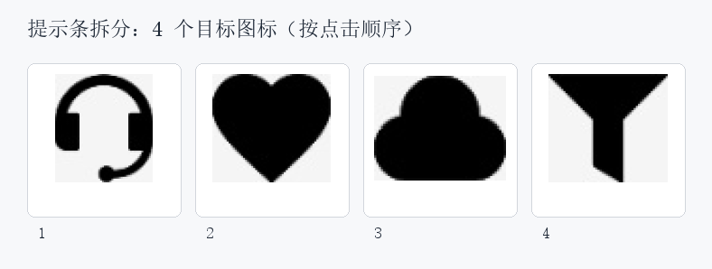

# 美团 Yoda · 图标点选（icon-click）

> 536×357 背景被横向切成三条打乱，提示条给出 4 个黑色图标的点击顺序；先做切点检测还原背景，再把提示条拆成 4 个模板做多尺度/旋转匹配，源记录图像 83/83、人工复核 12/12 满意。
>
> 返回：[美团索引](../../../docs/meituan.md) · [全量类型](../../../docs/types.md) · [方法论](../../../docs/00-methodology.md)

## 一、速览

| 项 | 值 |
|---|---|
| 厂商 | 美团 Yoda（`meituan`） |
| 类型 / 变体 | `icon-click` / `130` |
| 中文 | 图标点选 |
| 媒体 | 图片 |
| 样本 | 12 组（001–012） |
| 答案格式 | `points`：4 个有序坐标 |
| 方法 | `CV`（背景还原 + 模板/滑窗匹配，无 LLM） |
| 求解器 | `partial` · 高（源记录图像 83/83） |
| 人工审查 | 12 通过 / 0 错误（人工复核结果满意 12/12） |
| 证据等级 | `manual` · high |

## 二、题面与判定

题面是「请依次点击下图图标」，顺序由提示条决定；`meta.pass_criteria` 写的是「按图中图标的顺序依次点击；顺序错误不通过」。答案不是任意 4 个点，而是 4 个图标各自的位置与顺序。

| 案例 | 题面（`meta.prompt`） | 通过条件 | 结果文件 |
|---|---|---|---|
| [001](001/) | 请依次点击下图图标 | 按提示条顺序点击 4 个图标 | `answer.txt` + `result.json` |
| [006](006/) | 同上 | 同上 | 同上 |
| [012](012/) | 同上 | 同上 | 同上 |

> 提示条与背景分离：背景给「点哪里」，提示条给「先点哪个」，两者必须对齐。

## 三、样本长什么样

| 打乱背景 | 提示条拆分（process-01） | 背景还原（restored） | 点击结果（solved） |
|---|---|---|---|
|  |  |  |  |
|  |  |  |  |

- 第 1 列是打乱后的背景：同一张海滩图被切成三条并横向错位，图标仍在图中，但位置关系已被破坏。
- 第 2 列从 `aux-01.jpg` 拆出 4 个图标，按点击顺序编号；第 3 列是还原后的完整背景。
- 第 4 列用红圈和数字标出点击点；001 的顺序是锁 → 信封 → 学士帽 → 耳机。

## 四、形态与难点

- **背景打乱**：切点未知，三条图各自偏移；必须先还原，才能在正确位置匹配图标。
- **提示条与背景异构**：提示条是白底黑图标（536×70），背景是彩色照片；模板匹配要处理底色与缩放差异。
- **图标相似**：4 个图标都是黑色剪影，信封/锁/学士帽/耳机的轮廓差异有限，容易出现错配。
- **尺度与旋转**：源记录使用多尺度/旋转模板，说明背景中的图标不一定与提示条同尺寸同角度。
- **顺序约束**：4 个点必须与提示条顺序一致，匹配分数最高的组合不一定是正确顺序。

## 五、求解思路

源方案的流程是「先还原、再拆分、后匹配」：切点检测决定背景如何拼回，提示条拆分决定模板与顺序，模板/滑窗匹配决定坐标。

| 步骤 | 做法 | 关键判据 / 参数 |
|---|---|---|
| 1 切点检测 | 在打乱背景中找三条横带的接缝 | 接缝处纹理不连续 |
| 2 背景还原 | 按切点把三条横带平移拼回 | 得到 536×357 的 `restored` |
| 3 提示条拆分 | 从 536×70 的 `aux` 拆出 4 个图标 | 白底黑图标，按从左到右编号 |
| 4 模板匹配 | 在还原图上做多尺度/旋转模板/滑窗匹配 | 每个图标取最高分位置 |
| 5 输出 | 按提示条顺序输出 4 个中心坐标 | `result.json` 的 `order=[1,2,3,4]` |
| 6 提交 | 依次点击 4 个点 | 提交闭环未打通 |

> `result.json` 记录求解器为 `icon_solver v3`、`restored=true`、`cn=4`；`answer.txt` 的坐标单位是还原图 536×357 的像素。

## 六、结果与审查

- **源记录**：图像 83/83，标为「高」；`solver.status=partial`，备注「提交闭环未打通」。
- **本库**：12 组 `answer.txt` / `result.json` / `solved.png` 齐全，`evidence=manual`、`confidence=high`。
- **人工审查**：12 组 `review.state=pass`、`result=correct`，备注「人工复核：结果满意（12/12）」。
- **置信度**：12 组的匹配置信区间为 0.813–0.984；最低出现在 010，最高出现在 009。
- 统计截至 2026-11-21，以案例 `meta.json` 为准。

| 组 | 1 | 2 | 3 | 4 | conf 范围 |
|---|---|---|---|---|---|
| [001](001/) | (137,72) | (337,163) | (176,200) | (340,62) | 0.917–0.937 |
| [002](002/) | (231,184) | (329,284) | (478,53) | (463,205) | 0.907–0.966 |
| [003](003/) | (447,93) | (287,73) | (227,268) | (454,206) | 0.879–0.953 |
| [004](004/) | (479,261) | (266,109) | (351,264) | (187,290) | 0.892–0.949 |
| [005](005/) | (400,310) | (333,190) | (425,212) | (198,229) | 0.936–0.964 |
| [006](006/) | (390,163) | (474,56) | (147,274) | (474,231) | 0.913–0.971 |
| [007](007/) | (398,220) | (395,65) | (313,291) | (168,222) | 0.883–0.950 |
| [008](008/) | (482,291) | (241,301) | (334,60) | (197,137) | 0.890–0.965 |
| [009](009/) | (198,219) | (182,128) | (370,243) | (471,221) | 0.877–0.984 |
| [010](010/) | (171,290) | (289,246) | (428,165) | (457,314) | 0.813–0.943 |
| [011](011/) | (316,45) | (287,137) | (215,233) | (152,139) | 0.918–0.977 |
| [012](012/) | (140,257) | (359,286) | (479,169) | (408,70) | 0.893–0.948 |

## 七、失败与边界

| 现象 | 根因 | 证据 | 结论 |
|---|---|---|---|
| 图像正确但线上不通过 | 提交链未打通 | `solver.notes` 写「提交闭环未打通」 | `partial`，不是线上通过 |
| 背景切错导致图标错位 | 接缝纹理弱或周期性背景 | 源方案专门做切点检测 | 还原失败时匹配分再高也无意义 |
| 图标相似导致错配 | 4 个黑色剪影轮廓接近 | 010 的 conf 最低 0.813 | 需要顺序约束与人工复核 |
| 尺度/旋转差异 | 提示条与背景渲染不同 | 源方案用多尺度/旋转模板 | 单尺度模板会漏检 |

**边界**：本页只覆盖图像侧的还原、拆分与定位；提交链、轨迹和风控不在本库范围内。12/12 人工满意是离线复核，不是线上通过率。

## 八、相关

- 厂商索引：[docs/meituan.md](../../../docs/meituan.md)
- 全量类型：[docs/types.md](../../../docs/types.md) · 方法论：[docs/00-methodology.md](../../../docs/00-methodology.md)
- 同厂商对照：[line-connect](../line-connect/)（同样先还原背景）、[slide](../slide/) / [slide-inference](../slide-inference/)（滑块）、[text](../text/)（低准确率 OCR）
- 案例：[001](001/) – [012](012/)（每组含 `answer.txt` / `result.json` / `bg.png` / `aux-01.jpg` / `process-01-split.png` / `restored.png` / `solved.png`）
- 来源：<https://verify.meituan.com/v2>；样本版权归美团所有，仅用于研究与教学。
