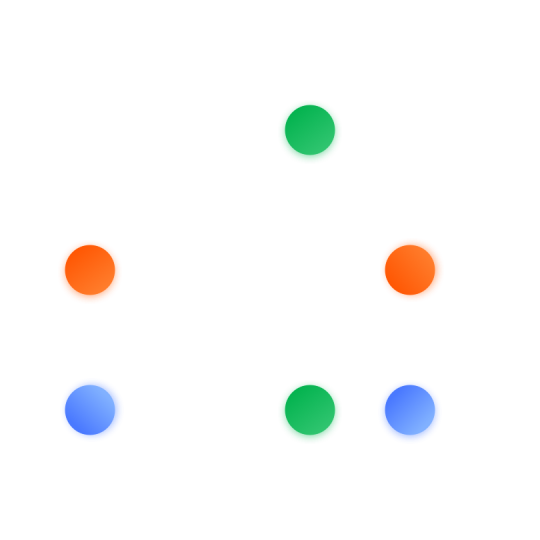
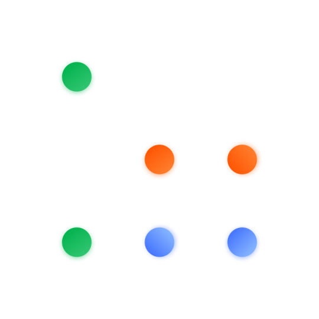
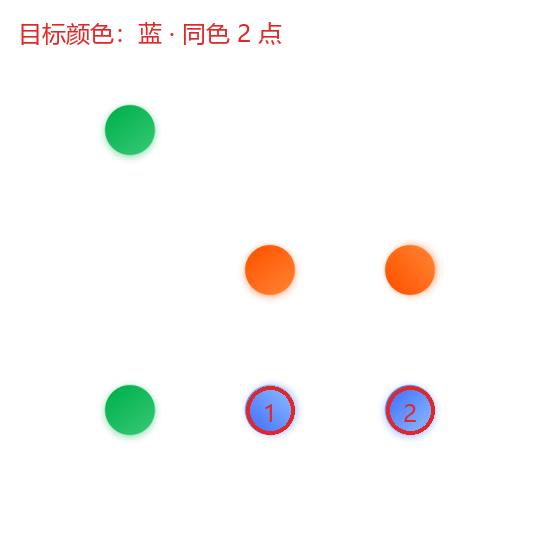
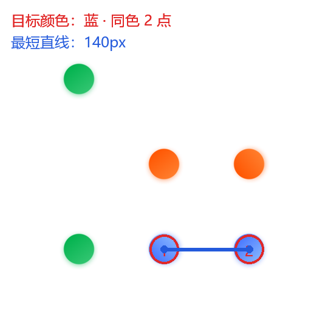

# 美团 Yoda · 最短线连点（line-connect）

> 540×540 背景上有 6 个彩色圆点，先还原被打乱的 0.png，再从 1.png 识别目标颜色（如「蓝」），找到同色两点并用最短直线连接；源记录图像 50/50。
>
> 返回：[美团索引](../../../docs/meituan.md) · [全量类型](../../../docs/types.md) · [方法论](../../../docs/00-methodology.md)

## 一、速览

| 项 | 值 |
|---|---|
| 厂商 | 美团 Yoda（`meituan`） |
| 类型 / 变体 | `line-connect` / `103` |
| 中文 | 最短线连点 |
| 媒体 | 图片 |
| 样本 | 12 组（001–012） |
| 答案格式 | `line/points`：一条直线 + 两个端点 |
| 方法 | `CV`（背景还原 + 颜色模板 + 同色连通域 + 最短直线，无 LLM） |
| 求解器 | `partial` · 高（源记录图像 50/50） |
| 人工审查 | 12 通过 / 0 错误（截至 2026-11-21） |
| 证据等级 | `offline-verified` · high |

## 二、题面与判定

题面写明了完整规则：「从 1.png 读取颜色，用最短线连接背景图中该颜色的两个点」。`meta.pass_criteria` 进一步约束「按 1.png 指定颜色找到两个同色点，用最短直线连接；连错点或绕行不通过」。

| 案例 | 题面（`meta.prompt`） | 通过条件 | 目标色 |
|---|---|---|---|
| [001](001/) | 从 1.png 读取颜色，用最短线连接背景图中该颜色的两个点 | 同色两点 + 最短直线 | 蓝 |
| [006](006/) | 同上 | 同上 | 橘 |
| [011](011/) | 同上 | 同上 | 黄 |

> 答案是一段线段，不是两个独立点；`result.json` 同时记录 `points` 与 `line`（端点、距离）。

## 三、样本长什么样

| 打乱背景（0.png） | 颜色字（1.png） | 背景还原 | 同色两点 | 连线结果 |
|---|---|---|---|---|
|  |  |  |  |  |

- 001 的 1.png 是 86×56 的黑色汉字「蓝」，下面配「识别：蓝色」；2.png 与 0.png 在案例里分别落为 `aux-01.png` 与 `bg.png`。
- 第 1 列是打乱后的背景；第 3 列是还原后的白底圆点图；第 4 列圈出蓝点 1、2；第 5 列画出 140px 的蓝色直线。
- 背景还原过程见 `process-01-restored.png`，颜色文字提取见 `process-02-text.png`。

## 四、形态与难点

- **背景被打乱**：圆点位置不能直接从 `bg.png` 读取，必须先还原 0.png；未还原时两点距离与相对位置都会错。
- **颜色命名**：1.png 是汉字（蓝/橘/绿/红/黄/紫/褐等），需要先 OCR 或模板匹配出颜色名，再到图中找同色点。
- **同色成对**：每种颜色恰好两个点，但白底与阴影会改变 RGB；需要颜色容差与连通域中心。
- **最短约束**：同色两点之间必须直线连接；不能绕行，也不要点到别的颜色。
- **颜色相近**：橘/红、黄/绿在压缩图上容易混淆，需用模板命中与颜色距离双重约束。

## 五、求解思路

源方案把问题拆成三步：读颜色字、还原背景、按颜色取两点。最后一步只是两点间欧氏距离，选距离最短的同色配对。

| 步骤 | 做法 | 关键判据 / 参数 |
|---|---|---|
| 1 读 1.png | 对 86×56 的黑色汉字做模板匹配 | `result.json` 记录 `recognition_distance=0`，命中 `1png_label_map` |
| 2 还原 0.png | 按切点/偏移把打乱背景拼回 | 输出 540×540 的 `process-01-restored.png` |
| 3 找圆点 | 在还原图上按颜色分割，取 6 个圆点中心 | `all_dots` 记录每点坐标、BGR、颜色名 |
| 4 选同色 | 取与目标色名称一致的两个点 | 001 的蓝点为 (270,410) 与 (410,410) |
| 5 连最短线 | 计算两点距离，输出直线 | 001 距离 140px |
| 6 提交 | 按住并从一点拖到另一点 | 提交闭环未打通 |

```text
# 最短线选点（伪代码，对 result.json 记录的直接翻译）
for pair in combinations(dots_of_color(target), 2):
    d = sqrt((x2 - x1)^2 + (y2 - y1)^2)
best = argmin(d)
line = (best.p1, best.p2, distance=d)
```

> 12 组的目标色与两点坐标都写在 `result.json` 的 `answer` / `solver.all_dots` 中；本库没有额外的求解器代码或阈值。

## 六、结果与审查

- **源记录**：图像 50/50，标为「高」；`solver.status=partial`，备注「提交闭环未打通；待审」。
- **本库**：12 组 `answer.txt` / `result.json` / `solved.png` 齐全，`evidence=offline-verified`、`confidence=high`；案例 `status=result-pending-review`，但 `review` 已全部给出结论。
- **人工审查**：12 组 `review.state=pass`、`result=correct`（核对的是颜色与两点选择，不包含线上提交）。
- 统计截至 2026-11-21，以案例 `meta.json` 为准。

| 组 | 目标色 | 端点 1 | 端点 2 | 距离（px） |
|---|---|---|---|---|
| [001](001/) | 蓝 | (270,410) | (410,410) | 140 |
| [002](002/) | 橘 | (410,129) | (410,410) | 281 |
| [003](003/) | 蓝 | (130,130) | (129,270) | 140 |
| [004](004/) | 绿 | (270,130) | (410,409) | 312.16 |
| [005](005/) | 橘 | (130,130) | (270,130) | 140 |
| [006](006/) | 橘 | (270,270) | (409,270) | 139 |
| [007](007/) | 绿 | (270,130) | (410,270) | 197.99 |
| [008](008/) | 橘 | (130,130) | (410,270) | 313.05 |
| [009](009/) | 红 | (270,269) | (130,270) | 140 |
| [010](010/) | 绿 | (130,130) | (270,409) | 312.16 |
| [011](011/) | 黄 | (130,410) | (409,410) | 279 |
| [012](012/) | 绿 | (270,270) | (410,270) | 140 |

## 七、失败与边界

| 现象 | 根因 | 证据 | 结论 |
|---|---|---|---|
| 图像正确但线上不通过 | 提交链未打通 | `solver.notes` 写「提交闭环未打通」 | `partial`，不是线上通过 |
| 颜色字识别错 | 1.png 分辨率低、字体特殊 | 源方案用 `1png_label_map` 模板匹配 | 颜色名错则后续全错 |
| 背景未还原导致两点错位 | 切点/偏移估计错 | 需先输出 `process-01-restored.png` | 还原是前置条件 |
| 相近色混淆 | 橘/红、黄/绿 RGB 接近 | 001–012 共出现蓝/橘/绿/红/黄 | 名称与颜色距离双重约束 |

**边界**：本页只覆盖图像侧的读色、还原与连线；拖拽轨迹、提交环节与风控不在本库范围内。12/12 审查通过是离线结论，不等于服务端接受。

## 八、相关

- 厂商索引：[docs/meituan.md](../../../docs/meituan.md)
- 全量类型：[docs/types.md](../../../docs/types.md) · 方法论：[docs/00-methodology.md](../../../docs/00-methodology.md)
- 同厂商对照：[icon-click](../icon-click/)（同样先还原背景）、[slide](../slide/) / [slide-inference](../slide-inference/)（滑块）、[text](../text/)（低准确率 OCR）
- 案例：[001](001/) – [012](012/)（每组含 `answer.txt` / `result.json` / `bg.png` / `aux-01.png` / 3 张 `process-*` / `solved.png`）
- 来源：<https://verify.meituan.com/v2>；样本版权归美团所有，仅用于研究与教学。
