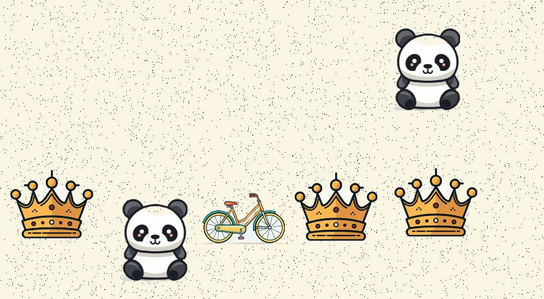
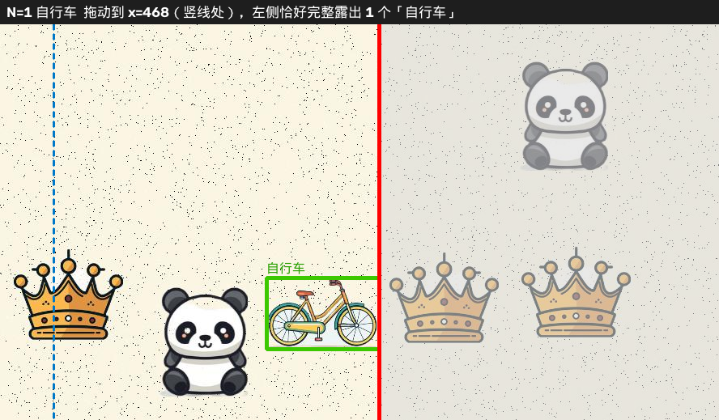
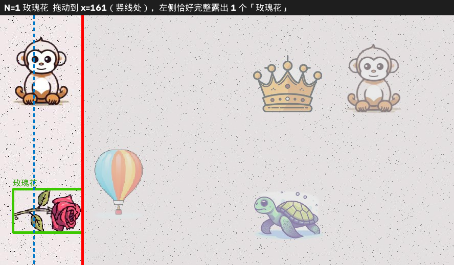
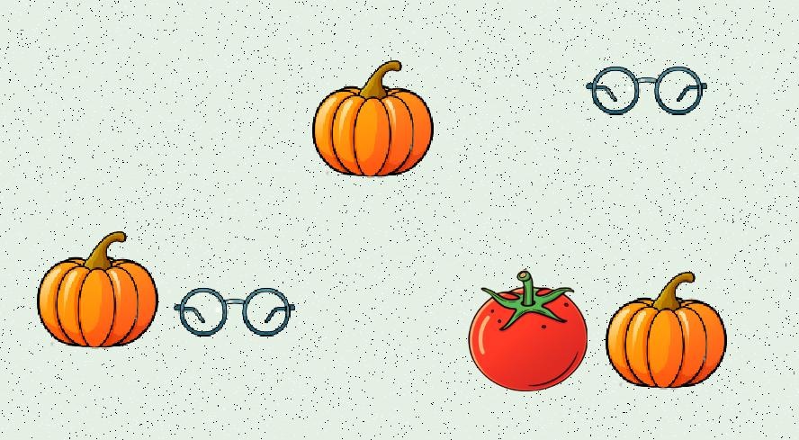
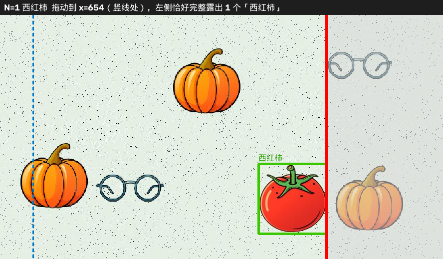

# 美团 Yoda · 滑动推理（slide-inference）

> 拖动滑块，让「1 个自行车 / 1 朵玫瑰花 / 樱桃」刚好完整露出时松手；判据是边界线落在第 N 个目标的右缘，源记录图像 1502/1502，但提交闭环未打通。
>
> 返回：[美团索引](../../../docs/meituan.md) · [全量类型](../../../docs/types.md) · [方法论](../../../docs/00-methodology.md)

## 一、速览

| 项 | 值 |
|---|---|
| 厂商 | 美团 Yoda（`meituan`） |
| 类型 / 变体 | `slide-inference` / `202` |
| 中文 | 滑动推理 |
| 媒体 | 图片 |
| 样本 | 12 组（001–012） |
| 答案格式 | `offset`：水平拖动量 |
| 方法 | `CV`（目标定位 + 计数规则，无 LLM） |
| 求解器 | `partial` · 高（源记录图像 1502/1502） |
| 人工审查 | 12 通过 / 0 错误（截至 2026-11-21） |
| 证据等级 | `meta` 未记录 `evidence`；提交闭环未打通 |

## 二、题面与判定

题面把「数量 + 目标」写进一句话，例如「拖动滑块刚露出完整的 1 自行车就松开」。目标数量有阿拉伯数字（1）和量词（个）两种写法，语义都是 1 个；`pass_criteria` 写的是「直到提示数量的目标完整露出时松开；服务端校验最终位置」。

| 案例 | 题面（`meta.prompt`） | 目标数 | 目标 |
|---|---|---|---|
| [001](001/) | 拖动滑块刚露出完整的1自行车就松开 | 1 | 自行车 |
| [006](006/) | 拖动滑块刚露出完整的个玫瑰花就松开 | 1（「个」） | 玫瑰花 |
| [007](007/) | 拖动滑块刚露出完整的樱桃就松开 | 1（省略数字） | 樱桃 |
| [012](012/) | 拖动滑块刚露出完整的1西红柿就松开 | 1 | 西红柿 |

> 不是「拖到最右」也不是「拖到目标出现」，而是「刚好完整露出」；边界线与目标右缘对齐。

## 三、样本长什么样

| 001 题面 | 001 结果 | 006 题面 | 006 结果 | 012 题面 | 012 结果 |
|---|---|---|---|---|---|
|  |  |  |  |  |  |

- 题面是 888×489 的卡通图：浅色点阵背景上散落自行车、熊猫、皇冠、热气球、玫瑰等对象。
- 结果图高 519，顶部多出一条 30px 标注带；001 写 `N=1 自行车 拖动到 x=468（竖线处），左侧恰好完整露出 1 个「自行车」`，并用绿框圈出目标。
- 006 的结果标注 `x=161`，说明目标在图像左侧时边界线也要左移，不能固定拖到底。

## 四、形态与难点

- **目标类别由 prompt 决定**：同一张图可能同时有自行车、熊猫、皇冠；必须只数 prompt 指定的类别。
- **「完整露出」是边界条件**：目标右缘刚过边界线即停；早一点不完整，晚一点会露出第 2 个。
- **数量写法不统一**：`1自行车`、`个玫瑰花`、直接写「樱桃」都表示 1 个；不能只靠数字正则。
- **干扰对象多**：12 组里同场有 4–6 个对象，尺寸和位置随机，部分对象靠近图像边缘。
- **结果坐标未落盘**：`solved.png` 上有 x 标注，但没有 `answer.txt` / `result.json`，无法逐组重算。

## 五、求解思路

源记录的路线是「CV 定位 + 计数规则」：先找到 prompt 指定的目标，再根据数量 N 找边界线位置。

| 步骤 | 做法 | 关键判据 / 参数 |
|---|---|---|
| 1 解析 prompt | 抽取目标类别与数量 N | `1` / `个` / 省略数字都按 1 处理 |
| 2 定位目标 | 在背景中检测该类别对象，取边界框 | 只保留 prompt 指定类别 |
| 3 计数 | 按 x 排序，找使「完整露出 N 个」成立的边界 | 边界线 = 第 N 个目标的右缘 |
| 4 输出 | 把边界线 x 作为 `offset` | 001 的参考值为 468，006 为 161 |
| 5 提交 | 拖动到该 x 后松开 | 轨迹与提交链未打通 |

> 源记录没有给出检测模型、阈值和计数实现；本页只保留「定位 + 计数」的规则与 `solved` 上的两个参考 x。

## 六、结果与审查

- **源记录**：图像 1502/1502，标为「高」；`solver.status=partial`，备注「提交闭环未打通」。
- **本库**：12 组只有 `bg.jpg` / `solved.png`，没有 `answer.txt` / `result.json`；`status=sample-only`，`meta` 未记录 `evidence`。
- **人工审查**：12 组 `review.state=pass`、`result=correct`；审查的是图像答案，不含线上提交。
- **结论**：图像侧接近全对，但因为提交链未打通，整体仍是 `partial`。
- 统计截至 2026-11-21，以案例 `meta.json` 为准。

| 组 | 目标 | 组 | 目标 |
|---|---|---|---|
| 001 | 自行车 | 007 | 樱桃 |
| 002 | 熊猫 | 008 | 萨摩耶 |
| 003 | 烤鸡腿 | 009 | 茄子 |
| 004 | 热气球 | 010 | 米饭 |
| 005 | 薯条 | 011 | 鲸鱼 |
| 006 | 玫瑰花 | 012 | 西红柿 |

## 七、失败与边界

| 现象 | 根因 | 证据 | 结论 |
|---|---|---|---|
| 图像 1502/1502 但闭环未完成 | 提交链未打通 | `solver.notes` 明确写「提交闭环未打通」 | 离线图像分 ≠ 线上通过率 |
| 数量解析错 | `1` / `个` / 省略数字混用 | 006 只有「个」，007 没有数字 | 不能只做数字正则 |
| 目标类别混淆 | 同场多个卡通对象 | 001 同场有熊猫、皇冠、自行车 | 必须先做类别筛选 |
| 边界早/晚 | 「刚好完整露出」是硬边界 | `solved` 的绿框与竖线对齐目标右缘 | 早一点不完整，晚一点多露出 |

**边界**：本页只覆盖图像侧的目标定位与边界计数；滑块轨迹、提交环节与风控不在本库范围内。`solved` 上的 x 是参考标注，不是服务端真值。

## 八、相关

- 厂商索引：[docs/meituan.md](../../../docs/meituan.md)
- 全量类型：[docs/types.md](../../../docs/types.md) · 方法论：[docs/00-methodology.md](../../../docs/00-methodology.md)
- 同厂商对照：[slide](../slide/)（缺口滑块）、[icon-click](../icon-click/) / [line-connect](../line-connect/)（背景还原类）、[text](../text/)（低准确率 OCR）
- 案例：[001](001/) – [012](012/)（每组含 `meta.json` + `bg.jpg` / `solved.png`）
- 来源：<https://verify.meituan.com/v2>；样本版权归美团所有，仅用于研究与教学。
