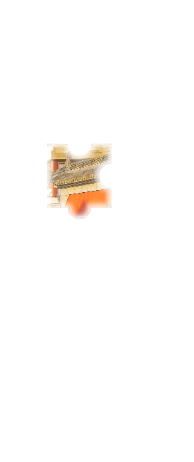
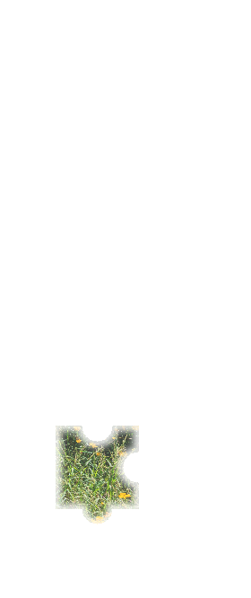

# 美团 Yoda · 滑动拼图（slide）

> 888×666 风景背景 + 280×666 全高拼图条带，拖动滑块把拼图块水平移进缺口；源记录图像 90/90，但提交闭环未打通，只能算 partial。
>
> 返回：[美团索引](../../../docs/meituan.md) · [全量类型](../../../docs/types.md) · [方法论](../../../docs/00-methodology.md)

## 一、速览

| 项 | 值 |
|---|---|
| 厂商 | 美团 Yoda（`meituan`） |
| 类型 / 变体 | `slide` / `163` |
| 中文 | 滑动拼图 |
| 媒体 | 图片 |
| 样本 | 12 组（001–012） |
| 答案格式 | `offset-x`：水平拖动量 |
| 方法 | `CV`（边缘 + 暗填充双信号，无 LLM） |
| 求解器 | `partial` · 高（源记录图像 90/90） |
| 人工审查 | 12 通过 / 0 错误（截至 2026-11-21） |
| 证据等级 | `meta` 未记录 `evidence`；提交闭环未打通 |

## 二、题面与判定

12 组共用「请拖动下方滑块完成拼图」。服务端校验最终位置与行为，因此图像侧只需给出水平偏移；`meta.pass_criteria` 写的是「拖动滑块，使拼图块与缺口对齐；服务端校验最终位置与行为」。

| 案例 | 题面（`meta.prompt`） | 通过条件 | 源记录 |
|---|---|---|---|
| [001](001/) | 请拖动下方滑块完成拼图 | 拼图块与缺口对齐，服务端校验位置与行为 | 图像 90/90 |
| [006](006/) | 同上 | 同上 | 同上 |
| [012](012/) | 同上 | 同上 | 同上 |

> 变体 `163` 的题面是静态背景 + 缺口；源记录另提到变体 `71` 无图、只做静态逆向，不在本目录 12 组内。

## 三、样本长什么样

| 原始背景 | 拼图条带（全高 alpha） | 参考贴合 |
|---|---|---|
|  |  |  |
|  |  |  |

- 第 1 列是 888×666 的风景照，缺口表现为白色半透明拼图剪影。
- 第 2 列不是小方块，而是 280×666 的 RGBA 全高条带：拼图块保留原始纵向位置，贴合时只需水平平移。
- 第 3 列是拼图块贴回缺口后的效果；本库没有 `answer.txt` / `result.json`，坐标未落盘。

## 四、形态与难点

- **全尺寸预填**：条带与背景同高，纵向位置已由 `aux` 给出，搜索空间压缩到一维 `x`；这也是「全尺寸预填贴合」的含义。
- **白色半透明缺口**：亮天空、水面、雪地会让缺口边界变弱，纯颜色匹配不稳定。
- **背景纹理**：山脊、树枝、建筑边缘会产生大量假边缘，必须靠缺口形状过滤。
- **尺寸映射**：图像 888×666，真实页面可能缩放；提交前要按显示尺寸换算。
- **变体边界**：`163` 有图；源记录提到的 `71` 无图，只能静态逆向，不能套用本页的图像流程。

## 五、求解思路

源记录的核心是「两条信号 + 一次全尺寸贴合」：边缘负责形状，暗填充负责缺口内部，二者共同定位水平偏移。

| 步骤 | 做法 | 关键判据 / 参数 |
|---|---|---|
| 1 全尺寸预填 | 把 280×666 的 `aux` 按原始纵向位置叠到背景上 | 只在 x 方向搜索 |
| 2 边缘信号 | 对背景与拼图块取边缘，比较缺口轮廓 | 形状一致、边缘响应高 |
| 3 暗填充信号 | 比较缺口内部的暗色/半透明填充 | 缺口通常比周围暗 |
| 4 融合取峰 | 两个信号共同打分，取最佳水平位置 | 单信号在亮背景上易失败 |
| 5 贴合校验 | 把拼图块贴回候选位置，人工/离线核对 | 源记录图像 90/90 |
| 6 提交 | 输出 `offset-x`，交给交互线 | 轨迹与提交链未打通 |

> 源记录没有给出边缘算子、权重和阈值，本页不补脑补参数；`solved` 只展示贴合效果，不标坐标。

## 六、结果与审查

- **源记录**：图像 90/90，标为「高」；`solver.status=partial`，备注「提交闭环未打通；71 无图仅静态逆向」。
- **本库**：12 组 `solved.png` 齐全，无 `answer.txt` / `result.json`，`status=sample-only`；`meta` 未记录 `evidence`。
- **人工审查**：12 组 `review.state=pass`、`result=correct`；审查对象是图像答案，不包含服务端是否接受。
- **结论**：图像侧完成，交互/协议侧未完成，因此是 `partial`，不是「几乎完美」。
- 统计截至 2026-11-21，以案例 `meta.json` 为准。

## 七、失败与边界

| 现象 | 根因 | 证据 | 结论 |
|---|---|---|---|
| 图像 90/90 但闭环未完成 | 提交链 / 轨迹未打通 | `solver.notes` 明确写「提交闭环未打通」 | 离线图像分 ≠ 线上通过率 |
| 亮背景缺口边界弱 | 白色剪影与天空/水面同色 | 001、012 缺口落在高亮区域 | 必须叠加暗填充信号 |
| 变体 71 无法出图 | 源记录只有静态逆向 | `meta.notes` 写「71 无图仅静态逆向」 | 不能声称覆盖全部变体 |
| 坐标可能与页面不一致 | 图像尺寸与页面显示尺寸不同 | 888×666 原图 | 提交前做缩放换算 |

**边界**：本页只覆盖缺口定位与贴合；滑块轨迹、时序与风控不在本库范围内。没有线上提交记录，不能把 90/90 写成通过率。

## 八、相关

- 厂商索引：[docs/meituan.md](../../../docs/meituan.md)
- 全量类型：[docs/types.md](../../../docs/types.md) · 方法论：[docs/00-methodology.md](../../../docs/00-methodology.md)
- 同厂商对照：[slide-inference](../slide-inference/)（滑动暴露计数）、[icon-click](../icon-click/) / [line-connect](../line-connect/)（背景还原类）、[text](../text/)（低准确率 OCR）
- 案例：[001](001/) – [012](012/)（每组含 `meta.json` + `bg.jpg` / `aux-01.png` / `solved.png`）
- 来源：<https://verify.meituan.com/v2>；样本版权归美团所有，仅用于研究与教学。
