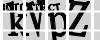
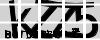
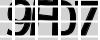
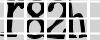

# 美团 Yoda · 字符识别（text）

> 100×40 的窄条里塞着 4 个被点阵、上下错切、波纹或彩色描边扭曲的字符，输入完整内容；本库有 YOLO26 检测/OCR 尝试，源记录字符 51.6%、全对 13.2%，仍是 `partial` + 低。
>
> 返回：[美团索引](../../../docs/meituan.md) · [全量类型](../../../docs/types.md) · [方法论](../../../docs/00-methodology.md)

## 一、速览

| 项 | 值 |
|---|---|
| 厂商 | 美团 Yoda（`meituan`） |
| 类型 / 变体 | `text` / `1` |
| 中文 | 字符识别 |
| 媒体 | 图片 |
| 样本 | 12 组（001–012） |
| 答案格式 | `text`：整段字符串 |
| 方法 | `DET+OCR`（YOLO26 字符检测/OCR） |
| 求解器 | `partial` · 低（源记录字符 51.6% / 全对 13.2%） |
| 人工审查 | 12 组 `pending`（截至 2026-11-21） |
| 证据等级 | 无 `answer.txt` / `result.json`；提交未打通 |

## 二、题面与判定

12 组共用「请输入图片中的内容」。`meta.pass_criteria` 写的是「输入图片中显示的完整字符；字符错误不通过」。题目只有一张窄条图，没有背景场景，也没有提示框。

| 案例 | 题面（`meta.prompt`） | 通过条件 | 可见字符数 |
|---|---|---|---|
| [001](001/) | 请输入图片中的内容 | 输入完整字符，字符错误不通过 | 4 |
| [006](006/) | 同上 | 同上 | 4 |
| [007](007/) | 同上 | 同上 | 4（图高 50px） |
| [012](012/) | 同上 | 同上 | 4 |

> 答案空间是整段字符串，不是单字；源记录把「字符级正确」与「整题全对」分开统计。

## 三、样本长什么样

| 001 | 003 | 006 | 008 | 010 | 012 |
|---|---|---|---|---|---|
|  |  |  |  |  |  |

- 12 组都是 100×40 的窄条（007 为 100×50），画面里只有 4 个字符，没有其他上下文。
- 变形族很杂：001 是白字黑底 + 放射线；003/006/010 被水平切成上下两半并错位；002/005 是点阵空心字；008/011 是彩色波纹；012 是白描边 + 切片。
- 本类型只有 `bg.jpg`，没有标注图或结果图；无法从媒体看出正确答案。

## 四、形态与难点

- **分辨率极低**：100×40 放 4 个字符，单字约 20×30，笔画经常只有 1–2px。
- **结构性破坏**：上下半字错切、点阵化、波纹、描边、3D 阴影，破坏字符的连通域与笔画顺序。
- **字体与颜色多变**：黑底白字、白底黑字、彩色渐变、描边空心混用，OCR 的预处理不能固定一套。
- **整题严格**：4 个字符必须全对；字符级 51.6% 意味着平均每题错近一半字符，整题全对只有 13.2%。
- **无真值文件**：本库没有逐组答案，不能把模型输出当人工标注。

## 五、求解思路

源记录只说明使用 YOLO26 做字符检测/OCR，没有展开模型结构、训练数据和后处理；因此这里只保留可追溯的流程。

| 步骤 | 做法 | 关键判据 / 参数 |
|---|---|---|
| 1 检测 | YOLO26 在窄条中检测 4 个字符框 | 字符紧邻、切片错位会增加框融合 |
| 2 识别 | 对每个字符框做 OCR | 小目标、低对比、描边字是主要误差源 |
| 3 排序 | 按横向位置拼接成字符串 | 切片错位时不能只按框中心排序 |
| 4 输出 | 提交完整字符串 | 任一字符错即整题失败 |
| 5 提交 | 填入输入框并提交 | 源记录「提交未打通」 |

> 源记录没有给出检测阈值、OCR 模型版本或逐组输出；本页不补这些参数，也不把 51.6% / 13.2% 拆成单组结论。

## 六、结果与审查

- **源记录**：字符 51.6%，全对 13.2%，标为「低」；`solver.status=partial`，备注「提交未打通」。
- **本库**：12 组只有 `bg.jpg`，没有 `answer.txt` / `result.json` / `solved.png`；`status=sample-only`。
- **人工审查**：12 组 `review.state=pending`，没有 `result`；本页不写本库复核后的准确率。
- **结论**：这是全厂商里效果最差的类型；图像侧字符识别本身就不稳，提交链也未打通。
- 统计截至 2026-11-21，以案例 `meta.json` 为准。

## 七、失败与边界

| 现象 | 根因 | 证据 | 结论 |
|---|---|---|---|
| 字符级只有 51.6% | 100×40 小图 + 上下错切/点阵/波纹 | 12 组视觉形态；源记录 | 常规 OCR 直接跑不够 |
| 全对只有 13.2% | 4 字必须全对，单字错误累积 | 源记录 | 整题通过率远低于字符级 |
| 切片错位导致顺序错 | 上下半字错切、字符框融合 | 003/006/010 | 需要先做切片还原或按列切分 |
| 无法离线复核 | 没有答案文件 | 12 组只有 `bg.jpg` | 只能引用「源记录」，不能重算 |
| 线上未打通 | 提交链缺失 | `solver.notes` | `partial`，不是线上通过 |

**边界**：本页只覆盖图像侧的字符识别；输入框提交、交互与风控不在本库范围内。51.6% / 13.2% 是源记录，不是本库复核值，也不能当作线上通过率。

## 八、相关

- 厂商索引：[docs/meituan.md](../../../docs/meituan.md)
- 全量类型：[docs/types.md](../../../docs/types.md) · 方法论：[docs/00-methodology.md](../../../docs/00-methodology.md)
- 同厂商对照：[slide](../slide/) / [slide-inference](../slide-inference/)（滑块）、[icon-click](../icon-click/) / [line-connect](../line-connect/)（背景还原类）
- 案例：[001](001/) – [012](012/)（每组仅 `meta.json` + `bg.jpg`）
- 来源：<https://verify.meituan.com/v2>；样本版权归美团所有，仅用于研究与教学。
