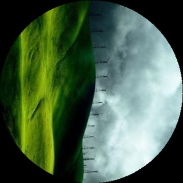
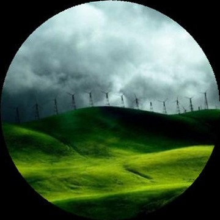
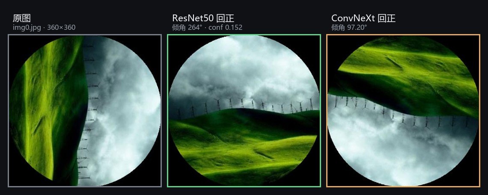
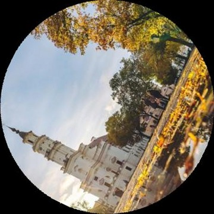
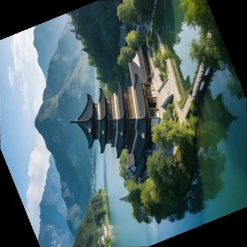

# 企讯通 · 角度验证（angle）

> 360×360 圆形遮罩内是一张被旋转的照片，滑块把图片转回正立方向；主线用 ResNet50 做 360 类分类，ConvNeXt-T 做 sin/cos 回归对照。源记录称 ResNet50 12/12，但本库 `meta.review` 复核为 9 通过 / 1 部分 / 2 错误。
>
> 返回：[企讯通索引](../../../docs/qingtongbu.md) · [全量类型](../../../docs/types.md) · [方法论](../../../docs/00-methodology.md)

## 一、速览

| 项 | 值 |
|---|---|
| 厂商 | 企讯通（`qingtongbu`） |
| 类型 / 变体 | `angle` / classic |
| 中文 | 角度验证 |
| 媒体 | 图片 |
| 样本 | 12 组（001–012） |
| 答案格式 | `angle`：图片相对正立方向的倾角 |
| 方法 | `CV`（ResNet50 360 类分类；ConvNeXt-T 回归对照） |
| 求解器 | `exists` · 中（未做在线提交） |
| 人工审查 | 9 通过 / 1 部分 / 2 错误（按 `meta.review`，截至 2026-11-21） |
| 证据等级 | `manual`（人工目检回正方向） |

## 二、题面与判定

图片被旋转任意角度后放进圆形遮罩，用户拖动滑块把它转回正立方向。`angle` 定义为图片相对正立方向的倾角，回正操作为 `rotate(360 - angle)`（PIL 逆时针）。通过条件是回正后的方向被判定为正立，而不是某个固定角度值。

| 案例 | 题面 | 源记录答案 | 通过条件 | 审查 |
|---|---|---|---|---|
| [001](001/) | 拖动滑块，调整到指定角度 | 264°（conf 0.152） | 回正方向正确 | 通过 |
| [002](002/) | 同上 | 182°（conf 0.797） | 同上 | 错误 |
| [005](005/) | 同上 | 158°（conf 0.196） | 同上 | 错误 |
| [008](008/) | 同上 | 182°（conf 0.795） | 同上 | 通过 |

> 「正立」是语义判断：有的图是风景（地平线、建筑、树），有的图是抽象纹理，后者没有明确上下，人工复核也会犹豫。002 / 005 的错误正是回正后仍然明显倾斜。

## 三、样本长什么样

| 原图 001 | ResNet50 回正 001 | 双模型对比 001 |
|---|---|---|
|  |  |  |
| **失败例 002** | **失败例 005** | **通过例 008** |
|  |  |  |

- 001 是绿色草坡 + 乌云 + 风车的风景；原图侧躺，ResNet50 回正后地平线与风车方向正常，ConvNeXt 版本仍偏。
- 002 是教堂街景，回正后塔楼仍然横躺，是明确失败；005 是水边建筑，回正后仍有明显旋转与黑角。
- 每组另有 `process-01-compare-methods.jpg`：左原图、中 ResNet50、右 ConvNeXt，并标注角度与置信度。

## 四、形态与难点

- **任意角度**：0–359° 都可能出现，不能用四个象限的粗分类代替。
- **圆形遮罩**：遮罩外是黑色，旋转后四角会露出黑边；判断时要区分「图像内容方向」与「黑边形状」。
- **语义正立**：风景有地平线、建筑有竖直墙线，但抽象纹理没有唯一正立方向，人工复核也存在歧义。
- **置信度不校准**：003 / 009 的 softmax 只有 0.066 / 0.059，但审查通过；002 的 0.797 却审查错误。
- **两模型分歧大**：12 组中 11 组角度差明显，001 / 007 / 011 的圆周差超过 100°。

## 五、求解思路

主线把「角度」离散成 360 类分类：ResNet50 输出 0–359 的整数角和 softmax 置信度，回正时旋转 `360 - angle`。ConvNeXt-T 用 `(sin, cos)` 回归再 `atan2` 得到浮点角，只作对照，不参与最终答案。

| 方法 | 模型 | 输出 | 本批表现（源记录） |
|---|---|---|---|
| ResNet50 360 类分类（主） | `aqc_spin_v2/model_13.pth` | 0–359° 整数 + 置信度 | 12/12 回正方向正确或持平（源记录） |
| ConvNeXt-T 回归（对照） | `rotate-captcha-solver/conv_0203_ft_0205_pl_0206.pth` | `(sin, cos)` → `atan2` 浮点角 | 11/12 明显偏差；01/07/11 超 100° |

```text
# 角度验证（伪代码，对应源方案 ResNet50 分类）

angle = argmax(resnet50_360(image))      # 0..359，softmax 置信度
upright = rotate(image, 360 - angle)     # PIL 逆时针回正
```

| 组 | ResNet50 角度 | 置信度 | ConvNeXt 角度 | 圆周差 | 审查 |
|---|---:|---:|---:|---:|---|
| [001](001/) | 264 | 0.152 | 97.20 | 166.80 | 通过 |
| [002](002/) | 182 | 0.797 | 114.32 | 67.68 | 错误 |
| [003](003/) | 192 | 0.066 | 170.17 | 21.83 | 通过 |
| [004](004/) | 141 | 0.230 | 217.18 | 76.18 | 通过 |
| [005](005/) | 158 | 0.196 | 107.72 | 50.28 | 错误 |
| [006](006/) | 182 | 0.429 | 169.35 | 12.65 | 部分 |
| [007](007/) | 279 | 0.215 | 71.68 | 152.68 | 通过 |
| [008](008/) | 182 | 0.795 | 176.73 | 5.27 | 通过 |
| [009](009/) | 196 | 0.059 | 157.00 | 39.00 | 通过 |
| [010](010/) | 159 | 0.155 | 195.87 | 36.87 | 通过 |
| [011](011/) | 124 | 0.184 | 231.43 | 107.43 | 通过 |
| [012](012/) | 141 | 0.296 | 220.38 | 79.38 | 通过 |

> 圆周差 = `min(|a-b|, 360-|a-b|)`；它只说明两模型差多少，不代表谁更接近真值。源记录认为 ResNet50 在本批整体更优，但 002 / 005 说明这个结论不能无条件外推。

## 六、结果与审查

- **源记录**：2026-11-20 本地双模型对比，ResNet50 在 12 组上「回正方向正确或持平」，ConvNeXt 11/12 明显偏差；逐组对比图已纳入。
- **本库审查**：`meta.review` 为 9 通过 / 1 部分 / 2 错误。002、005 判错，006 判部分；这与旧文档/源记录里的「12/12」不一致，本页以 `meta.review` 为准。
- **证据等级**：`manual`，只做了人工目检，没有线上提交校验。
- **复用判断**：ResNet50 可作为起步主线，但这 12 组的审查结果说明它还不是稳定求解器；低置信度不必然错、高置信度也可能错，不能只用 softmax 阈值过滤。

## 七、失败与边界

| 现象 | 根因 | 证据 | 结论 |
|---|---|---|---|
| 002 高置信度却判错 | 0.797 的置信度没有校准，教堂侧躺仍被高置信预测 | 002 `solved.png` 仍横躺；`review=fail` | 置信度不能当正确率 |
| 005 回正后仍倾斜 | 建筑/水面方向判断错误 | 005 `solved.png` 有明显旋转与黑角 | 复杂场景仍需复核 |
| 006 判部分 | 与 ConvNeXt 只差 12.65°，回正方向接近但不完全正 | `review=partial` | 「接近」不等于通过 |
| 003 / 009 低置信度却通过 | 0.066 / 0.059 仍给出正确方向 | `review=pass` | 低置信度不应直接丢弃 |
| ConvNeXt 方向偏差大 | 权重来自百度旋转验证码训练集，域不匹配 | 01/07/11 圆周差 >100° | 只作对照，不作主方法 |
| 旧文档写 12/12 | 源记录与 meta 审查口径不同 | `docs/qingtongbu.md` 旧汇总 vs `meta.review` | 引用时必须标明「源记录」还是「本库审查」 |

**边界**：本页只覆盖「估计倾角并回正」。真实提交还需要拖动轨迹、服务端角度容差与风控环境；当前没有任何在线通过记录。

## 八、相关

- 厂商索引：[docs/qingtongbu.md](../../../docs/qingtongbu.md)
- 全量类型：[docs/types.md](../../../docs/types.md) · 方法论：[docs/00-methodology.md](../../../docs/00-methodology.md)
- 同厂商对照：[rotate](../rotate/)（旋转补图，无求解器）、[slide](../slide/)（拼图缺口）
- 跨厂商对照：[天爱 angle](../../tianai/angle/)、[百度 rotate](../../baidu/rotate/)
- 案例：[001](001/) – [012](012/)（每组含 `meta.json`、`bg.jpg`、`solved.png`、`process-01-compare-methods.jpg`、`answer.txt`、`result.json`）
- 来源：<http://www.qingtongbu.com/#experience>；样本版权归企讯通所有，仅用于研究与教学。
