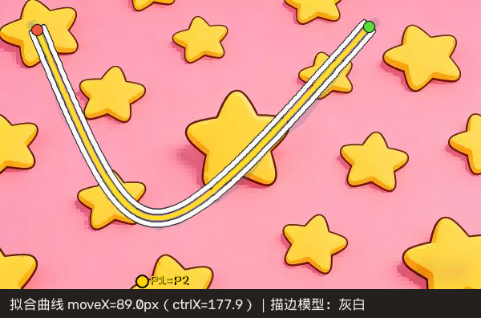
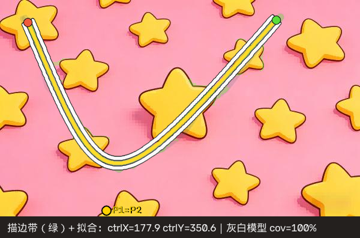
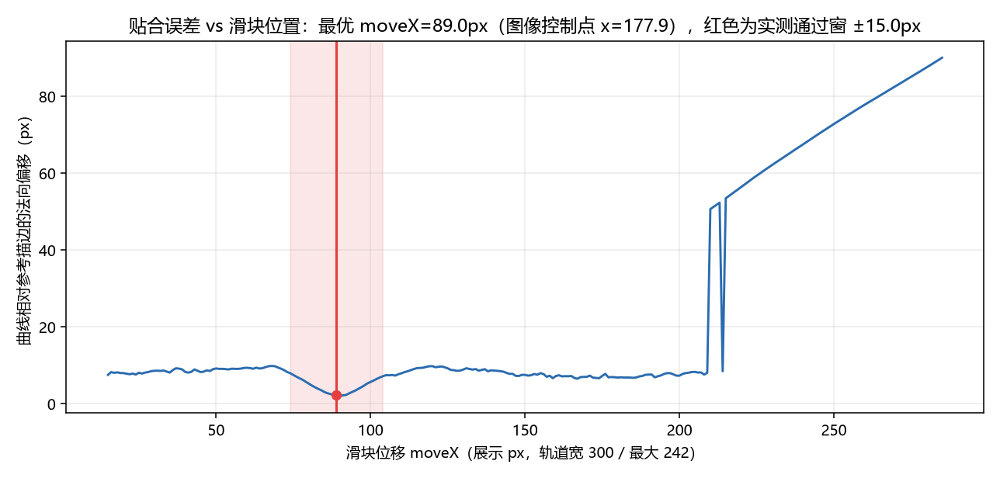
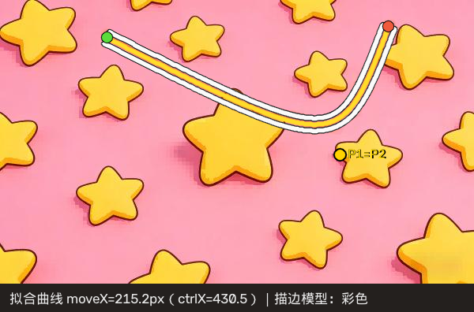
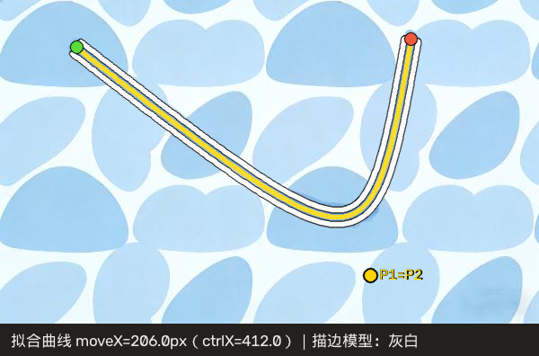

# 企讯通 · 曲线滑动（curve）

> 600×360 背景里有一条参考贝塞尔描边，滑块生成一条同族预览曲线；两条曲线的两个控制点重合，`moveX = ctrlX / 2`，服务端按 5% 容差比较。本库 24 组：旧 12 组离线 GT 拟合，新 12 组纯 HTTP 在线 `code=200`。
>
> 返回：[企讯通索引](../../../docs/qingtongbu.md) · [全量类型](../../../docs/types.md) · [方法论](../../../docs/00-methodology.md)

## 一、速览

| 项 | 值 |
|---|---|
| 厂商 | 企讯通（`qingtongbu`），新 12 组来自白标站 shipinren.com |
| 类型 / 变体 | `curve` / CURVE |
| 中文 | 曲线滑动 |
| 媒体 | 图片 |
| 样本 | 24 组（001–012 旧集；013–024 新集） |
| 答案格式 | `offset-x`：`moveX`（300 显示坐标） |
| 方法 | `CV+ACT`（双色描边模型 + 端点吸附 + 曲线族拟合；无 LLM） |
| 求解器 | `exists` · 高（源记录累计在线 36/36） |
| 人工审查 | 24 通过 / 0 错误（按 `meta.review`，截至 2026-11-21） |
| 证据等级 | 001–012 `offline-verified`；013–024 `live-pass` |

## 二、题面与判定

用户拖动滑块，让白色预览曲线与背景参考描边重合。参考描边和预览曲线都是三次贝塞尔，两个控制点重合；滑块位移只改变控制点 x，因此题目的未知量就是 `ctrlX`（或等价的 `moveX`）。

| 案例 | 题面 | 服务端判据 | 本库答案 |
|---|---|---|---|
| [001](001/) | 拖动滑块使曲线匹配 | `|moveX/bgW − randomX/600| ≤ 5%` | `moveX=89.0`（ctrlX=177.9） |
| [013](013/) | 同上 | 同上 | `moveX=215.2`（ctrlX=430.5），check 200 |
| [024](024/) | 同上 | 同上 | `moveX=206.0`（ctrlX=412.0），check 200 |

- 展示宽 300、图像宽 600；`moveX` 是 300 显示坐标，`ctrlX` 是 600 图像坐标，二者严格 2:1。
- 容差实测：展示窗 ±15px（5% × 300）；同平台 ±30 图像 px 通过、+35 图像 px 拒绝。
- 通过条件是两条曲线贴合，不是「滑块位置等于某个整数」。

## 三、样本长什么样

| 背景 001（灰白描边） | 拟合结果 001 | 描边证据 001 |
|---|---|---|
|  |  |  |
| **误差-滑块曲线 001** | **彩色描边例 013** | **灰白描边例 024** |
|  |  |  |

- 001 是粉色星星背景 + 灰白描边；013 是同类星星背景 + 彩色描边；024 是灰白描边。
- `process-01-fit.png` 用绿色标出描边证据，黄白线是拟合预览；`process-02-score.png` 画出贴合误差随滑块位置的变化，红带是 ±15px 通过窗。
- 拟合结果图底部会写出 `moveX`、`ctrlX` 与描边模型（彩色 / 灰白）。

## 四、形态与难点

- **只差一个 x**：端点与 `ctrlY` 由题面参数 `p` 或 GT 路径给出，真正要估的是控制点 x；答案空间是一维的。
- **控制点重合**：两个控制点都在 `(ctrlX, ctrlY)`，预览曲线是 `B(t)=(1-t)³P0+3(1-t)²tC+3(1-t)t²C+t³P3`。
- **两种描边**：彩色描边与灰白描边（灰晕 + 白芯）颜色模型不同；本批 16 组灰白、8 组彩色。
- **端点干扰**：端点附近常有星星、鹅卵石、云朵，骨架全图直径会被杂线带偏，必须做端点吸附。
- **背景纹理**：黄色星星有强边缘，线响应容易在星星边缘产生伪响应；需要限制在种子曲线 ±40px 内。
- **容差**：5% 是相对宽度，不是固定像素；不同展示宽下 ±15px 不能直接搬到图像坐标。

## 五、求解思路

核心是「先拿端点，再扫控制点 x」：新样本从 `p` 解出端点与 `ctrlY`，旧样本用 GT/颜色骨架路径；然后按彩色/灰白两种模型提描边，拟合或扫描 `ctrlX`，最后换算成 `moveX` 提交。

**题面参数 `p` 的解码**（以 013 为例）：

```text
p_raw = 01.354272220222222224230.2250.820.094444444444444440.13333333333333333
decodeP -> [0.2250, 0.1333, 0.8200, 0.0944, 0.5472]

P0    = (0.2250 * 600, 0.1333 * 360) = (135.0, 48.0)
P3    = (0.8200 * 600, 0.0944 * 360) = (492.0, 34.0)
ctrlY =  0.5472 * 360                = 197.0

拟合 ctrlX = 430.5
moveX = ctrlX * 300 / 600 = 215.25
check -> {"code":200,"msg":"OK","token":"CURVE_..."}
```

| 步骤 | 做法 | 关键判据 / 参数 |
|---|---|---|
| 1 端点 | 新样本用 `p` 的 v0–v3；旧样本用 GT 两端做种子 | 端点误差直接放大到整条曲线 |
| 2 端点吸附 | 把种子端点吸附到 ±38px 内最近的骨架点，再取两点间路径 | 避免被星形/鹅卵石/云朵带偏 |
| 3 彩色模型 | Lab `(a,b)` 中位色；`Δ(a,b)<24` 且彩度 `>20` | 彩色描边（8 组） |
| 4 灰白模型 | `max(背景彩度−像素彩度, 1.2·(L−背景L), 0.9·(背景L−L)) > 10` 且彩度 `<40` 且线响应 `>9` | 灰白描边（16 组） |
| 5 限域 | 两种掩膜都限制在种子曲线 ±40px 内，取重合最多的连通域 | 排除背景杂线 |
| 6 拟合 | 旧样本对曲线族做最小二乘，拟合 `ctrlX/ctrlY` | 输出残差与 p95 |
| 7 扫描 | 新样本用线响应集成扫描 `ctrlX`（中心 vs ±7/11/15px，取中位峰） | 端点已知，只扫一个自由度 |
| 8 换算提交 | `moveX = ctrlX × 300 / 600`，按 ACT 拖动轨迹提交 | 服务端比较归一化位移，容差 5% |

```text
# 曲线滑动（伪代码，对应源方案 CV+ACT）

P0, P3, ctrlY = decode_p(p) if p else endpoints_from_gt()
seed = polyline(P0, P3, ctrlY, ctrlX=guess)

stroke = chromatic_mask(bg) + greywhite_mask(bg)
stroke = stroke within 40px of seed
seed = snap_endpoints(seed, stroke, radius=38)

for ctrlX in scan_range:
    curve = cubic_bezier(P0, (ctrlX, ctrlY), (ctrlX, ctrlY), P3)
    error = normal_offset(curve, stroke)
    pick ctrlX with minimum error

moveX = ctrlX * 300 / 600
submit_drag(moveX)          # 服务端容差 5%
```

> 两个控制点重合不是近似，而是平台预览曲线的定义。因此 `ctrlX` 既是控制点 x，也是滑块位移换算到图像坐标后的值；`moveX = ctrlX / 2` 是展示宽 300、图像宽 600 的直接结果。

## 六、结果与审查

- **源记录**：纯 HTTP 在线累计 36/36（0 偏移，含新 12 组）；±30 图像 px 4/4 通过、+35 拒绝；本库 24 组审查全部通过。
- **证据**：001–012 为 `offline-verified`（GT 路径拟合）；013–024 为 `live-pass`（`check code=200`）。
- **拟合统计**：24 组拟合误差 0.60–2.80px；旧 12 组均值 1.52px，新 12 组均值 1.95px；旧组 GT 残差 0.85–4.38px（源文档记为 0.85–4.4px）。
- **模型分布**：灰白 16 组、彩色 8 组；两组旧样本因颜色掩膜不连续回退 GT 路径。

**旧 12 组（001–012，离线 GT 拟合）**

| 组 | 模型 | moveX | ctrlX | 拟合误差 | GT 残差 | 审查 |
|---|---|---:|---:|---:|---:|---|
| [001](001/) | 灰白 | 89.0 | 177.9 | 2.16 | 1.99 | 通过 |
| [002](002/) | 灰白 | 122.4 | 244.9 | 1.08 | 1.93 | 通过 |
| [003](003/) | 彩色 | 159.5 | 319.0 | 2.04 | 1.93 | 通过 |
| [004](004/) | 灰白 | 170.8 | 341.6 | 1.93 | 4.38 | 通过 |
| [005](005/) | 灰白 | 63.3 | 126.6 | 0.60 | 1.46 | 通过 |
| [006](006/) | 彩色 | 117.8 | 235.5 | 0.78 | 0.85 | 通过 |
| [007](007/) | 灰白 | 102.4 | 204.9 | 1.67 | 2.45 | 通过 |
| [008](008/) | 彩色 | 101.1 | 202.1 | 1.90 | 2.19 | 通过 |
| [009](009/) | 彩色 | 239.5 | 478.9 | 1.07 | 1.10 | 通过 |
| [010](010/) | 彩色 | 96.9 | 193.8 | 1.01 | 1.05 | 通过 |
| [011](011/) | 灰白 | 198.1 | 396.1 | 2.07 | 2.78 | 通过 |
| [012](012/) | 灰白 | 202.2 | 404.3 | 1.95 | 2.26 | 通过 |

**新 12 组（013–024，p 端点 + 在线 check）**

| 组 | 模型 | moveX | ctrlX | 拟合误差 | 在线 | 审查 |
|---|---|---:|---:|---:|---|---|
| [013](013/) | 彩色 | 215.2 | 430.5 | 2.65 | 200 | 通过 |
| [014](014/) | 灰白 | 158.5 | 317.0 | 2.62 | 200 | 通过 |
| [015](015/) | 灰白 | 109.0 | 218.0 | 2.80 | 200 | 通过 |
| [016](016/) | 彩色 | 202.5 | 405.0 | 1.40 | 200 | 通过 |
| [017](017/) | 灰白 | 152.0 | 304.0 | 1.86 | 200 | 通过 |
| [018](018/) | 彩色 | 187.8 | 375.5 | 1.60 | 200 | 通过 |
| [019](019/) | 灰白 | 91.2 | 182.5 | 1.73 | 200 | 通过 |
| [020](020/) | 灰白 | 183.8 | 367.5 | 1.66 | 200 | 通过 |
| [021](021/) | 灰白 | 65.2 | 130.5 | 0.94 | 200 | 通过 |
| [022](022/) | 灰白 | 200.5 | 401.0 | 2.51 | 200 | 通过 |
| [023](023/) | 灰白 | 114.5 | 229.0 | 1.05 | 200 | 通过 |
| [024](024/) | 灰白 | 206.0 | 412.0 | 2.59 | 200 | 通过 |

> 12 组在线全部 `code=200` 是本批最硬的证据；旧 12 组只有 GT 拟合，不能与在线通过混为一谈。源记录的「36/36」包含此前批次的在线记录，本页只对 013–024 的 12 次 check 负责。

## 七、失败与边界

| 现象 | 根因 | 证据 | 结论 |
|---|---|---|---|
| 端点被星形/云朵带偏 | 骨架全图直径不是端点间路径 | 源文档记录端点吸附 ±38px | 先吸附再取路径 |
| 2 组旧样本回退 GT | 颜色掩膜不连续，无法稳定吸附 | 源文档记录 10/12 成功吸附 | 回退组的残差不再独立于 GT |
| 低覆盖率仍通过 | 描边被背景吞掉一段，但拟合峰仍落在窗内 | 023 覆盖 0.323、021 0.353、019 0.443 | 覆盖率低不等于答案错，但需复核 |
| 004 的 GT 残差 4.38px | 旧样本端点/描边误差较大 | `result.json` 逐组残差 | 旧集误差上限接近 4.4px |
| 容差不能按固定像素搬 | 5% 是相对背景宽 | ±30 图像 px 通过、+35 拒绝 | 展示宽变化时要重新换算 |
| 旧集没有在线记录 | 只为 GT/描边拟合 | `check_code=null` | 离线贴合 ≠ 线上通过 |

**边界**：本页覆盖「读端点 + 估控制点 x + 换算提交」，不覆盖轨迹随机化与风控对抗。旧 12 组是离线拟合，新 12 组才有在线 check；两者在本页分开统计。

## 八、相关

- 厂商索引：[docs/qingtongbu.md](../../../docs/qingtongbu.md)
- 全量类型：[docs/types.md](../../../docs/types.md) · 方法论：[docs/00-methodology.md](../../../docs/00-methodology.md)
- 同厂商对照：[angle](../angle/)（旋转回正）、[slide](../slide/)（拼图缺口）
- 跨厂商曲线：[天爱 curve](../../tianai/curve/)、[天爱 curve-bezier](../../tianai/curve-bezier/)
- 案例：[001](001/) – [024](024/)（每组含 `meta.json`、`bg.jpg`、`solved.png`、4 张过程图、`answer.txt`、`result.json`）
- 来源：<http://www.qingtongbu.com/#experience>；013–024 来自 <https://www.shipinren.com/>；样本版权归平台所有，仅用于研究与教学。
