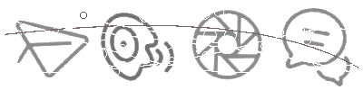
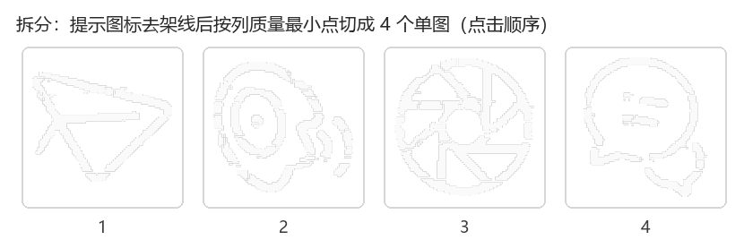
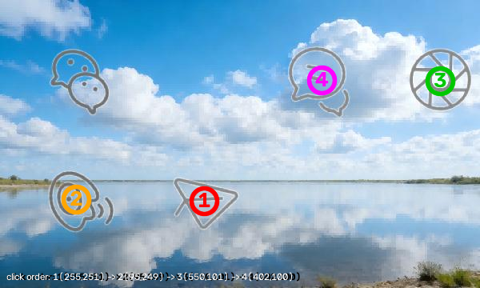
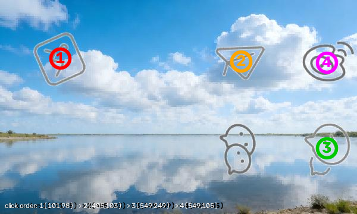

# 企讯通 · 图标点选（icon-click）

> 提示图 400×100 给出 4 个灰色描边图标（从左到右 = 点击顺序），600×360 背景照片里散落 5–7 个灰描边图标（含 1–3 个干扰）；用去架线切分 + 三通道颜色模型 + 多尺度打分 + 匈牙利求解，纯 CV、零 LLM。
>
> 返回：[企讯通索引](../../../docs/qingtongbu.md) · [全量类型](../../../docs/types.md) · [方法论](../../../docs/00-methodology.md)

## 一、速览

| 项 | 值 |
|---|---|
| 厂商 | 企讯通（`qingtongbu`） |
| 类型 / 变体 | `icon-click` / classic |
| 中文 | 图标点选 |
| 媒体 | 图片 |
| 样本 | 12 组（001–012） |
| 答案格式 | `points`：按提示顺序的 4 个点击点 |
| 方法 | `CV`（模板切分 + 颜色/形状匹配 + 匈牙利，无 LLM） |
| 求解器 | `exists` · 高（源记录 v5 12/12 人工目检） |
| 人工审查 | 12 通过 / 0 错误（按 `meta.review`，截至 2026-11-21） |
| 证据等级 | `unverified`（无线上提交记录） |

## 二、题面与判定

提示图是一条横向排列的 4 个灰色描边图标，图的从左到右就是点击顺序。背景照片中散布 5–7 个同类灰色描边图标，其中 1–3 个不在提示图中，是干扰项。用户必须按提示顺序点击 4 个目标图标，顺序错误不通过。

| 案例 | 提示图标 | 通过条件 | 答案（点击点） |
|---|---|---|---|
| [001](001/) | 4 个，左起 | 按提示顺序依次点击 4 个目标图标 | (255,251) → (95,249) → (550,101) → (402,100) |
| [004](004/) | 4 个，左起 | 同上 | (103,101) → (101,250) → (400,98) → (400,250) |
| [010](010/) | 4 个，左起 | 同上 | (250,100) → (548,254) → (250,250) → (552,98) |
| [011](011/) | 4 个，左起 | 同上 | (101,98) → (405,103) → (549,249) → (549,105) |

> `meta.pass_criteria` 原文：「按提示顺序依次点击 4 个目标图标；顺序错误不通过。」提示图本身不写编号，点击顺序只由横向位置决定。

## 三、样本长什么样

| 提示图（400×100） | 背景题面（600×360） | 去噪对照 |
|---|---|---|
|  |  |  |
| **提示图标切分** | **结果 001** | **结果 011** |
|  |  |  |

- 提示图是灰色线稿，周围有大量彩色小圆圈、短线和 1–2px 共享架线；去噪后线稿才干净。
- 背景是蓝天、云、湖面、草地等真实/合成照片，灰色半透明描边会与背景色混合，个别图标压在亮云或深色岸线上。
- `split.png` 是源方案的四槽切分示意；标注图 `solved.png` 用编号圈出 4 次点击的位置，并在底部写出 click order。

## 四、形态与难点

- **灰描边 + 彩色背景**：图标不是实心色块，而是半透明灰线；在饱和蓝天上绝对灰度带会失效。
- **共享架线**：提示图标之间常有 1–2px 连接线，直接切分会把两个图标粘在一起；需要开运算先抹掉。
- **干扰图标**：背景有 5–7 个图标，目标只有 4 个；相似图标可能互为干扰。
- **彩色压线**：提示图上叠加了彩色圆圈/短线，保留灰色时要去掉这些彩色像素。
- **点击点**：答案不是匹配框中心，而是框内墨迹加权质心；必须校验四个点两两不重合。

## 五、求解思路

| 步骤 | 做法 | 关键判据 / 参数 |
|---|---|---|
| 1 提示图去噪 | 保灰去彩：RGB 通道最大差 < 30 的像素保留 | 彩圈/彩线变透明 |
| 2 去架线 | 2×2 开运算，抹掉 1–2px 共享线 | 保留 3–5px 图标笔画 |
| 3 四槽切分 | 在 3 条分界线的 4 个窗口内找「列质量最小点」 | 得到 4 个模板，顺序=点击顺序 |
| 4 三通道墨迹 | 绝对灰 + 相对去饱和 + 细笔画对比，三者相乘 | 半透明灰线在蓝天上仍有响应 |
| 5 去伪响应 | 删除长横线（地平线）与实心团块（岸石/树丛） | 只保留线状图标 |
| 6 多尺度打分 | 0.8–1.2 缩放；颜色覆盖率（主）+ 倒角亲和（辅）+ 二值 IoU | 各模板 NMS 取峰并聚类 |
| 7 匈牙利指派 | 4×N 代价矩阵，全局一对一 | 干扰图标自然落选 |
| 8 取点击点 | 匹配窗口内墨迹加权质心，校验两两间距 | 防重复点击 |

```text
# 图标点选（伪代码，对应源方案 v5）

hint = read(aux)                          # 400x100，4 个图标
hint = keep_gray(hint)                    # 保留低彩度线稿
hint = opening_2x2(hint)                  # 去掉 1~2px 共享架线
templates = split_4_slots(hint)           # 列质量最小点切分，顺序=点击顺序

ink = absolute_gray(bg)                   # 通道 1：chroma <= 15 全置信
ink *= relative_desaturation(bg)          # 通道 2：比局部背景低 10~60 chroma
ink *= fine_stroke_contrast(bg)           # 通道 3：2~10 灰度级差即响应
ink = remove_long_lines_and_blobs(ink)

candidates = []
for tpl in templates:
    for s in 0.8 .. 1.2:
        score = color_coverage + chamfer_affinity + binary_iou
        candidates += nms_peaks(score)
assign = hungarian(4 x N)                 # 每个模板恰占一个不同位置
clicks = [ink_weighted_centroid(box) for box in assigned]
```

> 三条颜色通道是互补关系：绝对灰抓「干净」的灰线，相对去饱和抓「蓝天上带蓝调的灰线」，细笔画对比抓「亮白云上的浅灰线」。缺任何一条，都会在特定背景上整片漏检。

## 六、结果与审查

- **源记录**：v5 求解器 12/12 人工目检通过（2026-11-18）；本库 `evidence: unverified`，没有线上提交。
- **本库审查**：12 组 `review.state=pass`、`result=correct`；审查的是 4 个点击点及顺序。
- **匹配统计**（从 `result.json` 现算）：48 个点击点分数 0.57–0.87，均值 0.78；12 组的胜出尺度均为 1.0（多尺度已实现，但这批样本没有触发缩放胜出）。

| 组 | 按序点击（坐标） | 最低分 | 提示图切分点 | 尺度 | 审查 |
|---|---|---|---:|---|---:|
| [001](001/) | (255,251) → (95,249) → (550,101) → (402,100) | 0.72 | 104/203/300 | 1.0 | 通过 |
| [002](002/) | (249,249) → (393,101) → (98,253) → (254,105) | 0.73 | 96/199/306 | 1.0 | 通过 |
| [003](003/) | (552,105) → (101,248) → (404,99) → (399,250) | 0.73 | 100/192/303 | 1.0 | 通过 |
| [004](004/) | (103,101) → (101,250) → (400,98) → (400,250) | 0.72 | 104/201/301 | 1.0 | 通过 |
| [005](005/) | (252,250) → (547,103) → (103,101) → (405,251) | 0.66 | 105/201/302 | 1.0 | 通过 |
| [006](006/) | (249,249) → (103,99) → (552,101) → (99,246) | 0.73 | 99/206/304 | 1.0 | 通过 |
| [007](007/) | (251,104) → (253,250) → (100,253) → (400,252) | 0.66 | 103/202/304 | 1.0 | 通过 |
| [008](008/) | (551,101) → (96,98) → (251,102) → (401,103) | 0.74 | 101/201/299 | 1.0 | 通过 |
| [009](009/) | (545,107) → (100,98) → (99,244) → (397,252) | 0.72 | 97/196/303 | 1.0 | 通过 |
| [010](010/) | (250,100) → (548,254) → (250,250) → (552,98) | 0.75 | 96/204/296 | 1.0 | 通过 |
| [011](011/) | (101,98) → (405,103) → (549,249) → (549,105) | 0.57 | 104/203/299 | 1.0 | 通过 |
| [012](012/) | (401,107) → (100,97) → (553,101) → (551,249) | 0.74 | 96/206/305 | 1.0 | 通过 |

> 011 的最低分 0.566 是本批最弱的一次匹配；分数低不等于一定错，但它是最应该人工复核的组。切分点接近 100/200/300，说明提示图的四槽布局非常稳定。

## 七、失败与边界

| 现象 | 根因 | 证据 | 结论 |
|---|---|---|---|
| 半透明灰线在蓝天上消失 | 绝对灰度带与背景饱和度重叠 | 源文档记录的颜色模型动机 | 加「相对去饱和」通道 |
| 亮白云上的浅灰笔画漏检 | 灰度差只有 2–10 级 | 源文档记录的细笔画通道 | 加局部灰度对比通道 |
| 提示图标粘连 | 1–2px 共享架线 | `split.png` 四槽切分 | 2×2 开运算先断线 |
| 干扰图标抢配对 | 背景 5–7 个，目标 4 个 | 固定 4×N 代价矩阵 | 匈牙利全局一对一 |
| 低分匹配仍需复核 | 011 最低 0.566，均值 0.78 | `result.json` 逐点分数 | 源记录 12/12 不等于独立复核 |
| 无线上记录 | 未做提交闭环 | 统一 `evidence: unverified` | 离线点击正确 ≠ 线上通过 |

**边界**：本页只覆盖「切模板 + 找位置 + 排序点击」。真实提交还需要轨迹、时序与风控环境；多尺度在这批样本上全部落在 1.0，不能据此认为缩放鲁棒性已被验证。

## 八、相关

- 厂商索引：[docs/qingtongbu.md](../../../docs/qingtongbu.md)
- 全量类型：[docs/types.md](../../../docs/types.md) · 方法论：[docs/00-methodology.md](../../../docs/00-methodology.md)
- 同厂商对照：[text-click](../text-click/)（文字拆字 + Siamese）、[slide](../slide/)（拼图缺口）
- 案例：[001](001/) – [012](012/)（每组含 `meta.json`、`bg.jpg`、`aux-01.png`、`denoised.png`、`split.png`、`solved.png`、`answer.txt`、`result.json`）
- 来源：<http://www.qingtongbu.com/#experience>；样本版权归企讯通所有，仅用于研究与教学。
