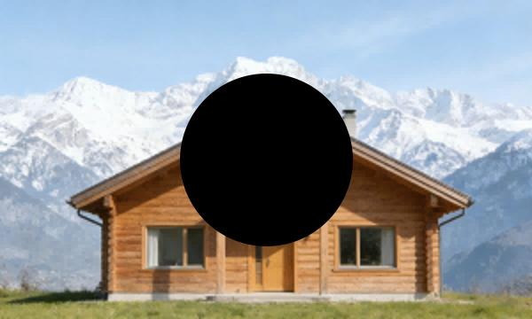
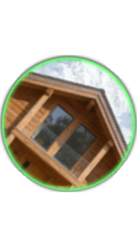
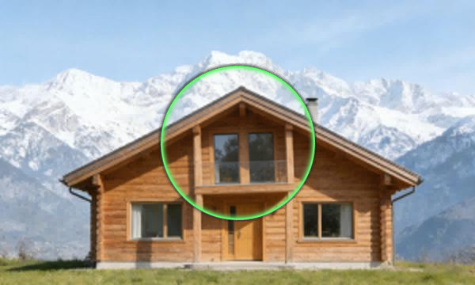

# 企讯通 · 旋转验证（rotate）

> 600×360 场景中央被一个黑色圆盘遮住，辅助图是一块被旋转过的圆形补片；用户要把补片转到正确方向并补进圆盘。本库只收 12 组样本，没有求解器、没有答案文件。
>
> 返回：[企讯通索引](../../../docs/qingtongbu.md) · [全量类型](../../../docs/types.md) · [方法论](../../../docs/00-methodology.md)

## 一、速览

| 项 | 值 |
|---|---|
| 厂商 | 企讯通（`qingtongbu`） |
| 类型 / 变体 | `rotate` / classic |
| 中文 | 旋转验证 |
| 媒体 | 图片 |
| 样本 | 12 组（001–012） |
| 答案格式 | `angle`（未记录具体角度） |
| 方法 | `NONE(CV+VLM)`（未撰写；建议 CV 角度估计 + VLM 兜底） |
| 求解器 | `none` · 未知（仅采集） |
| 人工审查 | 12 通过（按 `meta.review`；审查的是样本收录，不是求解准确率） |
| 证据等级 | 无（`meta` 未记录 `evidence`） |

## 二、题面与判定

背景是一张完整场景，中央挖掉一个圆形区域并用黑盘覆盖；辅助图是从原场景裁出的圆形补片，但已被旋转。用户需要把补片转到与周围场景连续的方向，再补进中央圆盘。题面只写「旋转到正确方向」，通过条件应是补片与场景结构对齐。

| 案例 | 场景 | 辅助补片 | 结果图 |
|---|---|---|---|
| [001](001/) | 蓝天 + 白云 | 圆形云块，旋转约 90° | 只画出目标圆位，未给角度 |
| [007](007/) | 草地 + 小房子 | 圆形房屋块，明显倒置 | 只画出目标圆位，未给角度 |
| [008](008/) | 雪山 + 木屋 | 圆形屋檐块，近乎倒置 | 只画出目标圆位，未给角度 |

> `solved.png` 只把补片贴回目标圆位并画绿圈，用于说明「补片应该放在哪里」；它没有记录旋转角，也没有 `answer.txt` / `result.json`。

## 三、样本长什么样

| 背景 001（黑盘） | 补片 001 | 结果 001（补片归位） |
|---|---|---|
|  |  |  |
| **背景 008** | **补片 008** | **结果 008** |
|  |  |  |

- 补片条是 200×360，圆形补片位于中间，四周透明；背景 600×360，黑盘约 200px 直径。
- 001/002 共用同一张云朵背景，只是补片旋转不同；008 的木屋场景结构与补片完全对应。
- 补片边缘有 1–2px 绿色描边，可能是采集/合成时留下的对齐标记，不是题面本身。

## 四、形态与难点

- **方向由场景决定**：没有文字提示，只能靠屋檐、窗框、云层等结构的连续性判断。
- **圆形补片**：旋转后圆形不变，但补片内的结构会转；黑盘遮住了唯一的对照区域。
- **无真值**：本库没有角度答案，无法离线算准确率；`review=pass` 只表示样本可用。
- **背景复用**：同一背景可能配不同旋转的补片，不能用「记住这张图」代替方向判断。

## 五、建议路线（未实现）

| 步骤 | 建议做法 | 说明 |
|---|---|---|
| 1 取补片 | 从 `aux-01.png` 裁出圆形区域与 alpha | 绿色描边可用来定位圆边界 |
| 2 粗估方向 | 在 0–359° 内旋转补片，比较圆边界外侧的场景边缘连续性 | 屋檐、窗框、地平线是强线索 |
| 3 精修 | 对最佳角度邻域做边缘/颜色匹配 | 与背景黑盘周围的结构对齐 |
| 4 VLM 兜底 | 让 VLM 判断「哪种旋转让房子正立」 | 只对 CV 不确定的样本调用 |

> 这条路线没有落地，也没有角度真值；它只是基于题面形态的起步建议。

## 六、为什么没有结果

- 本库对 `rotate` 的策略是「先收样本」：12 组只有 `meta.json`、`bg.jpg`、`aux-01.png`、`solved.png`，没有 `answer.txt` / `result.json`。
- `solved.png` 是补片归位示意，不是求解器输出；人工审查 12 组通过，审的是样本完整性与场景可读性，准确率保持未知。

## 七、边界

- **不要把 `review=pass` 当成 12/12 求解准确率**：这是样本审查，不是模型评估。
- **不要用背景记忆代替方向判断**：001/002 背景相同、补片旋转不同，记图会直接失效。
- **无线上记录**：没有角度提交、没有服务端反馈；任何「能过」的说法都缺乏证据。

## 八、相关

- 厂商索引：[docs/qingtongbu.md](../../../docs/qingtongbu.md) · 全量类型：[docs/types.md](../../../docs/types.md) · 方法论：[docs/00-methodology.md](../../../docs/00-methodology.md)
- 同厂商对照：[angle](../angle/)（有求解器的旋转回正）、[slide](../slide/)（拼图缺口）
- 跨厂商对照：[银联 rotate](../../cup/rotate/)（同为弱/无求解器）、[天爱 rotate](../../tianai/rotate/)
- 来源：<http://www.qingtongbu.com/#experience>；样本版权归企讯通所有，仅用于研究与教学。
