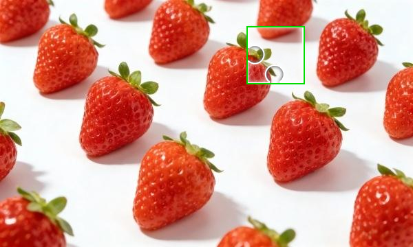
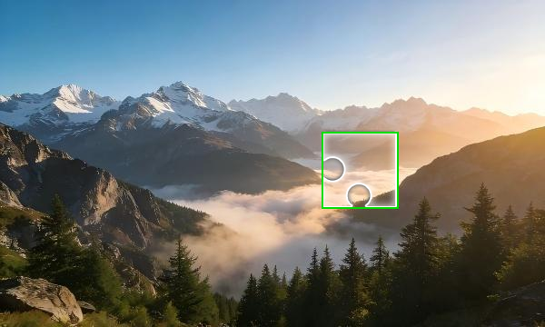

# 企讯通 · 滑动拼图（slide）

> 600×360 背景 + 84×84 带 alpha 的拼图块，没有 `ypos` 约束，需要在整个画面里做二维定位；用 alpha/RGB 双模板交叉验证，低置信时再做局部 Sobel 梯度精修。
>
> 返回：[企讯通索引](../../../docs/qingtongbu.md) · [全量类型](../../../docs/types.md) · [方法论](../../../docs/00-methodology.md)

## 一、速览

| 项 | 值 |
|---|---|
| 厂商 | 企讯通（`qingtongbu`） |
| 类型 / 变体 | `slide` / classic |
| 中文 | 滑动拼图 |
| 媒体 | 图片 |
| 样本 | 12 组（001–012） |
| 答案格式 | `offset-x`：缺口左上角 `(gap_x, gap_y)` |
| 方法 | `CV`（alpha/RGB 双模板 + 局部梯度精修，无 LLM） |
| 求解器 | `exists` · 中（源记录，未做在线提交） |
| 人工审查 | 12 通过 / 0 错误（按 `meta.review`，截至 2026-11-21） |
| 证据等级 | `unverified`（无线上提交记录） |

## 二、题面与判定

用户拖动滑块，把左侧拼图块水平移入背景缺口。与极验/银联的部分变体不同，企讯通这批案例没有给出 `ypos`，纵向位置也要自己找；通过条件是拼图块与缺口重合，答案记为缺口左上角。

| 案例 | 题面 | 通过条件 | 答案（缺口左上角） |
|---|---|---|---|
| [001](001/) | 拖动滑块，将拼图块补入缺口 | 拼图块与缺口重合 | `(358, 38)` |
| [004](004/) | 同上 | 同上 | `(396, 27)`（精修前 `(389,33)`） |
| [010](010/) | 同上 | 同上 | `(354, 145)` |

> 答案坐标系是 600×360 原图；拼图块 84×84，带 alpha 通道与凸/凹榫头。显示缩放会同时改变拖动距离与坐标，定位时必须固定原图尺度。

## 三、样本长什么样

| 背景 001 | 拼图块（alpha） | 结果 001 |
|---|---|---|
|  |  |  |
| **背景 004** | **结果 004（梯度精修）** | **背景 010** |
|  |  |  |

| 结果 010 |
|---|
|  |

- 背景是草莓平铺图，缺口是一个偏暗的方形块，边缘有榫头形状；拼图块本身带着同一块草莓纹理。
- `solved.png` 用绿框标出定位结果，部分案例会把精修前后的位置差标在图上。
- 与 `cup/slide` 的 300×150 小图相比，这里图幅更大、纹理更密，且没有纵向先验。

## 四、形态与难点

- **二维搜索**：没有 `ypos`，`gap_y` 也要估；搜索空间是 `(W-w) × (H-h)`，比一维滑动大得多。
- **重复纹理**：草莓形状和颜色高度重复，纯 RGB 相关容易出现多个相近峰。
- **缺口偏暗**：缺口与拼图块颜色不完全一致，直接做像素 SSD 会把暗区误判。
- **alpha 形状**：拼图块的透明区和榫头轮廓是强特征，但透明区必须屏蔽，否则会把白色背景当内容。
- **低分辨率辅助图**：`aux-01.png` 只有 110×360，拼图块贴在图带中，需要先裁出 84×84 区域。

## 五、求解思路

核心是「双模板各投一票，再做局部精修」：alpha 模板只看不透明像素，RGB 模板看原色；两个模板各自给出峰值，若一致则直接采用，若不一致则比较分数，最后用局部 Sobel 梯度把位置修到边缘对齐。

| 步骤 | 做法 | 关键判据 / 参数 |
|---|---|---|
| 1 取块 | 从 `aux-01.png` 裁出 84×84 拼图块与 alpha | 透明区不参与 alpha 匹配 |
| 2 alpha 模板 | 用 alpha 掩膜做 masked 相关 | 只信不透明像素 |
| 3 RGB 模板 | 用原色做相关 | 保留颜色分布 |
| 4 交叉验证 | 两个模板的峰值位置与分数对比 | 一致则 `consensus=true` |
| 5 局部精修 | 在峰值邻域做 Sobel 梯度对齐 | 输出位移 `(dx,dy)` |
| 6 定答案 | 取缺口左上角；精修有值时用精修后坐标 | 结果写入 `answer.txt` / `result.json` |

```text
# 拼图缺口定位（伪代码，对应源方案双模板 + 梯度精修）

tile, alpha = crop_piece(aux)            # 84 x 84
best = {}
for name, score_fn in [("alpha", masked_ncc), ("rgb", ncc)]:
    for y in 0 .. H - 84:
        for x in 0 .. W - 84:
            s = score_fn(bg[y:y+84, x:x+84], tile)
            best[name] = max(best[name], (s, x, y))

consensus = (best.alpha.xy == best.rgb.xy)
gap = best.alpha.xy if consensus else better_of(best)

if not consensus or best.score < threshold:
    gap = local_sobel_refine(bg, tile, gap)   # 邻域梯度对齐
```

> 双模板的意义不是「更准的模板」，而是「两种错误不相关」：alpha 对颜色变化不敏感，RGB 对形状透明区不敏感；两者同时落在同一位置时，重复纹理造成的假峰才比较可信。

## 六、结果与审查

- **源记录**：求解器准确率标为「中」，没有线上提交；12 组全部有 `answer.txt` / `result.json` / `solved.png`。
- **本库审查**：12 组 `review.state=pass`、`result=correct`；`evidence: unverified`，审查的是缺口坐标。
- **双模板统计**：alpha 分数 0.311–0.439，RGB 分数 0.290–0.459；11 组 `consensus=true`，只有 003 为 `false`；004 触发梯度精修，`(389,33) → (396,27)`，位移 `(+7,−6)`。

| 组 | gap | alpha | RGB | 共识 | 精修 | 审查 |
|---|---|---:|---:|---|---|---|
| [001](001/) | (358,38) | 0.311 | 0.340 | 是 | — | 通过 |
| [002](002/) | (144,187) | 0.367 | 0.348 | 是 | — | 通过 |
| [003](003/) | (458,188) | 0.332 | 0.308 | 否 | — | 通过 |
| [004](004/) | (396,27) | 0.360 | 0.362 | 是 | (389,33)→(396,27) | 通过 |
| [005](005/) | (205,170) | 0.439 | 0.336 | 是 | — | 通过 |
| [006](006/) | (437,169) | 0.387 | 0.388 | 是 | — | 通过 |
| [007](007/) | (204,30) | 0.350 | 0.422 | 是 | — | 通过 |
| [008](008/) | (277,234) | 0.338 | 0.405 | 是 | — | 通过 |
| [009](009/) | (462,151) | 0.385 | 0.459 | 是 | — | 通过 |
| [010](010/) | (354,145) | 0.319 | 0.290 | 是 | — | 通过 |
| [011](011/) | (438,51) | 0.356 | 0.352 | 是 | — | 通过 |
| [012](012/) | (389,255) | 0.318 | 0.429 | 是 | — | 通过 |

> 分数整体偏低（多数 0.3–0.4），说明重复纹理下相关峰并不尖锐；003 的双模板不一致仍被审查通过，主要靠人工目检 `solved.png`，不是靠分数阈值。

## 七、失败与边界

| 现象 | 根因 | 证据 | 结论 |
|---|---|---|---|
| 重复草莓造成多峰 | 背景纹理周期性太强 | alpha/RGB 分数普遍只有 0.3–0.4 | 需要双模板 + 人工复核 |
| 003 双模板不一致 | 两个峰位不同，分数都低 | `consensus=false` | 不一致时不能盲信单一模板 |
| 004 需要精修 | 初始峰值差 7/6px | `gradient_refine` 记录 | 局部梯度能把位置拉回边缘 |
| 透明区干扰 | 拼图块带 alpha 与榫头 | `aux-01.png` 有透明区 | 必须 masked 匹配 |
| 无线上记录 | 未做提交闭环 | 统一 `evidence: unverified` | 缺口坐标正确 ≠ 线上通过 |
| 源记录只标「中」 | 没有 12/12 的准确率数字 | `meta.solver.accuracy=medium` | 不要把它写成高置信求解器 |

**边界**：本页只覆盖缺口定位。轨迹生成、纵向拖动与服务端校验不在本库范围内；也没有 `ypos` 之类的接口先验可复现。

## 八、相关

- 厂商索引：[docs/qingtongbu.md](../../../docs/qingtongbu.md)
- 全量类型：[docs/types.md](../../../docs/types.md) · 方法论：[docs/00-methodology.md](../../../docs/00-methodology.md)
- 同厂商对照：[text-click](../text-click/)（文字点选）、[icon-click](../icon-click/)（图标点选）、[rotate](../rotate/)（旋转补图）
- 跨厂商对照：[极验 slide](../../geetest/slide/)、[银联 slide](../../cup/slide/)
- 案例：[001](001/) – [012](012/)（每组含 `meta.json`、`bg.jpg`、`aux-01.png`、`solved.png`、`answer.txt`、`result.json`）
- 来源：<http://www.qingtongbu.com/#experience>；样本版权归企讯通所有，仅用于研究与教学。
