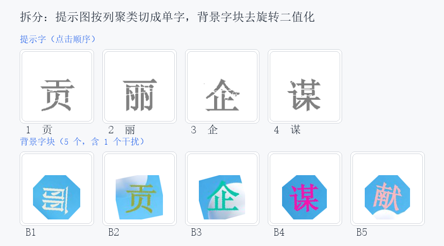
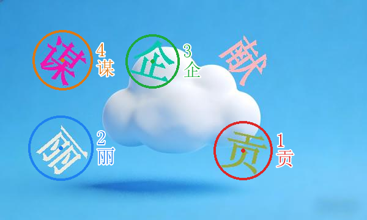
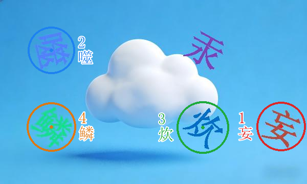

# 企讯通 · 文字点选（text-click）

> 提示图 4 个灰色汉字决定「点谁、按什么顺序」，600×360 背景图散落 5 个彩色旋转字（含 1 个干扰字）；用局部背景 Lab 色差掩膜提字、多角度 OCR + Siamese 三矩阵 + 匈牙利分配求解，纯 CV、零 LLM。
>
> 返回：[企讯通索引](../../../docs/qingtongbu.md) · [全量类型](../../../docs/types.md) · [方法论](../../../docs/00-methodology.md)

## 一、速览

| 项 | 值 |
|---|---|
| 厂商 | 企讯通（`qingtongbu`） |
| 类型 / 变体 | `text-click` / classic |
| 中文 | 文字点选 |
| 媒体 | 图片 |
| 样本 | 12 组（001–012） |
| 答案格式 | `points`：按提示顺序的 4 个点击点 |
| 方法 | `DET+OCR+CV`（YOLO + 多角度 OCR + Siamese，无 LLM） |
| 求解器 | `exists` · 高（源记录 12/12 人工复核） |
| 人工审查 | 12 通过 / 0 错误（按 `meta.review`，截至 2026-11-21） |
| 证据等级 | `unverified`（无线上提交记录） |

## 二、题面与判定

提示图从左到右给出 4 个目标字，背景图中有 5 个彩色、带旋转的字块；其中 4 个是目标，剩下 1 个是干扰字。用户必须按提示顺序依次点击目标字，顺序错误不通过。

| 案例 | 提示字（点击顺序） | 通过条件 | 答案（点击点） |
|---|---|---|---|
| [001](001/) | 贡丽企谋 | 按提示顺序依次点击 4 个目标字 | 贡(397,246) → 丽(99,242) → 企(249,100) → 谋(102,98) |
| [004](004/) | 崇砧拈难 | 同上 | 崇(401,248) → 砧(548,244) → 拈(99,98) → 难(97,250) |
| [010](010/) | 妄噬炊鳞 | 同上 | 妄(549,247) → 噬(100,98) → 炊(396,249) → 鳞(100,248) |
| [012](012/) | 柒粱谷柑 | 同上 | 柒(99,248) → 粱(548,99) → 谷(249,248) → 柑(252,96) |

> `meta.pass_criteria` 原文：「按提示顺序依次点击 4 个目标字；顺序错误不通过。」点击坐标统一在 600×360 背景图坐标系内。

## 三、样本长什么样

| 提示图（286×76） | 背景题面（600×360） | 去噪对照 |
|---|---|---|
|  |  |  |
| **单字拆分（4 个提示字）** | **结果 001** | **结果 010** |
|  |  |  |

- 提示图有彩色干扰线和小圆圈，但目标字本身是灰色；去噪时保留灰色、剔除彩色。
- 背景图是彩色 AI 场景，5 个目标/干扰字以不同颜色旋转摆放，部分字压在云朵、草坡上。
- `denoised.png` / `split.png` 是源方案输出的对照拼图，不是原始截图：前者对比「原图 / 去噪」，后者展示 4 个提示字与 5 个背景字块。

## 四、形态与难点

- **4 选 4 + 1 干扰**：背景固定 5 个检测框，只有 4 个是提示字；匈牙利必须做全局一对一指派，不能贪心。
- **旋转字**：背景字带任意旋转，部分接近 ±90°；OCR 单角度经常读错，需要多角度扫描。
- **彩色背景**：蓝天、草地、云朵的饱和度与字形接近，按全图颜色筛选会把整片背景当成字。
- **提示图干扰**：提示字上有彩色细线、圆圈穿过笔画；不剔除会破坏单字切分。
- **坐标**：点击点定义在 600×360 背景图上，显示缩放会改变坐标，标注时必须固定原图坐标系。

## 五、求解思路

核心是「提示字负责语义与顺序，背景字负责位置」：提示图拆成 4 个单字；背景图检测 5 个字框，先用多角度 OCR 强制命中，剩余用 Siamese 三矩阵补分，最后匈牙利做全局分配。

| 步骤 | 做法 | 关键判据 / 参数 |
|---|---|---|
| 1 提示图去噪 | 保灰去彩，剔除彩色干扰线/圆圈 | RGB 通道最大差小的像素保留 |
| 2 提示字拆分 | 按列像素质量聚类成 4 簇，在簇中点切开 | 4 个槽位；从左到右即点击顺序 |
| 3 提示字识别 | ddddocr 与 RapidOCR 交叉识别 | 两引擎结果用于确认提示字 |
| 4 背景检测 | YOLO 检测 5 个文字框（含 1 个干扰） | 固定 5 框 |
| 5 去旋提字 | 局部背景中值滤波 + Lab 色差 Otsu + `minAreaRect` 去旋 | 输出彩色字块与去旋二值图 |
| 6 多角度 OCR | 每个字旋转 -75°～+90° 逐角度 OCR | 命中提示字即强制锁定 |
| 7 Siamese 补分 | 三矩阵取 max：渲染字对原图 / 渲染字对去旋二值 / 提示字形对去旋二值 | 未命中的配对靠相似度 |
| 8 全局分配 | 4×5 代价矩阵做匈牙利一对一指派 | 避免强弱行交错时抢错列 |

```text
# 文字点选（伪代码，对应源方案 DET+OCR+Siamese+Hungarian）

hint = read(aux)                        # 4 个提示字，从左到右 = 点击顺序
hint = keep_gray_remove_color(hint)     # 保留灰色字，剔除彩色线/圈
chars = split_by_column_mass(hint, k=4)
tip = ocr_crosscheck(chars, [ddddocr, RapidOCR])

boxes = yolo(bg)                        # 5 个文字框，含 1 个干扰
for box in boxes:
    local_bg = median_filter(bg, box)
    mask = otsu(lab_distance(bg, local_bg))
    glyph, angle = deskew_min_area_rect(mask)
    ocr_hits[box] = ocr_multiangles(glyph, angles=-75..90)

score = 4 x 5 matrix
for i, ch in enumerate(tip):
    for j, box in enumerate(boxes):
        s_ocr  = 1 if ch in ocr_hits[box] else 0
        s_siam = max(siamese(ch, glyph[j]),          # M1 渲染 vs 原图
                     siamese(ch, binary[j]),         # M2 渲染 vs 去旋二值
                     siamese(template[ch], binary[j]))  # M3 字形 vs 去旋二值
        score[i][j] = max(s_ocr, s_siam)

assign = hungarian_max(score)           # 每个提示字恰占一个不同字框
clicks = [center(boxes[j]) for i, j in sorted(assign)]
```

> v3 的关键改动是「局部背景」：对每个字框单独估背景，再做 Lab 色差，而不是用全图饱和度。这样蓝天、草地不会再被整片判成字形；去旋后的彩色字块还能保留笔画与抗锯齿边缘。

## 六、结果与审查

- **源记录**：12/12 人工复核（2026-09 源 README）；本库 `evidence: unverified`，没有线上提交记录。
- **本库审查**：12 组 `review.state=pass`、`result=correct`；审查的是点击坐标是否符合提示顺序。
- **匹配统计**（从 `result.json` 现算）：48 个点击点，Siamese 最低 0.50（010 的「噬」）、最高 0.95，均值 0.91；5 个点在多角度 OCR 中没有候选，仍由 Siamese 锁定。

| 组 | 提示字 | 按序点击（坐标） | 最低 Siamese | 审查 |
|---|---|---|---|---:|---|
| [001](001/) | 贡丽企谋 | 贡(397,246) → 丽(99,242) → 企(249,100) → 谋(102,98) | 0.95 | 通过 |
| [002](002/) | 腆毒柑鹤 | 腆(549,247) → 毒(254,96) → 柑(400,246) → 鹤(99,247) | 0.92 | 通过 |
| [003](003/) | 嫡址奠速 | 嫡(400,245) → 址(549,246) → 奠(249,247) → 速(98,246) | 0.66 | 通过 |
| [004](004/) | 崇砧拈难 | 崇(401,248) → 砧(548,244) → 拈(99,98) → 难(97,250) | 0.81 | 通过 |
| [005](005/) | 又傅汕掏 | 又(246,249) → 傅(551,98) → 汕(549,248) → 掏(401,247) | 0.68 | 通过 |
| [006](006/) | 敢玫嗣召 | 敢(549,97) → 玫(247,100) → 嗣(101,247) → 召(249,246) | 0.77 | 通过 |
| [007](007/) | 惟芜经育 | 惟(548,246) → 芜(102,249) → 经(248,248) → 育(401,248) | 0.95 | 通过 |
| [008](008/) | 报钮吱浦 | 报(250,248) → 钮(97,245) → 吱(100,97) → 浦(400,249) | 0.94 | 通过 |
| [009](009/) | 呸撂槐幸 | 呸(401,245) → 撂(102,247) → 槐(248,248) → 幸(550,248) | 0.90 | 通过 |
| [010](010/) | 妄噬炊鳞 | 妄(549,247) → 噬(100,98) → 炊(396,249) → 鳞(100,248) | 0.50 | 通过 |
| [011](011/) | 王瞩阵熔 | 王(247,98) → 瞩(101,91) → 阵(549,98) → 熔(400,97) | 0.93 | 通过 |
| [012](012/) | 柒粱谷柑 | 柒(99,248) → 粱(548,99) → 谷(249,248) → 柑(252,96) | 0.83 | 通过 |

> 010 的「噬」是低分样本：背景字 OCR 原始结果读成「靡」，相似度只有 0.4958，靠 Siamese M1 仍被锁定；源记录认为结果正确，但这类点是最需要人工复核的。

## 七、失败与边界

| 现象 | 根因 | 证据 | 结论 |
|---|---|---|---|
| 旧版把整片蓝天/草地当字 | 全图饱和度筛选，彩色背景与字形混在一起 | 源文档记录的 v3 改进动机 | 改为字框内局部背景 Lab 色差掩膜 |
| 旋转字 OCR 读错 | 单角度 OCR 对 ±90° 字形不稳 | 48 个点中 5 个无 OCR 候选；26 个原始 OCR 与目标字不一致 | 多角度扫描 + Siamese 兜底 |
| 干扰字可能抢配对 | 5 个背景字里只有 4 个目标 | 每组固定 5 个检测框 | 匈牙利全局一对一，禁止重复指派 |
| 低相似度点仍需复核 | 010「噬」0.4958，远低于均值 0.91 | `result.json` 逐点分数 | 源记录 12/12 不等于独立复核；本库仍标 `unverified` |
| 无线上记录 | 未做提交闭环 | 统一 `evidence: unverified` | 离线坐标正确 ≠ 线上通过 |

**边界**：本页只覆盖「找字 + 排序点击」。真实提交还需要轨迹、时序与风控环境；源记录的 12/12 是人工复核，不是线上通过率。

## 八、相关

- 厂商索引：[docs/qingtongbu.md](../../../docs/qingtongbu.md)
- 全量类型：[docs/types.md](../../../docs/types.md) · 方法论：[docs/00-methodology.md](../../../docs/00-methodology.md)
- 同厂商对照：[icon-click](../icon-click/)（图标模板 + 匈牙利）、[slide](../slide/)（拼图缺口）
- 案例：[001](001/) – [012](012/)（每组含 `meta.json`、`bg.jpg`、`aux-01.png`、`denoised.png`、`split.png`、`solved.png`、`answer.txt`、`result.json`）
- 来源：<http://www.qingtongbu.com/#experience>；样本版权归企讯通所有，仅用于研究与教学。
