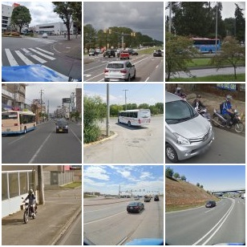
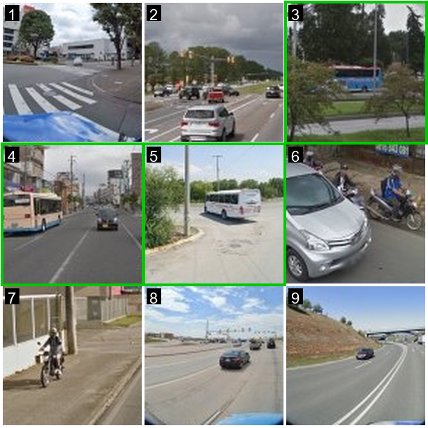
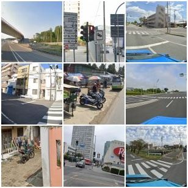
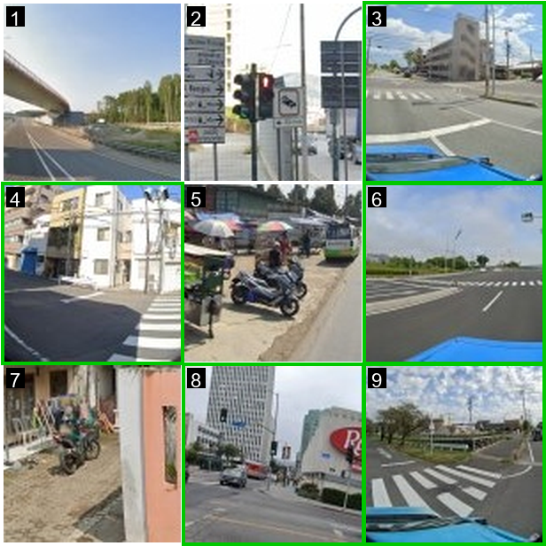
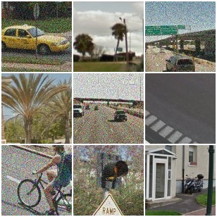
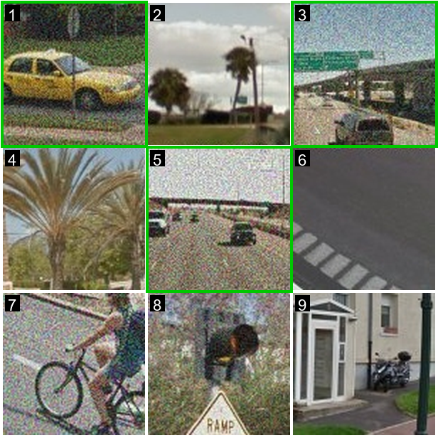

# Google reCAPTCHA · 独立子图九宫格（grid-independent）

> 3×3 九张互不连续的照片 + 一句中文题面，选中所有含目标的格子；视觉 LLM 直接读格，源记录旧批次 33/33 离线、7/7 线上。
>
> 返回：[reCAPTCHA 索引](../../../docs/recaptcha.md) · [全量类型](../../../docs/types.md) · [方法论](../../../docs/00-methodology.md)

## 一、速览

| 项 | 值 |
|---|---|
| 厂商 | Google reCAPTCHA（`recaptcha`） |
| 类型 / 变体 | `grid-independent` / independent |
| 中文 | 独立子图九宫格 |
| 媒体 | 图片（`bg.jpg` 题面 + `solved.png` 源标注） |
| 样本 | 12 组（001–012） |
| 答案格式 | `indices`：选中格子编号（1–9） |
| 方法 | `VLM`（视觉 LLM 直接读格；无需训练） |
| 求解器 | `exists` · 高（源记录旧批次 33/33 离线、7/7 线上；新批次待补跑） |
| 人工审查 | 待审 12（截至 2026-11-21） |
| 证据等级 | `sample-only`（样本中立收录，结果未纳入） |

## 二、题面与判定

题面指定一个物体类别，用户从 3×3 网格中选出所有包含该物体的格子。每一格来自不同照片，格与格之间没有场景连续性，因此按「单格是否含目标」判断即可。

| 案例 | 题面（`meta.prompt`） | 通过条件 | 目标 |
|---|---|---|---|
| [001](001/) | 请选择所有包含公交车的图片。 | 该批案例未记录 `pass_criteria`；按题面选中全部含目标的格子 | 公交车 |
| [005](005/) | 请选择包含人行横道的所有图片。 | 同上 | 人行横道 |
| [010](010/) | 请选择所有包含公交车的图片。在没有新图片可以点按后，请点击“验证”。 | 同上 | 公交车（含验证提示） |
| [012](012/) | 选择所有包含小轿车的图片在没有新图片可以点按后，请点击“验证”。 | 同上 | 小轿车（原文无句间标点） |

> 010–012 的题面追加了「没有新图片后点击验证」的说明；012 的 `meta.prompt` 在「图片」与「在」之间没有标点，本页按原文引用，不做改写。

## 三、样本长什么样

`bg.jpg` 是 308×308 的 3×3 拼图，九格边界清晰；`solved.png` 是 616×616 的源标注图，编号 1–9 并给选中格加绿框。绿框来自源求解截图，不是本库复核过的官方答案。

| 001 题面（公交车） | 001 源标注 | 005 题面（人行横道） | 005 源标注 |
|---|---|---|---|
|  |  |  |  |
|  |  | — | — |

- 左列是题面，右列是源标注；编号 1–9 按从上到下、从左到右排列。
- 九格之间有明显拼接边界，说明它们是独立照片，不是一张连续场景切出来的。

## 四、形态与难点

- **固定 3×3**：12 组 `bg.jpg` 均为 308×308；`solved.png` 放大到 616×616 后编号。
- **独立照片**：每格是不同地点、不同光照的街景，不能依赖相邻格的连续性。
- **类别跨度大**：12 组覆盖公交车、小轿车、红绿灯、人行横道、桥、摩托车、消防栓；同类物体的外观差异很大。
- **目标数量不定**：命中格数不固定，也有不含目标的格子；不能按固定数量猜。
- **无逐题真值**：本库只有 `meta.json` / `bg.jpg` / `solved.png`，没有 `answer.txt` / `result.json`，不能离线重算准确率。

## 五、求解思路

源记录的方法是「切九格 + 视觉 LLM 直接读格」。关键是固定编号与裁切边界，避免把相邻格的内容带进来。

| 步骤 | 做法 | 关键判据 / 参数 | 说明 |
|---|---|---|---|
| 1 读题 | 从 `meta.prompt` 取目标类别 | 中文短题；010–012 含验证提示 | 只取目标词，忽略 UI 提示 |
| 2 拆格 | 按 3×3 等分 `bg.jpg` | 308×308 → 每格约 102×102 | 保留原边界，不缩放单格 |
| 3 读格 | 逐格问「是否含目标」，或一次输出全部命中格号 | 输出 `indices` | 源记录为 VLM 直接读格 |
| 4 映射 | 按行优先编号 | 1–9 | 与 `solved.png` 编号一致 |
| 5 复核 | 低置信格二次询问或换模型投票 | 只对分歧格调用 | 控制成本 |
| 6 提交 | 输出选中格号集合 | 1–9 的子集 | 本库未复制逐题结果 |

```text
编号（与 solved.png 一致）：

1 2 3
4 5 6
7 8 9
```

> 源记录没有展开具体模型、提示词与温度，本页只保留「3×3 切格 → VLM 读格 → 行优先编号」这条链路。

## 六、结果与审查

- **源记录**：旧批次 33/33 离线、7/7 线上；新批次待补跑（`meta.solver.notes`）。源现有 independent 78 组，本库按 12 组精选。
- **本库结果**：12 组都是 `status=sample-only`、`sample_state=neutral`；没有逐题 `answer.txt` / `result.json`，`solved.png` 仅为源标注。
- **人工审查**：12 组 `review.state=pending`；不能把源记录成绩写成本库已审查结果。
- **证据等级**：`sample-only`，只能说明题面形态，不能给出本批准确率。

| 组 | 题面 | 目标 | 审查 |
|---|---|---|---|
| [001](001/) | 请选择所有包含公交车的图片。 | 公交车 | 待审 |
| [002](002/) | 选择所有包含小轿车的图片 | 小轿车 | 待审 |
| [003](003/) | 请选择包含红绿灯的所有图片。 | 红绿灯 | 待审 |
| [004](004/) | 请选择所有包含公交车的图片。 | 公交车 | 待审 |
| [005](005/) | 请选择包含人行横道的所有图片。 | 人行横道 | 待审 |
| [006](006/) | 请选择包含桥的所有图片。 | 桥 | 待审 |
| [007](007/) | 请选择所有包含摩托车的图片 | 摩托车 | 待审 |
| [008](008/) | 请选择包含消防栓的所有图片。 | 消防栓 | 待审 |
| [009](009/) | 选择所有包含小轿车的图片 | 小轿车 | 待审 |
| [010](010/) | 请选择所有包含公交车的图片。在没有新图片可以点按后，请点击“验证”。 | 公交车 | 待审 |
| [011](011/) | 请选择所有包含公交车的图片。在没有新图片可以点按后，请点击“验证”。 | 公交车 | 待审 |
| [012](012/) | 选择所有包含小轿车的图片在没有新图片可以点按后，请点击“验证”。 | 小轿车 | 待审 |

## 七、失败与边界

| 现象 | 根因 | 证据 | 结论 |
|---|---|---|---|
| 无法复算 33/33 | 本库没有逐题答案 | 12 组只有 `meta` / `bg` / `solved` | 源记录只作参考，不当成本库成绩 |
| 新批次没有成绩 | 源记录写明「新批次待补跑」 | `meta.solver.notes` | 不把旧批次 33/33 迁移到这批样本 |
| 绿框不等于官方答案 | `solved.png` 是源求解标注截图 | `meta.notes`：结果未纳入 | 不能用绿框反推真值 |
| 独立照片之间无上下文 | 九格来自不同地点，不能靠相邻格补线索 | 001/005/012 的格间边界明显 | 逐格独立判断 |
| 长题面混入 UI 提示 | 010–012 追加「点击验证」说明 | `meta.prompt` 原文 | 只提取目标类别，不把提示当目标 |
| 审查全 pending | 维护者尚未逐题回填 | `meta.review.state=pending` | 页面只写待审，不写通过率 |

**边界**：本页只覆盖「独立子图九宫格」的读格与编号。真实提交还需要页面会话、点选状态与验证按钮流程，本库没有这部分记录。

## 八、相关

- 厂商索引：[docs/recaptcha.md](../../../docs/recaptcha.md)
- 全量类型：[docs/types.md](../../../docs/types.md) · 方法论：[docs/00-methodology.md](../../../docs/00-methodology.md)
- 同厂商对照：[grid-split](../grid-split/)（整图切分 4×4）、[audio](../audio/)（音频听写）
- 案例：[001](001/) – [012](012/)（每组含 `meta.json` / `bg.jpg` / `solved.png`）
- 来源：Google reCAPTCHA `/sorry` 公开页，采集于 2026-11-01；样本版权归 Google 所有，仅用于研究与教学。
