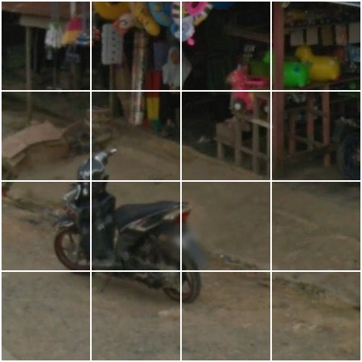
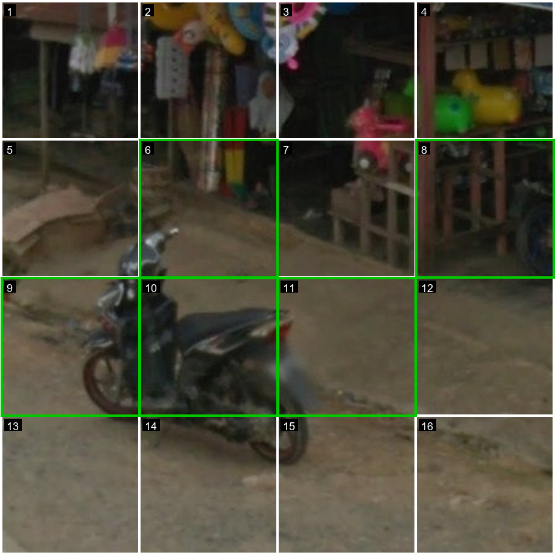
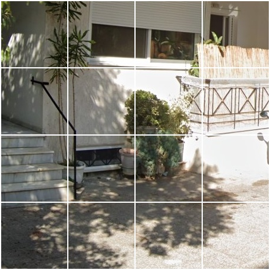
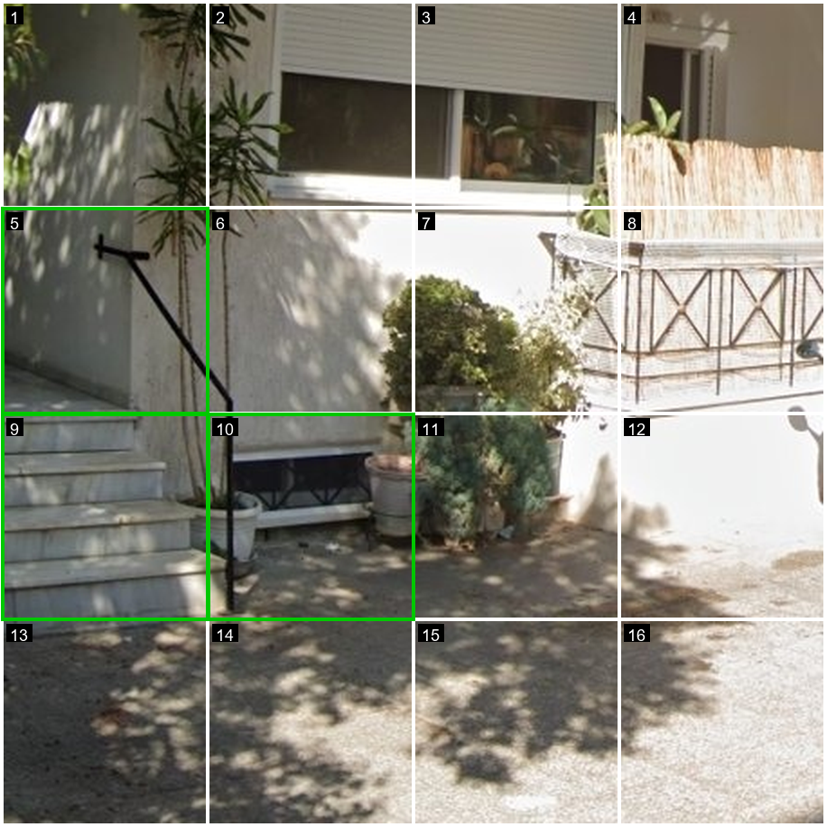
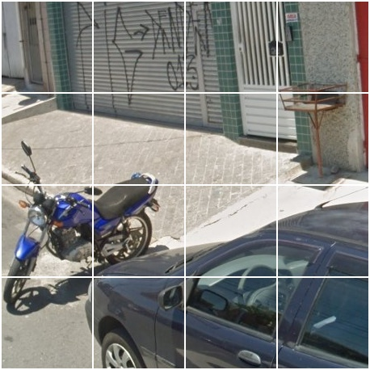

# Google reCAPTCHA · 整图切分九宫格（grid-split）

> 一张连续大图切成 4×4=16 块，选中所有含目标的图块；目标可能跨格，视觉 LLM 直接读块，源记录旧批次 33/33 离线、7/7 线上。
>
> 返回：[reCAPTCHA 索引](../../../docs/recaptcha.md) · [全量类型](../../../docs/types.md) · [方法论](../../../docs/00-methodology.md)

## 一、速览

| 项 | 值 |
|---|---|
| 厂商 | Google reCAPTCHA（`recaptcha`） |
| 类型 / 变体 | `grid-split` / split |
| 中文 | 整图切分九宫格（本批实际为 4×4） |
| 媒体 | 图片（`bg.jpg` 题面 + `solved.png` 源标注；012 无 `solved`） |
| 样本 | 12 组（001–012） |
| 答案格式 | `indices`：选中图块编号（1–16） |
| 方法 | `VLM`（视觉 LLM 直接读块；无需训练） |
| 求解器 | `exists` · 高（源记录旧批次 33/33 离线、7/7 线上；新批次待补跑） |
| 人工审查 | 待审 12（截至 2026-11-21） |
| 证据等级 | `sample-only`（样本中立收录，结果未纳入） |

## 二、题面与判定

题面指定一个目标类别，用户从切分后的图块中选出所有含该目标的块。与「独立子图」不同，这里的图块来自同一张连续照片，目标可能被切缝分成两半，需要判断「这块是否含目标的一部分」。

| 案例 | 题面（`meta.prompt`） | 通过条件 | 目标 |
|---|---|---|---|
| [001](001/) | 请选择包含摩托车的所有图块 | 该批案例未记录 `pass_criteria`；按题面选中全部含目标的图块 | 摩托车 |
| [005](005/) | 请选择包含楼梯的所有图块 | 同上 | 楼梯 |
| [009](009/) | 请选择包含公交车的所有图块 | 同上 | 公交车 |
| [012](012/) | Select all squares with motorcycles | 同上 | 摩托车（英文题面） |

> 12 组中 11 组为中文题面，012 为英文；题面只给目标类别，没有额外的验证提示。

## 三、样本长什么样

`bg.jpg` 是 458×458 的 4×4 切块图，白色切缝清晰；`solved.png` 是 916×916 的源标注图，编号 1–16 并给选中块加绿框。012 只有 `bg.jpg`，没有 `solved.png`。

| 001 题面（摩托车） | 001 源标注 | 005 题面（楼梯） | 005 源标注 |
|---|---|---|---|
|  |  |  |  |
|  | — | — | — |

- 左列是题面，右列是源标注；编号 1–16 按从上到下、从左到右排列。
- 001 的摩托车跨越多块，005 的楼梯沿左侧连续分布；源标注用绿框覆盖相关块，但不等于本库复核过的真值。

## 四、形态与难点

- **4×4=16 格**：12 组 `bg.jpg` 均为 458×458；`solved.png` 放大到 916×916。类型名里的「九宫格」是源类型名，实际本批是 16 格。
- **连续场景**：16 块来自同一张照片，切缝两侧共享同一场景，不能把每块当独立照片。
- **跨格目标**：摩托车、自行车、楼梯等目标可能跨多块；选块时要按「含目标的一部分」判断，而不是只选目标中心所在块。
- **相邻块干扰**：目标边缘、阴影、地面纹理可能落在相邻块，容易多选或漏选。
- **题面语言不统一**：11 组中文、1 组英文（012）；不能只写中文提示词。
- **012 无源标注**：只有题面图，不能从 `solved.png` 观察源求解结果。

## 五、求解思路

源记录同样是「切块 + 视觉 LLM 直接读块」。不同点在于切块是固定的 4×4，编号到 16，并且要给跨格目标保留相邻块上下文。

| 步骤 | 做法 | 关键判据 / 参数 | 说明 |
|---|---|---|---|
| 1 读题 | 从 `meta.prompt` 取目标类别 | 中文/英文都可能 | 012 为英文，需支持双语 |
| 2 切块 | 按 4×4 等分 `bg.jpg` | 458×458 → 每块约 114×114 | 保留白色切缝，不重叠裁切 |
| 3 读块 | 逐块问「是否含目标」，或一次输出全部命中块号 | 输出 `indices` | 源记录为 VLM 直接读块 |
| 4 跨格复核 | 对目标跨格处同时看相邻块 | 目标被切缝分成两半时 | 建议做法；源记录未展开细节 |
| 5 映射 | 按行优先编号 | 1–16 | 与 `solved.png` 编号一致 |
| 6 提交 | 输出选中块号集合 | 1–16 的子集 | 本库未复制逐题结果 |

```text
编号（与 solved.png 一致）：

 1  2  3  4
 5  6  7  8
 9 10 11 12
13 14 15 16
```

> 这是源记录路线的直译；跨格复核是面向连续场景的建议步骤，但源记录没有给出具体的模型、提示词或阈值。

## 六、结果与审查

- **源记录**：旧批次 33/33 离线、7/7 线上；新批次待补跑（`meta.solver.notes`）。源现有 split 35 组，本库按 12 组精选。
- **本库结果**：12 组都是 `status=sample-only`、`sample_state=neutral`；没有逐题 `answer.txt` / `result.json`；11 组有 `solved.png`，012 只有 `bg.jpg`。
- **人工审查**：12 组 `review.state=pending`；不能把源记录成绩写成本库已审查结果。
- **证据等级**：`sample-only`，只能说明题面形态，不能给出本批准确率。

| 组 | 题面 | 源标注 | 审查 |
|---|---|---|---|
| [001](001/) | 请选择包含摩托车的所有图块 | 有 | 待审 |
| [002](002/) | 请选择包含过街人行道的所有图块 | 有 | 待审 |
| [003](003/) | 请选择包含自行车的所有图块 | 有 | 待审 |
| [004](004/) | 请选择包含摩托车的所有图块 | 有 | 待审 |
| [005](005/) | 请选择包含楼梯的所有图块 | 有 | 待审 |
| [006](006/) | 请选择包含自行车的所有图块 | 有 | 待审 |
| [007](007/) | 请选择包含红绿灯的所有图块 | 有 | 待审 |
| [008](008/) | 请选择包含摩托车的所有图块 | 有 | 待审 |
| [009](009/) | 请选择包含公交车的所有图块 | 有 | 待审 |
| [010](010/) | 请选择包含摩托车的所有图块 | 有 | 待审 |
| [011](011/) | 请选择包含摩托车的所有图块 | 有 | 待审 |
| [012](012/) | Select all squares with motorcycles | 无 | 待审 |

## 七、失败与边界

| 现象 | 根因 | 证据 | 结论 |
|---|---|---|---|
| 按「九宫格」硬编码 9 格 | 类型名沿用源目录，实际图幅是 4×4 | 12 组 `bg.jpg` 均为 458×458，编号到 16 | 按 16 格处理，不按类型名写死 |
| 无法复算 33/33 | 本库没有逐题答案 | 12 组只有 `meta` / `bg` / `solved` | 源记录只作参考，不当成本库成绩 |
| 012 没有源标注 | 本次收录未附 `solved.png` | `meta.roles` 只有 `bg` | 012 只能看题面，不能观察源求解 |
| 跨格目标漏选/多选 | 切缝把目标分成两半 | 001 的摩托车、005 的楼梯跨多块 | 读块时结合相邻块判断「是否含目标部分」 |
| 绿框不等于官方答案 | `solved.png` 是源求解标注截图 | `meta.notes`：结果未纳入 | 不能用绿框反推真值 |

**边界**：本页只覆盖「整图切分 + 读块 + 输出编号」。真实提交还需要页面会话、点选状态与验证按钮流程；源记录的线上 7/7 属于旧批次，不能迁移到新批次。

## 八、相关

- 厂商索引：[docs/recaptcha.md](../../../docs/recaptcha.md)
- 全量类型：[docs/types.md](../../../docs/types.md) · 方法论：[docs/00-methodology.md](../../../docs/00-methodology.md)
- 同厂商对照：[grid-independent](../grid-independent/)（3×3 独立子图）、[audio](../audio/)（音频听写）
- 案例：[001](001/) – [012](012/)（每组含 `meta.json` / `bg.jpg`；001–011 另有 `solved.png`）
- 来源：Google reCAPTCHA `/sorry` 公开页，采集于 2026-11-01（012 为 2026-11-07）；样本版权归 Google 所有，仅用于研究与教学。
